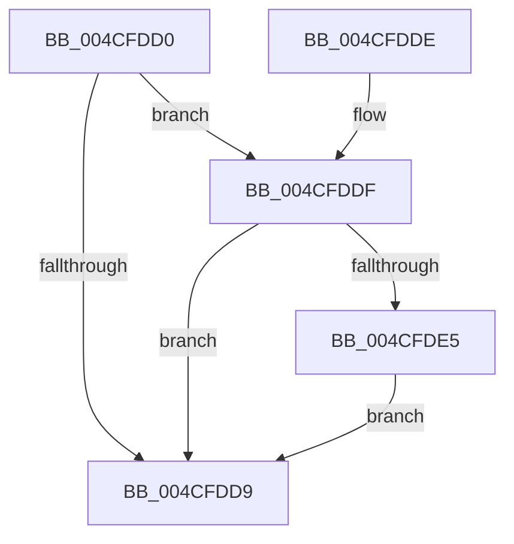

# HvlpPowerStateCallback

- RVA: `0x004CFDD0`–`0x004CFDEC` (길이 `28` bytes)
- VA: `0x00000001404CFDD0`
- 실행 섹션: `.text`
- PDB 이름 있음: `예`; PDB Function 태그: `아니요`
- unwind 정보 RVA: `0x00082A88`
- 디코드: `10`개 명령, `28/28` bytes 표시
- 미해석 바이트: `0` (있으면 어셈블리에 `.byte`로 보존)

> 이 문서는 커널 이미지의 기계어와 PDB 기호를 분석해 생성했습니다. 4번과 5번은 함수 원형과 자료형을 바이너리 사용 방식에서 추정한 C 해석이며 원본 소스 복구 결과는 아닙니다.

## 1. Dependencies

- 직접 호출 지점: **1**; 고유 호출 대상: **1**
- 직접 호출자로 확인된 함수: **0**
- RIP 상대 이미지 참조: **0**

### Outgoing calls
- `0x004CFDE5` → [HvlpCheckTscSync](../58/HvlpCheckTscSync_function_0058C300.md) (function, `0x0058C300`)

### Direct callers
- 이 함수 시작 RVA로 연결되는 직접 call은 확인되지 않았습니다. 간접 호출은 완전히 역산할 수 없습니다.

### Static image references
- 디코드된 RIP-relative 메모리 참조가 없습니다.

## 2. Other-region calls and transfers

- 다른 실행 섹션으로 향하는 call: **0**
- 별도 외부 분기/꼬리 이동을 확인하지 못했습니다.

## 3. Assembly (complete function range)

```asm
004CFDD0  48 83 EC 28                     sub rsp, 0x28
004CFDD4  83 FA 03                        cmp edx, 3
004CFDD7  74 06                           je 0x1404cfddf
004CFDD9  48 83 C4 28                     add rsp, 0x28
004CFDDD  C3                              ret
004CFDDE  CC                              int3
004CFDDF  41 83 F8 01                     cmp r8d, 1
004CFDE3  75 F4                           jne 0x1404cfdd9
004CFDE5  E8 16 C5 0B 00                  call 0x14058c300
004CFDEA  EB ED                           jmp 0x1404cfdd9
```

## 4. C-style interpretation (structured pseudocode)

```c
__int64 __fastcall HvlpPowerStateCallback(__int64 a1, int a2, int a3)
{
    __int64 result;
    __int64 v_rsp;

    v_rsp = (v_rsp) - (40);
    if (a2 == 3) goto loc_004CFDDF;
loc_004CFDD9:
    v_rsp = (v_rsp) + (40);
    return result;
loc_004CFDDF:
    if (a3 != 1) goto loc_004CFDD9;
    result = HvlpCheckTscSync(a1, a2, a3, a4);
    goto loc_004CFDD9;
}
```

## 5. (Beta) C Style

```c
int64_t HvlpPowerStateCallback(int64_t Arg1, int32_t Arg2, int32_t Arg3)
{
    int64_t result;
    int64_t local_rsp;

    local_rsp = (local_rsp) - (40);
    if (Arg2 == 3) goto loc_004CFDDF;
loc_004CFDD9:
    local_rsp = (local_rsp) + (40);
    return result;
loc_004CFDDF:
    if (Arg3 != 1) goto loc_004CFDD9;
    result = HvlpCheckTscSync(Arg1, Arg2, Arg3, a4);
    goto loc_004CFDD9;
}
```

## 6. Execution-region graph

[열기: 2D/3D 그래프와 함수 탐색 컨트롤 패널](../../../control-panel.html?section=text&rva=0x004CFDD0&view=graph)

- 2D 그래프는 위에서 아래로 흐르고, 3D 그래프는 빈 공간을 드래그해 회전합니다. Shift+드래그는 이동, 휠은 확대·축소, 함수 노드 선택은 대상 보고서 이동입니다.

### Static fallback


