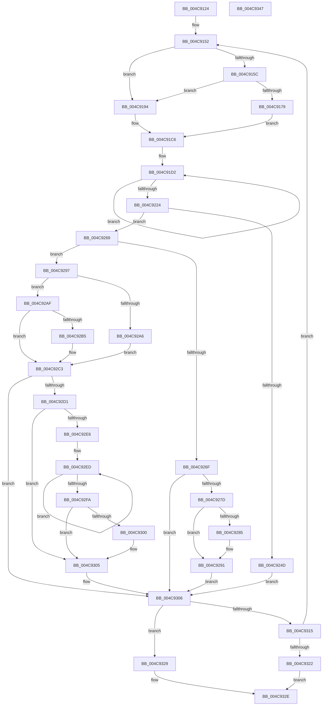

# HvlpSetPowerProperty

- RVA: `0x004C9124`–`0x004C9348` (길이 `548` bytes)
- VA: `0x00000001404C9124`
- 실행 섹션: `.text`
- PDB 이름 있음: `예`; PDB Function 태그: `아니요`
- unwind 정보 RVA: `0x000BD44C`
- 디코드: `139`개 명령, `548/548` bytes 표시
- 미해석 바이트: `0` (있으면 어셈블리에 `.byte`로 보존)

> 이 문서는 커널 이미지의 기계어와 PDB 기호를 분석해 생성했습니다. 4번과 5번은 함수 원형과 자료형을 바이너리 사용 방식에서 추정한 C 해석이며 원본 소스 복구 결과는 아닙니다.

## 1. Dependencies

- 직접 호출 지점: **9**; 고유 호출 대상: **9**
- 직접 호출자로 확인된 함수: **6**
- RIP 상대 이미지 참조: **2**

### Outgoing calls
- `0x004C916C` → [ExpInterlockedPopEntrySList](../6B/ExpInterlockedPopEntrySList_function_006BA570.md) (function, `0x006BA570`)
- `0x004C919B` → [KeDisableInterrupts](../21/KeDisableInterrupts_function_00217BE0.md) (function, `0x00217BE0`)
- `0x004C923D` → [HvcallInitiateHypercall](../31/HvcallInitiateHypercall_function_00313630.md) (function, `0x00313630`)
- `0x004C925F` → [ExpInterlockedPushEntrySList](../6B/ExpInterlockedPushEntrySList_function_006BA5B0.md) (function, `0x006BA5B0`)
- `0x004C928C` → [KiLowerIrqlProcessIrqlFlags](../4F/KiLowerIrqlProcessIrqlFlags_function_004F5698.md) (function, `0x004F5698`)
- `0x004C9300` → [KiRemoveSystemWorkPriorityKick](../26/KiRemoveSystemWorkPriorityKick_function_002631D0.md) (function, `0x002631D0`)
- `0x004C9309` → [HvlpHvStatusIsInsufficientMemory](../30/HvlpHvStatusIsInsufficientMemory_function_00307BB0.md) (function, `0x00307BB0`)
- `0x004C9315` → [HvlpHandleInsufficientMemory](../58/HvlpHandleInsufficientMemory_function_00584514.md) (function, `0x00584514`)
- `0x004C9329` → [HvlpHvToNtStatus](../30/HvlpHvToNtStatus_function_00307BD8.md) (function, `0x00307BD8`)

### Direct callers
- [HvlRegisterLogicalProcessorFrequency](HvlRegisterLogicalProcessorFrequency_function_004C90C8.md) at `0x004C9106`
- [HvlConfigureIdleStates](../58/HvlConfigureIdleStates_function_0058A324.md) at `0x0058A3BC`
- [HvlRegisterPerfFeedbackCounters](../58/HvlRegisterPerfFeedbackCounters_function_0058A8D4.md) at `0x0058A95A`
- [HvlSetLogicalProcessorCppcRequest](../58/HvlSetLogicalProcessorCppcRequest_function_0058A9C0.md) at `0x0058AA00`
- [HvlSetPlatformIdleState](../58/HvlSetPlatformIdleState_function_0058AA20.md) at `0x0058AA65`
- [HvlpPowerPolicySettingCallback](../58/HvlpPowerPolicySettingCallback_function_0058AE90.md) at `0x0058AEDC`

### Static image references
- `0x004C9152` → RVA `0x00FC6A90` (`ALMOSTRO`; read)
- `0x004C927D` → RVA `0x00FC6D20` (`ALMOSTRO`; read)

## 2. Other-region calls and transfers

- 다른 실행 섹션으로 향하는 call: **0**
- 별도 외부 분기/꼬리 이동을 확인하지 못했습니다.

## 3. Assembly (complete function range)

```asm
004C9124  48 89 5C 24 08                  mov qword ptr [rsp + 8], rbx
004C9129  48 89 74 24 10                  mov qword ptr [rsp + 0x10], rsi
004C912E  48 89 7C 24 18                  mov qword ptr [rsp + 0x18], rdi
004C9133  55                              push rbp
004C9134  41 56                           push r14
004C9136  41 57                           push r15
004C9138  48 8B EC                        mov rbp, rsp
004C913B  48 83 EC 40                     sub rsp, 0x40
004C913F  33 C0                           xor eax, eax
004C9141  0F 57 C0                        xorps xmm0, xmm0
004C9144  0F 11 45 E0                     movups xmmword ptr [rbp - 0x20], xmm0
004C9148  48 89 45 F0                     mov qword ptr [rbp - 0x10], rax
004C914C  4C 8B F9                        mov r15, rcx
004C914F  89 45 F8                        mov dword ptr [rbp - 8], eax
004C9152  8B 05 38 D9 AF 00               mov eax, dword ptr [rip + 0xafd938]
004C9158  A8 08                           test al, 8
004C915A  74 38                           je 0x1404c9194
004C915C  65 48 8B 1C 25 20 00 00 00      mov rbx, qword ptr gs:[0x20]
004C9165  48 8D 8B C0 8B 00 00            lea rcx, [rbx + 0x8bc0]
004C916C  E8 FF 13 1F 00                  call 0x1406ba570
004C9171  48 8B C8                        mov rcx, rax
004C9174  48 85 C0                        test rax, rax
004C9177  74 1B                           je 0x1404c9194
004C9179  48 8B 78 10                     mov rdi, qword ptr [rax + 0x10]
004C917D  41 BE 01 00 00 00               mov r14d, 1
004C9183  44 89 75 E0                     mov dword ptr [rbp - 0x20], r14d
004C9187  48 8B F0                        mov rsi, rax
004C918A  48 89 5D E8                     mov qword ptr [rbp - 0x18], rbx
004C918E  48 89 45 F0                     mov qword ptr [rbp - 0x10], rax
004C9192  EB 32                           jmp 0x1404c91c6
004C9194  C7 45 E0 04 00 00 00            mov dword ptr [rbp - 0x20], 4
004C919B  E8 40 EA D4 FF                  call 0x140217be0
004C91A0  88 45 E8                        mov byte ptr [rbp - 0x18], al
004C91A3  65 48 8B 04 25 20 00 00 00      mov rax, qword ptr gs:[0x20]
004C91AC  44 8B 75 E0                     mov r14d, dword ptr [rbp - 0x20]
004C91B0  48 8B 75 F0                     mov rsi, qword ptr [rbp - 0x10]
004C91B4  C7 45 EC 01 00 00 00            mov dword ptr [rbp - 0x14], 1
004C91BB  48 8B 88 00 8C 00 00            mov rcx, qword ptr [rax + 0x8c00]
004C91C2  48 8B 79 10                     mov rdi, qword ptr [rcx + 0x10]
004C91C6  48 89 7D F8                     mov qword ptr [rbp - 8], rdi
004C91CA  49 8B C7                        mov rax, r15
004C91CD  BA 04 00 00 00                  mov edx, 4
004C91D2  0F 10 00                        movups xmm0, xmmword ptr [rax]
004C91D5  48 8D 80 80 00 00 00            lea rax, [rax + 0x80]
004C91DC  0F 11 01                        movups xmmword ptr [rcx], xmm0
004C91DF  48 8D 89 80 00 00 00            lea rcx, [rcx + 0x80]
004C91E6  0F 10 48 90                     movups xmm1, xmmword ptr [rax - 0x70]
004C91EA  0F 11 49 90                     movups xmmword ptr [rcx - 0x70], xmm1
004C91EE  0F 10 40 A0                     movups xmm0, xmmword ptr [rax - 0x60]
004C91F2  0F 11 41 A0                     movups xmmword ptr [rcx - 0x60], xmm0
004C91F6  0F 10 48 B0                     movups xmm1, xmmword ptr [rax - 0x50]
004C91FA  0F 11 49 B0                     movups xmmword ptr [rcx - 0x50], xmm1
004C91FE  0F 10 40 C0                     movups xmm0, xmmword ptr [rax - 0x40]
004C9202  0F 11 41 C0                     movups xmmword ptr [rcx - 0x40], xmm0
004C9206  0F 10 48 D0                     movups xmm1, xmmword ptr [rax - 0x30]
004C920A  0F 11 49 D0                     movups xmmword ptr [rcx - 0x30], xmm1
004C920E  0F 10 40 E0                     movups xmm0, xmmword ptr [rax - 0x20]
004C9212  0F 11 41 E0                     movups xmmword ptr [rcx - 0x20], xmm0
004C9216  0F 10 48 F0                     movups xmm1, xmmword ptr [rax - 0x10]
004C921A  0F 11 49 F0                     movups xmmword ptr [rcx - 0x10], xmm1
004C921E  48 83 EA 01                     sub rdx, 1
004C9222  75 AE                           jne 0x1404c91d2
004C9224  0F 10 00                        movups xmm0, xmmword ptr [rax]
004C9227  45 33 C0                        xor r8d, r8d
004C922A  48 8B D7                        mov rdx, rdi
004C922D  0F 11 01                        movups xmmword ptr [rcx], xmm0
004C9230  48 8B 40 10                     mov rax, qword ptr [rax + 0x10]
004C9234  48 89 41 10                     mov qword ptr [rcx + 0x10], rax
004C9238  B9 9C 00 00 00                  mov ecx, 0x9c
004C923D  E8 EE A3 E4 FF                  call 0x140313630
004C9242  33 C9                           xor ecx, ecx
004C9244  48 8B D8                        mov rbx, rax
004C9247  41 F6 C6 01                     test r14b, 1
004C924B  74 1C                           je 0x1404c9269
004C924D  48 8B 4D E8                     mov rcx, qword ptr [rbp - 0x18]
004C9251  48 8B D6                        mov rdx, rsi
004C9254  48 81 C1 C0 8B 00 00            add rcx, 0x8bc0
004C925B  48 89 7E 10                     mov qword ptr [rsi + 0x10], rdi
004C925F  E8 4C 13 1F 00                  call 0x1406ba5b0
004C9264  E9 9D 00 00 00                  jmp 0x1404c9306
004C9269  41 F6 C6 02                     test r14b, 2
004C926D  74 28                           je 0x1404c9297
004C926F  0F B6 7D E8                     movzx edi, byte ptr [rbp - 0x18]
004C9273  40 80 FF 02                     cmp dil, 2
004C9277  0F 83 89 00 00 00               jae 0x1404c9306
004C927D  39 0D 9D DA AF 00               cmp dword ptr [rip + 0xafda9d], ecx
004C9283  74 0C                           je 0x1404c9291
004C9285  44 0F 20 C1                     mov rcx, cr8
004C9289  40 8A D7                        mov dl, dil
004C928C  E8 07 C4 02 00                  call 0x1404f5698
004C9291  44 0F 22 C7                     mov cr8, rdi
004C9295  EB 6F                           jmp 0x1404c9306
004C9297  65 48 8B 04 25 20 00 00 00      mov rax, qword ptr gs:[0x20]
004C92A0  F6 45 EC 01                     test byte ptr [rbp - 0x14], 1
004C92A4  74 09                           je 0x1404c92af
004C92A6  48 8B 88 00 8C 00 00            mov rcx, qword ptr [rax + 0x8c00]
004C92AD  EB 14                           jmp 0x1404c92c3
004C92AF  F6 45 EC 02                     test byte ptr [rbp - 0x14], 2
004C92B3  74 0E                           je 0x1404c92c3
004C92B5  48 8B 88 00 8C 00 00            mov rcx, qword ptr [rax + 0x8c00]
004C92BC  48 81 C1 00 10 00 00            add rcx, 0x1000
004C92C3  80 7D E8 00                     cmp byte ptr [rbp - 0x18], 0
004C92C7  48 8B 45 F8                     mov rax, qword ptr [rbp - 8]
004C92CB  48 89 41 10                     mov qword ptr [rcx + 0x10], rax
004C92CF  74 35                           je 0x1404c9306
004C92D1  65 48 8B 0C 25 20 00 00 00      mov rcx, qword ptr gs:[0x20]
004C92DA  4C 8B 81 B8 8E 00 00            mov r8, qword ptr [rcx + 0x8eb8]
004C92E1  4D 85 C0                        test r8, r8
004C92E4  74 1F                           je 0x1404c9305
004C92E6  41 0F 0D 08                     prefetchw byte ptr [r8]
004C92EA  41 8B 00                        mov eax, dword ptr [r8]
004C92ED  8B D0                           mov edx, eax
004C92EF  0F BA F2 15                     btr edx, 0x15
004C92F3  F0 41 0F B1 10                  lock cmpxchg dword ptr [r8], edx
004C92F8  75 F3                           jne 0x1404c92ed
004C92FA  0F BA E0 15                     bt eax, 0x15
004C92FE  73 05                           jae 0x1404c9305
004C9300  E8 CB 9E D9 FF                  call 0x1402631d0
004C9305  FB                              sti
004C9306  0F B7 CB                        movzx ecx, bx
004C9309  E8 A2 E8 E3 FF                  call 0x140307bb0
004C930E  0F B7 CB                        movzx ecx, bx
004C9311  84 C0                           test al, al
004C9313  74 14                           je 0x1404c9329
004C9315  E8 FA B1 0B 00                  call 0x140584514
004C931A  85 C0                           test eax, eax
004C931C  0F 89 30 FE FF FF               jns 0x1404c9152
004C9322  B8 9A 00 00 C0                  mov eax, 0xc000009a
004C9327  EB 05                           jmp 0x1404c932e
004C9329  E8 AA E8 E3 FF                  call 0x140307bd8
004C932E  48 8B 5C 24 60                  mov rbx, qword ptr [rsp + 0x60]
004C9333  48 8B 74 24 68                  mov rsi, qword ptr [rsp + 0x68]
004C9338  48 8B 7C 24 70                  mov rdi, qword ptr [rsp + 0x70]
004C933D  48 83 C4 40                     add rsp, 0x40
004C9341  41 5F                           pop r15
004C9343  41 5E                           pop r14
004C9345  5D                              pop rbp
004C9346  C3                              ret
004C9347  CC                              int3
```

## 4. C-style interpretation (structured pseudocode)

```c
__int64 __fastcall HvlpSetPowerProperty(__int64 a1, __int64 a2, int a3)
{
    __int64 result;
    __int64 v_rsp;
    unsigned int v_stack_m20;
    unsigned __int64 v_stack_m28;
    unsigned int v_stack_m2C;
    unsigned __int64 v_stack_m30;
    unsigned __int64 v_stack_m38;
    unsigned __int64 v_stack_p10;
    unsigned __int64 v_stack_p18;
    unsigned __int64 v_stack_p8;

    v_stack_p8 = v_rbx;
    v_stack_p10 = v_rsi;
    v_stack_p18 = v_rdi;
    v_rsp = (v_rsp) - (64);
    result = 0;
    v_stack_m38 = v_xmm0;
    v_stack_m28 = 0;
    v_stack_m20 = 0;
loc_004C9152:
    if ((((unsigned __int8)((unsigned int)(*(unsigned int *)(v_rip + 11524408)))) & (8)) == 0) goto loc_004C9194;
    result = ExpInterlockedPopEntrySList(*(unsigned __int64 *)(gs_base + (0 + 32)) + 35776, a2, a3, a4);
    if (result == 0) goto loc_004C9194;
    v_stack_m38 = 1;
    v_stack_m30 = *(unsigned __int64 *)(gs_base + (0 + 32));
    v_stack_m28 = result;
    goto loc_004C91C6;
loc_004C9194:
    v_stack_m38 = 4;
    result = KeDisableInterrupts(result, a2, a3, a4);
    v_stack_m30 = (unsigned __int8)(result);
    v_stack_m2C = 1;
loc_004C91C6:
    v_stack_m20 = *(unsigned __int64 *)(*(unsigned __int64 *)(*(unsigned __int64 *)(gs_base + (0 + 32)) + 35840) + 16);
loc_004C91D2:
    *(unsigned __int64 *)(*(unsigned __int64 *)(*(unsigned __int64 *)(gs_base + (0 + 32)) + 35840)) = v_xmm0;
    *(unsigned __int64 *)(*(unsigned __int64 *)(*(unsigned __int64 *)(gs_base + (0 + 32)) + 35840) + 128 - 112) = v_xmm1;
    *(unsigned __int64 *)(*(unsigned __int64 *)(*(unsigned __int64 *)(gs_base + (0 + 32)) + 35840) + 128 - 96) = v_xmm0;
    *(unsigned __int64 *)(*(unsigned __int64 *)(*(unsigned __int64 *)(gs_base + (0 + 32)) + 35840) + 128 - 80) = v_xmm1;
    *(unsigned __int64 *)(*(unsigned __int64 *)(*(unsigned __int64 *)(gs_base + (0 + 32)) + 35840) + 128 - 64) = v_xmm0;
    *(unsigned __int64 *)(*(unsigned __int64 *)(*(unsigned __int64 *)(gs_base + (0 + 32)) + 35840) + 128 - 48) = v_xmm1;
    *(unsigned __int64 *)(*(unsigned __int64 *)(*(unsigned __int64 *)(gs_base + (0 + 32)) + 35840) + 128 - 32) = v_xmm0;
    *(unsigned __int64 *)(*(unsigned __int64 *)(*(unsigned __int64 *)(gs_base + (0 + 32)) + 35840) + 128 - 16) = v_xmm1;
    a2 = (4) - (1);
    if (condition_is_not_equal) goto loc_004C91D2;
    a3 = 0;
    *(unsigned __int64 *)(*(unsigned __int64 *)(*(unsigned __int64 *)(gs_base + (0 + 32)) + 35840) + 128) = v_xmm0;
    *(unsigned __int64 *)(*(unsigned __int64 *)(*(unsigned __int64 *)(gs_base + (0 + 32)) + 35840) + 128 + 16) = *(unsigned __int64 *)(a1 + 128 + 16);
    result = HvcallInitiateHypercall(156, *(unsigned __int64 *)(*(unsigned __int64 *)(*(unsigned __int64 *)(gs_base + (0 + 32)) + 35840) + 16), a3, a4);
    a1 = 0;
    if ((((unsigned __int8)((unsigned int)(v_stack_m38))) & (1)) == 0) goto loc_004C9269;
    a1 = (v_stack_m30) + (0x8BC0ULL);
    *(unsigned __int64 *)(v_stack_m28 + 16) = *(unsigned __int64 *)(*(unsigned __int64 *)(*(unsigned __int64 *)(gs_base + (0 + 32)) + 35840) + 16);
    result = ExpInterlockedPushEntrySList(a1, v_stack_m28, a3, a4);
    goto loc_004C9306;
loc_004C9269:
    if ((((unsigned __int8)((unsigned int)(v_stack_m38))) & (2)) == 0) goto loc_004C9297;
    if (((unsigned __int8)(v_stack_m30)) >= 2) goto loc_004C9306;
    if ((*(unsigned int *)(v_rip + 11524765)) != ((unsigned int)(a1))) {
        a1 = v_cr8;
        a2 = (unsigned __int8)(v_stack_m30);
        result = KiLowerIrqlProcessIrqlFlags(a1, a2, a3, a4);
    }
    goto loc_004C9306;
loc_004C9297:
    if (((v_stack_m2C) & (1)) == 0) goto loc_004C92AF;
    goto loc_004C92C3;
loc_004C92AF:
    if (((v_stack_m2C) & (2)) != 0) {
        a1 = *(unsigned __int64 *)(*(unsigned __int64 *)(gs_base + (0 + 32)) + 35840);
        a1 = (a1) + (0x1000ULL);
    }
    *(unsigned __int64 *)(a1 + 16) = v_stack_m20;
    if (v_stack_m30 == 0) goto loc_004C9306;
    if (*(unsigned __int64 *)(*(unsigned __int64 *)(gs_base + (0 + 32)) + 36536) == 0) goto loc_004C9305;
loc_004C92ED:
    if (*(unsigned __int64 *)(*(unsigned __int64 *)(gs_base + (0 + 32)) + 36536) != 0) goto loc_004C92ED;
    result = (unsigned int)(*(unsigned int *)(*(unsigned __int64 *)(*(unsigned __int64 *)(gs_base + (0 + 32)) + 36536)));
    if (!(condition_is_above_or_equal)) {
        result = KiRemoveSystemWorkPriorityKick(*(unsigned __int64 *)(gs_base + (0 + 32)), (unsigned int)((unsigned int)((unsigned int)(*(unsigned int *)(*(unsigned __int64 *)(*(unsigned __int64 *)(gs_base + (0 + 32)) + 36536))))), *(unsigned __int64 *)(*(unsigned __int64 *)(gs_base + (0 + 32)) + 36536), a4);
    }
loc_004C9306:
    result = HvlpHvStatusIsInsufficientMemory((unsigned __int16)(result), (unsigned int)((unsigned int)((unsigned int)(*(unsigned int *)(*(unsigned __int64 *)(*(unsigned __int64 *)(gs_base + (0 + 32)) + 36536))))), *(unsigned __int64 *)(*(unsigned __int64 *)(gs_base + (0 + 32)) + 36536), a4);
    if ((unsigned __int8)(result) == 0) goto loc_004C9329;
    result = HvlpHandleInsufficientMemory((unsigned __int16)(result), (unsigned int)((unsigned int)((unsigned int)(*(unsigned int *)(*(unsigned __int64 *)(*(unsigned __int64 *)(gs_base + (0 + 32)) + 36536))))), *(unsigned __int64 *)(*(unsigned __int64 *)(gs_base + (0 + 32)) + 36536), a4);
    if (!sign_flag) goto loc_004C9152;
    goto loc_004C932E;
loc_004C9329:
    result = HvlpHvToNtStatus((unsigned __int16)(result), (unsigned int)((unsigned int)((unsigned int)(*(unsigned int *)(*(unsigned __int64 *)(*(unsigned __int64 *)(gs_base + (0 + 32)) + 36536))))), *(unsigned __int64 *)(*(unsigned __int64 *)(gs_base + (0 + 32)) + 36536), a4);
loc_004C932E:
    v_rsp = (v_rsp) + (64);
    return result;
}
```

## 5. (Beta) C Style

```c
int64_t HvlpSetPowerProperty(void *Arg1, int64_t Arg2, int32_t Arg3)
{
    uint8_t *arg1 = (uint8_t *)Arg1;

    int64_t result;
    int64_t local_rsp;
    uint32_t v_stack_m20;
    uint64_t v_stack_m28;
    uint32_t v_stack_m2C;
    uint64_t v_stack_m30;
    uint64_t v_stack_m38;
    uint64_t v_stack_p10;
    uint64_t v_stack_p18;
    uint64_t v_stack_p8;

    v_stack_p8 = local_rbx;
    v_stack_p10 = local_rsi;
    v_stack_p18 = local_rdi;
    local_rsp = (local_rsp) - (64);
    result = 0;
    v_stack_m38 = v_xmm0;
    v_stack_m28 = 0;
    v_stack_m20 = 0;
loc_004C9152:
    if ((((uint8_t)((uint32_t)(*(uint32_t *)(v_rip + 0xAFD938)))) & (8)) == 0) goto loc_004C9194;
    result = ExpInterlockedPopEntrySList(*(uint64_t *)(gs_base + (0 + 0x20)) + 35776, Arg2, Arg3, a4);
    if (result == 0) goto loc_004C9194;
    v_stack_m38 = 1;
    v_stack_m30 = *(uint64_t *)(gs_base + (0 + 0x20));
    v_stack_m28 = result;
    goto loc_004C91C6;
loc_004C9194:
    v_stack_m38 = 4;
    result = KeDisableInterrupts(result, Arg2, Arg3, a4);
    v_stack_m30 = (uint8_t)(result);
    v_stack_m2C = 1;
loc_004C91C6:
    v_stack_m20 = *(uint64_t *)(*(uint64_t *)(*(uint64_t *)(gs_base + (0 + 0x20)) + 0x8C00) + 0x10);
loc_004C91D2:
    *(uint64_t *)(*(uint64_t *)(*(uint64_t *)(gs_base + (0 + 0x20)) + 0x8C00)) = v_xmm0;
    *(uint64_t *)(*(uint64_t *)(*(uint64_t *)(gs_base + (0 + 0x20)) + 0x8C00) + 0x80 - 0x70) = v_xmm1;
    *(uint64_t *)(*(uint64_t *)(*(uint64_t *)(gs_base + (0 + 0x20)) + 0x8C00) + 0x80 - 0x60) = v_xmm0;
    *(uint64_t *)(*(uint64_t *)(*(uint64_t *)(gs_base + (0 + 0x20)) + 0x8C00) + 0x80 - 0x50) = v_xmm1;
    *(uint64_t *)(*(uint64_t *)(*(uint64_t *)(gs_base + (0 + 0x20)) + 0x8C00) + 0x80 - 0x40) = v_xmm0;
    *(uint64_t *)(*(uint64_t *)(*(uint64_t *)(gs_base + (0 + 0x20)) + 0x8C00) + 0x80 - 0x30) = v_xmm1;
    *(uint64_t *)(*(uint64_t *)(*(uint64_t *)(gs_base + (0 + 0x20)) + 0x8C00) + 0x80 - 0x20) = v_xmm0;
    *(uint64_t *)(*(uint64_t *)(*(uint64_t *)(gs_base + (0 + 0x20)) + 0x8C00) + 0x80 - 0x10) = v_xmm1;
    Arg2 = (4) - (1);
    if (condition_is_not_equal) goto loc_004C91D2;
    Arg3 = 0;
    *(uint64_t *)(*(uint64_t *)(*(uint64_t *)(gs_base + (0 + 0x20)) + 0x8C00) + 0x80) = v_xmm0;
    *(uint64_t *)(*(uint64_t *)(*(uint64_t *)(gs_base + (0 + 0x20)) + 0x8C00) + 0x80 + 0x10) = *(uint64_t *)(arg1 + 0x80 + 0x10);
    result = HvcallInitiateHypercall(156, *(uint64_t *)(*(uint64_t *)(*(uint64_t *)(gs_base + (0 + 0x20)) + 0x8C00) + 0x10), Arg3, a4);
    Arg1 = 0;
    if ((((uint8_t)((uint32_t)(v_stack_m38))) & (1)) == 0) goto loc_004C9269;
    Arg1 = (v_stack_m30) + (0x8BC0ULL);
    *(uint64_t *)(v_stack_m28 + 0x10) = *(uint64_t *)(*(uint64_t *)(*(uint64_t *)(gs_base + (0 + 0x20)) + 0x8C00) + 0x10);
    result = ExpInterlockedPushEntrySList(Arg1, v_stack_m28, Arg3, a4);
    goto loc_004C9306;
loc_004C9269:
    if ((((uint8_t)((uint32_t)(v_stack_m38))) & (2)) == 0) goto loc_004C9297;
    if (((uint8_t)(v_stack_m30)) >= 2) goto loc_004C9306;
    if ((*(uint32_t *)(v_rip + 0xAFDA9D)) != ((uint32_t)(Arg1))) {
        Arg1 = v_cr8;
        Arg2 = (uint8_t)(v_stack_m30);
        result = KiLowerIrqlProcessIrqlFlags(Arg1, Arg2, Arg3, a4);
    }
    goto loc_004C9306;
loc_004C9297:
    if (((v_stack_m2C) & (1)) == 0) goto loc_004C92AF;
    goto loc_004C92C3;
loc_004C92AF:
    if (((v_stack_m2C) & (2)) != 0) {
        Arg1 = *(uint64_t *)(*(uint64_t *)(gs_base + (0 + 0x20)) + 0x8C00);
        Arg1 = (Arg1) + (0x1000ULL);
    }
    *(uint64_t *)(arg1 + 0x10) = v_stack_m20;
    if (v_stack_m30 == 0) goto loc_004C9306;
    if (*(uint64_t *)(*(uint64_t *)(gs_base + (0 + 0x20)) + 0x8EB8) == 0) goto loc_004C9305;
loc_004C92ED:
    if (*(uint64_t *)(*(uint64_t *)(gs_base + (0 + 0x20)) + 0x8EB8) != 0) goto loc_004C92ED;
    result = (uint32_t)(*(uint32_t *)(*(uint64_t *)(*(uint64_t *)(gs_base + (0 + 0x20)) + 0x8EB8)));
    if (!(condition_is_above_or_equal)) {
        result = KiRemoveSystemWorkPriorityKick(*(uint64_t *)(gs_base + (0 + 0x20)), (uint32_t)((uint32_t)((uint32_t)(*(uint32_t *)(*(uint64_t *)(*(uint64_t *)(gs_base + (0 + 0x20)) + 0x8EB8))))), *(uint64_t *)(*(uint64_t *)(gs_base + (0 + 0x20)) + 0x8EB8), a4);
    }
loc_004C9306:
    result = HvlpHvStatusIsInsufficientMemory((uint16_t)(result), (uint32_t)((uint32_t)((uint32_t)(*(uint32_t *)(*(uint64_t *)(*(uint64_t *)(gs_base + (0 + 0x20)) + 0x8EB8))))), *(uint64_t *)(*(uint64_t *)(gs_base + (0 + 0x20)) + 0x8EB8), a4);
    if ((uint8_t)(result) == 0) goto loc_004C9329;
    result = HvlpHandleInsufficientMemory((uint16_t)(result), (uint32_t)((uint32_t)((uint32_t)(*(uint32_t *)(*(uint64_t *)(*(uint64_t *)(gs_base + (0 + 0x20)) + 0x8EB8))))), *(uint64_t *)(*(uint64_t *)(gs_base + (0 + 0x20)) + 0x8EB8), a4);
    if (!sign_flag) goto loc_004C9152;
    goto loc_004C932E;
loc_004C9329:
    result = HvlpHvToNtStatus((uint16_t)(result), (uint32_t)((uint32_t)((uint32_t)(*(uint32_t *)(*(uint64_t *)(*(uint64_t *)(gs_base + (0 + 0x20)) + 0x8EB8))))), *(uint64_t *)(*(uint64_t *)(gs_base + (0 + 0x20)) + 0x8EB8), a4);
loc_004C932E:
    local_rsp = (local_rsp) + (64);
    return result;
}
```

### 관측된 메모리 오프셋

구조체 형식이 확인되지 않은 접근은 인자 기준의 오프셋으로만 기록했습니다.

| 기준 인자 | 오프셋 표현 | 폭 (bit) | 접근 |
|---|---:|---:|---|
| `Arg1` | `- 0x70` | `128` | `R` |
| `Arg1` | `- 0x60` | `128` | `R` |
| `Arg1` | `- 0x50` | `128` | `R` |
| `Arg1` | `- 0x40` | `128` | `R` |
| `Arg1` | `- 0x30` | `128` | `R` |
| `Arg1` | `- 0x20` | `128` | `R` |
| `Arg1` | `- 0x10` | `128` | `R` |
| `Arg1` | `+ 0x0` | `128` | `R` |
| `Arg1` | `+ 0x10` | `64` | `R` |
| `Arg1` | `+ 0x80` | `64` | `R` |

## 6. Execution-region graph

[열기: 2D/3D 그래프와 함수 탐색 컨트롤 패널](../../../control-panel.html?section=text&rva=0x004C9124&view=graph)

- 2D 그래프는 위에서 아래로 흐르고, 3D 그래프는 빈 공간을 드래그해 회전합니다. Shift+드래그는 이동, 휠은 확대·축소, 함수 노드 선택은 대상 보고서 이동입니다.

### Static fallback


