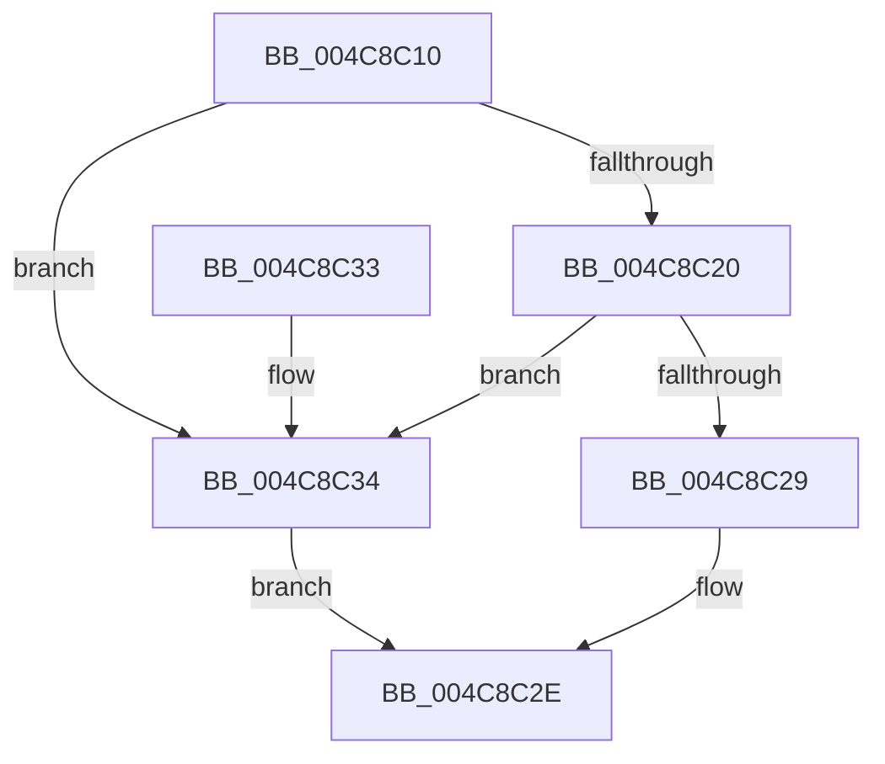

# InbvNotifyDisplayOwnershipChange

- RVA: `0x004C8C10`–`0x004C8C3B` (길이 `43` bytes)
- VA: `0x00000001404C8C10`
- 실행 섹션: `.text`
- PDB 이름 있음: `예`; PDB Function 태그: `아니요`
- unwind 정보 RVA: `0x0005CEE8`
- 디코드: `13`개 명령, `43/43` bytes 표시
- 미해석 바이트: `0` (있으면 어셈블리에 `.byte`로 보존)

> 이 문서는 커널 이미지의 기계어와 PDB 기호를 분석해 생성했습니다. 4번과 5번은 함수 원형과 자료형을 바이너리 사용 방식에서 추정한 C 해석이며 원본 소스 복구 결과는 아닙니다.

## 1. Dependencies

- 직접 호출 지점: **1**; 고유 호출 대상: **1**
- 직접 호출자로 확인된 함수: **0**
- RIP 상대 이미지 참조: **1**

### Outgoing calls
- `0x004C8C29` → [guard_dispatch_icall](../6B/guard_dispatch_icall_function_006BAAD0.md) (function, `0x006BAAD0`)

### Direct callers
- 이 함수 시작 RVA로 연결되는 직접 call은 확인되지 않았습니다. 간접 호출은 완전히 역산할 수 없습니다.

### Static image references
- `0x004C8C14` → RVA `0x00E65E58` (`.data`; read)

## 2. Other-region calls and transfers

- 다른 실행 섹션으로 향하는 call: **0**
- 별도 외부 분기/꼬리 이동을 확인하지 못했습니다.

## 3. Assembly (complete function range)

```asm
004C8C10  48 83 EC 28                     sub rsp, 0x28
004C8C14  48 8B 05 3D D2 99 00            mov rax, qword ptr [rip + 0x99d23d]
004C8C1B  48 85 C0                        test rax, rax
004C8C1E  74 14                           je 0x1404c8c34
004C8C20  48 8B 40 10                     mov rax, qword ptr [rax + 0x10]
004C8C24  48 85 C0                        test rax, rax
004C8C27  74 0B                           je 0x1404c8c34
004C8C29  E8 A2 1E 1F 00                  call 0x1406baad0
004C8C2E  48 83 C4 28                     add rsp, 0x28
004C8C32  C3                              ret
004C8C33  CC                              int3
004C8C34  B8 02 00 00 C0                  mov eax, 0xc0000002
004C8C39  EB F3                           jmp 0x1404c8c2e
```

## 4. C-style interpretation (structured pseudocode)

```c
__int64 __fastcall InbvNotifyDisplayOwnershipChange(void)
{
    __int64 result;
    __int64 v_rsp;

    v_rsp = (v_rsp) - (40);
    if (*(unsigned __int64 *)(v_rip + 10080829) == 0) goto loc_004C8C34;
    if (*(unsigned __int64 *)(*(unsigned __int64 *)(v_rip + 10080829) + 16) == 0) goto loc_004C8C34;
    result = guard_dispatch_icall(a1, a2, a3, a4);
loc_004C8C2E:
    v_rsp = (v_rsp) + (40);
    return result;
loc_004C8C34:
    goto loc_004C8C2E;
}
```

## 5. (Beta) C Style

```c
void InbvNotifyDisplayOwnershipChange(void)
{
    int64_t result;
    int64_t local_rsp;

    local_rsp = (local_rsp) - (40);
    if (*(uint64_t *)(v_rip + 0x99D23D) == 0) goto loc_004C8C34;
    if (*(uint64_t *)(*(uint64_t *)(v_rip + 0x99D23D) + 0x10) == 0) goto loc_004C8C34;
    result = guard_dispatch_icall(a1, a2, a3, a4);
loc_004C8C2E:
    local_rsp = (local_rsp) + (40);
    return result;
loc_004C8C34:
    goto loc_004C8C2E;
}
```

## 6. Execution-region graph

[열기: 2D/3D 그래프와 함수 탐색 컨트롤 패널](../../../control-panel.html?section=text&rva=0x004C8C10&view=graph)

- 2D 그래프는 위에서 아래로 흐르고, 3D 그래프는 빈 공간을 드래그해 회전합니다. Shift+드래그는 이동, 휠은 확대·축소, 함수 노드 선택은 대상 보고서 이동입니다.

### Static fallback


