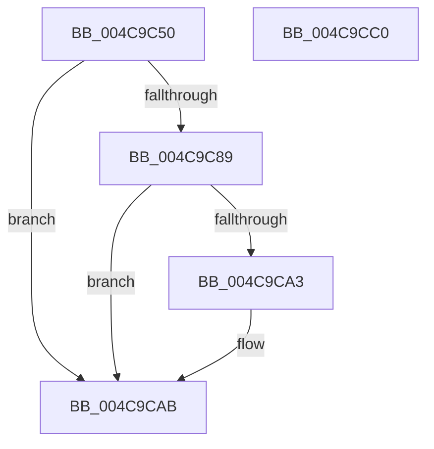

# IoAllocateController

- RVA: `0x004C9C50`–`0x004C9CC1` (길이 `113` bytes)
- VA: `0x00000001404C9C50`
- 실행 섹션: `.text`
- PDB 이름 있음: `예`; PDB Function 태그: `아니요`
- unwind 정보 RVA: `0x00066400`
- 디코드: `33`개 명령, `113/113` bytes 표시
- 미해석 바이트: `0` (있으면 어셈블리에 `.byte`로 보존)

> 이 문서는 커널 이미지의 기계어와 PDB 기호를 분석해 생성했습니다. 4번과 5번은 함수 원형과 자료형을 바이너리 사용 방식에서 추정한 C 해석이며 원본 소스 복구 결과는 아닙니다.

## 1. Dependencies

- 직접 호출 지점: **3**; 고유 호출 대상: **3**
- 직접 호출자로 확인된 함수: **1**
- RIP 상대 이미지 참조: **0**

### Outgoing calls
- `0x004C9C80` → [KeInsertDeviceQueue](../3D/KeInsertDeviceQueue_function_003DD900.md) (function, `0x003DD900`)
- `0x004C9C99` → [guard_dispatch_icall](../6B/guard_dispatch_icall_function_006BAAD0.md) (function, `0x006BAAD0`)
- `0x004C9CA6` → [IoFreeController](../59/IoFreeController_function_005979F0.md) (function, `0x005979F0`)

### Direct callers
- [DifIoAllocateControllerWrapper](../62/DifIoAllocateControllerWrapper_function_006273A0.md) at `0x00627496`

### Static image references
- 디코드된 RIP-relative 메모리 참조가 없습니다.

## 2. Other-region calls and transfers

- 다른 실행 섹션으로 향하는 call: **0**
- 별도 외부 분기/꼬리 이동을 확인하지 못했습니다.

## 3. Assembly (complete function range)

```asm
004C9C50  48 89 5C 24 08                  mov qword ptr [rsp + 8], rbx
004C9C55  48 89 6C 24 10                  mov qword ptr [rsp + 0x10], rbp
004C9C5A  48 89 74 24 18                  mov qword ptr [rsp + 0x18], rsi
004C9C5F  57                              push rdi
004C9C60  48 83 EC 30                     sub rsp, 0x30
004C9C64  48 8B DA                        mov rbx, rdx
004C9C67  4C 89 42 68                     mov qword ptr [rdx + 0x68], r8
004C9C6B  48 8B F9                        mov rdi, rcx
004C9C6E  4C 89 4A 70                     mov qword ptr [rdx + 0x70], r9
004C9C72  48 83 C2 50                     add rdx, 0x50
004C9C76  48 83 C1 10                     add rcx, 0x10
004C9C7A  49 8B F1                        mov rsi, r9
004C9C7D  49 8B E8                        mov rbp, r8
004C9C80  E8 7B 3C F1 FF                  call 0x1403dd900
004C9C85  84 C0                           test al, al
004C9C87  75 22                           jne 0x1404c9cab
004C9C89  48 8B 53 20                     mov rdx, qword ptr [rbx + 0x20]
004C9C8D  4C 8B CE                        mov r9, rsi
004C9C90  45 33 C0                        xor r8d, r8d
004C9C93  48 8B CB                        mov rcx, rbx
004C9C96  48 8B C5                        mov rax, rbp
004C9C99  E8 32 0E 1F 00                  call 0x1406baad0
004C9C9E  83 F8 02                        cmp eax, 2
004C9CA1  75 08                           jne 0x1404c9cab
004C9CA3  48 8B CF                        mov rcx, rdi
004C9CA6  E8 45 DD 0C 00                  call 0x1405979f0
004C9CAB  48 8B 5C 24 40                  mov rbx, qword ptr [rsp + 0x40]
004C9CB0  48 8B 6C 24 48                  mov rbp, qword ptr [rsp + 0x48]
004C9CB5  48 8B 74 24 50                  mov rsi, qword ptr [rsp + 0x50]
004C9CBA  48 83 C4 30                     add rsp, 0x30
004C9CBE  5F                              pop rdi
004C9CBF  C3                              ret
004C9CC0  CC                              int3
```

## 4. C-style interpretation (structured pseudocode)

```c
__int64 __fastcall IoAllocateController(__int64 a1, __int64 a2, __int64 a3, __int64 a4)
{
    __int64 result;
    __int64 v_rsp;
    unsigned __int64 v_stack_p10;
    unsigned __int64 v_stack_p18;
    unsigned __int64 v_stack_p8;

    v_stack_p8 = v_rbx;
    v_stack_p10 = v_rbp;
    v_stack_p18 = v_rsi;
    v_rsp = (v_rsp) - (48);
    *(unsigned __int64 *)(a2 + 104) = a3;
    *(unsigned __int64 *)(a2 + 112) = a4;
    a2 = (a2) + (80);
    a1 = (a1) + (16);
    result = KeInsertDeviceQueue(a1, a2, a3, a4);
    if ((unsigned __int8)(result) != 0) goto loc_004C9CAB;
    a3 = 0;
    result = guard_dispatch_icall(a2, *(unsigned __int64 *)(a2 + 32), a3, a4);
    if (((unsigned int)(result)) == 2) {
        a1 = a1;
        result = IoFreeController(a1, *(unsigned __int64 *)(a2 + 32), a3, a4);
    }
    v_rsp = (v_rsp) + (48);
    return result;
}
```

## 5. (Beta) C Style

```c
int64_t IoAllocateController(int64_t Arg1, void *Arg2, int64_t Arg3, int64_t Arg4)
{
    uint8_t *arg2 = (uint8_t *)Arg2;

    int64_t result;
    int64_t local_rsp;
    uint64_t v_stack_p10;
    uint64_t v_stack_p18;
    uint64_t v_stack_p8;

    v_stack_p8 = local_rbx;
    v_stack_p10 = local_rbp;
    v_stack_p18 = local_rsi;
    local_rsp = (local_rsp) - (48);
    *(uint64_t *)(arg2 + 0x68) = Arg3;
    *(uint64_t *)(arg2 + 0x70) = Arg4;
    Arg2 = (Arg2) + (80);
    Arg1 = (Arg1) + (16);
    result = KeInsertDeviceQueue(Arg1, Arg2, Arg3, Arg4);
    if ((uint8_t)(result) != 0) goto loc_004C9CAB;
    Arg3 = 0;
    result = guard_dispatch_icall(Arg2, *(uint64_t *)(arg2 + 0x20), Arg3, Arg4);
    if (((uint32_t)(result)) == 2) {
        Arg1 = Arg1;
        result = IoFreeController(Arg1, *(uint64_t *)(arg2 + 0x20), Arg3, Arg4);
    }
    local_rsp = (local_rsp) + (48);
    return result;
}
```

### 관측된 메모리 오프셋

구조체 형식이 확인되지 않은 접근은 인자 기준의 오프셋으로만 기록했습니다.

| 기준 인자 | 오프셋 표현 | 폭 (bit) | 접근 |
|---|---:|---:|---|
| `Arg2` | `+ 0x20` | `64` | `R` |
| `Arg2` | `+ 0x68` | `64` | `W` |
| `Arg2` | `+ 0x70` | `64` | `W` |

## 6. Execution-region graph

[열기: 2D/3D 그래프와 함수 탐색 컨트롤 패널](../../../control-panel.html?section=text&rva=0x004C9C50&view=graph)

- 2D 그래프는 위에서 아래로 흐르고, 3D 그래프는 빈 공간을 드래그해 회전합니다. Shift+드래그는 이동, 휠은 확대·축소, 함수 노드 선택은 대상 보고서 이동입니다.

### Static fallback


