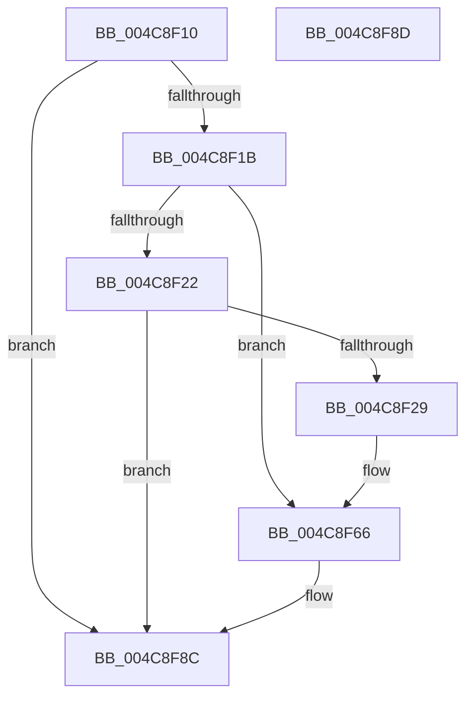

# IoInitializeRemoveLockEx

- RVA: `0x004C8F10`–`0x004C8F8E` (길이 `126` bytes)
- VA: `0x00000001404C8F10`
- 실행 섹션: `.text`
- PDB 이름 있음: `예`; PDB Function 태그: `아니요`
- unwind 정보 RVA: `0x000DB714`
- 디코드: `32`개 명령, `126/126` bytes 표시
- 미해석 바이트: `0` (있으면 어셈블리에 `.byte`로 보존)

> 이 문서는 커널 이미지의 기계어와 PDB 기호를 분석해 생성했습니다. 4번과 5번은 함수 원형과 자료형을 바이너리 사용 방식에서 추정한 C 해석이며 원본 소스 복구 결과는 아닙니다.

## 1. Dependencies

- 직접 호출 지점: **0**; 고유 호출 대상: **0**
- 직접 호출자로 확인된 함수: **4**
- RIP 상대 이미지 참조: **1**

### Outgoing calls
- 직접 디코드된 call 명령이 없습니다.

### Direct callers
- [PopFxCreateDeviceCommon](../5D/PopFxCreateDeviceCommon_function_005D2424.md) at `0x005D262E`
- [DifIoInitializeRemoveLockExWrapper](../62/DifIoInitializeRemoveLockExWrapper_function_0062B2D0.md) at `0x0062B3D4`
- [PopFxRegisterDeviceWorker](../../page/75/PopFxRegisterDeviceWorker_function_00759E20.md) at `0x0075A0AE`
- [sub_00BACE53](../../pagevrfy/BA/Unknown_function_00BACE53.md) at `0x00BACE70`

### Static image references
- `0x004C8F34` → RVA `0x00FC6AA0` (`ALMOSTRO`; read)

## 2. Other-region calls and transfers

- 다른 실행 섹션으로 향하는 call: **0**
- 별도 외부 분기/꼬리 이동을 확인하지 못했습니다.

## 3. Assembly (complete function range)

```asm
004C8F10  45 33 DB                        xor r11d, r11d
004C8F13  4C 8B D1                        mov r10, rcx
004C8F16  48 85 C9                        test rcx, rcx
004C8F19  74 71                           je 0x1404c8f8c
004C8F1B  83 7C 24 28 20                  cmp dword ptr [rsp + 0x28], 0x20
004C8F20  74 44                           je 0x1404c8f66
004C8F22  83 7C 24 28 78                  cmp dword ptr [rsp + 0x28], 0x78
004C8F27  75 63                           jne 0x1404c8f8c
004C8F29  C7 41 20 52 4C 4F 43            mov dword ptr [rcx + 0x20], 0x434f4c52
004C8F30  44 89 49 24                     mov dword ptr [rcx + 0x24], r9d
004C8F34  8B 0D 66 DB AF 00               mov ecx, dword ptr [rip + 0xafdb66]
004C8F3A  41 8B C0                        mov eax, r8d
004C8F3D  48 0F AF C8                     imul rcx, rax
004C8F41  48 69 C1 00 46 C3 23            imul rax, rcx, 0x23c34600
004C8F48  85 D2                           test edx, edx
004C8F4A  49 89 42 28                     mov qword ptr [r10 + 0x28], rax
004C8F4E  B8 50 6E 70 72                  mov eax, 0x72706e50
004C8F53  0F 45 C2                        cmovne eax, edx
004C8F56  41 89 42 30                     mov dword ptr [r10 + 0x30], eax
004C8F5A  4D 89 5A 48                     mov qword ptr [r10 + 0x48], r11
004C8F5E  45 89 5A 50                     mov dword ptr [r10 + 0x50], r11d
004C8F62  4D 89 5A 70                     mov qword ptr [r10 + 0x70], r11
004C8F66  45 88 1A                        mov byte ptr [r10], r11b
004C8F69  49 8D 42 10                     lea rax, [r10 + 0x10]
004C8F6D  41 C7 42 04 01 00 00 00         mov dword ptr [r10 + 4], 1
004C8F75  66 41 C7 42 08 01 00            mov word ptr [r10 + 8], 1
004C8F7C  41 C6 42 0A 06                  mov byte ptr [r10 + 0xa], 6
004C8F81  45 89 5A 0C                     mov dword ptr [r10 + 0xc], r11d
004C8F85  48 89 40 08                     mov qword ptr [rax + 8], rax
004C8F89  48 89 00                        mov qword ptr [rax], rax
004C8F8C  C3                              ret
004C8F8D  CC                              int3
```

## 4. C-style interpretation (structured pseudocode)

```c
__int64 __fastcall IoInitializeRemoveLockEx(__int64 a1, int a2, int a3, int a4, unsigned int a5)
{
    __int64 result;
    __int64 v_r11;

    v_r11 = 0;
    if (a1 == 0) goto loc_004C8F8C;
    if (a5 == 32) goto loc_004C8F66;
    if (a5 != 120) goto loc_004C8F8C;
    *(unsigned int *)(a1 + 32) = 0x434F4C52ULL;
    *(unsigned int *)(a1 + 36) = a4;
    a1 = ((unsigned int)(*(unsigned int *)(v_rip + 11524966))) * ((unsigned int)(a3));
    result = ((unsigned int)(a3)) * (a1);
    *(unsigned __int64 *)(a1 + 40) = result;
    result = (unsigned int)(0x72706E50ULL);
    if (a2 != 0) { result = a2; }
    *(unsigned int *)(a1 + 48) = (unsigned int)(result);
    *(unsigned __int64 *)(a1 + 72) = 0;
    *(unsigned int *)(a1 + 80) = 0;
    *(unsigned __int64 *)(a1 + 112) = 0;
loc_004C8F66:
    *(unsigned __int8 *)(a1) = 0;
    *(unsigned int *)(a1 + 4) = 1;
    *(unsigned __int16 *)(a1 + 8) = 1;
    *(unsigned __int8 *)(a1 + 10) = 6;
    *(unsigned int *)(a1 + 12) = 0;
    *(unsigned __int64 *)(a1 + 16 + 8) = a1 + 16;
    *(unsigned __int64 *)(a1 + 16) = a1 + 16;
loc_004C8F8C:
    return a1 + 16;
}
```

## 5. (Beta) C Style

```c
void *IoInitializeRemoveLockEx(void *Arg1, int32_t Arg2, int32_t Arg3, int32_t Arg4, uint32_t Arg5)
{
    uint8_t *arg1 = (uint8_t *)Arg1;

    int64_t result;
    int64_t local_r11;

    local_r11 = 0;
    if (Arg1 == NULL) goto loc_004C8F8C;
    if (Arg5 == 32) goto loc_004C8F66;
    if (Arg5 != 120) goto loc_004C8F8C;
    *(uint32_t *)(arg1 + 0x20) = 0x434F4C52ULL;
    *(uint32_t *)(arg1 + 0x24) = Arg4;
    Arg1 = ((uint32_t)(*(uint32_t *)(v_rip + 0xAFDB66))) * ((uint32_t)(Arg3));
    result = ((uint32_t)(Arg3)) * (Arg1);
    *(uint64_t *)(arg1 + 0x28) = result;
    result = (uint32_t)(0x72706E50ULL);
    if (Arg2 != 0) { result = Arg2; }
    *(uint32_t *)(arg1 + 0x30) = (uint32_t)(result);
    *(uint64_t *)(arg1 + 0x48) = 0;
    *(uint32_t *)(arg1 + 0x50) = 0;
    *(uint64_t *)(arg1 + 0x70) = 0;
loc_004C8F66:
    *(uint8_t *)(arg1) = 0;
    *(uint32_t *)(arg1 + 0x4) = 1;
    *(uint16_t *)(arg1 + 0x8) = 1;
    *(uint8_t *)(arg1 + 0xA) = 6;
    *(uint32_t *)(arg1 + 0xC) = 0;
    *(void **)(arg1 + 0x10 + 0x8) = Arg1 + 16;
    *(void **)(arg1 + 0x10) = Arg1 + 16;
loc_004C8F8C:
    return Arg1 + 16;
}
```

### 관측된 메모리 오프셋

구조체 형식이 확인되지 않은 접근은 인자 기준의 오프셋으로만 기록했습니다.

| 기준 인자 | 오프셋 표현 | 폭 (bit) | 접근 |
|---|---:|---:|---|
| `Arg1` | `+ 0x0` | `8` | `W` |
| `Arg1` | `+ 0x0` | `64` | `W` |
| `Arg1` | `+ 0x4` | `32` | `W` |
| `Arg1` | `+ 0x8` | `16` | `W` |
| `Arg1` | `+ 0x8` | `64` | `W` |
| `Arg1` | `+ 0xA` | `8` | `W` |
| `Arg1` | `+ 0xC` | `32` | `W` |
| `Arg1` | `+ 0x10` | `64` | `R` |
| `Arg1` | `+ 0x28` | `64` | `W` |
| `Arg1` | `+ 0x30` | `32` | `W` |
| `Arg1` | `+ 0x48` | `64` | `W` |
| `Arg1` | `+ 0x50` | `32` | `W` |
| `Arg1` | `+ 0x70` | `64` | `W` |

## 6. Execution-region graph

[열기: 2D/3D 그래프와 함수 탐색 컨트롤 패널](../../../control-panel.html?section=text&rva=0x004C8F10&view=graph)

- 2D 그래프는 위에서 아래로 흐르고, 3D 그래프는 빈 공간을 드래그해 회전합니다. Shift+드래그는 이동, 휠은 확대·축소, 함수 노드 선택은 대상 보고서 이동입니다.

### Static fallback


