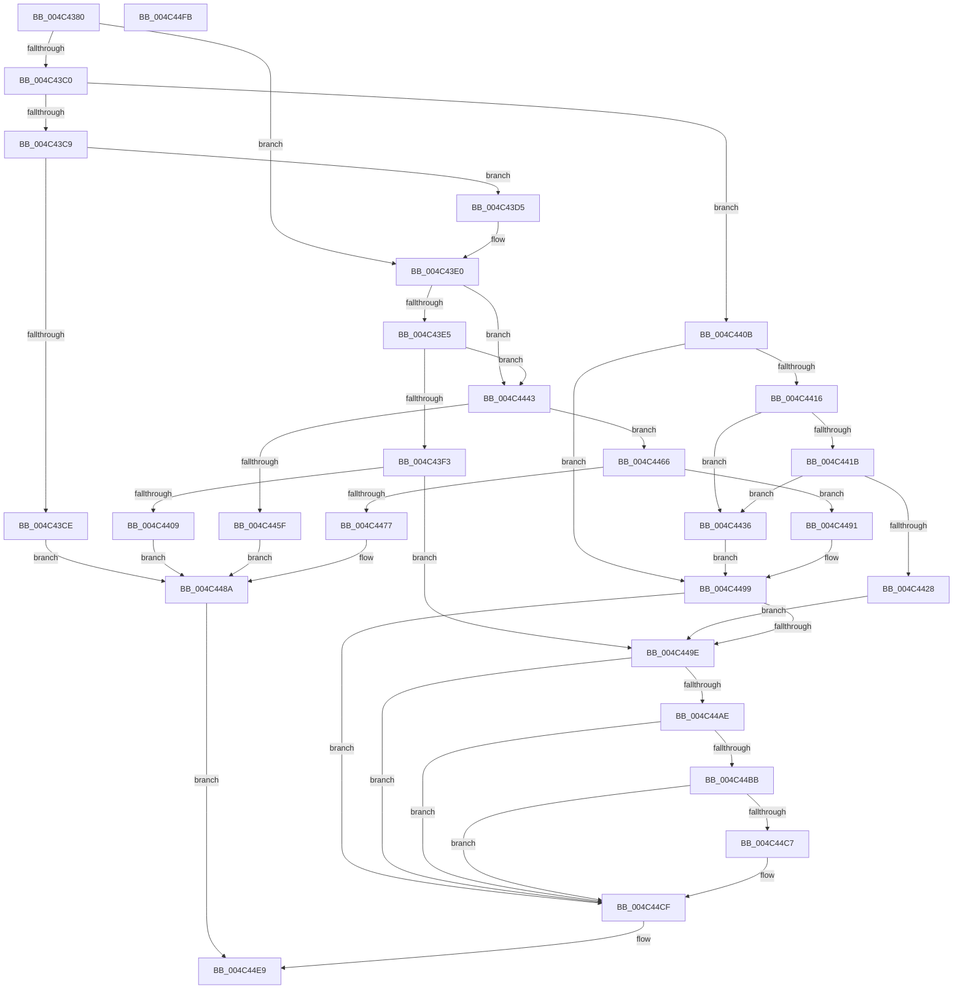

# IoResolveDependency

- RVA: `0x004C4380`–`0x004C44FC` (길이 `380` bytes)
- VA: `0x00000001404C4380`
- 실행 섹션: `.text`
- PDB 이름 있음: `예`; PDB Function 태그: `아니요`
- unwind 정보 RVA: `0x0009E61C`
- 디코드: `106`개 명령, `380/380` bytes 표시
- 미해석 바이트: `0` (있으면 어셈블리에 `.byte`로 보존)

> 이 문서는 커널 이미지의 기계어와 PDB 기호를 분석해 생성했습니다. 4번과 5번은 함수 원형과 자료형을 바이너리 사용 방식에서 추정한 C 해석이며 원본 소스 복구 결과는 아닙니다.

## 1. Dependencies

- 직접 호출 지점: **18**; 고유 호출 대상: **15**
- 직접 호출자로 확인된 함수: **0**
- RIP 상대 이미지 참조: **0**

### Outgoing calls
- `0x004C43A4` → [PnpAcquireDependencyRelationsLock](../../page/A0/PnpAcquireDependencyRelationsLock_function_00A06788.md) (function, `0x00A06788`)
- `0x004C43B3` → [PipQueryBindingResolution](../../page/A8/PipQueryBindingResolution_function_00A85310.md) (function, `0x00A85310`)
- `0x004C43DB` → [PipDeleteBindingId](../../page/72/PipDeleteBindingId_function_00727BFC.md) (function, `0x00727BFC`)
- `0x004C43FA` → [PipAddBindingId](../../page/72/PipAddBindingId_function_00727814.md) (function, `0x00727814`)
- `0x004C442F` → [PipMergeDependencyNodes](../../page/72/PipMergeDependencyNodes_function_00727EB8.md) (function, `0x00727EB8`)
- `0x004C443C` → [PipLinkDeviceObjectAndDependencyNode](../../page/72/PipLinkDeviceObjectAndDependencyNode_function_00727D30.md) (function, `0x00727D30`)
- `0x004C4452` → [PipCreateDependencyNode](../../page/72/PipCreateDependencyNode_function_00727B0C.md) (function, `0x00727B0C`)
- `0x004C446C` → [PipAddBindingId](../../page/72/PipAddBindingId_function_00727814.md) (function, `0x00727814`)
- `0x004C447D` → [PipUnlinkDeviceObjectAndDependencyNode](../../page/AC/PipUnlinkDeviceObjectAndDependencyNode_function_00ACD550.md) (function, `0x00ACD550`)
- `0x004C4485` → [PipDereferenceDependencyNode](../../page/AC/PipDereferenceDependencyNode_function_00ACD5A0.md) (function, `0x00ACD5A0`)
- `0x004C448A` → [PnpReleaseDependencyRelationsLock](../../page/A0/PnpReleaseDependencyRelationsLock_function_00A06E14.md) (function, `0x00A06E14`)
- `0x004C4494` → [PipDereferenceDependencyNode](../../page/AC/PipDereferenceDependencyNode_function_00ACD5A0.md) (function, `0x00ACD5A0`)
- `0x004C44BE` → [PipIsProviderStarted](../../page/72/PipIsProviderStarted_function_00727CD0.md) (function, `0x00727CD0`)
- `0x004C44CA` → [PipAttemptDependentsStart](../../page/A9/PipAttemptDependentsStart_function_00A9C888.md) (function, `0x00A9C888`)
- `0x004C44D2` → [PipAddtoRebuildPowerRelationsQueue](../../page/A0/PipAddtoRebuildPowerRelationsQueue_function_00A07174.md) (function, `0x00A07174`)
- `0x004C44DA` → [PipAddDependentsToRebuildPowerRelationsQueue](../../page/A0/PipAddDependentsToRebuildPowerRelationsQueue_function_00A067D8.md) (function, `0x00A067D8`)
- `0x004C44DF` → [PnpReleaseDependencyRelationsLock](../../page/A0/PnpReleaseDependencyRelationsLock_function_00A06E14.md) (function, `0x00A06E14`)
- `0x004C44E4` → [PipProcessRebuildPowerRelationsQueue](../../page/A0/PipProcessRebuildPowerRelationsQueue_function_00A06844.md) (function, `0x00A06844`)

### Direct callers
- 이 함수 시작 RVA로 연결되는 직접 call은 확인되지 않았습니다. 간접 호출은 완전히 역산할 수 없습니다.

### Static image references
- 디코드된 RIP-relative 메모리 참조가 없습니다.

## 2. Other-region calls and transfers

- 다른 실행 섹션으로 향하는 call: **18**
  - `0x004C43A4` → [PnpAcquireDependencyRelationsLock](../../page/A0/PnpAcquireDependencyRelationsLock_function_00A06788.md) (`.text` → `PAGE`)
  - `0x004C43B3` → [PipQueryBindingResolution](../../page/A8/PipQueryBindingResolution_function_00A85310.md) (`.text` → `PAGE`)
  - `0x004C43DB` → [PipDeleteBindingId](../../page/72/PipDeleteBindingId_function_00727BFC.md) (`.text` → `PAGE`)
  - `0x004C43FA` → [PipAddBindingId](../../page/72/PipAddBindingId_function_00727814.md) (`.text` → `PAGE`)
  - `0x004C442F` → [PipMergeDependencyNodes](../../page/72/PipMergeDependencyNodes_function_00727EB8.md) (`.text` → `PAGE`)
  - `0x004C443C` → [PipLinkDeviceObjectAndDependencyNode](../../page/72/PipLinkDeviceObjectAndDependencyNode_function_00727D30.md) (`.text` → `PAGE`)
  - `0x004C4452` → [PipCreateDependencyNode](../../page/72/PipCreateDependencyNode_function_00727B0C.md) (`.text` → `PAGE`)
  - `0x004C446C` → [PipAddBindingId](../../page/72/PipAddBindingId_function_00727814.md) (`.text` → `PAGE`)
  - `0x004C447D` → [PipUnlinkDeviceObjectAndDependencyNode](../../page/AC/PipUnlinkDeviceObjectAndDependencyNode_function_00ACD550.md) (`.text` → `PAGE`)
  - `0x004C4485` → [PipDereferenceDependencyNode](../../page/AC/PipDereferenceDependencyNode_function_00ACD5A0.md) (`.text` → `PAGE`)
  - `0x004C448A` → [PnpReleaseDependencyRelationsLock](../../page/A0/PnpReleaseDependencyRelationsLock_function_00A06E14.md) (`.text` → `PAGE`)
  - `0x004C4494` → [PipDereferenceDependencyNode](../../page/AC/PipDereferenceDependencyNode_function_00ACD5A0.md) (`.text` → `PAGE`)
  - `0x004C44BE` → [PipIsProviderStarted](../../page/72/PipIsProviderStarted_function_00727CD0.md) (`.text` → `PAGE`)
  - `0x004C44CA` → [PipAttemptDependentsStart](../../page/A9/PipAttemptDependentsStart_function_00A9C888.md) (`.text` → `PAGE`)
  - `0x004C44D2` → [PipAddtoRebuildPowerRelationsQueue](../../page/A0/PipAddtoRebuildPowerRelationsQueue_function_00A07174.md) (`.text` → `PAGE`)
  - `0x004C44DA` → [PipAddDependentsToRebuildPowerRelationsQueue](../../page/A0/PipAddDependentsToRebuildPowerRelationsQueue_function_00A067D8.md) (`.text` → `PAGE`)
  - `0x004C44DF` → [PnpReleaseDependencyRelationsLock](../../page/A0/PnpReleaseDependencyRelationsLock_function_00A06E14.md) (`.text` → `PAGE`)
  - `0x004C44E4` → [PipProcessRebuildPowerRelationsQueue](../../page/A0/PipProcessRebuildPowerRelationsQueue_function_00A06844.md) (`.text` → `PAGE`)
- 별도 외부 분기/꼬리 이동을 확인하지 못했습니다.

## 3. Assembly (complete function range)

```asm
004C4380  48 8B C4                        mov rax, rsp
004C4383  48 89 58 10                     mov qword ptr [rax + 0x10], rbx
004C4387  48 89 70 18                     mov qword ptr [rax + 0x18], rsi
004C438B  57                              push rdi
004C438C  48 83 EC 30                     sub rsp, 0x30
004C4390  48 8B F9                        mov rdi, rcx
004C4393  48 C7 40 E8 01 00 00 00         mov qword ptr [rax - 0x18], 1
004C439B  83 60 EC 00                     and dword ptr [rax - 0x14], 0
004C439F  B1 01                           mov cl, 1
004C43A1  48 8B DA                        mov rbx, rdx
004C43A4  E8 DF 23 54 00                  call 0x140a06788
004C43A9  48 8D 4C 24 20                  lea rcx, [rsp + 0x20]
004C43AE  48 89 7C 24 28                  mov qword ptr [rsp + 0x28], rdi
004C43B3  E8 58 0F 5C 00                  call 0x140a85310
004C43B8  4C 8B C0                        mov r8, rax
004C43BB  48 85 C0                        test rax, rax
004C43BE  74 20                           je 0x1404c43e0
004C43C0  48 8B 40 30                     mov rax, qword ptr [rax + 0x30]
004C43C4  48 85 C0                        test rax, rax
004C43C7  74 42                           je 0x1404c440b
004C43C9  48 3B C3                        cmp rax, rbx
004C43CC  75 07                           jne 0x1404c43d5
004C43CE  33 FF                           xor edi, edi
004C43D0  E9 B5 00 00 00                  jmp 0x1404c448a
004C43D5  48 8B D7                        mov rdx, rdi
004C43D8  49 8B C8                        mov rcx, r8
004C43DB  E8 1C 38 26 00                  call 0x140727bfc
004C43E0  48 85 DB                        test rbx, rbx
004C43E3  74 5E                           je 0x1404c4443
004C43E5  48 8B 83 38 01 00 00            mov rax, qword ptr [rbx + 0x138]
004C43EC  48 83 78 50 00                  cmp qword ptr [rax + 0x50], 0
004C43F1  74 50                           je 0x1404c4443
004C43F3  48 8B 48 50                     mov rcx, qword ptr [rax + 0x50]
004C43F7  48 8B D7                        mov rdx, rdi
004C43FA  E8 15 34 26 00                  call 0x140727814
004C43FF  8B F8                           mov edi, eax
004C4401  85 C0                           test eax, eax
004C4403  0F 89 95 00 00 00               jns 0x1404c449e
004C4409  EB 7F                           jmp 0x1404c448a
004C440B  33 FF                           xor edi, edi
004C440D  48 85 C0                        test rax, rax
004C4410  0F 85 83 00 00 00               jne 0x1404c4499
004C4416  48 85 DB                        test rbx, rbx
004C4419  74 1B                           je 0x1404c4436
004C441B  48 8B 83 38 01 00 00            mov rax, qword ptr [rbx + 0x138]
004C4422  48 39 78 50                     cmp qword ptr [rax + 0x50], rdi
004C4426  74 0E                           je 0x1404c4436
004C4428  48 8B 48 50                     mov rcx, qword ptr [rax + 0x50]
004C442C  49 8B D0                        mov rdx, r8
004C442F  E8 84 3A 26 00                  call 0x140727eb8
004C4434  EB 68                           jmp 0x1404c449e
004C4436  49 8B D0                        mov rdx, r8
004C4439  48 8B CB                        mov rcx, rbx
004C443C  E8 EF 38 26 00                  call 0x140727d30
004C4441  EB 56                           jmp 0x1404c4499
004C4443  83 64 24 20 00                  and dword ptr [rsp + 0x20], 0
004C4448  48 8D 4C 24 20                  lea rcx, [rsp + 0x20]
004C444D  48 89 5C 24 28                  mov qword ptr [rsp + 0x28], rbx
004C4452  E8 B5 36 26 00                  call 0x140727b0c
004C4457  48 8B F0                        mov rsi, rax
004C445A  48 85 C0                        test rax, rax
004C445D  75 07                           jne 0x1404c4466
004C445F  BF 9A 00 00 C0                  mov edi, 0xc000009a
004C4464  EB 24                           jmp 0x1404c448a
004C4466  48 8B D7                        mov rdx, rdi
004C4469  48 8B CE                        mov rcx, rsi
004C446C  E8 A3 33 26 00                  call 0x140727814
004C4471  8B F8                           mov edi, eax
004C4473  85 C0                           test eax, eax
004C4475  79 1A                           jns 0x1404c4491
004C4477  48 8B D6                        mov rdx, rsi
004C447A  48 8B CB                        mov rcx, rbx
004C447D  E8 CE 90 60 00                  call 0x140acd550
004C4482  48 8B CE                        mov rcx, rsi
004C4485  E8 16 91 60 00                  call 0x140acd5a0
004C448A  E8 85 29 54 00                  call 0x140a06e14
004C448F  EB 58                           jmp 0x1404c44e9
004C4491  48 8B CE                        mov rcx, rsi
004C4494  E8 07 91 60 00                  call 0x140acd5a0
004C4499  48 85 DB                        test rbx, rbx
004C449C  74 31                           je 0x1404c44cf
004C449E  48 8B 83 38 01 00 00            mov rax, qword ptr [rbx + 0x138]
004C44A5  4C 8B 40 28                     mov r8, qword ptr [rax + 0x28]
004C44A9  4D 85 C0                        test r8, r8
004C44AC  74 21                           je 0x1404c44cf
004C44AE  41 F7 80 8C 01 00 00 00 00 02 00  test dword ptr [r8 + 0x18c], 0x20000
004C44B9  75 14                           jne 0x1404c44cf
004C44BB  49 8B C8                        mov rcx, r8
004C44BE  E8 0D 38 26 00                  call 0x140727cd0
004C44C3  84 C0                           test al, al
004C44C5  74 08                           je 0x1404c44cf
004C44C7  49 8B C8                        mov rcx, r8
004C44CA  E8 B9 83 5D 00                  call 0x140a9c888
004C44CF  48 8B CB                        mov rcx, rbx
004C44D2  E8 9D 2C 54 00                  call 0x140a07174
004C44D7  48 8B CB                        mov rcx, rbx
004C44DA  E8 F9 22 54 00                  call 0x140a067d8
004C44DF  E8 30 29 54 00                  call 0x140a06e14
004C44E4  E8 5B 23 54 00                  call 0x140a06844
004C44E9  48 8B 5C 24 48                  mov rbx, qword ptr [rsp + 0x48]
004C44EE  8B C7                           mov eax, edi
004C44F0  48 8B 74 24 50                  mov rsi, qword ptr [rsp + 0x50]
004C44F5  48 83 C4 30                     add rsp, 0x30
004C44F9  5F                              pop rdi
004C44FA  C3                              ret
004C44FB  CC                              int3
```

## 4. C-style interpretation (structured pseudocode)

```c
__int64 __fastcall IoResolveDependency(__int64 a1, __int64 a2)
{
    __int64 result;
    __int64 v_rdi;
    __int64 v_rsp;
    unsigned __int64 v_stack_m10;
    unsigned __int64 v_stack_m18;
    unsigned __int64 v_stack_p10;
    unsigned __int64 v_stack_p18;

    *(unsigned __int64 *)(v_rsp + 16) = v_rbx;
    *(unsigned __int64 *)(v_rsp + 24) = v_rsi;
    v_rsp = (v_rsp) - (48);
    *(unsigned __int64 *)(v_rsp - 24) = 1;
    result = PnpAcquireDependencyRelationsLock(1, a2, a3, a4);
    v_stack_m10 = a1;
    result = PipQueryBindingResolution(v_stack_m18, a2, a3, a4);
    if (result == 0) goto loc_004C43E0;
    if (*(unsigned __int64 *)(result + 48) == 0) goto loc_004C440B;
    if ((*(unsigned __int64 *)(result + 48)) != a2) goto loc_004C43D5;
    v_rdi = 0;
    goto loc_004C448A;
loc_004C43D5:
    result = PipDeleteBindingId(result, 0, result, a4);
loc_004C43E0:
    if (a2 == 0) goto loc_004C4443;
    if ((*(unsigned __int64 *)(*(unsigned __int64 *)(a2 + 312) + 80)) == 0) goto loc_004C4443;
    result = PipAddBindingId(*(unsigned __int64 *)(*(unsigned __int64 *)(a2 + 312) + 80), 0, result, a4);
    if (!sign_flag) goto loc_004C449E;
    goto loc_004C448A;
loc_004C440B:
    v_rdi = 0;
    if (result != 0) goto loc_004C4499;
    if (a2 == 0) goto loc_004C4436;
    if ((*(unsigned __int64 *)(*(unsigned __int64 *)(a2 + 312) + 80)) == 0) goto loc_004C4436;
    result = PipMergeDependencyNodes(*(unsigned __int64 *)(*(unsigned __int64 *)(a2 + 312) + 80), result, result, a4);
    goto loc_004C449E;
loc_004C4436:
    result = PipLinkDeviceObjectAndDependencyNode(a2, result, result, a4);
    goto loc_004C4499;
loc_004C4443:
    v_stack_m10 = a2;
    result = PipCreateDependencyNode(v_stack_m18, result, result, a4);
    if (result != 0) goto loc_004C4466;
    goto loc_004C448A;
loc_004C4466:
    result = PipAddBindingId(result, (unsigned int)(0xC000009AULL), result, a4);
    if (!sign_flag) goto loc_004C4491;
    result = PipUnlinkDeviceObjectAndDependencyNode(a2, result, result, a4);
    result = PipDereferenceDependencyNode(result, result, result, a4);
loc_004C448A:
    result = PnpReleaseDependencyRelationsLock(result, result, result, a4);
    goto loc_004C44E9;
loc_004C4491:
    result = PipDereferenceDependencyNode(result, result, result, a4);
loc_004C4499:
    if (a2 == 0) goto loc_004C44CF;
loc_004C449E:
    if (*(unsigned __int64 *)(*(unsigned __int64 *)(a2 + 312) + 40) == 0) goto loc_004C44CF;
    if (((*(unsigned int *)(*(unsigned __int64 *)(*(unsigned __int64 *)(a2 + 312) + 40) + 396)) & (0x20000ULL)) != 0) goto loc_004C44CF;
    result = PipIsProviderStarted(*(unsigned __int64 *)(*(unsigned __int64 *)(a2 + 312) + 40), result, *(unsigned __int64 *)(*(unsigned __int64 *)(a2 + 312) + 40), a4);
    if ((unsigned __int8)(result) != 0) {
        a1 = *(unsigned __int64 *)(*(unsigned __int64 *)(a2 + 312) + 40);
        result = PipAttemptDependentsStart(a1, result, *(unsigned __int64 *)(*(unsigned __int64 *)(a2 + 312) + 40), a4);
    }
    result = PipAddtoRebuildPowerRelationsQueue(a2, result, *(unsigned __int64 *)(*(unsigned __int64 *)(a2 + 312) + 40), a4);
    result = PipAddDependentsToRebuildPowerRelationsQueue(a2, result, *(unsigned __int64 *)(*(unsigned __int64 *)(a2 + 312) + 40), a4);
    result = PnpReleaseDependencyRelationsLock(a2, result, *(unsigned __int64 *)(*(unsigned __int64 *)(a2 + 312) + 40), a4);
    result = PipProcessRebuildPowerRelationsQueue(a2, result, *(unsigned __int64 *)(*(unsigned __int64 *)(a2 + 312) + 40), a4);
loc_004C44E9:
    v_rsp = (v_rsp) + (48);
    return (unsigned int)((unsigned int)((unsigned int)((unsigned int)(result))));
}
```

## 5. (Beta) C Style

```c
int64_t IoResolveDependency(int64_t Arg1, int64_t Arg2)
{
    int64_t result;
    int64_t local_rdi;
    int64_t local_rsp;
    uint64_t v_stack_m10;
    uint64_t v_stack_m18;
    uint64_t v_stack_p10;
    uint64_t v_stack_p18;

    *(uint64_t *)(local_rsp + 0x10) = local_rbx;
    *(uint64_t *)(local_rsp + 0x18) = local_rsi;
    local_rsp = (local_rsp) - (48);
    *(uint64_t *)(local_rsp - 0x18) = 1;
    result = PnpAcquireDependencyRelationsLock(1, Arg2, a3, a4);
    v_stack_m10 = Arg1;
    result = PipQueryBindingResolution(v_stack_m18, Arg2, a3, a4);
    if (result == 0) goto loc_004C43E0;
    if (*(uint64_t *)(result + 0x30) == 0) goto loc_004C440B;
    if ((*(uint64_t *)(result + 0x30)) != Arg2) goto loc_004C43D5;
    local_rdi = 0;
    goto loc_004C448A;
loc_004C43D5:
    result = PipDeleteBindingId(result, 0, result, a4);
loc_004C43E0:
    if (Arg2 == 0) goto loc_004C4443;
    if ((*(uint64_t *)(*(uint64_t *)(Arg2 + 0x138) + 0x50)) == 0) goto loc_004C4443;
    result = PipAddBindingId(*(uint64_t *)(*(uint64_t *)(Arg2 + 0x138) + 0x50), 0, result, a4);
    if (!sign_flag) goto loc_004C449E;
    goto loc_004C448A;
loc_004C440B:
    local_rdi = 0;
    if (result != 0) goto loc_004C4499;
    if (Arg2 == 0) goto loc_004C4436;
    if ((*(uint64_t *)(*(uint64_t *)(Arg2 + 0x138) + 0x50)) == 0) goto loc_004C4436;
    result = PipMergeDependencyNodes(*(uint64_t *)(*(uint64_t *)(Arg2 + 0x138) + 0x50), result, result, a4);
    goto loc_004C449E;
loc_004C4436:
    result = PipLinkDeviceObjectAndDependencyNode(Arg2, result, result, a4);
    goto loc_004C4499;
loc_004C4443:
    v_stack_m10 = Arg2;
    result = PipCreateDependencyNode(v_stack_m18, result, result, a4);
    if (result != 0) goto loc_004C4466;
    goto loc_004C448A;
loc_004C4466:
    result = PipAddBindingId(result, (uint32_t)(0xC000009AULL), result, a4);
    if (!sign_flag) goto loc_004C4491;
    result = PipUnlinkDeviceObjectAndDependencyNode(Arg2, result, result, a4);
    result = PipDereferenceDependencyNode(result, result, result, a4);
loc_004C448A:
    result = PnpReleaseDependencyRelationsLock(result, result, result, a4);
    goto loc_004C44E9;
loc_004C4491:
    result = PipDereferenceDependencyNode(result, result, result, a4);
loc_004C4499:
    if (Arg2 == 0) goto loc_004C44CF;
loc_004C449E:
    if (*(uint64_t *)(*(uint64_t *)(Arg2 + 0x138) + 0x28) == 0) goto loc_004C44CF;
    if (((*(uint32_t *)(*(uint64_t *)(*(uint64_t *)(Arg2 + 0x138) + 0x28) + 0x18C)) & (0x20000ULL)) != 0) goto loc_004C44CF;
    result = PipIsProviderStarted(*(uint64_t *)(*(uint64_t *)(Arg2 + 0x138) + 0x28), result, *(uint64_t *)(*(uint64_t *)(Arg2 + 0x138) + 0x28), a4);
    if ((uint8_t)(result) != 0) {
        Arg1 = *(uint64_t *)(*(uint64_t *)(Arg2 + 0x138) + 0x28);
        result = PipAttemptDependentsStart(Arg1, result, *(uint64_t *)(*(uint64_t *)(Arg2 + 0x138) + 0x28), a4);
    }
    result = PipAddtoRebuildPowerRelationsQueue(Arg2, result, *(uint64_t *)(*(uint64_t *)(Arg2 + 0x138) + 0x28), a4);
    result = PipAddDependentsToRebuildPowerRelationsQueue(Arg2, result, *(uint64_t *)(*(uint64_t *)(Arg2 + 0x138) + 0x28), a4);
    result = PnpReleaseDependencyRelationsLock(Arg2, result, *(uint64_t *)(*(uint64_t *)(Arg2 + 0x138) + 0x28), a4);
    result = PipProcessRebuildPowerRelationsQueue(Arg2, result, *(uint64_t *)(*(uint64_t *)(Arg2 + 0x138) + 0x28), a4);
loc_004C44E9:
    local_rsp = (local_rsp) + (48);
    return (uint32_t)((uint32_t)((uint32_t)((uint32_t)(result))));
}
```

## 6. Execution-region graph

[열기: 2D/3D 그래프와 함수 탐색 컨트롤 패널](../../../control-panel.html?section=text&rva=0x004C4380&view=graph)

- 2D 그래프는 위에서 아래로 흐르고, 3D 그래프는 빈 공간을 드래그해 회전합니다. Shift+드래그는 이동, 휠은 확대·축소, 함수 노드 선택은 대상 보고서 이동입니다.

### Static fallback


