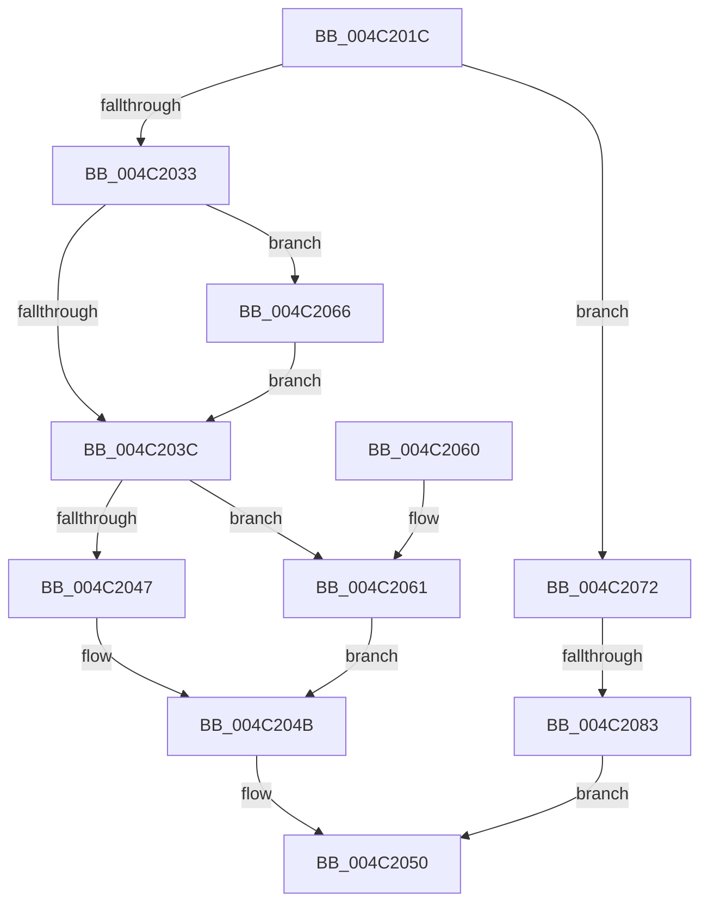

# IopFreeCopyObjectsFromDataBuffer

- RVA: `0x004C201C`–`0x004C20AC` (길이 `144` bytes)
- VA: `0x00000001404C201C`
- 실행 섹션: `.text`
- PDB 이름 있음: `예`; PDB Function 태그: `예`
- unwind 정보 RVA: `0x00088C58`
- 디코드: `42`개 명령, `144/144` bytes 표시
- 미해석 바이트: `0` (있으면 어셈블리에 `.byte`로 보존)

> 이 문서는 커널 이미지의 기계어와 PDB 기호를 분석해 생성했습니다. 4번과 5번은 함수 원형과 자료형을 바이너리 사용 방식에서 추정한 C 해석이며 원본 소스 복구 결과는 아닙니다.

## 1. Dependencies

- 직접 호출 지점: **5**; 고유 호출 대상: **5**
- 직접 호출자로 확인된 함수: **3**
- RIP 상대 이미지 참조: **0**

### Outgoing calls
- `0x004C203C` → [Feature_CopyFileChunk_BufferAlignment__private_IsEnabledDeviceUsageNoInline](../4F/Feature_CopyFileChunk_BufferAlignment__private_IsEnabledDeviceUsageNoInline_function_004F4EC4.md) (function, `0x004F4EC4`)
- `0x004C204B` → [ExFreePoolWithTag](../../poolcode/B8/ExFreePoolWithTag_function_00B82870.md) (function, `0x00B82870`)
- `0x004C206B` → [ObfDereferenceObjectWithTag](../2F/ObfDereferenceObjectWithTag_function_002F78E0.md) (function, `0x002F78E0`)
- `0x004C208E` → [IopFreeIrpExtension](../24/IopFreeIrpExtension_function_0024EDB0.md) (function, `0x0024EDB0`)
- `0x004C20A5` → [IopExceptionCleanupEx](../../page/8A/IopExceptionCleanupEx_function_008AE5C8.md) (function, `0x008AE5C8`)

### Direct callers
- [IopFreeCopyObjectsFromIrp](../4E/IopFreeCopyObjectsFromIrp_function_004E8834.md) at `0x004E886B`
- [IopReadFile](../../page/8A/IopReadFile_function_008AEFF0.md) at `0x008AF8D9`
- [NtCopyFileChunk](../../page/94/NtCopyFileChunk_function_0094B600.md) at `0x0094BD42`

### Static image references
- 디코드된 RIP-relative 메모리 참조가 없습니다.

## 2. Other-region calls and transfers

- 다른 실행 섹션으로 향하는 call: **2**
  - `0x004C204B` → [ExFreePoolWithTag](../../poolcode/B8/ExFreePoolWithTag_function_00B82870.md) (`.text` → `POOLCODE`)
  - `0x004C20A5` → [IopExceptionCleanupEx](../../page/8A/IopExceptionCleanupEx_function_008AE5C8.md) (`.text` → `PAGE`)
- call이 아닌 외부 분기/꼬리 이동: **1**
  - `0x004C207D` → [sub_006FCC20](../6F/Unknown_function_006FCC20.md) (`tail-transfer`)

## 3. Assembly (complete function range)

```asm
004C201C  48 89 5C 24 08                  mov qword ptr [rsp + 8], rbx
004C2021  48 89 74 24 10                  mov qword ptr [rsp + 0x10], rsi
004C2026  57                              push rdi
004C2027  48 83 EC 30                     sub rsp, 0x30
004C202B  48 8D 59 B0                     lea rbx, [rcx - 0x50]
004C202F  84 D2                           test dl, dl
004C2031  75 3F                           jne 0x1404c2072
004C2033  48 8B 4B 38                     mov rcx, qword ptr [rbx + 0x38]
004C2037  48 85 C9                        test rcx, rcx
004C203A  75 2A                           jne 0x1404c2066
004C203C  E8 83 2E 03 00                  call 0x1404f4ec4
004C2041  33 D2                           xor edx, edx
004C2043  85 C0                           test eax, eax
004C2045  74 1A                           je 0x1404c2061
004C2047  48 8B 4B 48                     mov rcx, qword ptr [rbx + 0x48]
004C204B  E8 20 08 6C 00                  call 0x140b82870
004C2050  48 8B 5C 24 40                  mov rbx, qword ptr [rsp + 0x40]
004C2055  48 8B 74 24 48                  mov rsi, qword ptr [rsp + 0x48]
004C205A  48 83 C4 30                     add rsp, 0x30
004C205E  5F                              pop rdi
004C205F  C3                              ret
004C2060  CC                              int3
004C2061  48 8B CB                        mov rcx, rbx
004C2064  EB E5                           jmp 0x1404c204b
004C2066  BA 44 66 6C 74                  mov edx, 0x746c6644
004C206B  E8 70 58 E3 FF                  call 0x1402f78e0
004C2070  EB CA                           jmp 0x1404c203c
004C2072  48 8B 73 20                     mov rsi, qword ptr [rbx + 0x20]
004C2076  48 8B 7B 30                     mov rdi, qword ptr [rbx + 0x30]
004C207A  48 85 F6                        test rsi, rsi
004C207D  0F 84 9D AB 23 00               je 0x1406fcc20
004C2083  41 B0 01                        mov r8b, 1
004C2086  BA 09 00 00 00                  mov edx, 9
004C208B  48 8B CE                        mov rcx, rsi
004C208E  E8 1D CD D8 FF                  call 0x14024edb0
004C2093  4C 8B 46 50                     mov r8, qword ptr [rsi + 0x50]
004C2097  45 33 C9                        xor r9d, r9d
004C209A  48 8B D6                        mov rdx, rsi
004C209D  C6 44 24 20 00                  mov byte ptr [rsp + 0x20], 0
004C20A2  48 8B CF                        mov rcx, rdi
004C20A5  E8 1E C5 3E 00                  call 0x1408ae5c8
004C20AA  EB A4                           jmp 0x1404c2050
```

## 4. C-style interpretation (structured pseudocode)

```c
__int64 __fastcall IopFreeCopyObjectsFromDataBuffer(__int64 a1, int a2, __int64 a3, int a4)
{
    __int64 result;
    __int64 v_rsp;
    unsigned __int64 v_stack_p10;
    unsigned __int8 v_stack_p20;
    unsigned __int64 v_stack_p8;

    v_stack_p8 = v_rbx;
    v_stack_p10 = v_rsi;
    v_rsp = (v_rsp) - (48);
    if ((unsigned __int8)(a2) != 0) goto loc_004C2072;
    if (*(unsigned __int64 *)(a1 - 80 + 56) != 0) goto loc_004C2066;
loc_004C203C:
    result = Feature_CopyFileChunk_BufferAlignment__private_IsEnabledDeviceUsageNoInline(*(unsigned __int64 *)(a1 - 80 + 56), a2, a3, a4);
    a2 = 0;
    if ((unsigned int)(result) == 0) goto loc_004C2061;
loc_004C204B:
    result = ExFreePoolWithTag(*(unsigned __int64 *)(a1 - 80 + 72), a2, a3, a4);
loc_004C2050:
    v_rsp = (v_rsp) + (48);
    return result;
loc_004C2061:
    goto loc_004C204B;
loc_004C2066:
    result = ObfDereferenceObjectWithTag(v_stack_p8, (unsigned int)(0x746C6644ULL), a3, a4);
    goto loc_004C203C;
loc_004C2072:
    result = IopFreeIrpExtension(*(unsigned __int64 *)(v_stack_p8 + 32), 9, 1, a4);
    a4 = 0;
    v_stack_p20 = 0;
    result = IopExceptionCleanupEx(*(unsigned __int64 *)(v_stack_p8 + 48), *(unsigned __int64 *)(v_stack_p8 + 32), *(unsigned __int64 *)(*(unsigned __int64 *)(v_stack_p8 + 32) + 80), a4);
    goto loc_004C2050;
}
```

## 5. (Beta) C Style

```c
int64_t IopFreeCopyObjectsFromDataBuffer(void *Arg1, int32_t Arg2, int64_t Arg3, int32_t Arg4)
{
    uint8_t *arg1 = (uint8_t *)Arg1;

    int64_t result;
    int64_t local_rsp;
    uint64_t v_stack_p10;
    uint8_t v_stack_p20;
    uint64_t v_stack_p8;

    v_stack_p8 = local_rbx;
    v_stack_p10 = local_rsi;
    local_rsp = (local_rsp) - (48);
    if ((uint8_t)(Arg2) != 0) goto loc_004C2072;
    if (*(uint64_t *)(arg1 - 0x50 + 0x38) != 0) goto loc_004C2066;
loc_004C203C:
    result = Feature_CopyFileChunk_BufferAlignment__private_IsEnabledDeviceUsageNoInline(*(uint64_t *)(arg1 - 0x50 + 0x38), Arg2, Arg3, Arg4);
    Arg2 = 0;
    if ((uint32_t)(result) == 0) goto loc_004C2061;
loc_004C204B:
    result = ExFreePoolWithTag(*(uint64_t *)(arg1 - 0x50 + 0x48), Arg2, Arg3, Arg4);
loc_004C2050:
    local_rsp = (local_rsp) + (48);
    return result;
loc_004C2061:
    goto loc_004C204B;
loc_004C2066:
    result = ObfDereferenceObjectWithTag(v_stack_p8, (uint32_t)(0x746C6644ULL), Arg3, Arg4);
    goto loc_004C203C;
loc_004C2072:
    result = IopFreeIrpExtension(*(uint64_t *)(v_stack_p8 + 0x20), 9, 1, Arg4);
    Arg4 = 0;
    v_stack_p20 = 0;
    result = IopExceptionCleanupEx(*(uint64_t *)(v_stack_p8 + 0x30), *(uint64_t *)(v_stack_p8 + 0x20), *(uint64_t *)(*(uint64_t *)(v_stack_p8 + 0x20) + 0x50), Arg4);
    goto loc_004C2050;
}
```

### 관측된 메모리 오프셋

구조체 형식이 확인되지 않은 접근은 인자 기준의 오프셋으로만 기록했습니다.

| 기준 인자 | 오프셋 표현 | 폭 (bit) | 접근 |
|---|---:|---:|---|
| `Arg1` | `- 0x50` | `64` | `R` |
| `Arg1` | `+ 0x20` | `64` | `R` |
| `Arg1` | `+ 0x30` | `64` | `R` |
| `Arg1` | `+ 0x38` | `64` | `R` |
| `Arg1` | `+ 0x48` | `64` | `R` |

## 6. Execution-region graph

[열기: 2D/3D 그래프와 함수 탐색 컨트롤 패널](../../../control-panel.html?section=text&rva=0x004C201C&view=graph)

- 2D 그래프는 위에서 아래로 흐르고, 3D 그래프는 빈 공간을 드래그해 회전합니다. Shift+드래그는 이동, 휠은 확대·축소, 함수 노드 선택은 대상 보고서 이동입니다.

### Static fallback


