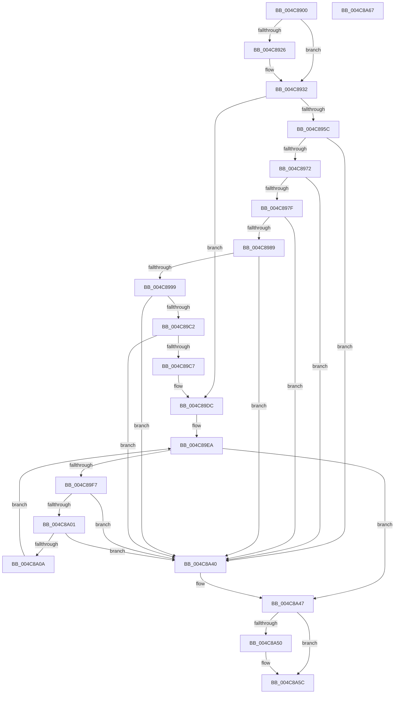

# IopInvalidateBusRelationsWorker

- RVA: `0x004C8900`–`0x004C8A68` (길이 `360` bytes)
- VA: `0x00000001404C8900`
- 실행 섹션: `.text`
- PDB 이름 있음: `예`; PDB Function 태그: `아니요`
- unwind 정보 RVA: `0x000A4C70`
- 디코드: `87`개 명령, `360/360` bytes 표시
- 미해석 바이트: `0` (있으면 어셈블리에 `.byte`로 보존)

> 이 문서는 커널 이미지의 기계어와 PDB 기호를 분석해 생성했습니다. 4번과 5번은 함수 원형과 자료형을 바이너리 사용 방식에서 추정한 C 해석이며 원본 소스 복구 결과는 아닙니다.

## 1. Dependencies

- 직접 호출 지점: **10**; 고유 호출 대상: **8**
- 직접 호출자로 확인된 함수: **1**
- RIP 상대 이미지 참조: **6**

### Outgoing calls
- `0x004C891D` → [Feature_Servicing_PnpBootWaitForAsyncBusRelations__private_IsEnabledDeviceUsageNoInline](Feature_Servicing_PnpBootWaitForAsyncBusRelations__private_IsEnabledDeviceUsageNoInline_function_004C8A70.md) (function, `0x004C8A70`)
- `0x004C892D` → [ExAcquireFastMutex](../20/ExAcquireFastMutex_function_0020E5A0.md) (function, `0x0020E5A0`)
- `0x004C8939` → [KeAcquireSpinLockRaiseToDpc](../20/KeAcquireSpinLockRaiseToDpc_function_00208470.md) (function, `0x00208470`)
- `0x004C8940` → [Feature_Servicing_PnpBootWaitForAsyncBusRelations__private_IsEnabledDeviceUsageNoInline](Feature_Servicing_PnpBootWaitForAsyncBusRelations__private_IsEnabledDeviceUsageNoInline_function_004C8A70.md) (function, `0x004C8A70`)
- `0x004C89E5` → [KeReleaseSpinLock](../39/KeReleaseSpinLock_function_00392BA0.md) (function, `0x00392BA0`)
- `0x004C8A19` → [IopProcessInvalidateBusRelationsRequest](../../page/95/IopProcessInvalidateBusRelationsRequest_function_009539A8.md) (function, `0x009539A8`)
- `0x004C8A27` → [ObfDereferenceObjectWithTag](../2F/ObfDereferenceObjectWithTag_function_002F78E0.md) (function, `0x002F78E0`)
- `0x004C8A39` → [ExFreePoolWithTag](../../poolcode/B8/ExFreePoolWithTag_function_00B82870.md) (function, `0x00B82870`)
- `0x004C8A47` → [Feature_Servicing_PnpBootWaitForAsyncBusRelations__private_IsEnabledDeviceUsageNoInline](Feature_Servicing_PnpBootWaitForAsyncBusRelations__private_IsEnabledDeviceUsageNoInline_function_004C8A70.md) (function, `0x004C8A70`)
- `0x004C8A57` → [ExReleaseFastMutex](../25/ExReleaseFastMutex_function_002519C0.md) (function, `0x002519C0`)

### Direct callers
- [PnpWaitForDevicesToStart](../../init/C3/PnpWaitForDevicesToStart_function_00C32930.md) at `0x00C32943`

### Static image references
- `0x004C8926` → RVA `0x00F8CE20` (`.data`; read)
- `0x004C8932` → RVA `0x00F8CE10` (`.data`; read)
- `0x004C8945` → RVA `0x00F8CE00` (`.data`; read)
- `0x004C8989` → RVA `0x00F8CE08` (`.data`; read)
- `0x004C89B5` → RVA `0x00F8CE08` (`.data`; write)
- `0x004C89D5` → RVA `0x00F8CE00` (`.data`; write)

## 2. Other-region calls and transfers

- 다른 실행 섹션으로 향하는 call: **2**
  - `0x004C8A19` → [IopProcessInvalidateBusRelationsRequest](../../page/95/IopProcessInvalidateBusRelationsRequest_function_009539A8.md) (`.text` → `PAGE`)
  - `0x004C8A39` → [ExFreePoolWithTag](../../poolcode/B8/ExFreePoolWithTag_function_00B82870.md) (`.text` → `POOLCODE`)
- 별도 외부 분기/꼬리 이동을 확인하지 못했습니다.

## 3. Assembly (complete function range)

```asm
004C8900  48 89 5C 24 08                  mov qword ptr [rsp + 8], rbx
004C8905  55                              push rbp
004C8906  48 8B EC                        mov rbp, rsp
004C8909  48 83 EC 30                     sub rsp, 0x30
004C890D  48 8D 45 F0                     lea rax, [rbp - 0x10]
004C8911  48 89 45 F8                     mov qword ptr [rbp - 8], rax
004C8915  48 8D 45 F0                     lea rax, [rbp - 0x10]
004C8919  48 89 45 F0                     mov qword ptr [rbp - 0x10], rax
004C891D  E8 4E 01 00 00                  call 0x1404c8a70
004C8922  85 C0                           test eax, eax
004C8924  74 0C                           je 0x1404c8932
004C8926  48 8D 0D F3 44 AC 00            lea rcx, [rip + 0xac44f3]
004C892D  E8 6E 5C D4 FF                  call 0x14020e5a0
004C8932  48 8D 0D D7 44 AC 00            lea rcx, [rip + 0xac44d7]
004C8939  E8 32 FB D3 FF                  call 0x140208470
004C893E  8A D8                           mov bl, al
004C8940  E8 2B 01 00 00                  call 0x1404c8a70
004C8945  4C 8B 05 B4 44 AC 00            mov r8, qword ptr [rip + 0xac44b4]
004C894C  4C 8D 0D AD 44 AC 00            lea r9, [rip + 0xac44ad]
004C8953  4D 3B C1                        cmp r8, r9
004C8956  0F 84 80 00 00 00               je 0x1404c89dc
004C895C  48 8B 4D F0                     mov rcx, qword ptr [rbp - 0x10]
004C8960  48 8D 45 F0                     lea rax, [rbp - 0x10]
004C8964  48 8B 55 F8                     mov rdx, qword ptr [rbp - 8]
004C8968  48 39 41 08                     cmp qword ptr [rcx + 8], rax
004C896C  0F 85 CE 00 00 00               jne 0x1404c8a40
004C8972  48 8D 45 F0                     lea rax, [rbp - 0x10]
004C8976  48 39 02                        cmp qword ptr [rdx], rax
004C8979  0F 85 C1 00 00 00               jne 0x1404c8a40
004C897F  4D 39 48 08                     cmp qword ptr [r8 + 8], r9
004C8983  0F 85 B7 00 00 00               jne 0x1404c8a40
004C8989  48 8B 05 78 44 AC 00            mov rax, qword ptr [rip + 0xac4478]
004C8990  4C 39 08                        cmp qword ptr [rax], r9
004C8993  0F 85 A7 00 00 00               jne 0x1404c8a40
004C8999  4C 89 0A                        mov qword ptr [rdx], r9
004C899C  48 8D 4D F0                     lea rcx, [rbp - 0x10]
004C89A0  48 8B 05 61 44 AC 00            mov rax, qword ptr [rip + 0xac4461]
004C89A7  48 89 45 F8                     mov qword ptr [rbp - 8], rax
004C89AB  48 89 08                        mov qword ptr [rax], rcx
004C89AE  48 8B 05 4B 44 AC 00            mov rax, qword ptr [rip + 0xac444b]
004C89B5  48 89 15 4C 44 AC 00            mov qword ptr [rip + 0xac444c], rdx
004C89BC  4C 39 48 08                     cmp qword ptr [rax + 8], r9
004C89C0  75 7E                           jne 0x1404c8a40
004C89C2  4C 39 0A                        cmp qword ptr [rdx], r9
004C89C5  75 79                           jne 0x1404c8a40
004C89C7  48 89 02                        mov qword ptr [rdx], rax
004C89CA  48 89 50 08                     mov qword ptr [rax + 8], rdx
004C89CE  4C 89 0D 33 44 AC 00            mov qword ptr [rip + 0xac4433], r9
004C89D5  4C 89 0D 24 44 AC 00            mov qword ptr [rip + 0xac4424], r9
004C89DC  8A D3                           mov dl, bl
004C89DE  48 8D 0D 2B 44 AC 00            lea rcx, [rip + 0xac442b]
004C89E5  E8 B6 A1 EC FF                  call 0x140392ba0
004C89EA  48 8B 5D F0                     mov rbx, qword ptr [rbp - 0x10]
004C89EE  48 8D 45 F0                     lea rax, [rbp - 0x10]
004C89F2  48 3B D8                        cmp rbx, rax
004C89F5  74 50                           je 0x1404c8a47
004C89F7  48 8D 45 F0                     lea rax, [rbp - 0x10]
004C89FB  48 39 43 08                     cmp qword ptr [rbx + 8], rax
004C89FF  75 3F                           jne 0x1404c8a40
004C8A01  48 8B 03                        mov rax, qword ptr [rbx]
004C8A04  48 39 58 08                     cmp qword ptr [rax + 8], rbx
004C8A08  75 36                           jne 0x1404c8a40
004C8A0A  48 8D 4D F0                     lea rcx, [rbp - 0x10]
004C8A0E  48 89 45 F0                     mov qword ptr [rbp - 0x10], rax
004C8A12  48 89 48 08                     mov qword ptr [rax + 8], rcx
004C8A16  48 8B CB                        mov rcx, rbx
004C8A19  E8 8A AF 48 00                  call 0x1409539a8
004C8A1E  48 8B 4B 10                     mov rcx, qword ptr [rbx + 0x10]
004C8A22  BA 50 6E 70 65                  mov edx, 0x65706e50
004C8A27  E8 B4 EE E2 FF                  call 0x1402f78e0
004C8A2C  48 83 63 10 00                  and qword ptr [rbx + 0x10], 0
004C8A31  BA 50 70 69 6F                  mov edx, 0x6f697050
004C8A36  48 8B CB                        mov rcx, rbx
004C8A39  E8 32 9E 6B 00                  call 0x140b82870
004C8A3E  EB AA                           jmp 0x1404c89ea
004C8A40  B9 03 00 00 00                  mov ecx, 3
004C8A45  CD 29                           int 0x29
004C8A47  E8 24 00 00 00                  call 0x1404c8a70
004C8A4C  85 C0                           test eax, eax
004C8A4E  74 0C                           je 0x1404c8a5c
004C8A50  48 8D 0D C9 43 AC 00            lea rcx, [rip + 0xac43c9]
004C8A57  E8 64 8F D8 FF                  call 0x1402519c0
004C8A5C  48 8B 5C 24 40                  mov rbx, qword ptr [rsp + 0x40]
004C8A61  48 83 C4 30                     add rsp, 0x30
004C8A65  5D                              pop rbp
004C8A66  C3                              ret
004C8A67  CC                              int3
```

## 4. C-style interpretation (structured pseudocode)

```c
__int64 __fastcall IopInvalidateBusRelationsWorker(void)
{
    __int64 result;
    __int64 v_rsp;
    unsigned __int64 v_stack_m10;
    unsigned __int64 v_stack_m18;
    unsigned __int64 v_stack_p8;

    v_stack_p8 = v_rbx;
    v_rsp = (v_rsp) - (48);
    v_stack_m10 = v_stack_m18;
    v_stack_m18 = v_stack_m18;
    result = Feature_Servicing_PnpBootWaitForAsyncBusRelations__private_IsEnabledDeviceUsageNoInline(a1, a2, a3, a4);
    if ((unsigned int)(result) != 0) {
        a1 = v_rip + 11289843;
        result = ExAcquireFastMutex(a1, a2, a3, a4);
    }
    result = KeAcquireSpinLockRaiseToDpc(v_rip + 11289815, a2, a3, a4);
    result = Feature_Servicing_PnpBootWaitForAsyncBusRelations__private_IsEnabledDeviceUsageNoInline(v_rip + 11289815, a2, a3, a4);
    if ((*(unsigned __int64 *)(v_rip + 11289780)) == (v_rip + 11289773)) goto loc_004C89DC;
    if ((*(unsigned __int64 *)(v_stack_m18 + 8)) != v_stack_m18) goto loc_004C8A40;
    if ((*(unsigned __int64 *)(v_stack_m10)) != v_stack_m18) goto loc_004C8A40;
    if ((*(unsigned __int64 *)(*(unsigned __int64 *)(v_rip + 11289780) + 8)) != (v_rip + 11289773)) goto loc_004C8A40;
    if ((*(unsigned __int64 *)(*(unsigned __int64 *)(v_rip + 11289720))) != (v_rip + 11289773)) goto loc_004C8A40;
    *(unsigned __int64 *)(v_stack_m10) = v_rip + 11289773;
    v_stack_m10 = *(unsigned __int64 *)(v_rip + 11289697);
    *(unsigned __int64 *)(*(unsigned __int64 *)(v_rip + 11289697)) = v_stack_m18;
    *(unsigned __int64 *)(v_rip + 11289676) = v_stack_m10;
    if ((*(unsigned __int64 *)(*(unsigned __int64 *)(v_rip + 11289675) + 8)) != (v_rip + 11289773)) goto loc_004C8A40;
    if ((*(unsigned __int64 *)(v_stack_m10)) != (v_rip + 11289773)) goto loc_004C8A40;
    *(unsigned __int64 *)(v_stack_m10) = *(unsigned __int64 *)(v_rip + 11289675);
    *(unsigned __int64 *)(*(unsigned __int64 *)(v_rip + 11289675) + 8) = v_stack_m10;
    *(unsigned __int64 *)(v_rip + 11289651) = v_rip + 11289773;
    *(unsigned __int64 *)(v_rip + 11289636) = v_rip + 11289773;
loc_004C89DC:
    result = KeReleaseSpinLock(v_rip + 11289643, (unsigned __int8)((unsigned __int8)(result)), *(unsigned __int64 *)(v_rip + 11289780), v_rip + 11289773);
loc_004C89EA:
    if (v_stack_m18 == v_stack_m18) goto loc_004C8A47;
    if ((*(unsigned __int64 *)(v_stack_m18 + 8)) != v_stack_m18) goto loc_004C8A40;
    if ((*(unsigned __int64 *)(*(unsigned __int64 *)(v_stack_m18) + 8)) != v_stack_m18) goto loc_004C8A40;
    v_stack_m18 = *(unsigned __int64 *)(v_stack_m18);
    *(unsigned __int64 *)(*(unsigned __int64 *)(v_stack_m18) + 8) = v_stack_m18;
    result = IopProcessInvalidateBusRelationsRequest(v_stack_m18, (unsigned __int8)((unsigned __int8)(result)), *(unsigned __int64 *)(v_rip + 11289780), v_rip + 11289773);
    result = ObfDereferenceObjectWithTag(*(unsigned __int64 *)(v_stack_m18 + 16), (unsigned int)(0x65706E50ULL), *(unsigned __int64 *)(v_rip + 11289780), v_rip + 11289773);
    result = ExFreePoolWithTag(v_stack_m18, (unsigned int)(0x6F697050ULL), *(unsigned __int64 *)(v_rip + 11289780), v_rip + 11289773);
    goto loc_004C89EA;
loc_004C8A40:
loc_004C8A47:
    result = Feature_Servicing_PnpBootWaitForAsyncBusRelations__private_IsEnabledDeviceUsageNoInline(3, (unsigned int)(0x6F697050ULL), *(unsigned __int64 *)(v_rip + 11289780), v_rip + 11289773);
    if ((unsigned int)(result) != 0) {
        a1 = v_rip + 11289545;
        result = ExReleaseFastMutex(a1, (unsigned int)(0x6F697050ULL), *(unsigned __int64 *)(v_rip + 11289780), v_rip + 11289773);
    }
    v_rsp = (v_rsp) + (48);
    return result;
}
```

## 5. (Beta) C Style

```c
void IopInvalidateBusRelationsWorker(void)
{
    int64_t result;
    int64_t local_rsp;
    uint64_t v_stack_m10;
    uint64_t v_stack_m18;
    uint64_t v_stack_p8;

    v_stack_p8 = local_rbx;
    local_rsp = (local_rsp) - (48);
    v_stack_m10 = v_stack_m18;
    v_stack_m18 = v_stack_m18;
    result = Feature_Servicing_PnpBootWaitForAsyncBusRelations__private_IsEnabledDeviceUsageNoInline(a1, a2, a3, a4);
    if ((uint32_t)(result) != 0) {
        a1 = v_rip + 11289843;
        result = ExAcquireFastMutex(a1, a2, a3, a4);
    }
    result = KeAcquireSpinLockRaiseToDpc(v_rip + 11289815, a2, a3, a4);
    result = Feature_Servicing_PnpBootWaitForAsyncBusRelations__private_IsEnabledDeviceUsageNoInline(v_rip + 11289815, a2, a3, a4);
    if ((*(uint64_t *)(v_rip + 0xAC44B4)) == (v_rip + 11289773)) goto loc_004C89DC;
    if ((*(uint64_t *)(v_stack_m18 + 0x8)) != v_stack_m18) goto loc_004C8A40;
    if ((*(uint64_t *)(v_stack_m10)) != v_stack_m18) goto loc_004C8A40;
    if ((*(uint64_t *)(*(uint64_t *)(v_rip + 0xAC44B4) + 0x8)) != (v_rip + 11289773)) goto loc_004C8A40;
    if ((*(uint64_t *)(*(uint64_t *)(v_rip + 0xAC4478))) != (v_rip + 11289773)) goto loc_004C8A40;
    *(uint64_t *)(v_stack_m10) = v_rip + 11289773;
    v_stack_m10 = *(uint64_t *)(v_rip + 0xAC4461);
    *(uint64_t *)(*(uint64_t *)(v_rip + 0xAC4461)) = v_stack_m18;
    *(uint64_t *)(v_rip + 0xAC444C) = v_stack_m10;
    if ((*(uint64_t *)(*(uint64_t *)(v_rip + 0xAC444B) + 0x8)) != (v_rip + 11289773)) goto loc_004C8A40;
    if ((*(uint64_t *)(v_stack_m10)) != (v_rip + 11289773)) goto loc_004C8A40;
    *(uint64_t *)(v_stack_m10) = *(uint64_t *)(v_rip + 0xAC444B);
    *(uint64_t *)(*(uint64_t *)(v_rip + 0xAC444B) + 0x8) = v_stack_m10;
    *(uint64_t *)(v_rip + 0xAC4433) = v_rip + 11289773;
    *(uint64_t *)(v_rip + 0xAC4424) = v_rip + 11289773;
loc_004C89DC:
    result = KeReleaseSpinLock(v_rip + 11289643, (uint8_t)((uint8_t)(result)), *(uint64_t *)(v_rip + 0xAC44B4), v_rip + 11289773);
loc_004C89EA:
    if (v_stack_m18 == v_stack_m18) goto loc_004C8A47;
    if ((*(uint64_t *)(v_stack_m18 + 0x8)) != v_stack_m18) goto loc_004C8A40;
    if ((*(uint64_t *)(*(uint64_t *)(v_stack_m18) + 0x8)) != v_stack_m18) goto loc_004C8A40;
    v_stack_m18 = *(uint64_t *)(v_stack_m18);
    *(uint64_t *)(*(uint64_t *)(v_stack_m18) + 0x8) = v_stack_m18;
    result = IopProcessInvalidateBusRelationsRequest(v_stack_m18, (uint8_t)((uint8_t)(result)), *(uint64_t *)(v_rip + 0xAC44B4), v_rip + 11289773);
    result = ObfDereferenceObjectWithTag(*(uint64_t *)(v_stack_m18 + 0x10), (uint32_t)(0x65706E50ULL), *(uint64_t *)(v_rip + 0xAC44B4), v_rip + 11289773);
    result = ExFreePoolWithTag(v_stack_m18, (uint32_t)(0x6F697050ULL), *(uint64_t *)(v_rip + 0xAC44B4), v_rip + 11289773);
    goto loc_004C89EA;
loc_004C8A40:
loc_004C8A47:
    result = Feature_Servicing_PnpBootWaitForAsyncBusRelations__private_IsEnabledDeviceUsageNoInline(3, (uint32_t)(0x6F697050ULL), *(uint64_t *)(v_rip + 0xAC44B4), v_rip + 11289773);
    if ((uint32_t)(result) != 0) {
        a1 = v_rip + 11289545;
        result = ExReleaseFastMutex(a1, (uint32_t)(0x6F697050ULL), *(uint64_t *)(v_rip + 0xAC44B4), v_rip + 11289773);
    }
    local_rsp = (local_rsp) + (48);
    return result;
}
```

## 6. Execution-region graph

[열기: 2D/3D 그래프와 함수 탐색 컨트롤 패널](../../../control-panel.html?section=text&rva=0x004C8900&view=graph)

- 2D 그래프는 위에서 아래로 흐르고, 3D 그래프는 빈 공간을 드래그해 회전합니다. Shift+드래그는 이동, 휠은 확대·축소, 함수 노드 선택은 대상 보고서 이동입니다.

### Static fallback


