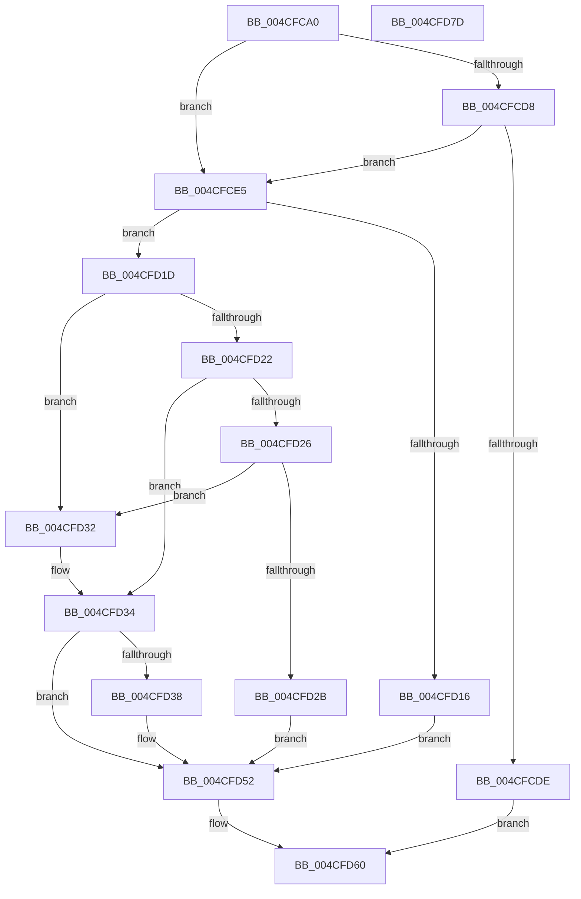

# IopIoRingSetupCompletionWait

- RVA: `0x004CFCA0`–`0x004CFD7E` (길이 `222` bytes)
- VA: `0x00000001404CFCA0`
- 실행 섹션: `.text`
- PDB 이름 있음: `예`; PDB Function 태그: `아니요`
- unwind 정보 RVA: `0x00075C18`
- 디코드: `71`개 명령, `222/222` bytes 표시
- 미해석 바이트: `0` (있으면 어셈블리에 `.byte`로 보존)

> 이 문서는 커널 이미지의 기계어와 PDB 기호를 분석해 생성했습니다. 4번과 5번은 함수 원형과 자료형을 바이너리 사용 방식에서 추정한 C 해석이며 원본 소스 복구 결과는 아닙니다.

## 1. Dependencies

- 직접 호출 지점: **2**; 고유 호출 대상: **2**
- 직접 호출자로 확인된 함수: **2**
- RIP 상대 이미지 참조: **0**

### Outgoing calls
- `0x004CFCE9` → [KeAcquireSpinLockRaiseToDpc](../20/KeAcquireSpinLockRaiseToDpc_function_00208470.md) (function, `0x00208470`)
- `0x004CFD59` → [KeReleaseSpinLock](../39/KeReleaseSpinLock_function_00392BA0.md) (function, `0x00392BA0`)

### Direct callers
- [NtSubmitIoRing](NtSubmitIoRing_function_004CF9E0.md) at `0x004CFB31`
- [NtSubmitIoRing](NtSubmitIoRing_function_004CF9E0.md) at `0x004CFBE4`
- [IopProcessIoRingEntry](../../page/70/IopProcessIoRingEntry_function_00700A38.md) at `0x00700A6E`

### Static image references
- 디코드된 RIP-relative 메모리 참조가 없습니다.

## 2. Other-region calls and transfers

- 다른 실행 섹션으로 향하는 call: **0**
- 별도 외부 분기/꼬리 이동을 확인하지 못했습니다.

## 3. Assembly (complete function range)

```asm
004CFCA0  48 89 5C 24 08                  mov qword ptr [rsp + 8], rbx
004CFCA5  48 89 6C 24 10                  mov qword ptr [rsp + 0x10], rbp
004CFCAA  48 89 74 24 18                  mov qword ptr [rsp + 0x18], rsi
004CFCAF  57                              push rdi
004CFCB0  41 54                           push r12
004CFCB2  41 55                           push r13
004CFCB4  41 56                           push r14
004CFCB6  41 57                           push r15
004CFCB8  48 83 EC 20                     sub rsp, 0x20
004CFCBC  4C 8B 7C 24 70                  mov r15, qword ptr [rsp + 0x70]
004CFCC1  33 F6                           xor esi, esi
004CFCC3  44 8B EA                        mov r13d, edx
004CFCC6  45 8A E1                        mov r12b, r9b
004CFCC9  41 8B F8                        mov edi, r8d
004CFCCC  4C 8B F1                        mov r14, rcx
004CFCCF  41 88 37                        mov byte ptr [r15], sil
004CFCD2  41 83 F8 FF                     cmp r8d, -1
004CFCD6  74 0D                           je 0x1404cfce5
004CFCD8  44 3B 41 1C                     cmp r8d, dword ptr [rcx + 0x1c]
004CFCDC  76 07                           jbe 0x1404cfce5
004CFCDE  B8 F1 00 00 C0                  mov eax, 0xc00000f1
004CFCE3  EB 7B                           jmp 0x1404cfd60
004CFCE5  48 83 C1 68                     add rcx, 0x68
004CFCE9  E8 82 87 D3 FF                  call 0x140208470
004CFCEE  4D 8B 4E 78                     mov r9, qword ptr [r14 + 0x78]
004CFCF2  44 8A C0                        mov r8b, al
004CFCF5  49 8B 46 50                     mov rax, qword ptr [r14 + 0x50]
004CFCF9  49 8B 4E 70                     mov rcx, qword ptr [r14 + 0x70]
004CFCFD  49 2B C9                        sub rcx, r9
004CFD00  8B 50 04                        mov edx, dword ptr [rax + 4]
004CFD03  2B 10                           sub edx, dword ptr [rax]
004CFD05  8B C2                           mov eax, edx
004CFD07  48 03 C8                        add rcx, rax
004CFD0A  41 8B 46 1C                     mov eax, dword ptr [r14 + 0x1c]
004CFD0E  49 03 CD                        add rcx, r13
004CFD11  48 3B C8                        cmp rcx, rax
004CFD14  76 07                           jbe 0x1404cfd1d
004CFD16  BE 08 00 46 C0                  mov esi, 0xc0460008
004CFD1B  EB 35                           jmp 0x1404cfd52
004CFD1D  83 FF FF                        cmp edi, -1
004CFD20  74 10                           je 0x1404cfd32
004CFD22  3B F9                           cmp edi, ecx
004CFD24  76 0E                           jbe 0x1404cfd34
004CFD26  45 84 E4                        test r12b, r12b
004CFD29  75 07                           jne 0x1404cfd32
004CFD2B  BE F1 00 00 C0                  mov esi, 0xc00000f1
004CFD30  EB 20                           jmp 0x1404cfd52
004CFD32  8B F9                           mov edi, ecx
004CFD34  3B FA                           cmp edi, edx
004CFD36  76 1A                           jbe 0x1404cfd52
004CFD38  2B FA                           sub edi, edx
004CFD3A  41 C6 86 A0 00 00 00 01         mov byte ptr [r14 + 0xa0], 1
004CFD42  8B D7                           mov edx, edi
004CFD44  49 03 D1                        add rdx, r9
004CFD47  49 89 96 80 00 00 00            mov qword ptr [r14 + 0x80], rdx
004CFD4E  41 C6 07 01                     mov byte ptr [r15], 1
004CFD52  41 8A D0                        mov dl, r8b
004CFD55  49 8D 4E 68                     lea rcx, [r14 + 0x68]
004CFD59  E8 42 2E EC FF                  call 0x140392ba0
004CFD5E  8B C6                           mov eax, esi
004CFD60  48 8B 5C 24 50                  mov rbx, qword ptr [rsp + 0x50]
004CFD65  48 8B 6C 24 58                  mov rbp, qword ptr [rsp + 0x58]
004CFD6A  48 8B 74 24 60                  mov rsi, qword ptr [rsp + 0x60]
004CFD6F  48 83 C4 20                     add rsp, 0x20
004CFD73  41 5F                           pop r15
004CFD75  41 5E                           pop r14
004CFD77  41 5D                           pop r13
004CFD79  41 5C                           pop r12
004CFD7B  5F                              pop rdi
004CFD7C  C3                              ret
004CFD7D  CC                              int3
```

## 4. C-style interpretation (structured pseudocode)

```c
__int64 __fastcall IopIoRingSetupCompletionWait(__int64 a1, int a2, int a3, unsigned __int8 a4, __int64 a5)
{
    __int64 result;
    __int64 v_rdi;
    __int64 v_rsi;
    __int64 v_rsp;
    unsigned __int64 v_stack_p10;
    unsigned __int64 v_stack_p18;
    unsigned __int64 v_stack_p8;

    v_stack_p8 = v_rbx;
    v_stack_p10 = v_rbp;
    v_stack_p18 = v_rsi;
    v_rsp = (v_rsp) - (32);
    v_rsi = 0;
    *(unsigned __int8 *)(a5) = 0;
    if (a3 == -1) goto loc_004CFCE5;
    if (a3 <= (*(unsigned int *)(a1 + 28))) goto loc_004CFCE5;
    goto loc_004CFD60;
loc_004CFCE5:
    a1 = (a1) + (104);
    result = KeAcquireSpinLockRaiseToDpc(a1, a2, a3, a4);
    a1 = (*(unsigned __int64 *)(a1 + 112)) - (*(unsigned __int64 *)(a1 + 120));
    a2 = (unsigned int)(((unsigned int)(*(unsigned int *)(*(unsigned __int64 *)(a1 + 80) + 4))) - (*(unsigned int *)(*(unsigned __int64 *)(a1 + 80))));
    a1 = (a1) + ((unsigned int)(a2));
    a1 = (a1) + ((unsigned int)(a2));
    if (a1 <= ((unsigned int)(*(unsigned int *)(a1 + 28)))) goto loc_004CFD1D;
    goto loc_004CFD52;
loc_004CFD1D:
    if (((unsigned int)((unsigned int)(a3))) == -1) goto loc_004CFD32;
    if (((unsigned int)((unsigned int)(a3))) <= ((unsigned int)(a1))) goto loc_004CFD34;
    if (a4 != 0) goto loc_004CFD32;
    goto loc_004CFD52;
loc_004CFD32:
loc_004CFD34:
    v_rdi = (unsigned int)((unsigned int)(a1));
    if (((unsigned int)((unsigned int)((unsigned int)(a1)))) >= = a2) {
        v_rdi = (unsigned int)(((unsigned int)((unsigned int)(a1))) - (a2));
        *(unsigned __int8 *)(a1 + 160) = 1;
        a2 = (unsigned int)(v_rdi);
        a2 = (a2) + (*(unsigned __int64 *)(a1 + 120));
        *(unsigned __int64 *)(a1 + 128) = a2;
        *(unsigned __int8 *)(a5) = 1;
    }
    result = KeReleaseSpinLock(a1 + 104, (unsigned __int8)((unsigned __int8)(result)), (unsigned __int8)(result), *(unsigned __int64 *)(a1 + 120));
loc_004CFD60:
    v_rsp = (v_rsp) + (32);
    return (unsigned int)((unsigned int)((unsigned int)(0xC00000F1ULL)));
}
```

## 5. (Beta) C Style

```c
int64_t IopIoRingSetupCompletionWait(void *Arg1, int32_t Arg2, int32_t Arg3, uint8_t Arg4, void *Arg5)
{
    uint8_t *arg1 = (uint8_t *)Arg1;
    uint8_t *arg5 = (uint8_t *)Arg5;

    int64_t result;
    int64_t local_rdi;
    int64_t local_rsi;
    int64_t local_rsp;
    uint64_t v_stack_p10;
    uint64_t v_stack_p18;
    uint64_t v_stack_p8;

    v_stack_p8 = local_rbx;
    v_stack_p10 = local_rbp;
    v_stack_p18 = local_rsi;
    local_rsp = (local_rsp) - (32);
    local_rsi = 0;
    *(uint8_t *)(arg5) = 0;
    if (Arg3 == -1) goto loc_004CFCE5;
    if (Arg3 <= (*(uint32_t *)(arg1 + 0x1C))) goto loc_004CFCE5;
    goto loc_004CFD60;
loc_004CFCE5:
    Arg1 = (Arg1) + (104);
    result = KeAcquireSpinLockRaiseToDpc(Arg1, Arg2, Arg3, Arg4);
    Arg1 = (*(uint64_t *)(arg1 + 0x70)) - (*(uint64_t *)(arg1 + 0x78));
    Arg2 = (uint32_t)(((uint32_t)(*(uint32_t *)(*(uint64_t *)(arg1 + 0x50) + 0x4))) - (*(uint32_t *)(*(uint64_t *)(arg1 + 0x50))));
    Arg1 = (Arg1) + ((uint32_t)(Arg2));
    Arg1 = (Arg1) + ((uint32_t)(Arg2));
    if (Arg1 <= ((uint32_t)(*(uint32_t *)(arg1 + 0x1C)))) goto loc_004CFD1D;
    goto loc_004CFD52;
loc_004CFD1D:
    if (((uint32_t)((uint32_t)(Arg3))) == -1) goto loc_004CFD32;
    if (((uint32_t)((uint32_t)(Arg3))) <= ((uint32_t)(Arg1))) goto loc_004CFD34;
    if (Arg4 != 0) goto loc_004CFD32;
    goto loc_004CFD52;
loc_004CFD32:
loc_004CFD34:
    local_rdi = (uint32_t)((uint32_t)(Arg1));
    if (((uint32_t)((uint32_t)((uint32_t)(Arg1)))) >= = Arg2) {
        local_rdi = (uint32_t)(((uint32_t)((uint32_t)(Arg1))) - (Arg2));
        *(uint8_t *)(arg1 + 0xA0) = 1;
        Arg2 = (uint32_t)(local_rdi);
        Arg2 = (Arg2) + (*(uint64_t *)(arg1 + 0x78));
        *(uint64_t *)(arg1 + 0x80) = Arg2;
        *(uint8_t *)(arg5) = 1;
    }
    result = KeReleaseSpinLock(Arg1 + 104, (uint8_t)((uint8_t)(result)), (uint8_t)(result), *(uint64_t *)(arg1 + 0x78));
loc_004CFD60:
    local_rsp = (local_rsp) + (32);
    return (uint32_t)((uint32_t)((uint32_t)(0xC00000F1ULL)));
}
```

### 관측된 메모리 오프셋

구조체 형식이 확인되지 않은 접근은 인자 기준의 오프셋으로만 기록했습니다.

| 기준 인자 | 오프셋 표현 | 폭 (bit) | 접근 |
|---|---:|---:|---|
| `Arg1` | `+ 0x1C` | `32` | `R` |
| `Arg1` | `+ 0x50` | `64` | `R` |
| `Arg1` | `+ 0x68` | `64` | `R` |
| `Arg1` | `+ 0x70` | `64` | `R` |
| `Arg1` | `+ 0x78` | `64` | `R` |
| `Arg1` | `+ 0x80` | `64` | `W` |
| `Arg1` | `+ 0xA0` | `8` | `W` |
| `Arg5` | `+ 0x0` | `8` | `W` |

## 6. Execution-region graph

[열기: 2D/3D 그래프와 함수 탐색 컨트롤 패널](../../../control-panel.html?section=text&rva=0x004CFCA0&view=graph)

- 2D 그래프는 위에서 아래로 흐르고, 3D 그래프는 빈 공간을 드래그해 회전합니다. Shift+드래그는 이동, 휠은 확대·축소, 함수 노드 선택은 대상 보고서 이동입니다.

### Static fallback


