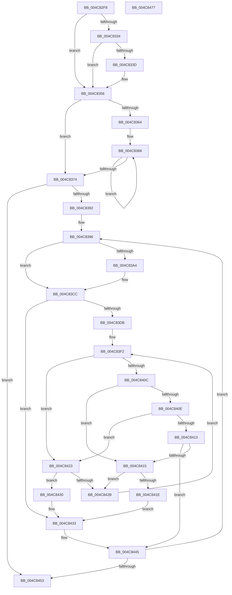

# IopMcAddMdlPagesToTable

- RVA: `0x004C82F8`–`0x004C8478` (길이 `384` bytes)
- VA: `0x00000001404C82F8`
- 실행 섹션: `.text`
- PDB 이름 있음: `예`; PDB Function 태그: `아니요`
- unwind 정보 RVA: `0x000A7960`
- 디코드: `109`개 명령, `384/384` bytes 표시
- 미해석 바이트: `0` (있으면 어셈블리에 `.byte`로 보존)

> 이 문서는 커널 이미지의 기계어와 PDB 기호를 분석해 생성했습니다. 4번과 5번은 함수 원형과 자료형을 바이너리 사용 방식에서 추정한 C 해석이며 원본 소스 복구 결과는 아닙니다.

## 1. Dependencies

- 직접 호출 지점: **8**; 고유 호출 대상: **6**
- 직접 호출자로 확인된 함수: **1**
- RIP 상대 이미지 참조: **3**

### Outgoing calls
- `0x004C8350` → [KeBugCheckEx](../4F/KeBugCheckEx_function_004FD660.md) (function, `0x004FD660`)
- `0x004C8380` → [ExAcquireSpinLockExclusive](../24/ExAcquireSpinLockExclusive_function_00248690.md) (function, `0x00248690`)
- `0x004C839B` → [IopMcShouldYield](IopMcShouldYield_function_004C8480.md) (function, `0x004C8480`)
- `0x004C83AE` → [ExReleaseSpinLockExclusive](../2C/ExReleaseSpinLockExclusive_function_002C0EF0.md) (function, `0x002C0EF0`)
- `0x004C83B8` → [KeYieldProcessorEx](../3F/KeYieldProcessorEx_function_003FBD00.md) (function, `0x003FBD00`)
- `0x004C83C4` → [ExAcquireSpinLockExclusive](../24/ExAcquireSpinLockExclusive_function_00248690.md) (function, `0x00248690`)
- `0x004C8440` → [RtlAvlInsertNodeEx](../26/RtlAvlInsertNodeEx_function_00265790.md) (function, `0x00265790`)
- `0x004C845D` → [ExReleaseSpinLockExclusive](../2C/ExReleaseSpinLockExclusive_function_002C0EF0.md) (function, `0x002C0EF0`)

### Direct callers
- [IopMcCreateBufferEntryMdl](../../page/72/IopMcCreateBufferEntryMdl_function_00722FA8.md) at `0x00722FEB`

### Static image references
- `0x004C832B` → RVA `0x00E66218` (`.data`; read)
- `0x004C8379` → RVA `0x00F8D024` (`.data`; read)
- `0x004C83CC` → RVA `0x00F8D028` (`.data`; read)

## 2. Other-region calls and transfers

- 다른 실행 섹션으로 향하는 call: **0**
- 별도 외부 분기/꼬리 이동을 확인하지 못했습니다.

## 3. Assembly (complete function range)

```asm
004C82F8  4C 8B DC                        mov r11, rsp
004C82FB  49 89 5B 08                     mov qword ptr [r11 + 8], rbx
004C82FF  49 89 6B 18                     mov qword ptr [r11 + 0x18], rbp
004C8303  49 89 73 20                     mov qword ptr [r11 + 0x20], rsi
004C8307  57                              push rdi
004C8308  48 83 EC 30                     sub rsp, 0x30
004C830C  44 8B 42 2C                     mov r8d, dword ptr [rdx + 0x2c]
004C8310  48 8B D9                        mov rbx, rcx
004C8313  8B 7A 28                        mov edi, dword ptr [rdx + 0x28]
004C8316  41 81 E0 FF 0F 00 00            and r8d, 0xfff
004C831D  48 81 C7 FF 0F 00 00            add rdi, 0xfff
004C8324  49 03 F8                        add rdi, r8
004C8327  48 C1 EF 0C                     shr rdi, 0xc
004C832B  80 3D E6 DE 99 00 00            cmp byte ptr [rip + 0x99dee6], 0
004C8332  74 22                           je 0x1404c8356
004C8334  48 8B 41 58                     mov rax, qword ptr [rcx + 0x58]
004C8338  48 85 C0                        test rax, rax
004C833B  74 19                           je 0x1404c8356
004C833D  45 33 C9                        xor r9d, r9d
004C8340  49 89 43 E8                     mov qword ptr [r11 - 0x18], rax
004C8344  4C 8B C1                        mov r8, rcx
004C8347  B9 F4 01 00 00                  mov ecx, 0x1f4
004C834C  41 8D 51 07                     lea edx, [r9 + 7]
004C8350  E8 0B 53 03 00                  call 0x1404fd660
004C8355  CC                              int3
004C8356  48 8D 42 30                     lea rax, [rdx + 0x30]
004C835A  48 89 41 58                     mov qword ptr [rcx + 0x58], rax
004C835E  33 C0                           xor eax, eax
004C8360  85 FF                           test edi, edi
004C8362  74 10                           je 0x1404c8374
004C8364  48 83 C1 78                     add rcx, 0x78
004C8368  89 01                           mov dword ptr [rcx], eax
004C836A  FF C0                           inc eax
004C836C  48 8D 49 20                     lea rcx, [rcx + 0x20]
004C8370  3B C7                           cmp eax, edi
004C8372  72 F4                           jb 0x1404c8368
004C8374  83 64 24 48 00                  and dword ptr [rsp + 0x48], 0
004C8379  48 8D 0D A4 4C AC 00            lea rcx, [rip + 0xac4ca4]
004C8380  E8 0B 03 D8 FF                  call 0x140248690
004C8385  33 F6                           xor esi, esi
004C8387  40 8A E8                        mov bpl, al
004C838A  85 FF                           test edi, edi
004C838C  0F 84 C1 00 00 00               je 0x1404c8453
004C8392  48 83 C3 60                     add rbx, 0x60
004C8396  40 8A D5                        mov dl, bpl
004C8399  8B CE                           mov ecx, esi
004C839B  E8 E0 00 00 00                  call 0x1404c8480
004C83A0  84 C0                           test al, al
004C83A2  74 28                           je 0x1404c83cc
004C83A4  40 8A D5                        mov dl, bpl
004C83A7  48 8D 0D 76 4C AC 00            lea rcx, [rip + 0xac4c76]
004C83AE  E8 3D 8B DF FF                  call 0x1402c0ef0
004C83B3  48 8D 4C 24 48                  lea rcx, [rsp + 0x48]
004C83B8  E8 43 39 F3 FF                  call 0x1403fbd00
004C83BD  48 8D 0D 60 4C AC 00            lea rcx, [rip + 0xac4c60]
004C83C4  E8 C7 02 D8 FF                  call 0x140248690
004C83C9  40 8A E8                        mov bpl, al
004C83CC  4C 8B 15 55 4C AC 00            mov r10, qword ptr [rip + 0xac4c55]
004C83D3  45 32 C0                        xor r8b, r8b
004C83D6  4D 85 D2                        test r10, r10
004C83D9  74 58                           je 0x1404c8433
004C83DB  8B 53 18                        mov edx, dword ptr [rbx + 0x18]
004C83DE  4C 8B CB                        mov r9, rbx
004C83E1  8D 4A 03                        lea ecx, [rdx + 3]
004C83E4  C1 E1 05                        shl ecx, 5
004C83E7  4C 2B C9                        sub r9, rcx
004C83EA  49 8B 41 58                     mov rax, qword ptr [r9 + 0x58]
004C83EE  4C 8B 1C D0                     mov r11, qword ptr [rax + rdx*8]
004C83F2  41 8B 52 18                     mov edx, dword ptr [r10 + 0x18]
004C83F6  4D 8B C2                        mov r8, r10
004C83F9  8D 4A 03                        lea ecx, [rdx + 3]
004C83FC  C1 E1 05                        shl ecx, 5
004C83FF  4C 2B C1                        sub r8, rcx
004C8402  49 8B 40 58                     mov rax, qword ptr [r8 + 0x58]
004C8406  4C 3B 1C D0                     cmp r11, qword ptr [rax + rdx*8]
004C840A  72 17                           jb 0x1404c8423
004C840C  77 07                           ja 0x1404c8415
004C840E  4D 3B C8                        cmp r9, r8
004C8411  72 10                           jb 0x1404c8423
004C8413  76 30                           jbe 0x1404c8445
004C8415  49 8B 42 08                     mov rax, qword ptr [r10 + 8]
004C8419  48 85 C0                        test rax, rax
004C841C  75 0D                           jne 0x1404c842b
004C841E  41 B0 01                        mov r8b, 1
004C8421  EB 10                           jmp 0x1404c8433
004C8423  49 8B 02                        mov rax, qword ptr [r10]
004C8426  48 85 C0                        test rax, rax
004C8429  74 05                           je 0x1404c8430
004C842B  4C 8B D0                        mov r10, rax
004C842E  EB C2                           jmp 0x1404c83f2
004C8430  45 32 C0                        xor r8b, r8b
004C8433  4C 8B CB                        mov r9, rbx
004C8436  48 8D 0D EB 4B AC 00            lea rcx, [rip + 0xac4beb]
004C843D  49 8B D2                        mov rdx, r10
004C8440  E8 4B D3 D9 FF                  call 0x140265790
004C8445  FF C6                           inc esi
004C8447  48 83 C3 20                     add rbx, 0x20
004C844B  3B F7                           cmp esi, edi
004C844D  0F 82 43 FF FF FF               jb 0x1404c8396
004C8453  40 8A D5                        mov dl, bpl
004C8456  48 8D 0D C7 4B AC 00            lea rcx, [rip + 0xac4bc7]
004C845D  E8 8E 8A DF FF                  call 0x1402c0ef0
004C8462  48 8B 5C 24 40                  mov rbx, qword ptr [rsp + 0x40]
004C8467  48 8B 6C 24 50                  mov rbp, qword ptr [rsp + 0x50]
004C846C  48 8B 74 24 58                  mov rsi, qword ptr [rsp + 0x58]
004C8471  48 83 C4 30                     add rsp, 0x30
004C8475  5F                              pop rdi
004C8476  C3                              ret
004C8477  CC                              int3
```

## 4. C-style interpretation (structured pseudocode)

```c
__int64 __fastcall IopMcAddMdlPagesToTable(__int64 a1, __int64 a2, __int64 a3, int a4)
{
    __int64 result;
    __int64 v_rbp;
    __int64 v_rbx;
    __int64 v_rdi;
    __int64 v_rsi;
    __int64 v_rsp;
    unsigned int v_stack_p10;
    unsigned __int64 v_stack_p18;
    unsigned __int64 v_stack_p20;
    unsigned __int64 v_stack_p8;

    *(unsigned __int64 *)(v_rsp + 8) = v_rbx;
    *(unsigned __int64 *)(v_rsp + 24) = v_rbp;
    *(unsigned __int64 *)(v_rsp + 32) = v_rsi;
    v_rsp = (v_rsp) - (48);
    a3 = (unsigned int)(((unsigned int)(*(unsigned int *)(a2 + 44))) & (0xFFFULL));
    v_rdi = ((unsigned int)(*(unsigned int *)(a2 + 40))) + (0xFFFULL);
    v_rdi = (v_rdi) + (a3);
    v_rdi = (v_rdi) >> (12);
    if ((*(unsigned __int8 *)(v_rip + 10084070)) == 0) goto loc_004C8356;
    result = *(unsigned __int64 *)(a1 + 88);
    if (*(unsigned __int64 *)(a1 + 88) != 0) {
        a4 = 0;
        *(unsigned __int64 *)(v_rsp - 24) = *(unsigned __int64 *)(a1 + 88);
        a3 = a1;
        a1 = 500;
        a2 = a4 + 7;
        result = KeBugCheckEx(a1, a2, a3, a4);
    }
    *(unsigned __int64 *)(a1 + 88) = a2 + 48;
    result = 0;
    if ((unsigned int)(v_rdi) == 0) goto loc_004C8374;
    a1 = (a1) + (120);
loc_004C8368:
    *(unsigned int *)(a1) = 0;
    result = (unsigned int)((result) + 1);
    if (((unsigned int)(result)) < ((unsigned int)(v_rdi))) goto loc_004C8368;
loc_004C8374:
    result = ExAcquireSpinLockExclusive(v_rip + 11291812, a2, a3, a4);
    v_rsi = 0;
    if ((unsigned int)(v_rdi) == 0) goto loc_004C8453;
    v_rbx = (a1) + (96);
loc_004C8396:
    result = IopMcShouldYield(0, (unsigned __int8)((unsigned __int8)(result)), a3, a4);
    v_rbp = (unsigned __int8)(result);
    if ((unsigned __int8)(result) != 0) {
        a2 = (unsigned __int8)((unsigned __int8)(result));
        a1 = v_rip + 11291766;
        result = ExReleaseSpinLockExclusive(a1, a2, a3, a4);
        a1 = v_stack_p10;
        result = KeYieldProcessorEx(a1, a2, a3, a4);
        a1 = v_rip + 11291744;
        result = ExAcquireSpinLockExclusive(a1, a2, a3, a4);
        v_rbp = (unsigned __int8)(result);
    }
    a3 = 0;
    if (*(unsigned __int64 *)(v_rip + 11291733) == 0) goto loc_004C8433;
    a1 = (unsigned int)(((unsigned int)(*(unsigned int *)(v_rbx + 24)) + 3) << (5));
    a4 = (v_rbx) - (a1);
loc_004C83F2:
    a1 = (unsigned int)(((unsigned int)(*(unsigned int *)(*(unsigned __int64 *)(v_rip + 11291733) + 24)) + 3) << (5));
    a3 = (*(unsigned __int64 *)(v_rip + 11291733)) - (a1);
    if ((*(unsigned __int64 *)(*(unsigned __int64 *)(a4 + 88) + (unsigned int)(*(unsigned int *)(v_rbx + 24)) * 8)) < (*(unsigned __int64 *)(*(unsigned __int64 *)(a3 + 88) + (unsigned int)(*(unsigned int *)(*(unsigned __int64 *)(v_rip + 11291733) + 24)) * 8))) goto loc_004C8423;
    if ((*(unsigned __int64 *)(*(unsigned __int64 *)(a4 + 88) + (unsigned int)(*(unsigned int *)(v_rbx + 24)) * 8)) > (*(unsigned __int64 *)(*(unsigned __int64 *)(a3 + 88) + (unsigned int)(*(unsigned int *)(*(unsigned __int64 *)(v_rip + 11291733) + 24)) * 8))) goto loc_004C8415;
    if (a4 < a3) goto loc_004C8423;
    if (a4 <= a3) goto loc_004C8445;
loc_004C8415:
    if (*(unsigned __int64 *)(*(unsigned __int64 *)(v_rip + 11291733) + 8) != 0) goto loc_004C842B;
    goto loc_004C8433;
loc_004C8423:
    if (*(unsigned __int64 *)(*(unsigned __int64 *)(v_rip + 11291733)) == 0) goto loc_004C8430;
loc_004C842B:
    goto loc_004C83F2;
loc_004C8430:
    a3 = 0;
loc_004C8433:
    result = RtlAvlInsertNodeEx(v_rip + 11291627, *(unsigned __int64 *)(*(unsigned __int64 *)(v_rip + 11291733)), a3, v_rbx);
loc_004C8445:
    v_rsi = (unsigned int)((v_rsi) + 1);
    v_rbx = (v_rbx) + (32);
    if (((unsigned int)(v_rsi)) < ((unsigned int)(v_rdi))) goto loc_004C8396;
loc_004C8453:
    result = ExReleaseSpinLockExclusive(v_rip + 11291591, (unsigned __int8)(v_rbp), a3, v_rbx);
    v_rsp = (v_rsp) + (48);
    return result;
}
```

## 5. (Beta) C Style

```c
int64_t IopMcAddMdlPagesToTable(void *Arg1, void *Arg2, int64_t Arg3, int32_t Arg4)
{
    uint8_t *arg1 = (uint8_t *)Arg1;
    uint8_t *arg2 = (uint8_t *)Arg2;

    int64_t result;
    int64_t local_rbp;
    int64_t local_rbx;
    int64_t local_rdi;
    int64_t local_rsi;
    int64_t local_rsp;
    uint32_t v_stack_p10;
    uint64_t v_stack_p18;
    uint64_t v_stack_p20;
    uint64_t v_stack_p8;

    *(uint64_t *)(local_rsp + 0x8) = local_rbx;
    *(uint64_t *)(local_rsp + 0x18) = local_rbp;
    *(uint64_t *)(local_rsp + 0x20) = local_rsi;
    local_rsp = (local_rsp) - (48);
    Arg3 = (uint32_t)(((uint32_t)(*(uint32_t *)(arg2 + 0x2C))) & (0xFFFULL));
    local_rdi = ((uint32_t)(*(uint32_t *)(arg2 + 0x28))) + (0xFFFULL);
    local_rdi = (local_rdi) + (Arg3);
    local_rdi = (local_rdi) >> (12);
    if ((*(uint8_t *)(v_rip + 0x99DEE6)) == 0) goto loc_004C8356;
    result = *(uint64_t *)(arg1 + 0x58);
    if (*(uint64_t *)(arg1 + 0x58) != 0) {
        Arg4 = 0;
        *(uint64_t *)(local_rsp - 0x18) = *(uint64_t *)(arg1 + 0x58);
        Arg3 = Arg1;
        Arg1 = 500;
        Arg2 = Arg4 + 7;
        result = KeBugCheckEx(Arg1, Arg2, Arg3, Arg4);
    }
    *(void **)(arg1 + 0x58) = Arg2 + 48;
    result = 0;
    if ((uint32_t)(local_rdi) == 0) goto loc_004C8374;
    Arg1 = (Arg1) + (120);
loc_004C8368:
    *(uint32_t *)(arg1) = 0;
    result = (uint32_t)((result) + 1);
    if (((uint32_t)(result)) < ((uint32_t)(local_rdi))) goto loc_004C8368;
loc_004C8374:
    result = ExAcquireSpinLockExclusive(v_rip + 11291812, Arg2, Arg3, Arg4);
    local_rsi = 0;
    if ((uint32_t)(local_rdi) == 0) goto loc_004C8453;
    local_rbx = (Arg1) + (96);
loc_004C8396:
    result = IopMcShouldYield(0, (uint8_t)((uint8_t)(result)), Arg3, Arg4);
    local_rbp = (uint8_t)(result);
    if ((uint8_t)(result) != 0) {
        Arg2 = (uint8_t)((uint8_t)(result));
        Arg1 = v_rip + 11291766;
        result = ExReleaseSpinLockExclusive(Arg1, Arg2, Arg3, Arg4);
        Arg1 = v_stack_p10;
        result = KeYieldProcessorEx(Arg1, Arg2, Arg3, Arg4);
        Arg1 = v_rip + 11291744;
        result = ExAcquireSpinLockExclusive(Arg1, Arg2, Arg3, Arg4);
        local_rbp = (uint8_t)(result);
    }
    Arg3 = 0;
    if (*(uint64_t *)(v_rip + 0xAC4C55) == 0) goto loc_004C8433;
    Arg1 = (uint32_t)(((uint32_t)(*(uint32_t *)(local_rbx + 0x18)) + 3) << (5));
    Arg4 = (local_rbx) - (Arg1);
loc_004C83F2:
    Arg1 = (uint32_t)(((uint32_t)(*(uint32_t *)(*(uint64_t *)(v_rip + 0xAC4C55) + 0x18)) + 3) << (5));
    Arg3 = (*(uint64_t *)(v_rip + 0xAC4C55)) - (Arg1);
    if ((*(uint64_t *)(*(uint64_t *)(Arg4 + 0x58) + (uint32_t)(*(uint32_t *)(local_rbx + 0x18)) * 8)) < (*(uint64_t *)(*(uint64_t *)(Arg3 + 0x58) + (uint32_t)(*(uint32_t *)(*(uint64_t *)(v_rip + 0xAC4C55) + 0x18)) * 8))) goto loc_004C8423;
    if ((*(uint64_t *)(*(uint64_t *)(Arg4 + 0x58) + (uint32_t)(*(uint32_t *)(local_rbx + 0x18)) * 8)) > (*(uint64_t *)(*(uint64_t *)(Arg3 + 0x58) + (uint32_t)(*(uint32_t *)(*(uint64_t *)(v_rip + 0xAC4C55) + 0x18)) * 8))) goto loc_004C8415;
    if (Arg4 < Arg3) goto loc_004C8423;
    if (Arg4 <= Arg3) goto loc_004C8445;
loc_004C8415:
    if (*(uint64_t *)(*(uint64_t *)(v_rip + 0xAC4C55) + 0x8) != 0) goto loc_004C842B;
    goto loc_004C8433;
loc_004C8423:
    if (*(uint64_t *)(*(uint64_t *)(v_rip + 0xAC4C55)) == 0) goto loc_004C8430;
loc_004C842B:
    goto loc_004C83F2;
loc_004C8430:
    Arg3 = 0;
loc_004C8433:
    result = RtlAvlInsertNodeEx(v_rip + 11291627, *(uint64_t *)(*(uint64_t *)(v_rip + 0xAC4C55)), Arg3, local_rbx);
loc_004C8445:
    local_rsi = (uint32_t)((local_rsi) + 1);
    local_rbx = (local_rbx) + (32);
    if (((uint32_t)(local_rsi)) < ((uint32_t)(local_rdi))) goto loc_004C8396;
loc_004C8453:
    result = ExReleaseSpinLockExclusive(v_rip + 11291591, (uint8_t)(local_rbp), Arg3, local_rbx);
    local_rsp = (local_rsp) + (48);
    return result;
}
```

### 관측된 메모리 오프셋

구조체 형식이 확인되지 않은 접근은 인자 기준의 오프셋으로만 기록했습니다.

| 기준 인자 | 오프셋 표현 | 폭 (bit) | 접근 |
|---|---:|---:|---|
| `Arg1` | `+ 0x18` | `32` | `R` |
| `Arg1` | `+ 0x58` | `64` | `R` |
| `Arg2` | `+ 0x28` | `32` | `R` |
| `Arg2` | `+ 0x2C` | `32` | `R` |

## 6. Execution-region graph

[열기: 2D/3D 그래프와 함수 탐색 컨트롤 패널](../../../control-panel.html?section=text&rva=0x004C82F8&view=graph)

- 2D 그래프는 위에서 아래로 흐르고, 3D 그래프는 빈 공간을 드래그해 회전합니다. Shift+드래그는 이동, 휠은 확대·축소, 함수 노드 선택은 대상 보고서 이동입니다.

### Static fallback


