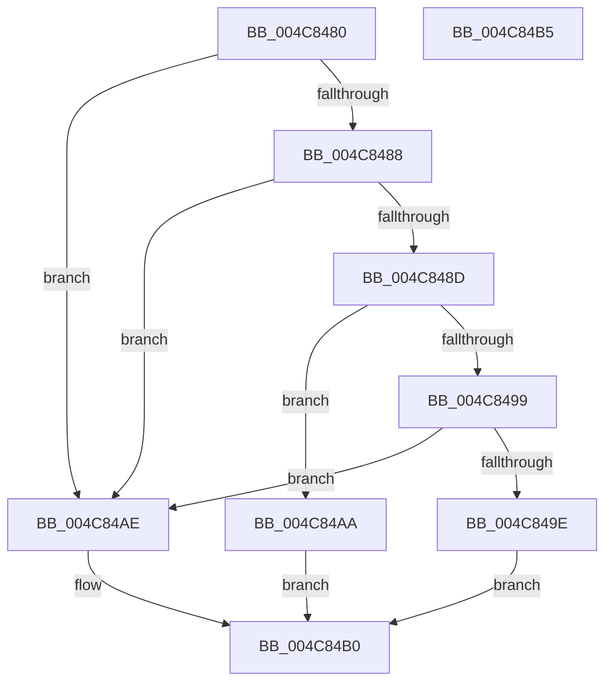

# IopMcShouldYield

- RVA: `0x004C8480`–`0x004C84B6` (길이 `54` bytes)
- VA: `0x00000001404C8480`
- 실행 섹션: `.text`
- PDB 이름 있음: `예`; PDB Function 태그: `아니요`
- unwind 정보 RVA: `0x0005C788`
- 디코드: `20`개 명령, `54/54` bytes 표시
- 미해석 바이트: `0` (있으면 어셈블리에 `.byte`로 보존)

> 이 문서는 커널 이미지의 기계어와 PDB 기호를 분석해 생성했습니다. 4번과 5번은 함수 원형과 자료형을 바이너리 사용 방식에서 추정한 C 해석이며 원본 소스 복구 결과는 아닙니다.

## 1. Dependencies

- 직접 호출 지점: **1**; 고유 호출 대상: **1**
- 직접 호출자로 확인된 함수: **2**
- RIP 상대 이미지 참조: **1**

### Outgoing calls
- `0x004C849E` → [KeShouldYieldProcessor](../27/KeShouldYieldProcessor_function_002773E0.md) (function, `0x002773E0`)

### Direct callers
- [IopMcAddMdlPagesToTable](IopMcAddMdlPagesToTable_function_004C82F8.md) at `0x004C839B`
- [IopMcRemoveMdlPagesFromTable](../5A/IopMcRemoveMdlPagesFromTable_function_005A3D94.md) at `0x005A3E1F`

### Static image references
- `0x004C848D` → RVA `0x00F8D024` (`.data`; read)

## 2. Other-region calls and transfers

- 다른 실행 섹션으로 향하는 call: **0**
- 별도 외부 분기/꼬리 이동을 확인하지 못했습니다.

## 3. Assembly (complete function range)

```asm
004C8480  48 83 EC 28                     sub rsp, 0x28
004C8484  85 C9                           test ecx, ecx
004C8486  74 26                           je 0x1404c84ae
004C8488  F6 C1 0F                        test cl, 0xf
004C848B  75 21                           jne 0x1404c84ae
004C848D  8B 05 91 4B AC 00               mov eax, dword ptr [rip + 0xac4b91]
004C8493  0F BA E0 1E                     bt eax, 0x1e
004C8497  72 11                           jb 0x1404c84aa
004C8499  80 FA 02                        cmp dl, 2
004C849C  73 10                           jae 0x1404c84ae
004C849E  E8 3D EF DA FF                  call 0x1402773e0
004C84A3  85 C0                           test eax, eax
004C84A5  0F 95 C0                        setne al
004C84A8  EB 06                           jmp 0x1404c84b0
004C84AA  B0 01                           mov al, 1
004C84AC  EB 02                           jmp 0x1404c84b0
004C84AE  32 C0                           xor al, al
004C84B0  48 83 C4 28                     add rsp, 0x28
004C84B4  C3                              ret
004C84B5  CC                              int3
```

## 4. C-style interpretation (structured pseudocode)

```c
__int64 __fastcall IopMcShouldYield(int a1, unsigned __int8 a2)
{
    __int64 result;
    __int64 v_rsp;

    v_rsp = (v_rsp) - (40);
    if (a1 == 0) goto loc_004C84AE;
    if ((((unsigned __int8)(a1)) & (15)) != 0) goto loc_004C84AE;
    if (condition_is_below) goto loc_004C84AA;
    if (a2 >= 2) goto loc_004C84AE;
    result = KeShouldYieldProcessor(a1, a2, a3, a4);
    result = ((unsigned int)(result) != 0) ? 1 : 0;
    goto loc_004C84B0;
loc_004C84AA:
    goto loc_004C84B0;
loc_004C84AE:
    result = 0;
loc_004C84B0:
    v_rsp = (v_rsp) + (40);
    return result;
}
```

## 5. (Beta) C Style

```c
int64_t IopMcShouldYield(int32_t Arg1, uint8_t Arg2)
{
    int64_t result;
    int64_t local_rsp;

    local_rsp = (local_rsp) - (40);
    if (Arg1 == 0) goto loc_004C84AE;
    if ((((uint8_t)(Arg1)) & (15)) != 0) goto loc_004C84AE;
    if (condition_is_below) goto loc_004C84AA;
    if (Arg2 >= 2) goto loc_004C84AE;
    result = KeShouldYieldProcessor(Arg1, Arg2, a3, a4);
    result = ((uint32_t)(result) != 0) ? 1 : 0;
    goto loc_004C84B0;
loc_004C84AA:
    goto loc_004C84B0;
loc_004C84AE:
    result = 0;
loc_004C84B0:
    local_rsp = (local_rsp) + (40);
    return result;
}
```

## 6. Execution-region graph

[열기: 2D/3D 그래프와 함수 탐색 컨트롤 패널](../../../control-panel.html?section=text&rva=0x004C8480&view=graph)

- 2D 그래프는 위에서 아래로 흐르고, 3D 그래프는 빈 공간을 드래그해 회전합니다. Shift+드래그는 이동, 휠은 확대·축소, 함수 노드 선택은 대상 보고서 이동입니다.

### Static fallback


