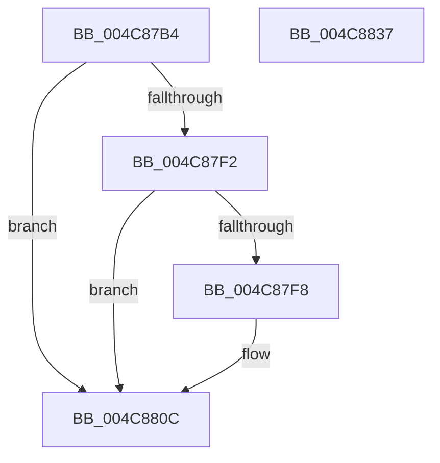

# IopReferenceVerifyVpb

- RVA: `0x004C87B4`–`0x004C8838` (길이 `132` bytes)
- VA: `0x00000001404C87B4`
- 실행 섹션: `.text`
- PDB 이름 있음: `예`; PDB Function 태그: `아니요`
- unwind 정보 RVA: `0x0005E6B4`
- 디코드: `39`개 명령, `132/132` bytes 표시
- 미해석 바이트: `0` (있으면 어셈블리에 `.byte`로 보존)

> 이 문서는 커널 이미지의 기계어와 PDB 기호를 분석해 생성했습니다. 4번과 5번은 함수 원형과 자료형을 바이너리 사용 방식에서 추정한 C 해석이며 원본 소스 복구 결과는 아닙니다.

## 1. Dependencies

- 직접 호출 지점: **3**; 고유 호출 대상: **3**
- 직접 호출자로 확인된 함수: **1**
- RIP 상대 이미지 참조: **0**

### Outgoing calls
- `0x004C87DB` → [KeAcquireQueuedSpinLock](../27/KeAcquireQueuedSpinLock_function_00273D80.md) (function, `0x00273D80`)
- `0x004C8807` → [IopIncrementVpbRefCount](../27/IopIncrementVpbRefCount_function_00272820.md) (function, `0x00272820`)
- `0x004C8814` → [KeReleaseQueuedSpinLock](../27/KeReleaseQueuedSpinLock_function_00272540.md) (function, `0x00272540`)

### Direct callers
- [IoVerifyVolume](../../page/AC/IoVerifyVolume_function_00ACF200.md) at `0x00ACF271`

### Static image references
- 디코드된 RIP-relative 메모리 참조가 없습니다.

## 2. Other-region calls and transfers

- 다른 실행 섹션으로 향하는 call: **0**
- 별도 외부 분기/꼬리 이동을 확인하지 못했습니다.

## 3. Assembly (complete function range)

```asm
004C87B4  48 8B C4                        mov rax, rsp
004C87B7  48 89 58 08                     mov qword ptr [rax + 8], rbx
004C87BB  48 89 68 10                     mov qword ptr [rax + 0x10], rbp
004C87BF  48 89 70 18                     mov qword ptr [rax + 0x18], rsi
004C87C3  48 89 78 20                     mov qword ptr [rax + 0x20], rdi
004C87C7  41 56                           push r14
004C87C9  48 83 EC 20                     sub rsp, 0x20
004C87CD  48 8B D9                        mov rbx, rcx
004C87D0  33 FF                           xor edi, edi
004C87D2  49 8B F0                        mov rsi, r8
004C87D5  4C 8B F2                        mov r14, rdx
004C87D8  8D 4F 09                        lea ecx, [rdi + 9]
004C87DB  E8 A0 B5 DA FF                  call 0x140273d80
004C87E0  48 8B 4B 38                     mov rcx, qword ptr [rbx + 0x38]
004C87E4  40 8A E8                        mov bpl, al
004C87E7  49 89 3E                        mov qword ptr [r14], rdi
004C87EA  48 89 3E                        mov qword ptr [rsi], rdi
004C87ED  48 85 C9                        test rcx, rcx
004C87F0  74 1A                           je 0x1404c880c
004C87F2  F6 41 04 01                     test byte ptr [rcx + 4], 1
004C87F6  74 14                           je 0x1404c880c
004C87F8  48 8B 41 08                     mov rax, qword ptr [rcx + 8]
004C87FC  33 D2                           xor edx, edx
004C87FE  48 89 06                        mov qword ptr [rsi], rax
004C8801  40 B7 01                        mov dil, 1
004C8804  49 89 0E                        mov qword ptr [r14], rcx
004C8807  E8 14 A0 DA FF                  call 0x140272820
004C880C  40 8A D5                        mov dl, bpl
004C880F  B9 09 00 00 00                  mov ecx, 9
004C8814  E8 27 9D DA FF                  call 0x140272540
004C8819  48 8B 5C 24 30                  mov rbx, qword ptr [rsp + 0x30]
004C881E  40 8A C7                        mov al, dil
004C8821  48 8B 7C 24 48                  mov rdi, qword ptr [rsp + 0x48]
004C8826  48 8B 6C 24 38                  mov rbp, qword ptr [rsp + 0x38]
004C882B  48 8B 74 24 40                  mov rsi, qword ptr [rsp + 0x40]
004C8830  48 83 C4 20                     add rsp, 0x20
004C8834  41 5E                           pop r14
004C8836  C3                              ret
004C8837  CC                              int3
```

## 4. C-style interpretation (structured pseudocode)

```c
__int64 __fastcall IopReferenceVerifyVpb(__int64 a1, __int64 a2, __int64 a3)
{
    __int64 result;
    __int64 v_rdi;
    __int64 v_rsp;
    unsigned __int64 v_stack_p10;
    unsigned __int64 v_stack_p18;
    unsigned __int64 v_stack_p20;
    unsigned __int64 v_stack_p8;

    *(unsigned __int64 *)(v_rsp + 8) = v_rbx;
    *(unsigned __int64 *)(v_rsp + 16) = v_rbp;
    *(unsigned __int64 *)(v_rsp + 24) = v_rsi;
    *(unsigned __int64 *)(v_rsp + 32) = v_rdi;
    v_rsp = (v_rsp) - (32);
    v_rdi = 0;
    result = KeAcquireQueuedSpinLock(v_rdi + 9, a2, a3, a4);
    *(unsigned __int64 *)(a2) = 0;
    *(unsigned __int64 *)(a3) = 0;
    if (*(unsigned __int64 *)(a1 + 56) == 0) goto loc_004C880C;
    if (((*(unsigned __int8 *)(*(unsigned __int64 *)(a1 + 56) + 4)) & (1)) != 0) {
        result = *(unsigned __int64 *)(*(unsigned __int64 *)(a1 + 56) + 8);
        a2 = 0;
        *(unsigned __int64 *)(a3) = result;
        v_rdi = 1;
        *(unsigned __int64 *)(a2) = *(unsigned __int64 *)(a1 + 56);
        result = IopIncrementVpbRefCount(*(unsigned __int64 *)(a1 + 56), a2, a3, a4);
    }
    result = KeReleaseQueuedSpinLock(9, (unsigned __int8)((unsigned __int8)(result)), a3, a4);
    v_rsp = (v_rsp) + (32);
    return (unsigned __int8)(v_rdi);
}
```

## 5. (Beta) C Style

```c
int64_t IopReferenceVerifyVpb(void *Arg1, void *Arg2, void *Arg3)
{
    uint8_t *arg1 = (uint8_t *)Arg1;
    uint8_t *arg2 = (uint8_t *)Arg2;
    uint8_t *arg3 = (uint8_t *)Arg3;

    int64_t result;
    int64_t local_rdi;
    int64_t local_rsp;
    uint64_t v_stack_p10;
    uint64_t v_stack_p18;
    uint64_t v_stack_p20;
    uint64_t v_stack_p8;

    *(uint64_t *)(local_rsp + 0x8) = local_rbx;
    *(uint64_t *)(local_rsp + 0x10) = local_rbp;
    *(uint64_t *)(local_rsp + 0x18) = local_rsi;
    *(uint64_t *)(local_rsp + 0x20) = local_rdi;
    local_rsp = (local_rsp) - (32);
    local_rdi = 0;
    result = KeAcquireQueuedSpinLock(local_rdi + 9, Arg2, Arg3, a4);
    *(uint64_t *)(arg2) = 0;
    *(uint64_t *)(arg3) = 0;
    if (*(uint64_t *)(arg1 + 0x38) == 0) goto loc_004C880C;
    if (((*(uint8_t *)(*(uint64_t *)(arg1 + 0x38) + 0x4)) & (1)) != 0) {
        result = *(uint64_t *)(*(uint64_t *)(arg1 + 0x38) + 0x8);
        Arg2 = 0;
        *(uint64_t *)(arg3) = result;
        local_rdi = 1;
        *(uint64_t *)(arg2) = *(uint64_t *)(arg1 + 0x38);
        result = IopIncrementVpbRefCount(*(uint64_t *)(arg1 + 0x38), Arg2, Arg3, a4);
    }
    result = KeReleaseQueuedSpinLock(9, (uint8_t)((uint8_t)(result)), Arg3, a4);
    local_rsp = (local_rsp) + (32);
    return (uint8_t)(local_rdi);
}
```

### 관측된 메모리 오프셋

구조체 형식이 확인되지 않은 접근은 인자 기준의 오프셋으로만 기록했습니다.

| 기준 인자 | 오프셋 표현 | 폭 (bit) | 접근 |
|---|---:|---:|---|
| `Arg1` | `+ 0x38` | `64` | `R` |
| `Arg2` | `+ 0x0` | `64` | `W` |
| `Arg3` | `+ 0x0` | `64` | `W` |

## 6. Execution-region graph

[열기: 2D/3D 그래프와 함수 탐색 컨트롤 패널](../../../control-panel.html?section=text&rva=0x004C87B4&view=graph)

- 2D 그래프는 위에서 아래로 흐르고, 3D 그래프는 빈 공간을 드래그해 회전합니다. Shift+드래그는 이동, 휠은 확대·축소, 함수 노드 선택은 대상 보고서 이동입니다.

### Static fallback


