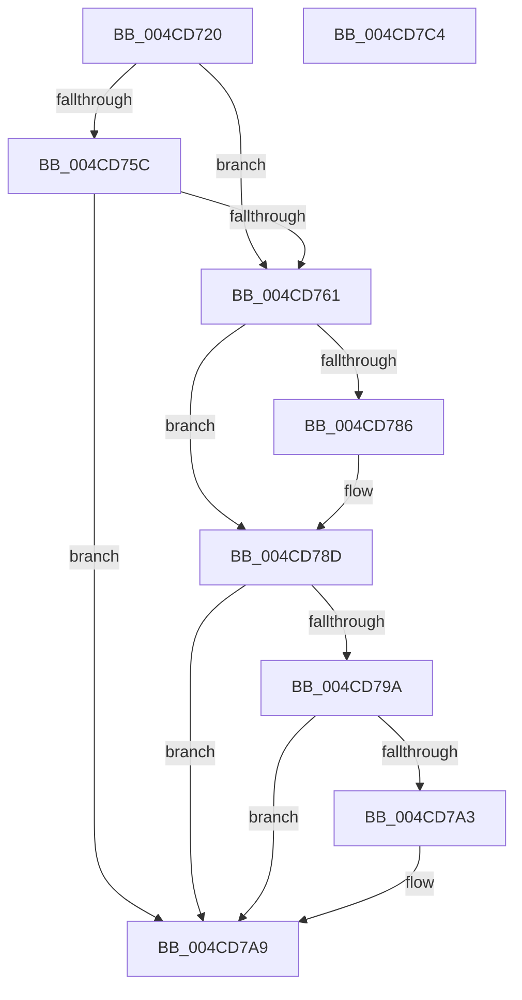

# IvtBuildScalableModePasidTableS2Entry

- RVA: `0x004CD720`–`0x004CD7C5` (길이 `165` bytes)
- VA: `0x00000001404CD720`
- 실행 섹션: `.text`
- PDB 이름 있음: `예`; PDB Function 태그: `아니요`
- unwind 정보 RVA: `0x0005E6B4`
- 디코드: `48`개 명령, `165/165` bytes 표시
- 미해석 바이트: `0` (있으면 어셈블리에 `.byte`로 보존)

> 이 문서는 커널 이미지의 기계어와 PDB 기호를 분석해 생성했습니다. 4번과 5번은 함수 원형과 자료형을 바이너리 사용 방식에서 추정한 C 해석이며 원본 소스 복구 결과는 아닙니다.

## 1. Dependencies

- 직접 호출 지점: **1**; 고유 호출 대상: **1**
- 직접 호출자로 확인된 함수: **1**
- RIP 상대 이미지 참조: **0**

### Outgoing calls
- `0x004CD752` → [memset](../6C/memset_function_006C6C40.md) (function, `0x006C6C40`)

### Direct callers
- [IvtUpdateScalableModePasidTablesForPasid](IvtUpdateScalableModePasidTablesForPasid_function_004CD628.md) at `0x004CD6AC`

### Static image references
- 디코드된 RIP-relative 메모리 참조가 없습니다.

## 2. Other-region calls and transfers

- 다른 실행 섹션으로 향하는 call: **0**
- 별도 외부 분기/꼬리 이동을 확인하지 못했습니다.

## 3. Assembly (complete function range)

```asm
004CD720  48 8B C4                        mov rax, rsp
004CD723  48 89 58 08                     mov qword ptr [rax + 8], rbx
004CD727  48 89 68 10                     mov qword ptr [rax + 0x10], rbp
004CD72B  48 89 70 18                     mov qword ptr [rax + 0x18], rsi
004CD72F  48 89 78 20                     mov qword ptr [rax + 0x20], rdi
004CD733  41 56                           push r14
004CD735  48 83 EC 20                     sub rsp, 0x20
004CD739  48 8B 5C 24 58                  mov rbx, qword ptr [rsp + 0x58]
004CD73E  8B F2                           mov esi, edx
004CD740  33 D2                           xor edx, edx
004CD742  4D 8B F0                        mov r14, r8
004CD745  48 8B E9                        mov rbp, rcx
004CD748  49 8B F9                        mov rdi, r9
004CD74B  48 8B CB                        mov rcx, rbx
004CD74E  44 8D 42 40                     lea r8d, [rdx + 0x40]
004CD752  E8 E9 94 1F 00                  call 0x1406c6c40
004CD757  83 FE 02                        cmp esi, 2
004CD75A  75 05                           jne 0x1404cd761
004CD75C  48 85 FF                        test rdi, rdi
004CD75F  74 48                           je 0x1404cd7a9
004CD761  8B C6                           mov eax, esi
004CD763  83 E0 07                        and eax, 7
004CD766  48 C1 E0 06                     shl rax, 6
004CD76A  48 83 C8 01                     or rax, 1
004CD76E  48 89 03                        mov qword ptr [rbx], rax
004CD771  8B 8D F8 00 00 00               mov ecx, dword ptr [rbp + 0xf8]
004CD777  83 E1 07                        and ecx, 7
004CD77A  48 C1 E1 02                     shl rcx, 2
004CD77E  48 0B C8                        or rcx, rax
004CD781  83 FE 04                        cmp esi, 4
004CD784  74 07                           je 0x1404cd78d
004CD786  48 C1 E7 0C                     shl rdi, 0xc
004CD78A  48 0B CF                        or rcx, rdi
004CD78D  48 89 0B                        mov qword ptr [rbx], rcx
004CD790  66 44 89 73 08                  mov word ptr [rbx + 8], r14w
004CD795  83 FE 04                        cmp esi, 4
004CD798  74 0F                           je 0x1404cd7a9
004CD79A  F6 85 E6 00 00 00 01            test byte ptr [rbp + 0xe6], 1
004CD7A1  74 06                           je 0x1404cd7a9
004CD7A3  48 0F BA 6B 08 17               bts qword ptr [rbx + 8], 0x17
004CD7A9  48 8B 5C 24 30                  mov rbx, qword ptr [rsp + 0x30]
004CD7AE  48 8B 6C 24 38                  mov rbp, qword ptr [rsp + 0x38]
004CD7B3  48 8B 74 24 40                  mov rsi, qword ptr [rsp + 0x40]
004CD7B8  48 8B 7C 24 48                  mov rdi, qword ptr [rsp + 0x48]
004CD7BD  48 83 C4 20                     add rsp, 0x20
004CD7C1  41 5E                           pop r14
004CD7C3  C3                              ret
004CD7C4  CC                              int3
```

## 4. C-style interpretation (structured pseudocode)

```c
__int64 __fastcall IvtBuildScalableModePasidTableS2Entry(__int64 a1, int a2, __int64 a3, __int64 a4, __int64 a5, __int64 a6)
{
    __int64 result;
    __int64 v_rdi;
    __int64 v_rsp;
    unsigned __int64 v_stack_p10;
    unsigned __int64 v_stack_p18;
    unsigned __int64 v_stack_p20;
    unsigned __int64 v_stack_p8;

    *(unsigned __int64 *)(v_rsp + 8) = v_rbx;
    *(unsigned __int64 *)(v_rsp + 16) = v_rbp;
    *(unsigned __int64 *)(v_rsp + 24) = v_rsi;
    *(unsigned __int64 *)(v_rsp + 32) = v_rdi;
    v_rsp = (v_rsp) - (32);
    a2 = 0;
    result = memset(a6, a2, a2 + 64, a4);
    if (((unsigned int)((unsigned int)(a2))) != 2) goto loc_004CD761;
    if (a4 == 0) goto loc_004CD7A9;
loc_004CD761:
    result = (unsigned int)(((unsigned int)((unsigned int)((unsigned int)(a2)))) & (7));
    result = (result) << (6);
    result = (result) | (1);
    *(unsigned __int64 *)(a6) = result;
    a1 = (unsigned int)(((unsigned int)(*(unsigned int *)(a1 + 248))) & (7));
    a1 = (a1) << (2);
    a1 = (a1) | (result);
    v_rdi = a4;
    if (((unsigned int)((unsigned int)(a2))) != 4) {
        v_rdi = (a4) << (12);
        a1 = (a1) | (v_rdi);
    }
    *(unsigned __int64 *)(a6) = a1;
    *(unsigned __int16 *)(a6 + 8) = (unsigned __int16)(a3);
    if (((unsigned int)((unsigned int)(a2))) == 4) goto loc_004CD7A9;
    if (((*(unsigned __int8 *)(a1 + 230)) & (1)) != 0) {
    }
    v_rsp = (v_rsp) + (32);
    return result;
}
```

## 5. (Beta) C Style

```c
int64_t IvtBuildScalableModePasidTableS2Entry(void *Arg1, int32_t Arg2, int64_t Arg3, int64_t Arg4, uint64_t Arg5, void *Arg6)
{
    uint8_t *arg1 = (uint8_t *)Arg1;
    uint8_t *arg6 = (uint8_t *)Arg6;

    int64_t result;
    int64_t local_rdi;
    int64_t local_rsp;
    uint64_t v_stack_p10;
    uint64_t v_stack_p18;
    uint64_t v_stack_p20;
    uint64_t v_stack_p8;

    *(uint64_t *)(local_rsp + 0x8) = local_rbx;
    *(uint64_t *)(local_rsp + 0x10) = local_rbp;
    *(uint64_t *)(local_rsp + 0x18) = local_rsi;
    *(uint64_t *)(local_rsp + 0x20) = local_rdi;
    local_rsp = (local_rsp) - (32);
    Arg2 = 0;
    result = memset(Arg6, Arg2, Arg2 + 64, Arg4);
    if (((uint32_t)((uint32_t)(Arg2))) != 2) goto loc_004CD761;
    if (Arg4 == 0) goto loc_004CD7A9;
loc_004CD761:
    result = (uint32_t)(((uint32_t)((uint32_t)((uint32_t)(Arg2)))) & (7));
    result = (result) << (6);
    result = (result) | (1);
    *(uint64_t *)(arg6) = result;
    Arg1 = (uint32_t)(((uint32_t)(*(uint32_t *)(arg1 + 0xF8))) & (7));
    Arg1 = (Arg1) << (2);
    Arg1 = (Arg1) | (result);
    local_rdi = Arg4;
    if (((uint32_t)((uint32_t)(Arg2))) != 4) {
        local_rdi = (Arg4) << (12);
        Arg1 = (Arg1) | (local_rdi);
    }
    *(void **)(arg6) = Arg1;
    *(uint16_t *)(arg6 + 0x8) = (uint16_t)(Arg3);
    if (((uint32_t)((uint32_t)(Arg2))) == 4) goto loc_004CD7A9;
    if (((*(uint8_t *)(arg1 + 0xE6)) & (1)) != 0) {
    }
    local_rsp = (local_rsp) + (32);
    return result;
}
```

### 관측된 메모리 오프셋

구조체 형식이 확인되지 않은 접근은 인자 기준의 오프셋으로만 기록했습니다.

| 기준 인자 | 오프셋 표현 | 폭 (bit) | 접근 |
|---|---:|---:|---|
| `Arg1` | `+ 0xE6` | `8` | `R` |
| `Arg1` | `+ 0xF8` | `32` | `R` |
| `Arg6` | `+ 0x0` | `64` | `W` |
| `Arg6` | `+ 0x8` | `16` | `W` |
| `Arg6` | `+ 0x8` | `64` | `R/W` |

## 6. Execution-region graph

[열기: 2D/3D 그래프와 함수 탐색 컨트롤 패널](../../../control-panel.html?section=text&rva=0x004CD720&view=graph)

- 2D 그래프는 위에서 아래로 흐르고, 3D 그래프는 빈 공간을 드래그해 회전합니다. Shift+드래그는 이동, 휠은 확대·축소, 함수 노드 선택은 대상 보고서 이동입니다.

### Static fallback


