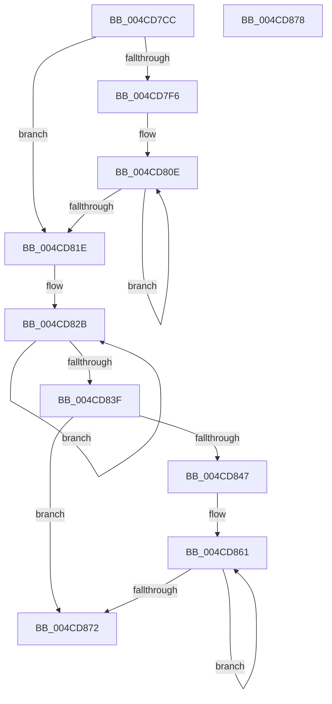

# IvtLegacySetScalableModePasidTableEntry

- RVA: `0x004CD7CC`–`0x004CD879` (길이 `173` bytes)
- VA: `0x00000001404CD7CC`
- 실행 섹션: `.text`
- PDB 이름 있음: `예`; PDB Function 태그: `아니요`
- unwind 정보 RVA: `0x0005CF00`
- 디코드: `48`개 명령, `173/173` bytes 표시
- 미해석 바이트: `0` (있으면 어셈블리에 `.byte`로 보존)

> 이 문서는 커널 이미지의 기계어와 PDB 기호를 분석해 생성했습니다. 4번과 5번은 함수 원형과 자료형을 바이너리 사용 방식에서 추정한 C 해석이며 원본 소스 복구 결과는 아닙니다.

## 1. Dependencies

- 직접 호출 지점: **0**; 고유 호출 대상: **0**
- 직접 호출자로 확인된 함수: **3**
- RIP 상대 이미지 참조: **0**

### Outgoing calls
- 직접 디코드된 call 명령이 없습니다.

### Direct callers
- [IvtUpdateScalableModePasidTablesForPasid](IvtUpdateScalableModePasidTablesForPasid_function_004CD628.md) at `0x004CD6D3`
- [IvtLegacyInitializeScalableModePasidTables](../57/IvtLegacyInitializeScalableModePasidTables_function_00571DE4.md) at `0x00571E7F`
- [IvtLegacySetPasidAddressSpace](../57/IvtLegacySetPasidAddressSpace_function_00571FD0.md) at `0x005720F3`

### Static image references
- 디코드된 RIP-relative 메모리 참조가 없습니다.

## 2. Other-region calls and transfers

- 다른 실행 섹션으로 향하는 call: **0**
- 별도 외부 분기/꼬리 이동을 확인하지 못했습니다.

## 3. Assembly (complete function range)

```asm
004CD7CC  40 53                           push rbx
004CD7CE  48 83 EC 20                     sub rsp, 0x20
004CD7D2  49 8B 19                        mov rbx, qword ptr [r9]
004CD7D5  45 8B D0                        mov r10d, r8d
004CD7D8  41 83 E2 3F                     and r10d, 0x3f
004CD7DC  41 8B C0                        mov eax, r8d
004CD7DF  48 C1 E8 06                     shr rax, 6
004CD7E3  25 FF 3F 00 00                  and eax, 0x3fff
004CD7E8  49 C1 E2 06                     shl r10, 6
004CD7EC  4C 03 54 C2 40                  add r10, qword ptr [rdx + rax*8 + 0x40]
004CD7F1  F6 C3 01                        test bl, 1
004CD7F4  75 28                           jne 0x1404cd81e
004CD7F6  49 8B 02                        mov rax, qword ptr [r10]
004CD7F9  49 8B 52 08                     mov rdx, qword ptr [r10 + 8]
004CD7FD  49 8B 49 08                     mov rcx, qword ptr [r9 + 8]
004CD801  48 89 04 24                     mov qword ptr [rsp], rax
004CD805  48 8B 04 24                     mov rax, qword ptr [rsp]
004CD809  48 89 54 24 08                  mov qword ptr [rsp + 8], rdx
004CD80E  F0 49 0F C7 0A                  lock cmpxchg16b xmmword ptr [r10]
004CD813  48 89 04 24                     mov qword ptr [rsp], rax
004CD817  48 89 54 24 08                  mov qword ptr [rsp + 8], rdx
004CD81C  75 F0                           jne 0x1404cd80e
004CD81E  49 8D 49 38                     lea rcx, [r9 + 0x38]
004CD822  BB 06 00 00 00                  mov ebx, 6
004CD827  49 8D 52 38                     lea rdx, [r10 + 0x38]
004CD82B  48 8B 01                        mov rax, qword ptr [rcx]
004CD82E  48 8D 49 F8                     lea rcx, [rcx - 8]
004CD832  48 89 02                        mov qword ptr [rdx], rax
004CD835  48 8D 52 F8                     lea rdx, [rdx - 8]
004CD839  48 83 EB 01                     sub rbx, 1
004CD83D  75 EC                           jne 0x1404cd82b
004CD83F  49 8B 19                        mov rbx, qword ptr [r9]
004CD842  F6 C3 01                        test bl, 1
004CD845  74 2B                           je 0x1404cd872
004CD847  49 8B 02                        mov rax, qword ptr [r10]
004CD84A  49 8B 52 08                     mov rdx, qword ptr [r10 + 8]
004CD84E  49 8B 49 08                     mov rcx, qword ptr [r9 + 8]
004CD852  48 89 44 24 10                  mov qword ptr [rsp + 0x10], rax
004CD857  48 8B 44 24 10                  mov rax, qword ptr [rsp + 0x10]
004CD85C  48 89 54 24 18                  mov qword ptr [rsp + 0x18], rdx
004CD861  F0 49 0F C7 0A                  lock cmpxchg16b xmmword ptr [r10]
004CD866  48 89 44 24 10                  mov qword ptr [rsp + 0x10], rax
004CD86B  48 89 54 24 18                  mov qword ptr [rsp + 0x18], rdx
004CD870  75 EF                           jne 0x1404cd861
004CD872  48 83 C4 20                     add rsp, 0x20
004CD876  5B                              pop rbx
004CD877  C3                              ret
004CD878  CC                              int3
```

## 4. C-style interpretation (structured pseudocode)

```c
__int64 __fastcall IvtLegacySetScalableModePasidTableEntry(__int64 a1, __int64 a2, int a3, __int64 a4)
{
    __int64 result;
    __int64 v_r10;
    __int64 v_rbx;
    __int64 v_rsp;
    unsigned __int64 v_stack_m10;
    unsigned __int64 v_stack_m18;
    unsigned __int64 v_stack_m20;
    unsigned __int64 v_stack_m28;

    v_rsp = (v_rsp) - (32);
    v_r10 = (unsigned int)(((unsigned int)(a3)) & (63));
    result = ((unsigned int)(a3)) >> (6);
    result = (unsigned int)((result) & (0x3FFFULL));
    v_r10 = (v_r10) << (6);
    v_r10 = (v_r10) + (*(unsigned __int64 *)(a2 + result * 8 + 64));
    if ((((unsigned __int8)(*(unsigned __int64 *)(a4))) & (1)) != 0) goto loc_004CD81E;
    v_stack_m28 = *(unsigned __int64 *)(v_r10);
    v_stack_m20 = *(unsigned __int64 *)(v_r10 + 8);
loc_004CD80E:
    v_stack_m28 = v_stack_m28;
    v_stack_m20 = *(unsigned __int64 *)(v_r10 + 8);
    if ((((unsigned __int8)(*(unsigned __int64 *)(a4))) & (1)) != 0) goto loc_004CD80E;
loc_004CD81E:
loc_004CD82B:
    *(unsigned __int64 *)(v_r10 + 56) = *(unsigned __int64 *)(a4 + 56);
    v_rbx = (6) - (1);
    if (condition_is_not_equal) goto loc_004CD82B;
    if ((((unsigned __int8)(*(unsigned __int64 *)(a4))) & (1)) == 0) goto loc_004CD872;
    v_stack_m18 = *(unsigned __int64 *)(v_r10);
    v_stack_m10 = *(unsigned __int64 *)(v_r10 + 8);
loc_004CD861:
    v_stack_m18 = v_stack_m18;
    v_stack_m10 = *(unsigned __int64 *)(v_r10 + 8);
    if ((((unsigned __int8)(*(unsigned __int64 *)(a4))) & (1)) != 0) goto loc_004CD861;
loc_004CD872:
    v_rsp = (v_rsp) + (32);
    return v_stack_m18;
}
```

## 5. (Beta) C Style

```c
int64_t IvtLegacySetScalableModePasidTableEntry(int64_t Arg1, void *Arg2, int32_t Arg3, void *Arg4)
{
    uint8_t *arg2 = (uint8_t *)Arg2;
    uint8_t *arg4 = (uint8_t *)Arg4;

    int64_t result;
    int64_t local_r10;
    int64_t local_rbx;
    int64_t local_rsp;
    uint64_t v_stack_m10;
    uint64_t v_stack_m18;
    uint64_t v_stack_m20;
    uint64_t v_stack_m28;

    local_rsp = (local_rsp) - (32);
    local_r10 = (uint32_t)(((uint32_t)(Arg3)) & (63));
    result = ((uint32_t)(Arg3)) >> (6);
    result = (uint32_t)((result) & (0x3FFFULL));
    local_r10 = (local_r10) << (6);
    local_r10 = (local_r10) + (*(uint64_t *)(arg2 + result * 8 + 0x40));
    if ((((uint8_t)(*(uint64_t *)(arg4))) & (1)) != 0) goto loc_004CD81E;
    v_stack_m28 = *(uint64_t *)(local_r10);
    v_stack_m20 = *(uint64_t *)(local_r10 + 0x8);
loc_004CD80E:
    v_stack_m28 = v_stack_m28;
    v_stack_m20 = *(uint64_t *)(local_r10 + 0x8);
    if ((((uint8_t)(*(uint64_t *)(arg4))) & (1)) != 0) goto loc_004CD80E;
loc_004CD81E:
loc_004CD82B:
    *(uint64_t *)(local_r10 + 0x38) = *(uint64_t *)(arg4 + 0x38);
    local_rbx = (6) - (1);
    if (condition_is_not_equal) goto loc_004CD82B;
    if ((((uint8_t)(*(uint64_t *)(arg4))) & (1)) == 0) goto loc_004CD872;
    v_stack_m18 = *(uint64_t *)(local_r10);
    v_stack_m10 = *(uint64_t *)(local_r10 + 0x8);
loc_004CD861:
    v_stack_m18 = v_stack_m18;
    v_stack_m10 = *(uint64_t *)(local_r10 + 0x8);
    if ((((uint8_t)(*(uint64_t *)(arg4))) & (1)) != 0) goto loc_004CD861;
loc_004CD872:
    local_rsp = (local_rsp) + (32);
    return v_stack_m18;
}
```

### 관측된 메모리 오프셋

구조체 형식이 확인되지 않은 접근은 인자 기준의 오프셋으로만 기록했습니다.

| 기준 인자 | 오프셋 표현 | 폭 (bit) | 접근 |
|---|---:|---:|---|
| `Arg2` | `+ 0x40 + rax*8` | `64` | `R` |
| `Arg4` | `- 0x8` | `64` | `R` |
| `Arg4` | `+ 0x0` | `64` | `R` |
| `Arg4` | `+ 0x8` | `64` | `R` |
| `Arg4` | `+ 0x38` | `64` | `R` |

## 6. Execution-region graph

[열기: 2D/3D 그래프와 함수 탐색 컨트롤 패널](../../../control-panel.html?section=text&rva=0x004CD7CC&view=graph)

- 2D 그래프는 위에서 아래로 흐르고, 3D 그래프는 빈 공간을 드래그해 회전합니다. Shift+드래그는 이동, 휠은 확대·축소, 함수 노드 선택은 대상 보고서 이동입니다.

### Static fallback


