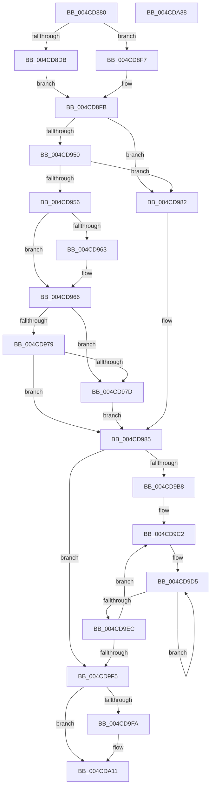

# IvtUpdateScalableModeContextEntry

- RVA: `0x004CD880`–`0x004CDA39` (길이 `441` bytes)
- VA: `0x00000001404CD880`
- 실행 섹션: `.text`
- PDB 이름 있음: `예`; PDB Function 태그: `아니요`
- unwind 정보 RVA: `0x000BD934`
- 디코드: `135`개 명령, `441/441` bytes 표시
- 미해석 바이트: `0` (있으면 어셈블리에 `.byte`로 보존)

> 이 문서는 커널 이미지의 기계어와 PDB 기호를 분석해 생성했습니다. 4번과 5번은 함수 원형과 자료형을 바이너리 사용 방식에서 추정한 C 해석이며 원본 소스 복구 결과는 아닙니다.

## 1. Dependencies

- 직접 호출 지점: **3**; 고유 호출 대상: **3**
- 직접 호출자로 확인된 함수: **3**
- RIP 상대 이미지 참조: **1**

### Outgoing calls
- `0x004CD994` → [IvtBuildScalableModeContextEntry](../4F/IvtBuildScalableModeContextEntry_function_004FA57C.md) (function, `0x004FA57C`)
- `0x004CDA0C` → [IvtInvalidateScalableModeContextEntry](../57/IvtInvalidateScalableModeContextEntry_function_00570940.md) (function, `0x00570940`)
- `0x004CDA18` → [_security_check_cookie](../6A/_security_check_cookie_function_006AC640.md) (function, `0x006AC640`)

### Direct callers
- [IvtUpdateScalableModeTranslationStructures](IvtUpdateScalableModeTranslationStructures_function_004CD52C.md) at `0x004CD5E4`
- [IvtConfigureAts](../56/IvtConfigureAts_function_0056F1F0.md) at `0x0056F325`
- [IvtSetDevicePasidTable](../57/IvtSetDevicePasidTable_function_005724D0.md) at `0x00572599`

### Static image references
- `0x004CD89C` → RVA `0x00E0A740` (`.data`; read)

## 2. Other-region calls and transfers

- 다른 실행 섹션으로 향하는 call: **0**
- 별도 외부 분기/꼬리 이동을 확인하지 못했습니다.

## 3. Assembly (complete function range)

```asm
004CD880  48 89 5C 24 20                  mov qword ptr [rsp + 0x20], rbx
004CD885  55                              push rbp
004CD886  56                              push rsi
004CD887  57                              push rdi
004CD888  41 54                           push r12
004CD88A  41 55                           push r13
004CD88C  41 56                           push r14
004CD88E  41 57                           push r15
004CD890  48 8D 6C 24 F9                  lea rbp, [rsp - 7]
004CD895  48 81 EC 90 00 00 00            sub rsp, 0x90
004CD89C  48 8B 05 9D CE 93 00            mov rax, qword ptr [rip + 0x93ce9d]
004CD8A3  48 33 C4                        xor rax, rsp
004CD8A6  48 89 45 F7                     mov qword ptr [rbp - 9], rax
004CD8AA  44 8B 12                        mov r10d, dword ptr [rdx]
004CD8AD  0F 57 C0                        xorps xmm0, xmm0
004CD8B0  48 8B 59 20                     mov rbx, qword ptr [rcx + 0x20]
004CD8B4  41 8B C2                        mov eax, r10d
004CD8B7  C1 E8 08                        shr eax, 8
004CD8BA  45 33 ED                        xor r13d, r13d
004CD8BD  03 C0                           add eax, eax
004CD8BF  4C 8B F2                        mov r14, rdx
004CD8C2  4D 8B D8                        mov r11, r8
004CD8C5  4C 8B F9                        mov r15, rcx
004CD8C8  0F 11 45 D7                     movups xmmword ptr [rbp - 0x29], xmm0
004CD8CC  8B D0                           mov edx, eax
004CD8CE  0F 11 45 E7                     movups xmmword ptr [rbp - 0x19], xmm0
004CD8D2  44 38 A9 40 01 00 00            cmp byte ptr [rcx + 0x140], r13b
004CD8D9  74 1C                           je 0x1404cd8f7
004CD8DB  41 8B CD                        mov ecx, r13d
004CD8DE  41 8B C2                        mov eax, r10d
004CD8E1  25 F8 00 00 00                  and eax, 0xf8
004CD8E6  3D 80 00 00 00                  cmp eax, 0x80
004CD8EB  0F 93 C1                        setae cl
004CD8EE  48 03 CA                        add rcx, rdx
004CD8F1  48 8D 14 CB                     lea rdx, [rbx + rcx*8]
004CD8F5  EB 04                           jmp 0x1404cd8fb
004CD8F7  48 8D 14 C3                     lea rdx, [rbx + rax*8]
004CD8FB  8B 5D 67                        mov ebx, dword ptr [rbp + 0x67]
004CD8FE  BE 01 00 00 00                  mov esi, 1
004CD903  44 3B CE                        cmp r9d, esi
004CD906  41 0F B6 CD                     movzx ecx, r13b
004CD90A  41 8B FA                        mov edi, r10d
004CD90D  45 8A E5                        mov r12b, r13b
004CD910  41 0F 94 C0                     sete r8b
004CD914  8D 43 FF                        lea eax, [rbx - 1]
004CD917  3B C6                           cmp eax, esi
004CD919  41 0F B7 C2                     movzx eax, r10w
004CD91D  0F 46 CE                        cmovbe ecx, esi
004CD920  C1 EF 03                        shr edi, 3
004CD923  83 E7 0F                        and edi, 0xf
004CD926  83 E0 07                        and eax, 7
004CD929  48 C1 E7 03                     shl rdi, 3
004CD92D  48 0B F8                        or rdi, rax
004CD930  48 C1 E7 05                     shl rdi, 5
004CD934  48 03 3A                        add rdi, qword ptr [rdx]
004CD937  0F 10 0F                        movups xmm1, xmmword ptr [rdi]
004CD93A  0F 10 47 10                     movups xmm0, xmmword ptr [rdi + 0x10]
004CD93E  66 48 0F 7E C8                  movq rax, xmm1
004CD943  0F 11 4D B7                     movups xmmword ptr [rbp - 0x49], xmm1
004CD947  0F 11 45 C7                     movups xmmword ptr [rbp - 0x39], xmm0
004CD94B  40 84 C6                        test sil, al
004CD94E  74 32                           je 0x1404cd982
004CD950  44 39 6D 7F                     cmp dword ptr [rbp + 0x7f], r13d
004CD954  75 2C                           jne 0x1404cd982
004CD956  8A D0                           mov dl, al
004CD958  C0 EA 02                        shr dl, 2
004CD95B  40 22 D6                        and dl, sil
004CD95E  45 85 C9                        test r9d, r9d
004CD961  75 03                           jne 0x1404cd966
004CD963  44 8A C2                        mov r8b, dl
004CD966  48 C1 E8 03                     shr rax, 3
004CD96A  23 C6                           and eax, esi
004CD96C  0F B6 C9                        movzx ecx, cl
004CD96F  85 DB                           test ebx, ebx
004CD971  0F 44 C8                        cmove ecx, eax
004CD974  44 3A C2                        cmp r8b, dl
004CD977  75 04                           jne 0x1404cd97d
004CD979  84 D2                           test dl, dl
004CD97B  74 08                           je 0x1404cd985
004CD97D  44 8A E6                        mov r12b, sil
004CD980  EB 03                           jmp 0x1404cd985
004CD982  41 8A F5                        mov sil, r13b
004CD985  48 8D 45 D7                     lea rax, [rbp - 0x29]
004CD989  44 8A C9                        mov r9b, cl
004CD98C  49 8B D3                        mov rdx, r11
004CD98F  48 89 44 24 28                  mov qword ptr [rsp + 0x28], rax
004CD994  E8 E3 CB 02 00                  call 0x1404fa57c
004CD999  41 8B 46 04                     mov eax, dword ptr [r14 + 4]
004CD99D  BA 01 00 00 00                  mov edx, 1
004CD9A2  8B C8                           mov ecx, eax
004CD9A4  D3 E2                           shl edx, cl
004CD9A6  B9 03 00 00 00                  mov ecx, 3
004CD9AB  2B C8                           sub ecx, eax
004CD9AD  B8 01 00 00 00                  mov eax, 1
004CD9B2  D3 E0                           shl eax, cl
004CD9B4  85 D2                           test edx, edx
004CD9B6  74 3D                           je 0x1404cd9f5
004CD9B8  44 8B C0                        mov r8d, eax
004CD9BB  49 C1 E0 05                     shl r8, 5
004CD9BF  44 8B CA                        mov r9d, edx
004CD9C2  48 8B 07                        mov rax, qword ptr [rdi]
004CD9C5  48 8B 57 08                     mov rdx, qword ptr [rdi + 8]
004CD9C9  48 89 45 A7                     mov qword ptr [rbp - 0x59], rax
004CD9CD  48 8B 45 A7                     mov rax, qword ptr [rbp - 0x59]
004CD9D1  48 89 55 AF                     mov qword ptr [rbp - 0x51], rdx
004CD9D5  48 8B 4D DF                     mov rcx, qword ptr [rbp - 0x21]
004CD9D9  48 8B 5D D7                     mov rbx, qword ptr [rbp - 0x29]
004CD9DD  F0 48 0F C7 0F                  lock cmpxchg16b xmmword ptr [rdi]
004CD9E2  48 89 45 A7                     mov qword ptr [rbp - 0x59], rax
004CD9E6  48 89 55 AF                     mov qword ptr [rbp - 0x51], rdx
004CD9EA  75 E9                           jne 0x1404cd9d5
004CD9EC  49 03 F8                        add rdi, r8
004CD9EF  49 83 E9 01                     sub r9, 1
004CD9F3  75 CD                           jne 0x1404cd9c2
004CD9F5  40 84 F6                        test sil, sil
004CD9F8  74 17                           je 0x1404cda11
004CD9FA  4C 8B 85 87 00 00 00            mov r8, qword ptr [rbp + 0x87]
004CDA01  49 8B D6                        mov rdx, r14
004CDA04  49 8B CF                        mov rcx, r15
004CDA07  44 88 64 24 20                  mov byte ptr [rsp + 0x20], r12b
004CDA0C  E8 2F 2F 0A 00                  call 0x140570940
004CDA11  48 8B 4D F7                     mov rcx, qword ptr [rbp - 9]
004CDA15  48 33 CC                        xor rcx, rsp
004CDA18  E8 23 EC 1D 00                  call 0x1406ac640
004CDA1D  48 8B 9C 24 E8 00 00 00         mov rbx, qword ptr [rsp + 0xe8]
004CDA25  48 81 C4 90 00 00 00            add rsp, 0x90
004CDA2C  41 5F                           pop r15
004CDA2E  41 5E                           pop r14
004CDA30  41 5D                           pop r13
004CDA32  41 5C                           pop r12
004CDA34  5F                              pop rdi
004CDA35  5E                              pop rsi
004CDA36  5D                              pop rbp
004CDA37  C3                              ret
004CDA38  CC                              int3
```

## 4. C-style interpretation (structured pseudocode)

```c
__int64 __fastcall IvtUpdateScalableModeContextEntry(__int64 a1, __int64 a2, __int64 a3, int a4, unsigned int a5, __int64 a6, __int64 a7, unsigned int a8, __int64 a9)
{
    __int64 result;
    __int64 v_r13;
    __int64 v_rdi;
    __int64 v_rsp;
    unsigned __int64 v_stack_m3F;
    unsigned __int64 v_stack_m48;
    unsigned __int64 v_stack_m58;
    unsigned __int64 v_stack_m60;
    unsigned __int64 v_stack_m68;
    unsigned __int64 v_stack_m78;
    unsigned __int64 v_stack_m88;
    unsigned __int64 v_stack_m90;
    unsigned __int64 v_stack_m98;
    unsigned __int64 v_stack_mA0;
    unsigned __int8 v_stack_mA8;
    unsigned __int64 v_stack_p20;

    v_stack_p20 = v_rbx;
    v_rsp = (v_rsp) - (144);
    result = (*(unsigned __int64 *)(v_rip + 9686685)) ^ (v_rsp);
    v_stack_m48 = result;
    result = (unsigned int)(((unsigned int)((unsigned int)((unsigned int)(*(unsigned int *)(a2))))) >> (8));
    v_r13 = 0;
    result = (unsigned int)((result) + ((unsigned int)(result)));
    v_stack_m68 = v_xmm0;
    v_stack_m58 = v_xmm0;
    if ((*(unsigned __int8 *)(a1 + 320)) == 0) goto loc_004CD8F7;
    result = (unsigned int)(((unsigned int)((unsigned int)((unsigned int)(*(unsigned int *)(a2))))) & (248));
    a1 = (((unsigned int)(result)) >= 128) ? 1 : 0;
    a1 = (a1) + ((unsigned int)((unsigned int)(result)));
    goto loc_004CD8FB;
loc_004CD8F7:
loc_004CD8FB:
    a3 = (a4 == 1) ? 1 : 0;
    a1 = 0;
    if (((unsigned int)((unsigned int)(a5) - 1)) <= 1) { a1 = 1; }
    v_rdi = (unsigned int)(((unsigned int)((unsigned int)((unsigned int)(*(unsigned int *)(a2))))) >> (3));
    v_rdi = (unsigned int)((v_rdi) & (15));
    result = (unsigned int)(((unsigned __int16)((unsigned int)(*(unsigned int *)(a2)))) & (7));
    v_rdi = (v_rdi) << (3);
    v_rdi = (v_rdi) | (result);
    v_rdi = (v_rdi) << (5);
    v_rdi = (v_rdi) + (*(unsigned __int64 *)(*(unsigned __int64 *)(a1 + 32) + result * 8));
    v_stack_m88 = v_xmm1;
    v_stack_m78 = v_xmm0;
    if (((1) & ((unsigned __int8)(result))) == 0) goto loc_004CD982;
    if (a8 != 0) goto loc_004CD982;
    a2 = (unsigned __int8)(((unsigned __int8)(result)) >> (2));
    a2 = (unsigned __int8)((a2) & (1));
    if (a4 == 0) {
        a3 = (unsigned __int8)(a2);
    }
    result = (result) >> (3);
    result = (unsigned int)((result) & (1));
    a1 = (unsigned __int8)(a1);
    if ((unsigned int)((unsigned int)(a5)) == 0) { a1 = (unsigned int)(result); }
    if (((unsigned __int8)(a3)) != ((unsigned __int8)(a2))) goto loc_004CD97D;
    if ((unsigned __int8)(a2) == 0) goto loc_004CD985;
loc_004CD97D:
    goto loc_004CD985;
loc_004CD982:
loc_004CD985:
    v_stack_mA0 = v_stack_m68;
    result = IvtBuildScalableModeContextEntry(a1, a3, a3, (unsigned __int8)(a1));
    a2 = (unsigned int)((1) << ((unsigned __int8)((unsigned int)((unsigned int)((unsigned int)(*(unsigned int *)(a2 + 4)))))));
    a1 = (unsigned int)((3) - ((unsigned int)((unsigned int)(*(unsigned int *)(a2 + 4)))));
    result = (unsigned int)((1) << ((unsigned __int8)(a1)));
    if ((unsigned int)(a2) == 0) goto loc_004CD9F5;
    a3 = ((unsigned int)((unsigned int)(result))) << (5);
loc_004CD9C2:
    v_stack_m98 = *(unsigned __int64 *)(v_rdi);
    v_stack_m90 = *(unsigned __int64 *)(v_rdi + 8);
loc_004CD9D5:
    v_stack_m98 = v_stack_m98;
    v_stack_m90 = *(unsigned __int64 *)(v_rdi + 8);
    if (condition_is_not_equal) goto loc_004CD9D5;
    v_rdi = (v_rdi) + (a3);
    a4 = ((unsigned int)((unsigned int)(a2))) - (1);
    if (condition_is_not_equal) goto loc_004CD9C2;
loc_004CD9F5:
    result = v_stack_m98;
    if (0 != 0) {
        a3 = a9;
        a2 = a2;
        a1 = a1;
        v_stack_mA8 = 1;
        result = IvtInvalidateScalableModeContextEntry(a1, a2, a3, a4);
    }
    a1 = (v_stack_m48) ^ (v_rsp);
    result = _security_check_cookie(a1, a2, a3, a4);
    v_rsp = (v_rsp) + (144);
    return result;
}
```

## 5. (Beta) C Style

```c
int64_t IvtUpdateScalableModeContextEntry(void *Arg1, void *Arg2, int64_t Arg3, int32_t Arg4, void *Arg5, uint64_t Arg6, uint64_t Arg7, uint32_t Arg8, int64_t Arg9)
{
    uint8_t *arg1 = (uint8_t *)Arg1;
    uint8_t *arg2 = (uint8_t *)Arg2;
    uint8_t *arg5 = (uint8_t *)Arg5;

    int64_t result;
    int64_t local_r13;
    int64_t local_rdi;
    int64_t local_rsp;
    uint64_t v_stack_m3F;
    uint64_t v_stack_m48;
    uint64_t v_stack_m58;
    uint64_t v_stack_m60;
    uint64_t v_stack_m68;
    uint64_t v_stack_m78;
    uint64_t v_stack_m88;
    uint64_t v_stack_m90;
    uint64_t v_stack_m98;
    uint64_t v_stack_mA0;
    uint8_t v_stack_mA8;
    uint64_t v_stack_p20;

    v_stack_p20 = local_rbx;
    local_rsp = (local_rsp) - (144);
    result = (*(uint64_t *)(v_rip + 0x93CE9D)) ^ (local_rsp);
    v_stack_m48 = result;
    result = (uint32_t)(((uint32_t)((uint32_t)((uint32_t)(*(uint32_t *)(arg2))))) >> (8));
    local_r13 = 0;
    result = (uint32_t)((result) + ((uint32_t)(result)));
    v_stack_m68 = v_xmm0;
    v_stack_m58 = v_xmm0;
    if ((*(uint8_t *)(arg1 + 0x140)) == 0) goto loc_004CD8F7;
    result = (uint32_t)(((uint32_t)((uint32_t)((uint32_t)(*(uint32_t *)(arg2))))) & (248));
    Arg1 = (((uint32_t)(result)) >= 128) ? 1 : 0;
    Arg1 = (Arg1) + ((uint32_t)((uint32_t)(result)));
    goto loc_004CD8FB;
loc_004CD8F7:
loc_004CD8FB:
    Arg3 = (Arg4 == 1) ? 1 : 0;
    Arg1 = 0;
    if (((uint32_t)((uint32_t)(Arg5) - 1)) <= 1) { Arg1 = 1; }
    local_rdi = (uint32_t)(((uint32_t)((uint32_t)((uint32_t)(*(uint32_t *)(arg2))))) >> (3));
    local_rdi = (uint32_t)((local_rdi) & (15));
    result = (uint32_t)(((uint16_t)((uint32_t)(*(uint32_t *)(arg2)))) & (7));
    local_rdi = (local_rdi) << (3);
    local_rdi = (local_rdi) | (result);
    local_rdi = (local_rdi) << (5);
    local_rdi = (local_rdi) + (*(uint64_t *)(*(uint64_t *)(arg1 + 0x20) + result * 8));
    v_stack_m88 = v_xmm1;
    v_stack_m78 = v_xmm0;
    if (((1) & ((uint8_t)(result))) == 0) goto loc_004CD982;
    if (Arg8 != 0) goto loc_004CD982;
    Arg2 = (uint8_t)(((uint8_t)(result)) >> (2));
    Arg2 = (uint8_t)((Arg2) & (1));
    if (Arg4 == 0) {
        Arg3 = (uint8_t)(Arg2);
    }
    result = (result) >> (3);
    result = (uint32_t)((result) & (1));
    Arg1 = (uint8_t)(Arg1);
    if ((uint32_t)((uint32_t)(Arg5)) == 0) { Arg1 = (uint32_t)(result); }
    if (((uint8_t)(Arg3)) != ((uint8_t)(Arg2))) goto loc_004CD97D;
    if ((uint8_t)(Arg2) == 0) goto loc_004CD985;
loc_004CD97D:
    goto loc_004CD985;
loc_004CD982:
loc_004CD985:
    v_stack_mA0 = v_stack_m68;
    result = IvtBuildScalableModeContextEntry(Arg1, Arg3, Arg3, (uint8_t)(Arg1));
    Arg2 = (uint32_t)((1) << ((uint8_t)((uint32_t)((uint32_t)((uint32_t)(*(uint32_t *)(arg2 + 0x4)))))));
    Arg1 = (uint32_t)((3) - ((uint32_t)((uint32_t)(*(uint32_t *)(arg2 + 0x4)))));
    result = (uint32_t)((1) << ((uint8_t)(Arg1)));
    if ((uint32_t)(Arg2) == 0) goto loc_004CD9F5;
    Arg3 = ((uint32_t)((uint32_t)(result))) << (5);
loc_004CD9C2:
    v_stack_m98 = *(uint64_t *)(local_rdi);
    v_stack_m90 = *(uint64_t *)(local_rdi + 0x8);
loc_004CD9D5:
    v_stack_m98 = v_stack_m98;
    v_stack_m90 = *(uint64_t *)(local_rdi + 0x8);
    if (condition_is_not_equal) goto loc_004CD9D5;
    local_rdi = (local_rdi) + (Arg3);
    Arg4 = ((uint32_t)((uint32_t)(Arg2))) - (1);
    if (condition_is_not_equal) goto loc_004CD9C2;
loc_004CD9F5:
    result = v_stack_m98;
    if (0 != 0) {
        Arg3 = Arg9;
        Arg2 = Arg2;
        Arg1 = Arg1;
        v_stack_mA8 = 1;
        result = IvtInvalidateScalableModeContextEntry(Arg1, Arg2, Arg3, Arg4);
    }
    Arg1 = (v_stack_m48) ^ (local_rsp);
    result = _security_check_cookie(Arg1, Arg2, Arg3, Arg4);
    local_rsp = (local_rsp) + (144);
    return result;
}
```

### 관측된 메모리 오프셋

구조체 형식이 확인되지 않은 접근은 인자 기준의 오프셋으로만 기록했습니다.

| 기준 인자 | 오프셋 표현 | 폭 (bit) | 접근 |
|---|---:|---:|---|
| `Arg1` | `+ 0x20` | `64` | `R` |
| `Arg1` | `+ 0x140` | `8` | `R` |
| `Arg2` | `+ 0x0` | `32` | `R` |
| `Arg2` | `+ 0x4` | `32` | `R` |
| `Arg5` | `- 0x1` | `32` | `R` |

## 6. Execution-region graph

[열기: 2D/3D 그래프와 함수 탐색 컨트롤 패널](../../../control-panel.html?section=text&rva=0x004CD880&view=graph)

- 2D 그래프는 위에서 아래로 흐르고, 3D 그래프는 빈 공간을 드래그해 회전합니다. Shift+드래그는 이동, 휠은 확대·축소, 함수 노드 선택은 대상 보고서 이동입니다.

### Static fallback


