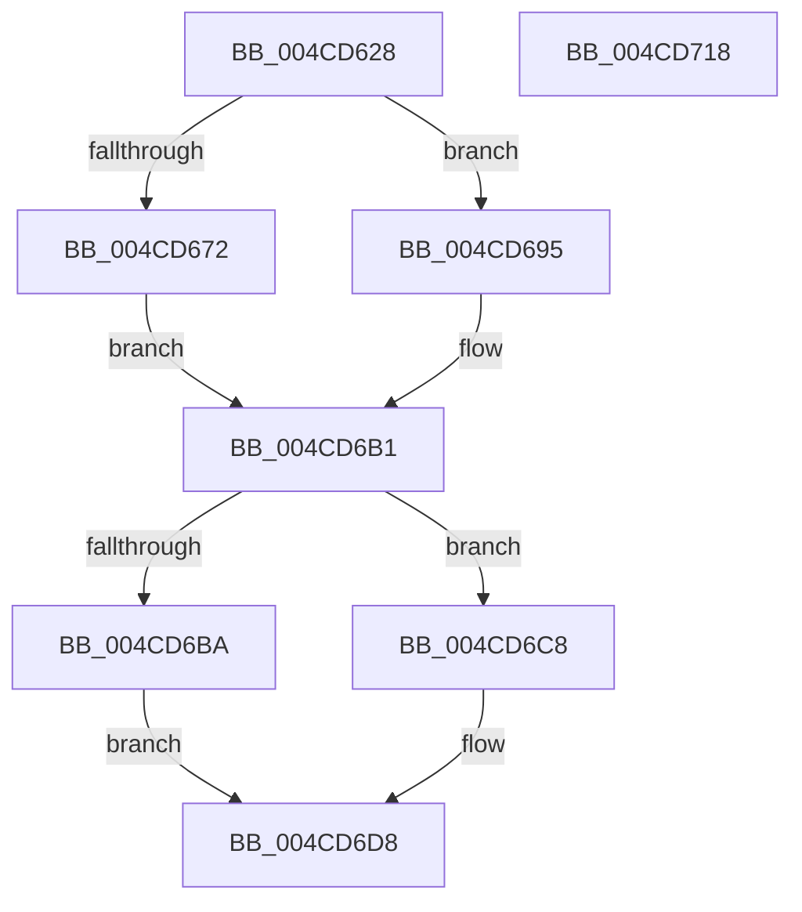

# IvtUpdateScalableModePasidTablesForPasid

- RVA: `0x004CD628`–`0x004CD719` (길이 `241` bytes)
- VA: `0x00000001404CD628`
- 실행 섹션: `.text`
- PDB 이름 있음: `예`; PDB Function 태그: `아니요`
- unwind 정보 RVA: `0x000BD914`
- 디코드: `58`개 명령, `241/241` bytes 표시
- 미해석 바이트: `0` (있으면 어셈블리에 `.byte`로 보존)

> 이 문서는 커널 이미지의 기계어와 PDB 기호를 분석해 생성했습니다. 4번과 5번은 함수 원형과 자료형을 바이너리 사용 방식에서 추정한 C 해석이며 원본 소스 복구 결과는 아닙니다.

## 1. Dependencies

- 직접 호출 지점: **7**; 고유 호출 대상: **7**
- 직접 호출자로 확인된 함수: **4**
- RIP 상대 이미지 참조: **1**

### Outgoing calls
- `0x004CD660` → [memset](../6C/memset_function_006C6C40.md) (function, `0x006C6C40`)
- `0x004CD68E` → [IvtBuildScalableModePasidTableS1Entry](../4F/IvtBuildScalableModePasidTableS1Entry_function_004F6644.md) (function, `0x004F6644`)
- `0x004CD6AC` → [IvtBuildScalableModePasidTableS2Entry](IvtBuildScalableModePasidTableS2Entry_function_004CD720.md) (function, `0x004CD720`)
- `0x004CD6B1` → [Feature_Test57481295__private_IsEnabledDeviceUsageNoInline](../4F/Feature_Test57481295__private_IsEnabledDeviceUsageNoInline_function_004F7B90.md) (function, `0x004F7B90`)
- `0x004CD6D3` → [IvtLegacySetScalableModePasidTableEntry](IvtLegacySetScalableModePasidTableEntry_function_004CD7CC.md) (function, `0x004CD7CC`)
- `0x004CD6DC` → [MmGetPhysicalAddress](../23/MmGetPhysicalAddress_function_0023A500.md) (function, `0x0023A500`)
- `0x004CD6FE` → [_security_check_cookie](../6A/_security_check_cookie_function_006AC640.md) (function, `0x006AC640`)

### Direct callers
- [IvtUpdateScalableModeTranslationStructures](IvtUpdateScalableModeTranslationStructures_function_004CD52C.md) at `0x004CD5B6`
- [IvtLegacyUpdateScalableModeTranslationStructures](../57/IvtLegacyUpdateScalableModeTranslationStructures_function_0057237C.md) at `0x00572416`
- [IvtLegacySetupScalableModeDefaultPasidTables](../../pagelk/B6/IvtLegacySetupScalableModeDefaultPasidTables_function_00B62A5C.md) at `0x00B62ACB`
- [IvtSetupScalableModeDefaultPasidTables](../../pagelk/B6/IvtSetupScalableModeDefaultPasidTables_function_00B62E78.md) at `0x00B62EEA`

### Static image references
- `0x004CD63A` → RVA `0x00E0A740` (`.data`; read)

## 2. Other-region calls and transfers

- 다른 실행 섹션으로 향하는 call: **0**
- 별도 외부 분기/꼬리 이동을 확인하지 못했습니다.

## 3. Assembly (complete function range)

```asm
004CD628  48 89 5C 24 18                  mov qword ptr [rsp + 0x18], rbx
004CD62D  48 89 74 24 20                  mov qword ptr [rsp + 0x20], rsi
004CD632  57                              push rdi
004CD633  48 81 EC 90 00 00 00            sub rsp, 0x90
004CD63A  48 8B 05 FF D0 93 00            mov rax, qword ptr [rip + 0x93d0ff]
004CD641  48 33 C4                        xor rax, rsp
004CD644  48 89 84 24 80 00 00 00         mov qword ptr [rsp + 0x80], rax
004CD64C  48 8B DA                        mov rbx, rdx
004CD64F  48 8B F9                        mov rdi, rcx
004CD652  33 D2                           xor edx, edx
004CD654  48 8D 4C 24 40                  lea rcx, [rsp + 0x40]
004CD659  41 8B F1                        mov esi, r9d
004CD65C  44 8D 42 40                     lea r8d, [rdx + 0x40]
004CD660  E8 DB 95 1F 00                  call 0x1406c6c40
004CD665  48 8D 44 24 40                  lea rax, [rsp + 0x40]
004CD66A  48 8B CF                        mov rcx, rdi
004CD66D  83 FE 01                        cmp esi, 1
004CD670  75 23                           jne 0x1404cd695
004CD672  48 89 44 24 30                  mov qword ptr [rsp + 0x30], rax
004CD677  45 33 C0                        xor r8d, r8d
004CD67A  48 8B 84 24 C0 00 00 00         mov rax, qword ptr [rsp + 0xc0]
004CD682  8B D6                           mov edx, esi
004CD684  48 89 44 24 28                  mov qword ptr [rsp + 0x28], rax
004CD689  C6 44 24 20 00                  mov byte ptr [rsp + 0x20], 0
004CD68E  E8 B1 8F 02 00                  call 0x1404f6644
004CD693  EB 1C                           jmp 0x1404cd6b1
004CD695  4C 8B 8C 24 C8 00 00 00         mov r9, qword ptr [rsp + 0xc8]
004CD69D  8B D6                           mov edx, esi
004CD69F  4C 8B 84 24 C0 00 00 00         mov r8, qword ptr [rsp + 0xc0]
004CD6A7  48 89 44 24 28                  mov qword ptr [rsp + 0x28], rax
004CD6AC  E8 6F 00 00 00                  call 0x1404cd720
004CD6B1  E8 DA A4 02 00                  call 0x1404f7b90
004CD6B6  85 C0                           test eax, eax
004CD6B8  74 0E                           je 0x1404cd6c8
004CD6BA  48 8B 43 40                     mov rax, qword ptr [rbx + 0x40]
004CD6BE  66 48 0F 38 F8 44 24 40         movdir64b rax, zmmword ptr [rsp + 0x40]
004CD6C6  EB 10                           jmp 0x1404cd6d8
004CD6C8  4C 8D 4C 24 40                  lea r9, [rsp + 0x40]
004CD6CD  45 33 C0                        xor r8d, r8d
004CD6D0  48 8B D3                        mov rdx, rbx
004CD6D3  E8 F4 00 00 00                  call 0x1404cd7cc
004CD6D8  48 8B 4B 40                     mov rcx, qword ptr [rbx + 0x40]
004CD6DC  E8 1F CE D6 FF                  call 0x14023a500
004CD6E1  48 8B 4B 38                     mov rcx, qword ptr [rbx + 0x38]
004CD6E5  48 25 01 F0 FF FF               and rax, 0xfffffffffffff001
004CD6EB  48 83 C8 01                     or rax, 1
004CD6EF  90                              nop
004CD6F0  48 89 01                        mov qword ptr [rcx], rax
004CD6F3  48 8B 8C 24 80 00 00 00         mov rcx, qword ptr [rsp + 0x80]
004CD6FB  48 33 CC                        xor rcx, rsp
004CD6FE  E8 3D EF 1D 00                  call 0x1406ac640
004CD703  4C 8D 9C 24 90 00 00 00         lea r11, [rsp + 0x90]
004CD70B  49 8B 5B 20                     mov rbx, qword ptr [r11 + 0x20]
004CD70F  49 8B 73 28                     mov rsi, qword ptr [r11 + 0x28]
004CD713  49 8B E3                        mov rsp, r11
004CD716  5F                              pop rdi
004CD717  C3                              ret
004CD718  CC                              int3
```

## 4. C-style interpretation (structured pseudocode)

```c
__int64 __fastcall IvtUpdateScalableModePasidTablesForPasid(__int64 a1, __int64 a2, __int64 a3, int a4, __int64 a5, __int64 a6)
{
    __int64 result;
    __int64 v_rsp;
    unsigned __int64 v_stack_m18;
    unsigned __int64 v_stack_m58;
    unsigned __int64 v_stack_m68;
    unsigned __int64 v_stack_m70;
    unsigned __int8 v_stack_m78;
    unsigned __int64 v_stack_m8;
    unsigned __int64 v_stack_p18;
    unsigned __int64 v_stack_p20;

    v_stack_p18 = v_rbx;
    v_stack_p20 = v_rsi;
    v_rsp = (v_rsp) - (144);
    result = (*(unsigned __int64 *)(v_rip + 9687295)) ^ (v_rsp);
    v_stack_m18 = result;
    a2 = 0;
    result = memset(v_stack_m58, a2, a2 + 64, a4);
    if (((unsigned int)((unsigned int)(a4))) != 1) goto loc_004CD695;
    v_stack_m68 = v_stack_m58;
    a3 = 0;
    v_stack_m70 = a5;
    v_stack_m78 = 0;
    result = IvtBuildScalableModePasidTableS1Entry(a1, (unsigned int)((unsigned int)((unsigned int)(a4))), a3, a4);
    goto loc_004CD6B1;
loc_004CD695:
    v_stack_m70 = result;
    result = IvtBuildScalableModePasidTableS2Entry(a1, (unsigned int)((unsigned int)((unsigned int)(a4))), a5, a6);
loc_004CD6B1:
    result = Feature_Test57481295__private_IsEnabledDeviceUsageNoInline(a1, (unsigned int)((unsigned int)((unsigned int)(a4))), a5, a6);
    if ((unsigned int)(result) == 0) goto loc_004CD6C8;
    goto loc_004CD6D8;
loc_004CD6C8:
    a3 = 0;
    result = IvtLegacySetScalableModePasidTableEntry(a1, 0, a3, v_stack_m58);
loc_004CD6D8:
    result = MmGetPhysicalAddress(*(unsigned __int64 *)(a2 + 64), 0, a3, v_stack_m58);
    result = (result) & (0xFFFFFFFFFFFFF001ULL);
    result = (result) | (1);
    *(unsigned __int64 *)(*(unsigned __int64 *)(a2 + 56)) = result;
    a1 = (v_stack_m18) ^ (v_rsp);
    result = _security_check_cookie(a1, 0, a3, v_stack_m58);
    return result;
}
```

## 5. (Beta) C Style

```c
int64_t IvtUpdateScalableModePasidTablesForPasid(int64_t Arg1, void *Arg2, int64_t Arg3, int32_t Arg4, int64_t Arg5, int64_t Arg6)
{
    uint8_t *arg2 = (uint8_t *)Arg2;

    int64_t result;
    int64_t local_rsp;
    uint64_t v_stack_m18;
    uint64_t v_stack_m58;
    uint64_t v_stack_m68;
    uint64_t v_stack_m70;
    uint8_t v_stack_m78;
    uint64_t v_stack_m8;
    uint64_t v_stack_p18;
    uint64_t v_stack_p20;

    v_stack_p18 = local_rbx;
    v_stack_p20 = local_rsi;
    local_rsp = (local_rsp) - (144);
    result = (*(uint64_t *)(v_rip + 0x93D0FF)) ^ (local_rsp);
    v_stack_m18 = result;
    Arg2 = 0;
    result = memset(v_stack_m58, Arg2, Arg2 + 64, Arg4);
    if (((uint32_t)((uint32_t)(Arg4))) != 1) goto loc_004CD695;
    v_stack_m68 = v_stack_m58;
    Arg3 = 0;
    v_stack_m70 = Arg5;
    v_stack_m78 = 0;
    result = IvtBuildScalableModePasidTableS1Entry(Arg1, (uint32_t)((uint32_t)((uint32_t)(Arg4))), Arg3, Arg4);
    goto loc_004CD6B1;
loc_004CD695:
    v_stack_m70 = result;
    result = IvtBuildScalableModePasidTableS2Entry(Arg1, (uint32_t)((uint32_t)((uint32_t)(Arg4))), Arg5, Arg6);
loc_004CD6B1:
    result = Feature_Test57481295__private_IsEnabledDeviceUsageNoInline(Arg1, (uint32_t)((uint32_t)((uint32_t)(Arg4))), Arg5, Arg6);
    if ((uint32_t)(result) == 0) goto loc_004CD6C8;
    goto loc_004CD6D8;
loc_004CD6C8:
    Arg3 = 0;
    result = IvtLegacySetScalableModePasidTableEntry(Arg1, 0, Arg3, v_stack_m58);
loc_004CD6D8:
    result = MmGetPhysicalAddress(*(uint64_t *)(arg2 + 0x40), 0, Arg3, v_stack_m58);
    result = (result) & (0xFFFFFFFFFFFFF001ULL);
    result = (result) | (1);
    *(uint64_t *)(*(uint64_t *)(arg2 + 0x38)) = result;
    Arg1 = (v_stack_m18) ^ (local_rsp);
    result = _security_check_cookie(Arg1, 0, Arg3, v_stack_m58);
    return result;
}
```

### 관측된 메모리 오프셋

구조체 형식이 확인되지 않은 접근은 인자 기준의 오프셋으로만 기록했습니다.

| 기준 인자 | 오프셋 표현 | 폭 (bit) | 접근 |
|---|---:|---:|---|
| `Arg2` | `+ 0x38` | `64` | `R` |
| `Arg2` | `+ 0x40` | `64` | `R` |

## 6. Execution-region graph

[열기: 2D/3D 그래프와 함수 탐색 컨트롤 패널](../../../control-panel.html?section=text&rva=0x004CD628&view=graph)

- 2D 그래프는 위에서 아래로 흐르고, 3D 그래프는 빈 공간을 드래그해 회전합니다. Shift+드래그는 이동, 휠은 확대·축소, 함수 노드 선택은 대상 보고서 이동입니다.

### Static fallback


