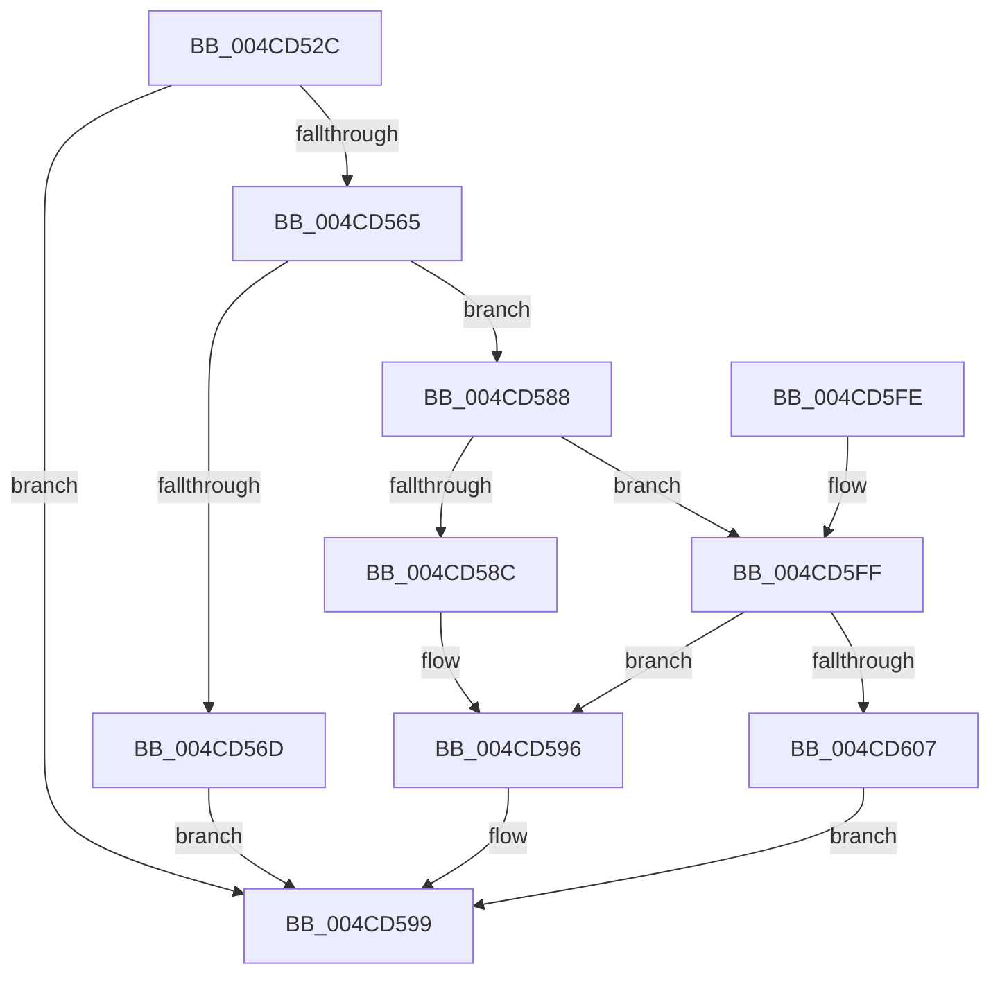

# IvtUpdateScalableModeTranslationStructures

- RVA: `0x004CD52C`–`0x004CD61F` (길이 `243` bytes)
- VA: `0x00000001404CD52C`
- 실행 섹션: `.text`
- PDB 이름 있음: `예`; PDB Function 태그: `아니요`
- unwind 정보 RVA: `0x000BD8FC`
- 디코드: `70`개 명령, `243/243` bytes 표시
- 미해석 바이트: `0` (있으면 어셈블리에 `.byte`로 보존)

> 이 문서는 커널 이미지의 기계어와 PDB 기호를 분석해 생성했습니다. 4번과 5번은 함수 원형과 자료형을 바이너리 사용 방식에서 추정한 C 해석이며 원본 소스 복구 결과는 아닙니다.

## 1. Dependencies

- 직접 호출 지점: **4**; 고유 호출 대상: **4**
- 직접 호출자로 확인된 함수: **1**
- RIP 상대 이미지 참조: **0**

### Outgoing calls
- `0x004CD579` → [IvtGetBlockedDomain](../4D/IvtGetBlockedDomain_function_004D2204.md) (function, `0x004D2204`)
- `0x004CD59E` → [IvtGetPasidGranularTranslationType](../4F/IvtGetPasidGranularTranslationType_function_004FC2FC.md) (function, `0x004FC2FC`)
- `0x004CD5B6` → [IvtUpdateScalableModePasidTablesForPasid](IvtUpdateScalableModePasidTablesForPasid_function_004CD628.md) (function, `0x004CD628`)
- `0x004CD5E4` → [IvtUpdateScalableModeContextEntry](IvtUpdateScalableModeContextEntry_function_004CD880.md) (function, `0x004CD880`)

### Direct callers
- [IvtUpdateTranslationStructures](../4F/IvtUpdateTranslationStructures_function_004F913C.md) at `0x004F916B`

### Static image references
- 디코드된 RIP-relative 메모리 참조가 없습니다.

## 2. Other-region calls and transfers

- 다른 실행 섹션으로 향하는 call: **0**
- 별도 외부 분기/꼬리 이동을 확인하지 못했습니다.

## 3. Assembly (complete function range)

```asm
004CD52C  4C 8B DC                        mov r11, rsp
004CD52F  49 89 5B 08                     mov qword ptr [r11 + 8], rbx
004CD533  49 89 6B 18                     mov qword ptr [r11 + 0x18], rbp
004CD537  56                              push rsi
004CD538  57                              push rdi
004CD539  41 56                           push r14
004CD53B  48 83 EC 50                     sub rsp, 0x50
004CD53F  48 8B 84 24 98 00 00 00         mov rax, qword ptr [rsp + 0x98]
004CD547  33 DB                           xor ebx, ebx
004CD549  48 8B 72 38                     mov rsi, qword ptr [rdx + 0x38]
004CD54D  48 8B F9                        mov rdi, rcx
004CD550  48 8B 6A 40                     mov rbp, qword ptr [rdx + 0x40]
004CD554  45 8B F1                        mov r14d, r9d
004CD557  49 89 5B 10                     mov qword ptr [r11 + 0x10], rbx
004CD55B  8B CB                           mov ecx, ebx
004CD55D  44 8B D3                        mov r10d, ebx
004CD560  48 85 C0                        test rax, rax
004CD563  74 34                           je 0x1404cd599
004CD565  8B 48 04                        mov ecx, dword ptr [rax + 4]
004CD568  83 F9 01                        cmp ecx, 1
004CD56B  75 1B                           jne 0x1404cd588
004CD56D  8A D9                           mov bl, cl
004CD56F  4D 8D 43 10                     lea r8, [r11 + 0x10]
004CD573  48 8B CF                        mov rcx, rdi
004CD576  48 8B D6                        mov rdx, rsi
004CD579  E8 86 4C 00 00                  call 0x1404d2204
004CD57E  4C 8B 54 24 78                  mov r10, qword ptr [rsp + 0x78]
004CD583  48 8B C8                        mov rcx, rax
004CD586  EB 11                           jmp 0x1404cd599
004CD588  85 C9                           test ecx, ecx
004CD58A  74 73                           je 0x1404cd5ff
004CD58C  4C 8B 50 28                     mov r10, qword ptr [rax + 0x28]
004CD590  B3 01                           mov bl, 1
004CD592  49 C1 EA 0C                     shr r10, 0xc
004CD596  8B 48 30                        mov ecx, dword ptr [rax + 0x30]
004CD599  44 8A C3                        mov r8b, bl
004CD59C  33 D2                           xor edx, edx
004CD59E  E8 59 ED 02 00                  call 0x1404fc2fc
004CD5A3  4C 89 54 24 28                  mov qword ptr [rsp + 0x28], r10
004CD5A8  44 8B C8                        mov r9d, eax
004CD5AB  48 89 4C 24 20                  mov qword ptr [rsp + 0x20], rcx
004CD5B0  48 8B D5                        mov rdx, rbp
004CD5B3  48 8B CF                        mov rcx, rdi
004CD5B6  E8 6D 00 00 00                  call 0x1404cd628
004CD5BB  48 8B 84 24 A8 00 00 00         mov rax, qword ptr [rsp + 0xa8]
004CD5C3  45 33 C9                        xor r9d, r9d
004CD5C6  48 89 44 24 40                  mov qword ptr [rsp + 0x40], rax
004CD5CB  4C 8B C5                        mov r8, rbp
004CD5CE  8B 84 24 A0 00 00 00            mov eax, dword ptr [rsp + 0xa0]
004CD5D5  48 8B D6                        mov rdx, rsi
004CD5D8  89 44 24 38                     mov dword ptr [rsp + 0x38], eax
004CD5DC  48 8B CF                        mov rcx, rdi
004CD5DF  44 89 74 24 20                  mov dword ptr [rsp + 0x20], r14d
004CD5E4  E8 97 02 00 00                  call 0x1404cd880
004CD5E9  4C 8D 5C 24 50                  lea r11, [rsp + 0x50]
004CD5EE  49 8B 5B 20                     mov rbx, qword ptr [r11 + 0x20]
004CD5F2  49 8B 6B 30                     mov rbp, qword ptr [r11 + 0x30]
004CD5F6  49 8B E3                        mov rsp, r11
004CD5F9  41 5E                           pop r14
004CD5FB  5F                              pop rdi
004CD5FC  5E                              pop rsi
004CD5FD  C3                              ret
004CD5FE  CC                              int3
004CD5FF  38 9F 3F 01 00 00               cmp byte ptr [rdi + 0x13f], bl
004CD605  74 8F                           je 0x1404cd596
004CD607  4C 8B 97 48 01 00 00            mov r10, qword ptr [rdi + 0x148]
004CD60E  B3 01                           mov bl, 1
004CD610  8B 8F 08 01 00 00               mov ecx, dword ptr [rdi + 0x108]
004CD616  49 C1 FA 0C                     sar r10, 0xc
004CD61A  E9 7A FF FF FF                  jmp 0x1404cd599
```

## 4. C-style interpretation (structured pseudocode)

```c
__int64 __fastcall IvtUpdateScalableModeTranslationStructures(__int64 a1, __int64 a2, __int64 a3, int a4, __int64 a5, __int64 a6, unsigned int a7, __int64 a8)
{
    __int64 result;
    __int64 v_r10;
    __int64 v_rbx;
    __int64 v_rsp;
    unsigned __int64 v_stack_m18;
    unsigned __int64 v_stack_m28;
    unsigned int v_stack_m30;
    unsigned __int64 v_stack_m40;
    unsigned __int64 v_stack_m48;
    unsigned __int64 v_stack_p10;

    *(unsigned __int64 *)(v_rsp + 8) = v_rbx;
    *(unsigned __int64 *)(v_rsp + 24) = v_rbp;
    v_rsp = (v_rsp) - (80);
    v_rbx = 0;
    *(unsigned __int64 *)(v_rsp + 16) = 0;
    if (a6 == 0) goto loc_004CD599;
    if (((unsigned int)((unsigned int)(*(unsigned int *)(a6 + 4)))) != 1) goto loc_004CD588;
    result = IvtGetBlockedDomain(a1, *(unsigned __int64 *)(a2 + 56), v_rsp + 16, a4);
    goto loc_004CD599;
loc_004CD588:
    if ((unsigned int)(result) == 0) goto loc_004CD5FF;
    v_r10 = (*(unsigned __int64 *)(result + 40)) >> (12);
loc_004CD596:
loc_004CD599:
    a2 = 0;
    result = IvtGetPasidGranularTranslationType((unsigned int)(*(unsigned int *)(result + 48)), a2, 1, a4);
    v_stack_m40 = v_r10;
    v_stack_m48 = (unsigned int)(*(unsigned int *)(result + 48));
    result = IvtUpdateScalableModePasidTablesForPasid(a1, *(unsigned __int64 *)(a2 + 64), 1, (unsigned int)((unsigned int)(result)));
    a4 = 0;
    v_stack_m28 = a8;
    v_stack_m30 = (unsigned int)((unsigned int)(a7));
    v_stack_m48 = (unsigned int)((unsigned int)(a4));
    result = IvtUpdateScalableModeContextEntry(a1, *(unsigned __int64 *)(a2 + 56), *(unsigned __int64 *)(a2 + 64), a4);
    return result;
loc_004CD5FF:
    if ((*(unsigned __int8 *)(a1 + 319)) == ((unsigned __int8)(*(unsigned __int64 *)(v_stack_m18 + 32)))) goto loc_004CD596;
    v_r10 = (*(unsigned __int64 *)(a1 + 328)) >> (12);
    goto loc_004CD599;
}
```

## 5. (Beta) C Style

```c
int64_t IvtUpdateScalableModeTranslationStructures(void *Arg1, void *Arg2, int64_t Arg3, int32_t Arg4, uint64_t Arg5, int64_t Arg6, uint32_t Arg7, int64_t Arg8)
{
    uint8_t *arg1 = (uint8_t *)Arg1;
    uint8_t *arg2 = (uint8_t *)Arg2;

    int64_t result;
    int64_t local_r10;
    int64_t local_rbx;
    int64_t local_rsp;
    uint64_t v_stack_m18;
    uint64_t v_stack_m28;
    uint32_t v_stack_m30;
    uint64_t v_stack_m40;
    uint64_t v_stack_m48;
    uint64_t v_stack_p10;

    *(uint64_t *)(local_rsp + 0x8) = local_rbx;
    *(uint64_t *)(local_rsp + 0x18) = local_rbp;
    local_rsp = (local_rsp) - (80);
    local_rbx = 0;
    *(uint64_t *)(local_rsp + 0x10) = 0;
    if (Arg6 == 0) goto loc_004CD599;
    if (((uint32_t)((uint32_t)(*(uint32_t *)(Arg6 + 0x4)))) != 1) goto loc_004CD588;
    result = IvtGetBlockedDomain(Arg1, *(uint64_t *)(arg2 + 0x38), local_rsp + 16, Arg4);
    goto loc_004CD599;
loc_004CD588:
    if ((uint32_t)(result) == 0) goto loc_004CD5FF;
    local_r10 = (*(uint64_t *)(result + 0x28)) >> (12);
loc_004CD596:
loc_004CD599:
    Arg2 = 0;
    result = IvtGetPasidGranularTranslationType((uint32_t)(*(uint32_t *)(result + 0x30)), Arg2, 1, Arg4);
    v_stack_m40 = local_r10;
    v_stack_m48 = (uint32_t)(*(uint32_t *)(result + 0x30));
    result = IvtUpdateScalableModePasidTablesForPasid(Arg1, *(uint64_t *)(arg2 + 0x40), 1, (uint32_t)((uint32_t)(result)));
    Arg4 = 0;
    v_stack_m28 = Arg8;
    v_stack_m30 = (uint32_t)((uint32_t)(Arg7));
    v_stack_m48 = (uint32_t)((uint32_t)(Arg4));
    result = IvtUpdateScalableModeContextEntry(Arg1, *(uint64_t *)(arg2 + 0x38), *(uint64_t *)(arg2 + 0x40), Arg4);
    return result;
loc_004CD5FF:
    if ((*(uint8_t *)(arg1 + 0x13F)) == ((uint8_t)(*(uint64_t *)(v_stack_m18 + 0x20)))) goto loc_004CD596;
    local_r10 = (*(uint64_t *)(arg1 + 0x148)) >> (12);
    goto loc_004CD599;
}
```

### 관측된 메모리 오프셋

구조체 형식이 확인되지 않은 접근은 인자 기준의 오프셋으로만 기록했습니다.

| 기준 인자 | 오프셋 표현 | 폭 (bit) | 접근 |
|---|---:|---:|---|
| `Arg1` | `+ 0x108` | `32` | `R` |
| `Arg1` | `+ 0x13F` | `8` | `R` |
| `Arg1` | `+ 0x148` | `64` | `R` |
| `Arg2` | `+ 0x38` | `64` | `R` |
| `Arg2` | `+ 0x40` | `64` | `R` |

## 6. Execution-region graph

[열기: 2D/3D 그래프와 함수 탐색 컨트롤 패널](../../../control-panel.html?section=text&rva=0x004CD52C&view=graph)

- 2D 그래프는 위에서 아래로 흐르고, 3D 그래프는 빈 공간을 드래그해 회전합니다. Shift+드래그는 이동, 휠은 확대·축소, 함수 노드 선택은 대상 보고서 이동입니다.

### Static fallback


