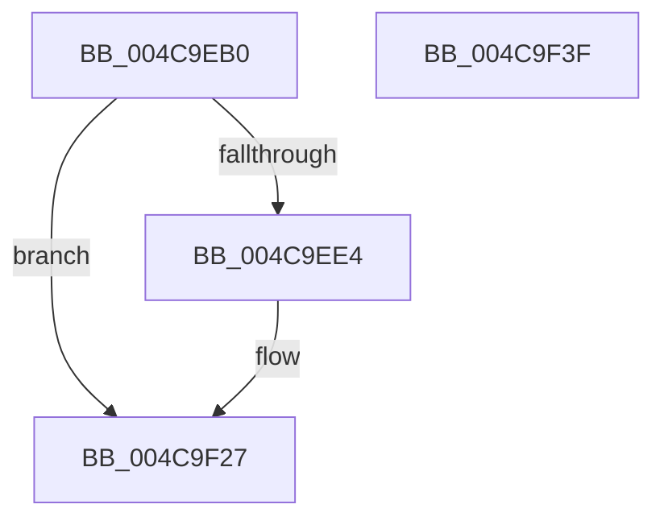

# KeAdjustInterruptTime

- RVA: `0x004C9EB0`–`0x004C9F40` (길이 `144` bytes)
- VA: `0x00000001404C9EB0`
- 실행 섹션: `.text`
- PDB 이름 있음: `예`; PDB Function 태그: `아니요`
- unwind 정보 RVA: `0x000BD4D8`
- 디코드: `35`개 명령, `144/144` bytes 표시
- 미해석 바이트: `0` (있으면 어셈블리에 `.byte`로 보존)

> 이 문서는 커널 이미지의 기계어와 PDB 기호를 분석해 생성했습니다. 4번과 5번은 함수 원형과 자료형을 바이너리 사용 방식에서 추정한 C 해석이며 원본 소스 복구 결과는 아닙니다.

## 1. Dependencies

- 직접 호출 지점: **3**; 고유 호출 대상: **3**
- 직접 호출자로 확인된 함수: **3**
- RIP 상대 이미지 참조: **2**

### Outgoing calls
- `0x004C9EF9` → [KeQueryActiveProcessorCountEx](../24/KeQueryActiveProcessorCountEx_function_00249EF0.md) (function, `0x00249EF0`)
- `0x004C9F20` → [KeIpiGenericCall](../47/KeIpiGenericCall_function_00471720.md) (function, `0x00471720`)
- `0x004C9F2F` → [_security_check_cookie](../6A/_security_check_cookie_function_006AC640.md) (function, `0x006AC640`)

### Direct callers
- [xHalTscSynchronization](../58/xHalTscSynchronization_function_00583730.md) at `0x00583738`
- [sub_006F5584](../6F/Unknown_function_006F5584.md) at `0x006F55D1`
- [InitBootProcessor](../../init/C1/InitBootProcessor_function_00C1B1C8.md) at `0x00C1B62D`

### Static image references
- `0x004C9EBA` → RVA `0x00E0A740` (`.data`; read)
- `0x004C9F07` → RVA `0x00B797E0` (`KiCalibrateTimeAdjustment`; read)

## 2. Other-region calls and transfers

- 다른 실행 섹션으로 향하는 call: **0**
- 별도 외부 분기/꼬리 이동을 확인하지 못했습니다.

## 3. Assembly (complete function range)

```asm
004C9EB0  48 89 5C 24 18                  mov qword ptr [rsp + 0x18], rbx
004C9EB5  57                              push rdi
004C9EB6  48 83 EC 50                     sub rsp, 0x50
004C9EBA  48 8B 05 7F 08 94 00            mov rax, qword ptr [rip + 0x94087f]
004C9EC1  48 33 C4                        xor rax, rsp
004C9EC4  48 89 44 24 40                  mov qword ptr [rsp + 0x40], rax
004C9EC9  33 C0                           xor eax, eax
004C9ECB  40 8A FA                        mov dil, dl
004C9ECE  66 89 44 24 21                  mov word ptr [rsp + 0x21], ax
004C9ED3  48 8B D9                        mov rbx, rcx
004C9ED6  88 44 24 23                     mov byte ptr [rsp + 0x23], al
004C9EDA  48 89 44 24 30                  mov qword ptr [rsp + 0x30], rax
004C9EDF  48 85 C9                        test rcx, rcx
004C9EE2  78 43                           js 0x1404c9f27
004C9EE4  65 48 8B 04 25 20 00 00 00      mov rax, qword ptr gs:[0x20]
004C9EED  8B 48 24                        mov ecx, dword ptr [rax + 0x24]
004C9EF0  89 4C 24 24                     mov dword ptr [rsp + 0x24], ecx
004C9EF4  B9 FF FF 00 00                  mov ecx, 0xffff
004C9EF9  E8 F2 FF D7 FF                  call 0x140249ef0
004C9EFE  48 8D 54 24 20                  lea rdx, [rsp + 0x20]
004C9F03  89 44 24 38                     mov dword ptr [rsp + 0x38], eax
004C9F07  48 8D 0D D2 F8 6A 00            lea rcx, [rip + 0x6af8d2]
004C9F0E  48 89 5C 24 28                  mov qword ptr [rsp + 0x28], rbx
004C9F13  40 88 7C 24 20                  mov byte ptr [rsp + 0x20], dil
004C9F18  C7 44 24 3C 01 00 00 00         mov dword ptr [rsp + 0x3c], 1
004C9F20  E8 FB 77 FA FF                  call 0x140471720
004C9F25  B0 01                           mov al, 1
004C9F27  48 8B 4C 24 40                  mov rcx, qword ptr [rsp + 0x40]
004C9F2C  48 33 CC                        xor rcx, rsp
004C9F2F  E8 0C 27 1E 00                  call 0x1406ac640
004C9F34  48 8B 5C 24 70                  mov rbx, qword ptr [rsp + 0x70]
004C9F39  48 83 C4 50                     add rsp, 0x50
004C9F3D  5F                              pop rdi
004C9F3E  C3                              ret
004C9F3F  CC                              int3
```

## 4. C-style interpretation (structured pseudocode)

```c
__int64 __fastcall KeAdjustInterruptTime(__int64 a1, unsigned __int8 a2)
{
    __int64 result;
    __int64 v_rsp;
    unsigned __int64 v_stack_m18;
    unsigned int v_stack_m1C;
    unsigned int v_stack_m20;
    unsigned __int64 v_stack_m28;
    unsigned __int64 v_stack_m30;
    unsigned int v_stack_m34;
    unsigned __int8 v_stack_m35;
    unsigned __int16 v_stack_m37;
    unsigned __int64 v_stack_m38;
    unsigned __int64 v_stack_p18;

    v_stack_p18 = v_rbx;
    v_rsp = (v_rsp) - (80);
    result = (*(unsigned __int64 *)(v_rip + 9701503)) ^ (v_rsp);
    v_stack_m18 = result;
    result = 0;
    v_stack_m37 = 0;
    v_stack_m35 = 0;
    v_stack_m28 = 0;
    if (!(sign_flag)) {
        result = *(unsigned __int64 *)(gs_base + (0 + 32));
        a1 = *(unsigned int *)(result + 36);
        v_stack_m34 = (unsigned int)(a1);
        a1 = 0xFFFFULL;
        result = KeQueryActiveProcessorCountEx(a1, a2, a3, a4);
        a2 = v_stack_m38;
        v_stack_m20 = (unsigned int)(result);
        a1 = v_rip + 7010514;
        v_stack_m30 = a1;
        v_stack_m38 = a2;
        v_stack_m1C = 1;
        result = KeIpiGenericCall(a1, a2, a3, a4);
        result = 1;
    }
    a1 = (v_stack_m18) ^ (v_rsp);
    result = _security_check_cookie(a1, a2, a3, a4);
    v_rsp = (v_rsp) + (80);
    return result;
}
```

## 5. (Beta) C Style

```c
int64_t KeAdjustInterruptTime(int64_t Arg1, uint8_t Arg2)
{
    int64_t result;
    int64_t local_rsp;
    uint64_t v_stack_m18;
    uint32_t v_stack_m1C;
    uint32_t v_stack_m20;
    uint64_t v_stack_m28;
    uint64_t v_stack_m30;
    uint32_t v_stack_m34;
    uint8_t v_stack_m35;
    uint16_t v_stack_m37;
    uint64_t v_stack_m38;
    uint64_t v_stack_p18;

    v_stack_p18 = local_rbx;
    local_rsp = (local_rsp) - (80);
    result = (*(uint64_t *)(v_rip + 0x94087F)) ^ (local_rsp);
    v_stack_m18 = result;
    result = 0;
    v_stack_m37 = 0;
    v_stack_m35 = 0;
    v_stack_m28 = 0;
    if (!(sign_flag)) {
        result = *(uint64_t *)(gs_base + (0 + 0x20));
        Arg1 = *(uint32_t *)(result + 0x24);
        v_stack_m34 = (uint32_t)(Arg1);
        Arg1 = 0xFFFFULL;
        result = KeQueryActiveProcessorCountEx(Arg1, Arg2, a3, a4);
        Arg2 = v_stack_m38;
        v_stack_m20 = (uint32_t)(result);
        Arg1 = v_rip + 7010514;
        v_stack_m30 = Arg1;
        v_stack_m38 = Arg2;
        v_stack_m1C = 1;
        result = KeIpiGenericCall(Arg1, Arg2, a3, a4);
        result = 1;
    }
    Arg1 = (v_stack_m18) ^ (local_rsp);
    result = _security_check_cookie(Arg1, Arg2, a3, a4);
    local_rsp = (local_rsp) + (80);
    return result;
}
```

## 6. Execution-region graph

[열기: 2D/3D 그래프와 함수 탐색 컨트롤 패널](../../../control-panel.html?section=text&rva=0x004C9EB0&view=graph)

- 2D 그래프는 위에서 아래로 흐르고, 3D 그래프는 빈 공간을 드래그해 회전합니다. Shift+드래그는 이동, 휠은 확대·축소, 함수 노드 선택은 대상 보고서 이동입니다.

### Static fallback


