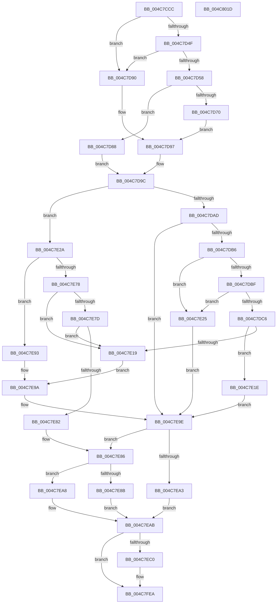

# KeEstimateClockTickDuration

- RVA: `0x004C7CCC`–`0x004C801E` (길이 `850` bytes)
- VA: `0x00000001404C7CCC`
- 실행 섹션: `.text`
- PDB 이름 있음: `예`; PDB Function 태그: `아니요`
- unwind 정보 RVA: `0x000BD274`
- 디코드: `201`개 명령, `850/850` bytes 표시
- 미해석 바이트: `0` (있으면 어셈블리에 `.byte`로 보존)

> 이 문서는 커널 이미지의 기계어와 PDB 기호를 분석해 생성했습니다. 4번과 5번은 함수 원형과 자료형을 바이너리 사용 방식에서 추정한 C 해석이며 원본 소스 복구 결과는 아닙니다.

## 1. Dependencies

- 직접 호출 지점: **7**; 고유 호출 대상: **5**
- 직접 호출자로 확인된 함수: **1**
- RIP 상대 이미지 참조: **8**

### Outgoing calls
- `0x004C7D43` → [Feature_Servicing_Kernel_ClockTickIdleEstimateFix__private_IsEnabledNoReportingNoInline](../39/Feature_Servicing_Kernel_ClockTickIdleEstimateFix__private_IsEnabledNoReportingNoInline_function_0039CEE8.md) (function, `0x0039CEE8`)
- `0x004C7D5D` → [KiGetClockTimerEarliestDeadline](../23/KiGetClockTimerEarliestDeadline_function_00237AB0.md) (function, `0x00237AB0`)
- `0x004C7DFE` → [KiGetNextTimerExpirationDueTime](../5B/KiGetNextTimerExpirationDueTime_function_005BCF60.md) (function, `0x005BCF60`)
- `0x004C7E62` → [KiGetNextTimerExpirationDueTime](../5B/KiGetNextTimerExpirationDueTime_function_005BCF60.md) (function, `0x005BCF60`)
- `0x004C7E67` → [Feature_Servicing_Kernel_ClockTickIdleEstimateFix__private_IsEnabledNoReportingNoInline](../39/Feature_Servicing_Kernel_ClockTickIdleEstimateFix__private_IsEnabledNoReportingNoInline_function_0039CEE8.md) (function, `0x0039CEE8`)
- `0x004C7FE5` → [tlgWriteTransfer_EtwWriteTransfer](../42/tlgWriteTransfer_EtwWriteTransfer_function_004260E0.md) (function, `0x004260E0`)
- `0x004C7FF7` → [_security_check_cookie](../6A/_security_check_cookie_function_006AC640.md) (function, `0x006AC640`)

### Direct callers
- [PpmEstimateIdleDuration](PpmEstimateIdleDuration_function_004C79DC.md) at `0x004C7ABE`

### Static image references
- `0x004C7CF0` → RVA `0x00E0A740` (`.data`; read)
- `0x004C7D22` → RVA `0x00FCF000` (`CACHEALI`; read)
- `0x004C7D4F` → RVA `0x00FC6A85` (`ALMOSTRO`; read)
- `0x004C7D90` → RVA `0x00F21F88` (`.data`; read)
- `0x004C7DB6` → RVA `0x00FC5364` (`ALMOSTRO`; read)
- `0x004C7E03` → RVA `0x00F21FC0` (`.data`; read)
- `0x004C7EB3` → RVA `0x00E070D8` (`.data`; read)
- `0x004C7ECE` → RVA `0x00048326` (`.rdata`; read)

## 2. Other-region calls and transfers

- 다른 실행 섹션으로 향하는 call: **0**
- 별도 외부 분기/꼬리 이동을 확인하지 못했습니다.

## 3. Assembly (complete function range)

```asm
004C7CCC  48 89 5C 24 10                  mov qword ptr [rsp + 0x10], rbx
004C7CD1  48 89 74 24 18                  mov qword ptr [rsp + 0x18], rsi
004C7CD6  48 89 7C 24 20                  mov qword ptr [rsp + 0x20], rdi
004C7CDB  55                              push rbp
004C7CDC  41 54                           push r12
004C7CDE  41 55                           push r13
004C7CE0  41 56                           push r14
004C7CE2  41 57                           push r15
004C7CE4  48 8D 6C 24 90                  lea rbp, [rsp - 0x70]
004C7CE9  48 81 EC 70 01 00 00            sub rsp, 0x170
004C7CF0  48 8B 05 49 2A 94 00            mov rax, qword ptr [rip + 0x942a49]
004C7CF7  48 33 C4                        xor rax, rsp
004C7CFA  48 89 45 60                     mov qword ptr [rbp + 0x60], rax
004C7CFE  48 8B 85 D0 00 00 00            mov rax, qword ptr [rbp + 0xd0]
004C7D05  49 83 CE FF                     or r14, 0xffffffffffffffff
004C7D09  48 89 44 24 78                  mov qword ptr [rsp + 0x78], rax
004C7D0E  44 8A FA                        mov r15b, dl
004C7D11  48 8B 85 D8 00 00 00            mov rax, qword ptr [rbp + 0xd8]
004C7D18  4C 8B E9                        mov r13, rcx
004C7D1B  48 89 45 88                     mov qword ptr [rbp - 0x78], rax
004C7D1F  49 8B F6                        mov rsi, r14
004C7D22  8B 05 D8 72 B0 00               mov eax, dword ptr [rip + 0xb072d8]
004C7D28  89 44 24 68                     mov dword ptr [rsp + 0x68], eax
004C7D2C  4C 89 74 24 70                  mov qword ptr [rsp + 0x70], r14
004C7D31  C7 44 24 58 07 00 00 00         mov dword ptr [rsp + 0x58], 7
004C7D39  44 88 4C 24 51                  mov byte ptr [rsp + 0x51], r9b
004C7D3E  44 88 44 24 50                  mov byte ptr [rsp + 0x50], r8b
004C7D43  E8 A0 51 ED FF                  call 0x14039cee8
004C7D48  45 33 DB                        xor r11d, r11d
004C7D4B  85 C0                           test eax, eax
004C7D4D  74 41                           je 0x1404c7d90
004C7D4F  44 38 1D 2F ED AF 00            cmp byte ptr [rip + 0xafed2f], r11b
004C7D56  74 38                           je 0x1404c7d90
004C7D58  33 D2                           xor edx, edx
004C7D5A  49 8B CD                        mov rcx, r13
004C7D5D  E8 4E FD D6 FF                  call 0x140237ab0
004C7D62  4C 63 E0                        movsxd r12, eax
004C7D65  44 89 64 24 58                  mov dword ptr [rsp + 0x58], r12d
004C7D6A  41 83 FC 07                     cmp r12d, 7
004C7D6E  7D 18                           jge 0x1404c7d88
004C7D70  49 8B CC                        mov rcx, r12
004C7D73  48 03 C9                        add rcx, rcx
004C7D76  41 8B 9C CD A0 95 00 00         mov ebx, dword ptr [r13 + rcx*8 + 0x95a0]
004C7D7E  49 03 9C CD 98 95 00 00         add rbx, qword ptr [r13 + rcx*8 + 0x9598]
004C7D86  EB 0F                           jmp 0x1404c7d97
004C7D88  49 8B DE                        mov rbx, r14
004C7D8B  41 8B FB                        mov edi, r11d
004C7D8E  EB 0C                           jmp 0x1404c7d9c
004C7D90  48 8B 1D F1 A1 A5 00            mov rbx, qword ptr [rip + 0xa5a1f1]
004C7D97  BF 02 00 00 00                  mov edi, 2
004C7D9C  4C 8B A5 C8 00 00 00            mov r12, qword ptr [rbp + 0xc8]
004C7DA3  89 7C 24 60                     mov dword ptr [rsp + 0x60], edi
004C7DA7  45 38 5D 21                     cmp byte ptr [r13 + 0x21], r11b
004C7DAB  74 7D                           je 0x1404c7e2a
004C7DAD  45 84 FF                        test r15b, r15b
004C7DB0  0F 84 E8 00 00 00               je 0x1404c7e9e
004C7DB6  44 38 1D A7 D5 AF 00            cmp byte ptr [rip + 0xafd5a7], r11b
004C7DBD  75 66                           jne 0x1404c7e25
004C7DBF  44 39 5C 24 68                  cmp dword ptr [rsp + 0x68], r11d
004C7DC4  75 5F                           jne 0x1404c7e25
004C7DC6  44 8A 4C 24 50                  mov r9b, byte ptr [rsp + 0x50]
004C7DCB  48 8D 44 24 60                  lea rax, [rsp + 0x60]
004C7DD0  4C 89 5C 24 40                  mov qword ptr [rsp + 0x40], r11
004C7DD5  4D 8B C4                        mov r8, r12
004C7DD8  48 89 44 24 38                  mov qword ptr [rsp + 0x38], rax
004C7DDD  B2 01                           mov dl, 1
004C7DDF  48 8D 44 24 70                  lea rax, [rsp + 0x70]
004C7DE4  49 8B CD                        mov rcx, r13
004C7DE7  48 89 44 24 30                  mov qword ptr [rsp + 0x30], rax
004C7DEC  8A 85 C0 00 00 00               mov al, byte ptr [rbp + 0xc0]
004C7DF2  88 44 24 28                     mov byte ptr [rsp + 0x28], al
004C7DF6  8A 44 24 51                     mov al, byte ptr [rsp + 0x51]
004C7DFA  88 44 24 20                     mov byte ptr [rsp + 0x20], al
004C7DFE  E8 5D 51 0F 00                  call 0x1405bcf60
004C7E03  8B 05 B7 A1 A5 00               mov eax, dword ptr [rip + 0xa5a1b7]
004C7E09  45 33 DB                        xor r11d, r11d
004C7E0C  48 8B 74 24 70                  mov rsi, qword ptr [rsp + 0x70]
004C7E11  49 03 C4                        add rax, r12
004C7E14  48 3B C6                        cmp rax, rsi
004C7E17  73 05                           jae 0x1404c7e1e
004C7E19  48 8B DE                        mov rbx, rsi
004C7E1C  EB 7C                           jmp 0x1404c7e9a
004C7E1E  BF 02 00 00 00                  mov edi, 2
004C7E23  EB 79                           jmp 0x1404c7e9e
004C7E25  45 8A FB                        mov r15b, r11b
004C7E28  EB 74                           jmp 0x1404c7e9e
004C7E2A  44 8A 4C 24 50                  mov r9b, byte ptr [rsp + 0x50]
004C7E2F  48 8D 44 24 60                  lea rax, [rsp + 0x60]
004C7E34  4C 89 5C 24 40                  mov qword ptr [rsp + 0x40], r11
004C7E39  4D 8B C4                        mov r8, r12
004C7E3C  48 89 44 24 38                  mov qword ptr [rsp + 0x38], rax
004C7E41  33 D2                           xor edx, edx
004C7E43  48 8D 44 24 70                  lea rax, [rsp + 0x70]
004C7E48  49 8B CD                        mov rcx, r13
004C7E4B  48 89 44 24 30                  mov qword ptr [rsp + 0x30], rax
004C7E50  8A 85 C0 00 00 00               mov al, byte ptr [rbp + 0xc0]
004C7E56  88 44 24 28                     mov byte ptr [rsp + 0x28], al
004C7E5A  8A 44 24 51                     mov al, byte ptr [rsp + 0x51]
004C7E5E  88 44 24 20                     mov byte ptr [rsp + 0x20], al
004C7E62  E8 F9 50 0F 00                  call 0x1405bcf60
004C7E67  E8 7C 50 ED FF                  call 0x14039cee8
004C7E6C  48 8B 74 24 70                  mov rsi, qword ptr [rsp + 0x70]
004C7E71  45 33 DB                        xor r11d, r11d
004C7E74  85 C0                           test eax, eax
004C7E76  74 1B                           je 0x1404c7e93
004C7E78  49 3B DE                        cmp rbx, r14
004C7E7B  74 9C                           je 0x1404c7e19
004C7E7D  48 3B DE                        cmp rbx, rsi
004C7E80  72 97                           jb 0x1404c7e19
004C7E82  41 8D 7B 02                     lea edi, [r11 + 2]
004C7E86  49 3B DC                        cmp rbx, r12
004C7E89  76 1D                           jbe 0x1404c7ea8
004C7E8B  4C 8B F3                        mov r14, rbx
004C7E8E  4D 2B F4                        sub r14, r12
004C7E91  EB 18                           jmp 0x1404c7eab
004C7E93  48 3B DE                        cmp rbx, rsi
004C7E96  48 0F 46 DE                     cmovbe rbx, rsi
004C7E9A  8B 7C 24 60                     mov edi, dword ptr [rsp + 0x60]
004C7E9E  49 3B DE                        cmp rbx, r14
004C7EA1  75 E3                           jne 0x1404c7e86
004C7EA3  41 8B FB                        mov edi, r11d
004C7EA6  EB 03                           jmp 0x1404c7eab
004C7EA8  4D 8B F3                        mov r14, r11
004C7EAB  48 8B 44 24 78                  mov rax, qword ptr [rsp + 0x78]
004C7EB0  4C 89 30                        mov qword ptr [rax], r14
004C7EB3  83 3D 1E F2 93 00 05            cmp dword ptr [rip + 0x93f21e], 5
004C7EBA  0F 86 2A 01 00 00               jbe 0x1404c7fea
004C7EC0  48 8D 44 24 78                  lea rax, [rsp + 0x78]
004C7EC5  4C 89 64 24 78                  mov qword ptr [rsp + 0x78], r12
004C7ECA  48 89 45 B0                     mov qword ptr [rbp - 0x50], rax
004C7ECE  48 8D 15 51 04 B8 FF            lea rdx, [rip - 0x47fbaf]
004C7ED5  41 8A 45 21                     mov al, byte ptr [r13 + 0x21]
004C7ED9  48 8D 0D F8 F1 93 00            lea rcx, [rip + 0x93f1f8]
004C7EE0  88 44 24 52                     mov byte ptr [rsp + 0x52], al
004C7EE4  45 33 C9                        xor r9d, r9d
004C7EE7  48 8D 44 24 52                  lea rax, [rsp + 0x52]
004C7EEC  48 C7 45 B8 08 00 00 00         mov qword ptr [rbp - 0x48], 8
004C7EF4  48 89 45 C0                     mov qword ptr [rbp - 0x40], rax
004C7EF8  45 33 C0                        xor r8d, r8d
004C7EFB  48 8D 44 24 70                  lea rax, [rsp + 0x70]
004C7F00  48 C7 45 C8 01 00 00 00         mov qword ptr [rbp - 0x38], 1
004C7F08  48 89 45 D0                     mov qword ptr [rbp - 0x30], rax
004C7F0C  48 8D 44 24 60                  lea rax, [rsp + 0x60]
004C7F11  48 89 45 E0                     mov qword ptr [rbp - 0x20], rax
004C7F15  48 8D 44 24 68                  lea rax, [rsp + 0x68]
004C7F1A  48 89 45 F0                     mov qword ptr [rbp - 0x10], rax
004C7F1E  48 8D 45 80                     lea rax, [rbp - 0x80]
004C7F22  48 89 45 00                     mov qword ptr [rbp], rax
004C7F26  8B 44 24 58                     mov eax, dword ptr [rsp + 0x58]
004C7F2A  89 44 24 58                     mov dword ptr [rsp + 0x58], eax
004C7F2E  48 8D 44 24 58                  lea rax, [rsp + 0x58]
004C7F33  48 89 45 10                     mov qword ptr [rbp + 0x10], rax
004C7F37  48 8D 44 24 53                  lea rax, [rsp + 0x53]
004C7F3C  48 89 45 20                     mov qword ptr [rbp + 0x20], rax
004C7F40  8A 44 24 50                     mov al, byte ptr [rsp + 0x50]
004C7F44  88 44 24 50                     mov byte ptr [rsp + 0x50], al
004C7F48  48 8D 44 24 50                  lea rax, [rsp + 0x50]
004C7F4D  48 89 45 30                     mov qword ptr [rbp + 0x30], rax
004C7F51  8A 44 24 51                     mov al, byte ptr [rsp + 0x51]
004C7F55  88 44 24 51                     mov byte ptr [rsp + 0x51], al
004C7F59  48 8D 44 24 51                  lea rax, [rsp + 0x51]
004C7F5E  48 89 45 40                     mov qword ptr [rbp + 0x40], rax
004C7F62  8A 85 C0 00 00 00               mov al, byte ptr [rbp + 0xc0]
004C7F68  88 44 24 54                     mov byte ptr [rsp + 0x54], al
004C7F6C  48 8D 44 24 54                  lea rax, [rsp + 0x54]
004C7F71  48 89 45 50                     mov qword ptr [rbp + 0x50], rax
004C7F75  48 8D 45 90                     lea rax, [rbp - 0x70]
004C7F79  48 89 44 24 28                  mov qword ptr [rsp + 0x28], rax
004C7F7E  C7 44 24 20 0D 00 00 00         mov dword ptr [rsp + 0x20], 0xd
004C7F86  4C 89 74 24 70                  mov qword ptr [rsp + 0x70], r14
004C7F8B  48 C7 45 D8 08 00 00 00         mov qword ptr [rbp - 0x28], 8
004C7F93  48 89 5C 24 60                  mov qword ptr [rsp + 0x60], rbx
004C7F98  48 C7 45 E8 08 00 00 00         mov qword ptr [rbp - 0x18], 8
004C7FA0  89 7C 24 68                     mov dword ptr [rsp + 0x68], edi
004C7FA4  48 C7 45 F8 04 00 00 00         mov qword ptr [rbp - 8], 4
004C7FAC  48 89 75 80                     mov qword ptr [rbp - 0x80], rsi
004C7FB0  48 C7 45 08 08 00 00 00         mov qword ptr [rbp + 8], 8
004C7FB8  48 C7 45 18 04 00 00 00         mov qword ptr [rbp + 0x18], 4
004C7FC0  44 88 7C 24 53                  mov byte ptr [rsp + 0x53], r15b
004C7FC5  48 C7 45 28 01 00 00 00         mov qword ptr [rbp + 0x28], 1
004C7FCD  48 C7 45 38 01 00 00 00         mov qword ptr [rbp + 0x38], 1
004C7FD5  48 C7 45 48 01 00 00 00         mov qword ptr [rbp + 0x48], 1
004C7FDD  48 C7 45 58 01 00 00 00         mov qword ptr [rbp + 0x58], 1
004C7FE5  E8 F6 E0 F5 FF                  call 0x1404260e0
004C7FEA  48 8B 45 88                     mov rax, qword ptr [rbp - 0x78]
004C7FEE  89 38                           mov dword ptr [rax], edi
004C7FF0  48 8B 4D 60                     mov rcx, qword ptr [rbp + 0x60]
004C7FF4  48 33 CC                        xor rcx, rsp
004C7FF7  E8 44 46 1E 00                  call 0x1406ac640
004C7FFC  4C 8D 9C 24 70 01 00 00         lea r11, [rsp + 0x170]
004C8004  49 8B 5B 38                     mov rbx, qword ptr [r11 + 0x38]
004C8008  49 8B 73 40                     mov rsi, qword ptr [r11 + 0x40]
004C800C  49 8B 7B 48                     mov rdi, qword ptr [r11 + 0x48]
004C8010  49 8B E3                        mov rsp, r11
004C8013  41 5F                           pop r15
004C8015  41 5E                           pop r14
004C8017  41 5D                           pop r13
004C8019  41 5C                           pop r12
004C801B  5D                              pop rbp
004C801C  C3                              ret
004C801D  CC                              int3
```

## 4. C-style interpretation (structured pseudocode)

```c
__int64 __fastcall KeEstimateClockTickDuration(__int64 a1, int a2, unsigned __int8 a3, unsigned __int8 a4, unsigned __int8 a5, __int64 a6, __int64 a7, __int64 a8)
{
    __int64 result;
    __int64 v_r11;
    __int64 v_r14;
    __int64 v_rbx;
    __int64 v_rsp;
    unsigned __int64 v_stack_m108;
    unsigned __int64 v_stack_m110;
    unsigned __int64 v_stack_m118;
    unsigned __int64 v_stack_m120;
    unsigned __int64 v_stack_m128;
    unsigned int v_stack_m130;
    unsigned int v_stack_m138;
    unsigned int v_stack_m140;
    unsigned __int8 v_stack_m144;
    unsigned __int64 v_stack_m145;
    unsigned __int8 v_stack_m146;
    unsigned __int8 v_stack_m147;
    unsigned __int8 v_stack_m148;
    unsigned __int64 v_stack_m158;
    unsigned __int64 v_stack_m160;
    unsigned __int64 v_stack_m168;
    unsigned __int8 v_stack_m170;
    unsigned __int8 v_stack_m178;
    unsigned __int64 v_stack_m28;
    unsigned __int64 v_stack_m38;
    unsigned __int64 v_stack_m40;
    unsigned __int64 v_stack_m48;
    unsigned __int64 v_stack_m50;
    unsigned __int64 v_stack_m58;
    unsigned __int64 v_stack_m60;
    unsigned __int64 v_stack_m68;
    unsigned __int64 v_stack_m70;
    unsigned __int64 v_stack_m78;
    unsigned __int64 v_stack_m80;
    unsigned __int64 v_stack_m88;
    unsigned __int64 v_stack_m90;
    unsigned __int64 v_stack_m98;
    unsigned __int64 v_stack_mA0;
    unsigned __int64 v_stack_mA8;
    unsigned __int64 v_stack_mB0;
    unsigned __int64 v_stack_mB8;
    unsigned __int64 v_stack_mC0;
    unsigned __int64 v_stack_mC8;
    unsigned __int64 v_stack_mD0;
    unsigned __int64 v_stack_mD8;
    unsigned __int64 v_stack_mE0;
    unsigned __int64 v_stack_mE8;
    unsigned __int64 v_stack_p10;
    unsigned __int64 v_stack_p18;
    unsigned __int64 v_stack_p20;

    v_stack_p10 = v_rbx;
    v_stack_p18 = v_rsi;
    v_stack_p20 = v_rdi;
    v_rsp = (v_rsp) - (368);
    result = (*(unsigned __int64 *)(v_rip + 9710153)) ^ (v_rsp);
    v_stack_m38 = result;
    v_r14 = (v_r14) | (-1);
    v_stack_m120 = a7;
    v_stack_m110 = a8;
    v_stack_m130 = (unsigned int)((unsigned int)(*(unsigned int *)(v_rip + 11563736)));
    v_stack_m128 = v_r14;
    v_stack_m140 = 7;
    v_stack_m147 = a4;
    v_stack_m148 = a3;
    result = Feature_Servicing_Kernel_ClockTickIdleEstimateFix__private_IsEnabledNoReportingNoInline(a1, a2, a3, a4);
    v_r11 = 0;
    if ((unsigned int)(result) == 0) goto loc_004C7D90;
    if ((*(unsigned __int8 *)(v_rip + 11529519)) == 0) goto loc_004C7D90;
    a2 = 0;
    result = KiGetClockTimerEarliestDeadline(a1, a2, a3, a4);
    v_stack_m140 = (unsigned int)((int)((unsigned int)(result)));
    if (((unsigned int)((int)((unsigned int)(result)))) >= 7) goto loc_004C7D88;
    a1 = ((int)((unsigned int)(result))) + ((int)((unsigned int)(result)));
    v_rbx = ((unsigned int)(*(unsigned int *)(a1 + a1 * 8 + 38304))) + (*(unsigned __int64 *)(a1 + a1 * 8 + 38296));
    goto loc_004C7D97;
loc_004C7D88:
    goto loc_004C7D9C;
loc_004C7D90:
loc_004C7D97:
loc_004C7D9C:
    v_stack_m138 = 2;
    if ((*(unsigned __int8 *)(a1 + 33)) == 0) goto loc_004C7E2A;
    if ((unsigned __int8)((unsigned __int8)(a2)) == 0) goto loc_004C7E9E;
    if ((*(unsigned __int8 *)(v_rip + 11523495)) != 0) goto loc_004C7E25;
    if (v_stack_m130 != 0) goto loc_004C7E25;
    v_stack_m158 = 0;
    v_stack_m160 = v_stack_m138;
    v_stack_m168 = v_stack_m128;
    v_stack_m170 = a5;
    v_stack_m178 = (unsigned __int8)(v_stack_m147);
    result = KiGetNextTimerExpirationDueTime(a1, 1, a6, v_stack_m148);
    v_r11 = 0;
    result = ((unsigned int)(*(unsigned int *)(v_rip + 10854839))) + (a6);
    if (result >= v_stack_m128) goto loc_004C7E1E;
loc_004C7E19:
    goto loc_004C7E9A;
loc_004C7E1E:
    goto loc_004C7E9E;
loc_004C7E25:
    goto loc_004C7E9E;
loc_004C7E2A:
    v_stack_m158 = 0;
    v_stack_m160 = v_stack_m138;
    a2 = 0;
    v_stack_m168 = v_stack_m128;
    v_stack_m170 = a5;
    v_stack_m178 = (unsigned __int8)(v_stack_m147);
    result = KiGetNextTimerExpirationDueTime(a1, a2, a6, v_stack_m148);
    result = Feature_Servicing_Kernel_ClockTickIdleEstimateFix__private_IsEnabledNoReportingNoInline(a1, a2, a6, v_stack_m148);
    v_r11 = 0;
    if ((unsigned int)(result) == 0) goto loc_004C7E93;
    if (v_stack_m128 == v_r14) goto loc_004C7E19;
    if (v_stack_m128 < v_stack_m128) goto loc_004C7E19;
loc_004C7E86:
    if (v_stack_m128 <= a6) goto loc_004C7EA8;
    v_r14 = (v_stack_m128) - (a6);
    goto loc_004C7EAB;
loc_004C7E93:
    v_rbx = v_stack_m128;
    if (v_stack_m128 <= v_stack_m128) { v_rbx = v_stack_m128; }
loc_004C7E9A:
loc_004C7E9E:
    if (v_rbx != v_r14) goto loc_004C7E86;
    goto loc_004C7EAB;
loc_004C7EA8:
loc_004C7EAB:
    *(unsigned __int64 *)(v_stack_m120) = 0;
    result = v_stack_m120;
    if ((*(unsigned int *)(v_rip + 9695774)) >= = 5) {
        result = v_stack_m120;
        v_stack_m120 = a6;
        v_stack_mE8 = result;
        a2 = v_rip - 4717487;
        result = *(unsigned __int8 *)(a1 + 33);
        a1 = v_rip + 9695736;
        v_stack_m146 = (unsigned __int8)(result);
        a4 = 0;
        result = v_stack_m146;
        v_stack_mE0 = 8;
        v_stack_mD8 = result;
        a3 = 0;
        result = v_stack_m128;
        v_stack_mD0 = 1;
        v_stack_mC8 = result;
        result = v_stack_m138;
        v_stack_mB8 = result;
        result = v_stack_m130;
        v_stack_mA8 = result;
        result = v_stack_m118;
        v_stack_m98 = result;
        result = v_stack_m140;
        v_stack_m140 = (unsigned int)(result);
        result = v_stack_m140;
        v_stack_m88 = result;
        result = v_stack_m145;
        v_stack_m78 = result;
        result = v_stack_m148;
        v_stack_m148 = (unsigned __int8)(result);
        result = v_stack_m148;
        v_stack_m68 = result;
        result = v_stack_m147;
        v_stack_m147 = (unsigned __int8)(result);
        result = v_stack_m147;
        v_stack_m58 = result;
        result = a5;
        v_stack_m144 = (unsigned __int8)(result);
        result = v_stack_m144;
        v_stack_m48 = result;
        result = v_stack_m108;
        v_stack_m170 = result;
        v_stack_m178 = 13;
        v_stack_m128 = 0;
        v_stack_mC0 = 8;
        v_stack_m138 = v_rbx;
        v_stack_mB0 = 8;
        v_stack_m130 = 0;
        v_stack_mA0 = 4;
        v_stack_m118 = v_stack_m128;
        v_stack_m90 = 8;
        v_stack_m80 = 4;
        v_stack_m145 = 0;
        v_stack_m70 = 1;
        v_stack_m60 = 1;
        v_stack_m50 = 1;
        v_stack_m40 = 1;
        result = tlgWriteTransfer_EtwWriteTransfer(a1, a2, a3, a4);
    }
    *(unsigned int *)(v_stack_m110) = 0;
    a1 = (v_stack_m38) ^ (v_rsp);
    result = _security_check_cookie(a1, a2, a3, a4);
    return result;
}
```

## 5. (Beta) C Style

```c
int64_t KeEstimateClockTickDuration(void *Arg1, int32_t Arg2, uint8_t Arg3, uint8_t Arg4, uint8_t Arg5, int64_t Arg6, int64_t Arg7, int64_t Arg8)
{
    uint8_t *arg1 = (uint8_t *)Arg1;

    int64_t result;
    int64_t local_r11;
    int64_t local_r14;
    int64_t local_rbx;
    int64_t local_rsp;
    uint64_t v_stack_m108;
    uint64_t v_stack_m110;
    uint64_t v_stack_m118;
    uint64_t v_stack_m120;
    uint64_t v_stack_m128;
    uint32_t v_stack_m130;
    uint32_t v_stack_m138;
    uint32_t v_stack_m140;
    uint8_t v_stack_m144;
    uint64_t v_stack_m145;
    uint8_t v_stack_m146;
    uint8_t v_stack_m147;
    uint8_t v_stack_m148;
    uint64_t v_stack_m158;
    uint64_t v_stack_m160;
    uint64_t v_stack_m168;
    uint8_t v_stack_m170;
    uint8_t v_stack_m178;
    uint64_t v_stack_m28;
    uint64_t v_stack_m38;
    uint64_t v_stack_m40;
    uint64_t v_stack_m48;
    uint64_t v_stack_m50;
    uint64_t v_stack_m58;
    uint64_t v_stack_m60;
    uint64_t v_stack_m68;
    uint64_t v_stack_m70;
    uint64_t v_stack_m78;
    uint64_t v_stack_m80;
    uint64_t v_stack_m88;
    uint64_t v_stack_m90;
    uint64_t v_stack_m98;
    uint64_t v_stack_mA0;
    uint64_t v_stack_mA8;
    uint64_t v_stack_mB0;
    uint64_t v_stack_mB8;
    uint64_t v_stack_mC0;
    uint64_t v_stack_mC8;
    uint64_t v_stack_mD0;
    uint64_t v_stack_mD8;
    uint64_t v_stack_mE0;
    uint64_t v_stack_mE8;
    uint64_t v_stack_p10;
    uint64_t v_stack_p18;
    uint64_t v_stack_p20;

    v_stack_p10 = local_rbx;
    v_stack_p18 = local_rsi;
    v_stack_p20 = local_rdi;
    local_rsp = (local_rsp) - (368);
    result = (*(uint64_t *)(v_rip + 0x942A49)) ^ (local_rsp);
    v_stack_m38 = result;
    local_r14 = (local_r14) | (-1);
    v_stack_m120 = Arg7;
    v_stack_m110 = Arg8;
    v_stack_m130 = (uint32_t)((uint32_t)(*(uint32_t *)(v_rip + 0xB072D8)));
    v_stack_m128 = local_r14;
    v_stack_m140 = 7;
    v_stack_m147 = Arg4;
    v_stack_m148 = Arg3;
    result = Feature_Servicing_Kernel_ClockTickIdleEstimateFix__private_IsEnabledNoReportingNoInline(Arg1, Arg2, Arg3, Arg4);
    local_r11 = 0;
    if ((uint32_t)(result) == 0) goto loc_004C7D90;
    if ((*(uint8_t *)(v_rip + 0xAFED2F)) == 0) goto loc_004C7D90;
    Arg2 = 0;
    result = KiGetClockTimerEarliestDeadline(Arg1, Arg2, Arg3, Arg4);
    v_stack_m140 = (uint32_t)((int32_t)((uint32_t)(result)));
    if (((uint32_t)((int32_t)((uint32_t)(result)))) >= 7) goto loc_004C7D88;
    Arg1 = ((int32_t)((uint32_t)(result))) + ((int32_t)((uint32_t)(result)));
    local_rbx = ((uint32_t)(*(uint32_t *)(arg1 + arg1 * 8 + 0x95A0))) + (*(uint64_t *)(arg1 + arg1 * 8 + 0x9598));
    goto loc_004C7D97;
loc_004C7D88:
    goto loc_004C7D9C;
loc_004C7D90:
loc_004C7D97:
loc_004C7D9C:
    v_stack_m138 = 2;
    if ((*(uint8_t *)(arg1 + 0x21)) == 0) goto loc_004C7E2A;
    if ((uint8_t)((uint8_t)(Arg2)) == 0) goto loc_004C7E9E;
    if ((*(uint8_t *)(v_rip + 0xAFD5A7)) != 0) goto loc_004C7E25;
    if (v_stack_m130 != 0) goto loc_004C7E25;
    v_stack_m158 = 0;
    v_stack_m160 = v_stack_m138;
    v_stack_m168 = v_stack_m128;
    v_stack_m170 = Arg5;
    v_stack_m178 = (uint8_t)(v_stack_m147);
    result = KiGetNextTimerExpirationDueTime(Arg1, 1, Arg6, v_stack_m148);
    local_r11 = 0;
    result = ((uint32_t)(*(uint32_t *)(v_rip + 0xA5A1B7))) + (Arg6);
    if (result >= v_stack_m128) goto loc_004C7E1E;
loc_004C7E19:
    goto loc_004C7E9A;
loc_004C7E1E:
    goto loc_004C7E9E;
loc_004C7E25:
    goto loc_004C7E9E;
loc_004C7E2A:
    v_stack_m158 = 0;
    v_stack_m160 = v_stack_m138;
    Arg2 = 0;
    v_stack_m168 = v_stack_m128;
    v_stack_m170 = Arg5;
    v_stack_m178 = (uint8_t)(v_stack_m147);
    result = KiGetNextTimerExpirationDueTime(Arg1, Arg2, Arg6, v_stack_m148);
    result = Feature_Servicing_Kernel_ClockTickIdleEstimateFix__private_IsEnabledNoReportingNoInline(Arg1, Arg2, Arg6, v_stack_m148);
    local_r11 = 0;
    if ((uint32_t)(result) == 0) goto loc_004C7E93;
    if (v_stack_m128 == local_r14) goto loc_004C7E19;
    if (v_stack_m128 < v_stack_m128) goto loc_004C7E19;
loc_004C7E86:
    if (v_stack_m128 <= Arg6) goto loc_004C7EA8;
    local_r14 = (v_stack_m128) - (Arg6);
    goto loc_004C7EAB;
loc_004C7E93:
    local_rbx = v_stack_m128;
    if (v_stack_m128 <= v_stack_m128) { local_rbx = v_stack_m128; }
loc_004C7E9A:
loc_004C7E9E:
    if (local_rbx != local_r14) goto loc_004C7E86;
    goto loc_004C7EAB;
loc_004C7EA8:
loc_004C7EAB:
    *(uint64_t *)(v_stack_m120) = 0;
    result = v_stack_m120;
    if ((*(uint32_t *)(v_rip + 0x93F21E)) >= = 5) {
        result = v_stack_m120;
        v_stack_m120 = Arg6;
        v_stack_mE8 = result;
        Arg2 = v_rip - 4717487;
        result = *(uint8_t *)(arg1 + 0x21);
        Arg1 = v_rip + 9695736;
        v_stack_m146 = (uint8_t)(result);
        Arg4 = 0;
        result = v_stack_m146;
        v_stack_mE0 = 8;
        v_stack_mD8 = result;
        Arg3 = 0;
        result = v_stack_m128;
        v_stack_mD0 = 1;
        v_stack_mC8 = result;
        result = v_stack_m138;
        v_stack_mB8 = result;
        result = v_stack_m130;
        v_stack_mA8 = result;
        result = v_stack_m118;
        v_stack_m98 = result;
        result = v_stack_m140;
        v_stack_m140 = (uint32_t)(result);
        result = v_stack_m140;
        v_stack_m88 = result;
        result = v_stack_m145;
        v_stack_m78 = result;
        result = v_stack_m148;
        v_stack_m148 = (uint8_t)(result);
        result = v_stack_m148;
        v_stack_m68 = result;
        result = v_stack_m147;
        v_stack_m147 = (uint8_t)(result);
        result = v_stack_m147;
        v_stack_m58 = result;
        result = Arg5;
        v_stack_m144 = (uint8_t)(result);
        result = v_stack_m144;
        v_stack_m48 = result;
        result = v_stack_m108;
        v_stack_m170 = result;
        v_stack_m178 = 13;
        v_stack_m128 = 0;
        v_stack_mC0 = 8;
        v_stack_m138 = local_rbx;
        v_stack_mB0 = 8;
        v_stack_m130 = 0;
        v_stack_mA0 = 4;
        v_stack_m118 = v_stack_m128;
        v_stack_m90 = 8;
        v_stack_m80 = 4;
        v_stack_m145 = 0;
        v_stack_m70 = 1;
        v_stack_m60 = 1;
        v_stack_m50 = 1;
        v_stack_m40 = 1;
        result = tlgWriteTransfer_EtwWriteTransfer(Arg1, Arg2, Arg3, Arg4);
    }
    *(uint32_t *)(v_stack_m110) = 0;
    Arg1 = (v_stack_m38) ^ (local_rsp);
    result = _security_check_cookie(Arg1, Arg2, Arg3, Arg4);
    return result;
}
```

### 관측된 메모리 오프셋

구조체 형식이 확인되지 않은 접근은 인자 기준의 오프셋으로만 기록했습니다.

| 기준 인자 | 오프셋 표현 | 폭 (bit) | 접근 |
|---|---:|---:|---|
| `Arg1` | `+ 0x21` | `8` | `R` |
| `Arg1` | `+ 0x9598 + rcx*8` | `64` | `R` |
| `Arg1` | `+ 0x95A0 + rcx*8` | `32` | `R` |

## 6. Execution-region graph

[열기: 2D/3D 그래프와 함수 탐색 컨트롤 패널](../../../control-panel.html?section=text&rva=0x004C7CCC&view=graph)

- 2D 그래프는 위에서 아래로 흐르고, 3D 그래프는 빈 공간을 드래그해 회전합니다. Shift+드래그는 이동, 휠은 확대·축소, 함수 노드 선택은 대상 보고서 이동입니다.

### Static fallback


