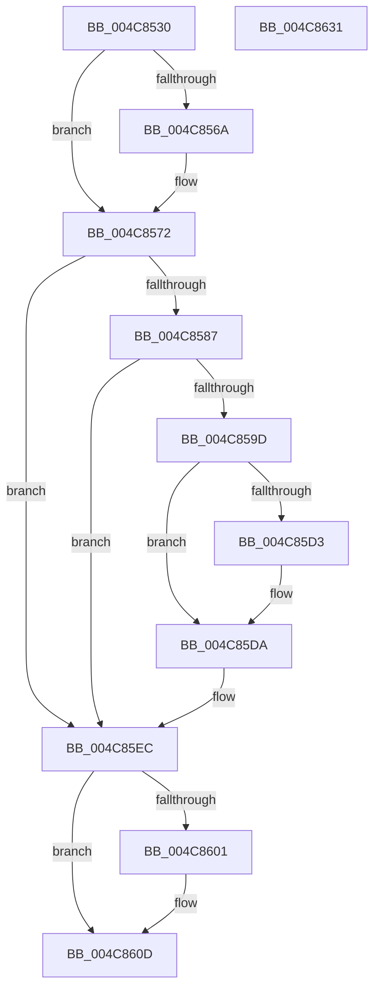

# KeRegisterBugCheckCallback

- RVA: `0x004C8530`–`0x004C8632` (길이 `258` bytes)
- VA: `0x00000001404C8530`
- 실행 섹션: `.text`
- PDB 이름 있음: `예`; PDB Function 태그: `아니요`
- unwind 정보 RVA: `0x00060300`
- 디코드: `68`개 명령, `258/258` bytes 표시
- 미해석 바이트: `0` (있으면 어셈블리에 `.byte`로 보존)

> 이 문서는 커널 이미지의 기계어와 PDB 기호를 분석해 생성했습니다. 4번과 5번은 함수 원형과 자료형을 바이너리 사용 방식에서 추정한 C 해석이며 원본 소스 복구 결과는 아닙니다.

## 1. Dependencies

- 직접 호출 지점: **5**; 고유 호출 대상: **5**
- 직접 호출자로 확인된 함수: **0**
- RIP 상대 이미지 참조: **4**

### Outgoing calls
- `0x004C856D` → [KiRaiseIrqlProcessIrqlFlags](../4F/KiRaiseIrqlProcessIrqlFlags_function_004F56FC.md) (function, `0x004F56FC`)
- `0x004C8579` → [KeAcquireSpinLockAtDpcLevel](../20/KeAcquireSpinLockAtDpcLevel_function_00208430.md) (function, `0x00208430`)
- `0x004C8594` → [KiCheckForDuplicateBugCheckCallback](../47/KiCheckForDuplicateBugCheckCallback_function_004721E0.md) (function, `0x004721E0`)
- `0x004C85F3` → [KxReleaseSpinLock](../20/KxReleaseSpinLock_function_00206670.md) (function, `0x00206670`)
- `0x004C8608` → [KiLowerIrqlProcessIrqlFlags](../4F/KiLowerIrqlProcessIrqlFlags_function_004F5698.md) (function, `0x004F5698`)

### Direct callers
- 이 함수 시작 RVA로 연결되는 직접 call은 확인되지 않았습니다. 간접 호출은 완전히 역산할 수 없습니다.

### Static image references
- `0x004C8561` → RVA `0x00FC6D20` (`ALMOSTRO`; read)
- `0x004C8572` → RVA `0x00F231A0` (`.data`; read)
- `0x004C8587` → RVA `0x00F23470` (`.data`; read)
- `0x004C85E5` → RVA `0x00F23470` (`.data`; write)

## 2. Other-region calls and transfers

- 다른 실행 섹션으로 향하는 call: **0**
- 별도 외부 분기/꼬리 이동을 확인하지 못했습니다.

## 3. Assembly (complete function range)

```asm
004C8530  48 89 5C 24 08                  mov qword ptr [rsp + 8], rbx
004C8535  48 89 6C 24 10                  mov qword ptr [rsp + 0x10], rbp
004C853A  48 89 74 24 18                  mov qword ptr [rsp + 0x18], rsi
004C853F  57                              push rdi
004C8540  41 56                           push r14
004C8542  41 57                           push r15
004C8544  48 83 EC 20                     sub rsp, 0x20
004C8548  41 8B E9                        mov ebp, r9d
004C854B  4D 8B F0                        mov r14, r8
004C854E  4C 8B FA                        mov r15, rdx
004C8551  48 8B D9                        mov rbx, rcx
004C8554  44 0F 20 C7                     mov rdi, cr8
004C8558  BA 0F 00 00 00                  mov edx, 0xf
004C855D  44 0F 22 C2                     mov cr8, rdx
004C8561  83 3D B8 E7 AF 00 00            cmp dword ptr [rip + 0xafe7b8], 0
004C8568  74 08                           je 0x1404c8572
004C856A  40 8A CF                        mov cl, dil
004C856D  E8 8A D1 02 00                  call 0x1404f56fc
004C8572  48 8D 0D 27 AC A5 00            lea rcx, [rip + 0xa5ac27]
004C8579  E8 B2 FE D3 FF                  call 0x140208430
004C857E  40 32 F6                        xor sil, sil
004C8581  40 38 73 38                     cmp byte ptr [rbx + 0x38], sil
004C8585  75 65                           jne 0x1404c85ec
004C8587  4C 8D 05 E2 AE A5 00            lea r8, [rip + 0xa5aee2]
004C858E  48 8B D3                        mov rdx, rbx
004C8591  49 8B C8                        mov rcx, r8
004C8594  E8 47 9C FA FF                  call 0x1404721e0
004C8599  84 C0                           test al, al
004C859B  75 4F                           jne 0x1404c85ec
004C859D  48 8B 4C 24 60                  mov rcx, qword ptr [rsp + 0x60]
004C85A2  49 8D 04 2F                     lea rax, [r15 + rbp]
004C85A6  49 03 C6                        add rax, r14
004C85A9  4C 89 7B 10                     mov qword ptr [rbx + 0x10], r15
004C85AD  48 03 C1                        add rax, rcx
004C85B0  4C 89 73 18                     mov qword ptr [rbx + 0x18], r14
004C85B4  48 89 43 30                     mov qword ptr [rbx + 0x30], rax
004C85B8  40 B6 01                        mov sil, 1
004C85BB  89 6B 20                        mov dword ptr [rbx + 0x20], ebp
004C85BE  48 89 4B 28                     mov qword ptr [rbx + 0x28], rcx
004C85C2  40 88 73 38                     mov byte ptr [rbx + 0x38], sil
004C85C6  48 8B 05 A3 AE A5 00            mov rax, qword ptr [rip + 0xa5aea3]
004C85CD  4C 39 40 08                     cmp qword ptr [rax + 8], r8
004C85D1  74 07                           je 0x1404c85da
004C85D3  B9 03 00 00 00                  mov ecx, 3
004C85D8  CD 29                           int 0x29
004C85DA  48 89 03                        mov qword ptr [rbx], rax
004C85DD  4C 89 43 08                     mov qword ptr [rbx + 8], r8
004C85E1  48 89 58 08                     mov qword ptr [rax + 8], rbx
004C85E5  48 89 1D 84 AE A5 00            mov qword ptr [rip + 0xa5ae84], rbx
004C85EC  48 8D 0D AD AB A5 00            lea rcx, [rip + 0xa5abad]
004C85F3  E8 78 E0 D3 FF                  call 0x140206670
004C85F8  83 3D 21 E7 AF 00 00            cmp dword ptr [rip + 0xafe721], 0
004C85FF  74 0C                           je 0x1404c860d
004C8601  44 0F 20 C1                     mov rcx, cr8
004C8605  40 8A D7                        mov dl, dil
004C8608  E8 8B D0 02 00                  call 0x1404f5698
004C860D  40 0F B6 CF                     movzx ecx, dil
004C8611  44 0F 22 C1                     mov cr8, rcx
004C8615  48 8B 5C 24 40                  mov rbx, qword ptr [rsp + 0x40]
004C861A  40 8A C6                        mov al, sil
004C861D  48 8B 74 24 50                  mov rsi, qword ptr [rsp + 0x50]
004C8622  48 8B 6C 24 48                  mov rbp, qword ptr [rsp + 0x48]
004C8627  48 83 C4 20                     add rsp, 0x20
004C862B  41 5F                           pop r15
004C862D  41 5E                           pop r14
004C862F  5F                              pop rdi
004C8630  C3                              ret
004C8631  CC                              int3
```

## 4. C-style interpretation (structured pseudocode)

```c
__int64 __fastcall KeRegisterBugCheckCallback(__int64 a1, __int64 a2, __int64 a3, int a4, __int64 a5)
{
    __int64 result;
    __int64 v_rsi;
    __int64 v_rsp;
    unsigned __int64 v_stack_p10;
    unsigned __int64 v_stack_p18;
    unsigned __int64 v_stack_p8;

    v_stack_p8 = v_rbx;
    v_stack_p10 = v_rbp;
    v_stack_p18 = v_rsi;
    v_rsp = (v_rsp) - (32);
    if ((*(unsigned int *)(v_rip + 11528120)) != 0) {
        a1 = (unsigned __int8)(v_cr8);
        result = KiRaiseIrqlProcessIrqlFlags(a1, 15, a3, a4);
    }
    result = KeAcquireSpinLockAtDpcLevel(v_rip + 10857511, 15, a3, a4);
    v_rsi = 0;
    if ((*(unsigned __int8 *)(a1 + 56)) != 0) goto loc_004C85EC;
    result = KiCheckForDuplicateBugCheckCallback(v_rip + 10858210, a1, v_rip + 10858210, a4);
    if ((unsigned __int8)(result) != 0) goto loc_004C85EC;
    result = (a2 + (unsigned int)(a4) * 1) + (a3);
    *(unsigned __int64 *)(a1 + 16) = a2;
    result = (result) + (a5);
    *(unsigned __int64 *)(a1 + 24) = a3;
    *(unsigned __int64 *)(a1 + 48) = result;
    *(unsigned int *)(a1 + 32) = (unsigned int)((unsigned int)(a4));
    *(unsigned __int64 *)(a1 + 40) = a5;
    *(unsigned __int8 *)(a1 + 56) = 1;
    if ((*(unsigned __int64 *)(*(unsigned __int64 *)(v_rip + 10858147) + 8)) != (v_rip + 10858210)) {
        a1 = 3;
    }
    *(unsigned __int64 *)(a1) = *(unsigned __int64 *)(v_rip + 10858147);
    *(unsigned __int64 *)(a1 + 8) = v_rip + 10858210;
    *(unsigned __int64 *)(*(unsigned __int64 *)(v_rip + 10858147) + 8) = a1;
    *(unsigned __int64 *)(v_rip + 10858116) = a1;
loc_004C85EC:
    result = KxReleaseSpinLock(v_rip + 10857389, a1, v_rip + 10858210, a4);
    if ((*(unsigned int *)(v_rip + 11527969)) != 0) {
        a1 = 15;
        a2 = (unsigned __int8)(v_cr8);
        result = KiLowerIrqlProcessIrqlFlags(a1, a2, v_rip + 10858210, a4);
    }
    v_rsp = (v_rsp) + (32);
    return 1;
}
```

## 5. (Beta) C Style

```c
int64_t KeRegisterBugCheckCallback(void *Arg1, void *Arg2, int64_t Arg3, int32_t Arg4, int64_t Arg5)
{
    uint8_t *arg1 = (uint8_t *)Arg1;
    uint8_t *arg2 = (uint8_t *)Arg2;

    int64_t result;
    int64_t local_rsi;
    int64_t local_rsp;
    uint64_t v_stack_p10;
    uint64_t v_stack_p18;
    uint64_t v_stack_p8;

    v_stack_p8 = local_rbx;
    v_stack_p10 = local_rbp;
    v_stack_p18 = local_rsi;
    local_rsp = (local_rsp) - (32);
    if ((*(uint32_t *)(v_rip + 0xAFE7B8)) != 0) {
        Arg1 = (uint8_t)(v_cr8);
        result = KiRaiseIrqlProcessIrqlFlags(Arg1, 15, Arg3, Arg4);
    }
    result = KeAcquireSpinLockAtDpcLevel(v_rip + 10857511, 15, Arg3, Arg4);
    local_rsi = 0;
    if ((*(uint8_t *)(arg1 + 0x38)) != 0) goto loc_004C85EC;
    result = KiCheckForDuplicateBugCheckCallback(v_rip + 10858210, Arg1, v_rip + 10858210, Arg4);
    if ((uint8_t)(result) != 0) goto loc_004C85EC;
    result = (Arg2 + (uint32_t)(Arg4) * 1) + (Arg3);
    *(void **)(arg1 + 0x10) = Arg2;
    result = (result) + (Arg5);
    *(uint64_t *)(arg1 + 0x18) = Arg3;
    *(uint64_t *)(arg1 + 0x30) = result;
    *(uint32_t *)(arg1 + 0x20) = (uint32_t)((uint32_t)(Arg4));
    *(uint64_t *)(arg1 + 0x28) = Arg5;
    *(uint8_t *)(arg1 + 0x38) = 1;
    if ((*(uint64_t *)(*(uint64_t *)(v_rip + 0xA5AEA3) + 0x8)) != (v_rip + 10858210)) {
        Arg1 = 3;
    }
    *(uint64_t *)(arg1) = *(uint64_t *)(v_rip + 0xA5AEA3);
    *(uint64_t *)(arg1 + 0x8) = v_rip + 10858210;
    *(void **)(*(uint64_t *)(v_rip + 0xA5AEA3) + 0x8) = Arg1;
    *(void **)(v_rip + 0xA5AE84) = Arg1;
loc_004C85EC:
    result = KxReleaseSpinLock(v_rip + 10857389, Arg1, v_rip + 10858210, Arg4);
    if ((*(uint32_t *)(v_rip + 0xAFE721)) != 0) {
        Arg1 = 15;
        Arg2 = (uint8_t)(v_cr8);
        result = KiLowerIrqlProcessIrqlFlags(Arg1, Arg2, v_rip + 10858210, Arg4);
    }
    local_rsp = (local_rsp) + (32);
    return 1;
}
```

### 관측된 메모리 오프셋

구조체 형식이 확인되지 않은 접근은 인자 기준의 오프셋으로만 기록했습니다.

| 기준 인자 | 오프셋 표현 | 폭 (bit) | 접근 |
|---|---:|---:|---|
| `Arg1` | `+ 0x0` | `64` | `W` |
| `Arg1` | `+ 0x8` | `64` | `W` |
| `Arg1` | `+ 0x10` | `64` | `W` |
| `Arg1` | `+ 0x18` | `64` | `W` |
| `Arg1` | `+ 0x20` | `32` | `W` |
| `Arg1` | `+ 0x28` | `64` | `W` |
| `Arg1` | `+ 0x30` | `64` | `W` |
| `Arg1` | `+ 0x38` | `8` | `R` |
| `Arg1` | `+ 0x38` | `8` | `W` |
| `Arg2` | `+ 0x0 + rbp*1` | `64` | `R` |

## 6. Execution-region graph

[열기: 2D/3D 그래프와 함수 탐색 컨트롤 패널](../../../control-panel.html?section=text&rva=0x004C8530&view=graph)

- 2D 그래프는 위에서 아래로 흐르고, 3D 그래프는 빈 공간을 드래그해 회전합니다. Shift+드래그는 이동, 휠은 확대·축소, 함수 노드 선택은 대상 보고서 이동입니다.

### Static fallback


