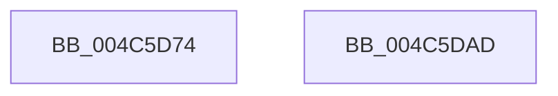

# KeSecureThread

- RVA: `0x004C5D74`–`0x004C5DAE` (길이 `58` bytes)
- VA: `0x00000001404C5D74`
- 실행 섹션: `.text`
- PDB 이름 있음: `예`; PDB Function 태그: `아니요`
- unwind 정보 RVA: `0x00063458`
- 디코드: `14`개 명령, `58/58` bytes 표시
- 미해석 바이트: `0` (있으면 어셈블리에 `.byte`로 보존)

> 이 문서는 커널 이미지의 기계어와 PDB 기호를 분석해 생성했습니다. 4번과 5번은 함수 원형과 자료형을 바이너리 사용 방식에서 추정한 C 해석이며 원본 소스 복구 결과는 아닙니다.

## 1. Dependencies

- 직접 호출 지점: **1**; 고유 호출 대상: **1**
- 직접 호출자로 확인된 함수: **1**
- RIP 상대 이미지 참조: **0**

### Outgoing calls
- `0x004C5DA3` → [VslCreateSecureThread](../../page/A9/VslCreateSecureThread_function_00A9CB70.md) (function, `0x00A9CB70`)

### Direct callers
- [PspCreateSecureThread](../../page/A8/PspCreateSecureThread_function_00A89160.md) at `0x00A89247`

### Static image references
- 디코드된 RIP-relative 메모리 참조가 없습니다.

## 2. Other-region calls and transfers

- 다른 실행 섹션으로 향하는 call: **1**
  - `0x004C5DA3` → [VslCreateSecureThread](../../page/A9/VslCreateSecureThread_function_00A9CB70.md) (`.text` → `PAGE`)
- 별도 외부 분기/꼬리 이동을 확인하지 못했습니다.

## 3. Assembly (complete function range)

```asm
004C5D74  48 83 EC 48                     sub rsp, 0x48
004C5D78  48 8D 81 1C 03 00 00            lea rax, [rcx + 0x31c]
004C5D7F  48 89 44 24 30                  mov qword ptr [rsp + 0x30], rax
004C5D84  48 8B 44 24 70                  mov rax, qword ptr [rsp + 0x70]
004C5D89  48 89 44 24 28                  mov qword ptr [rsp + 0x28], rax
004C5D8E  4C 89 4C 24 20                  mov qword ptr [rsp + 0x20], r9
004C5D93  4D 8B C8                        mov r9, r8
004C5D96  4C 8B C2                        mov r8, rdx
004C5D99  48 8B D1                        mov rdx, rcx
004C5D9C  48 8B 89 20 02 00 00            mov rcx, qword ptr [rcx + 0x220]
004C5DA3  E8 C8 6D 5D 00                  call 0x140a9cb70
004C5DA8  48 83 C4 48                     add rsp, 0x48
004C5DAC  C3                              ret
004C5DAD  CC                              int3
```

## 4. C-style interpretation (structured pseudocode)

```c
__int64 __fastcall KeSecureThread(__int64 a1, __int64 a2, __int64 a3, __int64 a4, __int64 a5)
{
    __int64 result;
    __int64 v_rsp;
    unsigned __int64 v_stack_m18;
    unsigned __int64 v_stack_m20;
    unsigned __int64 v_stack_m28;

    v_rsp = (v_rsp) - (72);
    v_stack_m18 = a1 + 796;
    v_stack_m20 = a5;
    v_stack_m28 = a4;
    result = VslCreateSecureThread(*(unsigned __int64 *)(a1 + 544), a1, a2, a3);
    v_rsp = (v_rsp) + (72);
    return result;
}
```

## 5. (Beta) C Style

```c
int64_t KeSecureThread(void *Arg1, int64_t Arg2, int64_t Arg3, int64_t Arg4, int64_t Arg5)
{
    uint8_t *arg1 = (uint8_t *)Arg1;

    int64_t result;
    int64_t local_rsp;
    uint64_t v_stack_m18;
    uint64_t v_stack_m20;
    uint64_t v_stack_m28;

    local_rsp = (local_rsp) - (72);
    v_stack_m18 = Arg1 + 796;
    v_stack_m20 = Arg5;
    v_stack_m28 = Arg4;
    result = VslCreateSecureThread(*(uint64_t *)(arg1 + 0x220), Arg1, Arg2, Arg3);
    local_rsp = (local_rsp) + (72);
    return result;
}
```

### 관측된 메모리 오프셋

구조체 형식이 확인되지 않은 접근은 인자 기준의 오프셋으로만 기록했습니다.

| 기준 인자 | 오프셋 표현 | 폭 (bit) | 접근 |
|---|---:|---:|---|
| `Arg1` | `+ 0x220` | `64` | `R` |
| `Arg1` | `+ 0x31C` | `64` | `R` |

## 6. Execution-region graph

[열기: 2D/3D 그래프와 함수 탐색 컨트롤 패널](../../../control-panel.html?section=text&rva=0x004C5D74&view=graph)

- 2D 그래프는 위에서 아래로 흐르고, 3D 그래프는 빈 공간을 드래그해 회전합니다. Shift+드래그는 이동, 휠은 확대·축소, 함수 노드 선택은 대상 보고서 이동입니다.

### Static fallback


