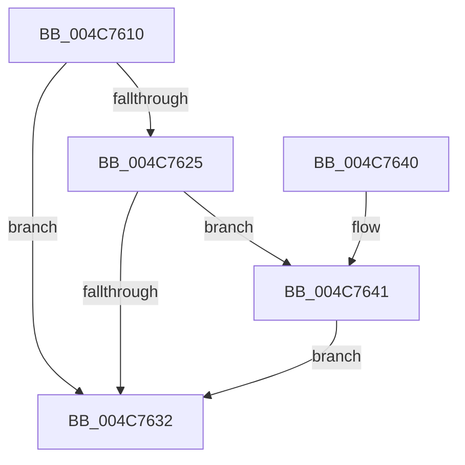

# KiDispatchPassiveInterrupts

- RVA: `0x004C7610`–`0x004C7648` (길이 `56` bytes)
- VA: `0x00000001404C7610`
- 실행 섹션: `.text`
- PDB 이름 있음: `예`; PDB Function 태그: `아니요`
- unwind 정보 RVA: `0x0005DAC8`
- 디코드: `17`개 명령, `56/56` bytes 표시
- 미해석 바이트: `0` (있으면 어셈블리에 `.byte`로 보존)

> 이 문서는 커널 이미지의 기계어와 PDB 기호를 분석해 생성했습니다. 4번과 5번은 함수 원형과 자료형을 바이너리 사용 방식에서 추정한 C 해석이며 원본 소스 복구 결과는 아닙니다.

## 1. Dependencies

- 직접 호출 지점: **2**; 고유 호출 대상: **2**
- 직접 호출자로 확인된 함수: **1**
- RIP 상대 이미지 참조: **1**

### Outgoing calls
- `0x004C7635` → [IoProcessPassiveInterrupts](../39/IoProcessPassiveInterrupts_function_0039F85C.md) (function, `0x0039F85C`)
- `0x004C7641` → [KiForceIdleInterruptNotify](../3A/KiForceIdleInterruptNotify_function_003A3830.md) (function, `0x003A3830`)

### Direct callers
- [KiScanInterruptObjectList](../6B/KiScanInterruptObjectList_function_006B3860.md) at `0x006B3979`

### Static image references
- `0x004C7616` → RVA `0x00FC6B38` (`ALMOSTRO`; read)

## 2. Other-region calls and transfers

- 다른 실행 섹션으로 향하는 call: **0**
- 별도 외부 분기/꼬리 이동을 확인하지 못했습니다.

## 3. Assembly (complete function range)

```asm
004C7610  40 53                           push rbx
004C7612  48 83 EC 20                     sub rsp, 0x20
004C7616  F7 05 18 F5 AF 00 00 00 00 10   test dword ptr [rip + 0xaff518], 0x10000000
004C7620  48 8B D9                        mov rbx, rcx
004C7623  74 0D                           je 0x1404c7632
004C7625  8B 41 58                        mov eax, dword ptr [rcx + 0x58]
004C7628  83 E8 30                        sub eax, 0x30
004C762B  3D 9F 00 00 00                  cmp eax, 0x9f
004C7630  76 0F                           jbe 0x1404c7641
004C7632  8B 4B 58                        mov ecx, dword ptr [rbx + 0x58]
004C7635  E8 22 82 ED FF                  call 0x14039f85c
004C763A  48 83 C4 20                     add rsp, 0x20
004C763E  5B                              pop rbx
004C763F  C3                              ret
004C7640  CC                              int3
004C7641  E8 EA C1 ED FF                  call 0x1403a3830
004C7646  EB EA                           jmp 0x1404c7632
```

## 4. C-style interpretation (structured pseudocode)

```c
__int64 __fastcall KiDispatchPassiveInterrupts(__int64 a1)
{
    __int64 result;
    __int64 v_rsp;

    v_rsp = (v_rsp) - (32);
    if (((*(unsigned int *)(v_rip + 11531544)) & (0x10000000ULL)) == 0) goto loc_004C7632;
    result = (unsigned int)(((unsigned int)(*(unsigned int *)(a1 + 88))) - (48));
    if (((unsigned int)(result)) <= 159) goto loc_004C7641;
loc_004C7632:
    result = IoProcessPassiveInterrupts((unsigned int)(*(unsigned int *)(a1 + 88)), a2, a3, a4);
    v_rsp = (v_rsp) + (32);
    return result;
loc_004C7641:
    result = KiForceIdleInterruptNotify((unsigned int)(*(unsigned int *)(a1 + 88)), a2, a3, a4);
    goto loc_004C7632;
}
```

## 5. (Beta) C Style

```c
int64_t KiDispatchPassiveInterrupts(void *Arg1)
{
    uint8_t *arg1 = (uint8_t *)Arg1;

    int64_t result;
    int64_t local_rsp;

    local_rsp = (local_rsp) - (32);
    if (((*(uint32_t *)(v_rip + 0xAFF518)) & (0x10000000ULL)) == 0) goto loc_004C7632;
    result = (uint32_t)(((uint32_t)(*(uint32_t *)(arg1 + 0x58))) - (48));
    if (((uint32_t)(result)) <= 159) goto loc_004C7641;
loc_004C7632:
    result = IoProcessPassiveInterrupts((uint32_t)(*(uint32_t *)(arg1 + 0x58)), a2, a3, a4);
    local_rsp = (local_rsp) + (32);
    return result;
loc_004C7641:
    result = KiForceIdleInterruptNotify((uint32_t)(*(uint32_t *)(arg1 + 0x58)), a2, a3, a4);
    goto loc_004C7632;
}
```

### 관측된 메모리 오프셋

구조체 형식이 확인되지 않은 접근은 인자 기준의 오프셋으로만 기록했습니다.

| 기준 인자 | 오프셋 표현 | 폭 (bit) | 접근 |
|---|---:|---:|---|
| `Arg1` | `+ 0x58` | `32` | `R` |

## 6. Execution-region graph

[열기: 2D/3D 그래프와 함수 탐색 컨트롤 패널](../../../control-panel.html?section=text&rva=0x004C7610&view=graph)

- 2D 그래프는 위에서 아래로 흐르고, 3D 그래프는 빈 공간을 드래그해 회전합니다. Shift+드래그는 이동, 휠은 확대·축소, 함수 노드 선택은 대상 보고서 이동입니다.

### Static fallback


