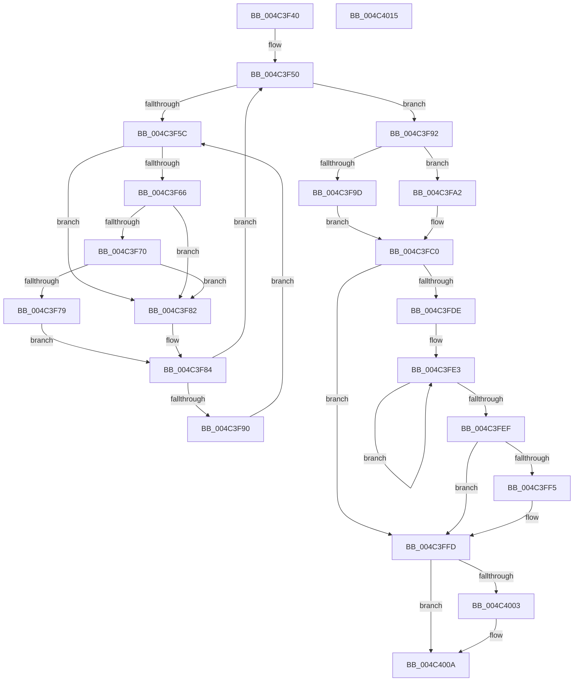

# KiForceIdleStartDpcRoutine

- RVA: `0x004C3F40`–`0x004C4016` (길이 `214` bytes)
- VA: `0x00000001404C3F40`
- 실행 섹션: `.text`
- PDB 이름 있음: `예`; PDB Function 태그: `아니요`
- unwind 정보 RVA: `0x0005CAAC`
- 디코드: `60`개 명령, `214/214` bytes 표시
- 미해석 바이트: `0` (있으면 어셈블리에 `.byte`로 보존)

> 이 문서는 커널 이미지의 기계어와 PDB 기호를 분석해 생성했습니다. 4번과 5번은 함수 원형과 자료형을 바이너리 사용 방식에서 추정한 C 해석이며 원본 소스 복구 결과는 아닙니다.

## 1. Dependencies

- 직접 호출 지점: **5**; 고유 호출 대상: **5**
- 직접 호출자로 확인된 함수: **0**
- RIP 상대 이미지 참조: **6**

### Outgoing calls
- `0x004C3F70` → [KiCheckVpBackingLongSpinWaitHypercall](../30/KiCheckVpBackingLongSpinWaitHypercall_function_0030F490.md) (function, `0x0030F490`)
- `0x004C3F7B` → [HvlNotifyLongSpinWait](../30/HvlNotifyLongSpinWait_function_0030F460.md) (function, `0x0030F460`)
- `0x004C3FA7` → [KiSetForceIdleState](../48/KiSetForceIdleState_function_0048DCC0.md) (function, `0x0048DCC0`)
- `0x004C3FF8` → [KiRemoveSystemWorkPriorityKick](../26/KiRemoveSystemWorkPriorityKick_function_002631D0.md) (function, `0x002631D0`)
- `0x004C4005` → [KiForceIdleUpdateSchedulerParkState](../48/KiForceIdleUpdateSchedulerParkState_function_0048D874.md) (function, `0x0048D874`)

### Direct callers
- 이 함수 시작 RVA로 연결되는 직접 call은 확인되지 않았습니다. 간접 호출은 완전히 역산할 수 없습니다.

### Static image references
- `0x004C3F50` → RVA `0x00F23140` (`.data`; read/write)
- `0x004C3F5E` → RVA `0x00FC52AC` (`ALMOSTRO`; reference)
- `0x004C3F66` → RVA `0x00FC6AB8` (`ALMOSTRO`; read)
- `0x004C3F84` → RVA `0x00F23140` (`.data`; read)
- `0x004C3F92` → RVA `0x00F233CC` (`.data`; read)
- `0x004C3FB9` → RVA `0x00F232F0` (`.data`; write)

## 2. Other-region calls and transfers

- 다른 실행 섹션으로 향하는 call: **0**
- 별도 외부 분기/꼬리 이동을 확인하지 못했습니다.

## 3. Assembly (complete function range)

```asm
004C3F40  48 89 5C 24 08                  mov qword ptr [rsp + 8], rbx
004C3F45  57                              push rdi
004C3F46  48 83 EC 20                     sub rsp, 0x20
004C3F4A  40 32 FF                        xor dil, dil
004C3F4D  FA                              cli
004C3F4E  33 DB                           xor ebx, ebx
004C3F50  F0 48 0F BA 2D E6 F1 A5 00 00   lock bts qword ptr [rip + 0xa5f1e6], 0
004C3F5A  73 36                           jae 0x1404c3f92
004C3F5C  FF C3                           inc ebx
004C3F5E  85 1D 48 13 B0 00               test dword ptr [rip + 0xb01348], ebx
004C3F64  75 1C                           jne 0x1404c3f82
004C3F66  8B 05 4C 2B B0 00               mov eax, dword ptr [rip + 0xb02b4c]
004C3F6C  A8 40                           test al, 0x40
004C3F6E  74 12                           je 0x1404c3f82
004C3F70  E8 1B B5 E4 FF                  call 0x14030f490
004C3F75  84 C0                           test al, al
004C3F77  74 09                           je 0x1404c3f82
004C3F79  8B CB                           mov ecx, ebx
004C3F7B  E8 E0 B4 E4 FF                  call 0x14030f460
004C3F80  EB 02                           jmp 0x1404c3f84
004C3F82  F3 90                           pause
004C3F84  48 8B 05 B5 F1 A5 00            mov rax, qword ptr [rip + 0xa5f1b5]
004C3F8B  48 85 C0                        test rax, rax
004C3F8E  74 C0                           je 0x1404c3f50
004C3F90  EB CA                           jmp 0x1404c3f5c
004C3F92  8B 05 34 F4 A5 00               mov eax, dword ptr [rip + 0xa5f434]
004C3F98  83 F8 01                        cmp eax, 1
004C3F9B  74 05                           je 0x1404c3fa2
004C3F9D  40 B7 01                        mov dil, 1
004C3FA0  EB 1E                           jmp 0x1404c3fc0
004C3FA2  B9 04 00 00 00                  mov ecx, 4
004C3FA7  E8 14 9D FC FF                  call 0x14048dcc0
004C3FAC  48 B8 08 00 00 00 80 F7 FF FF   movabs rax, 0xfffff78000000008
004C3FB6  48 8B 00                        mov rax, qword ptr [rax]
004C3FB9  48 89 05 30 F3 A5 00            mov qword ptr [rip + 0xa5f330], rax
004C3FC0  F0 48 83 25 77 F1 A5 00 00      lock and qword ptr [rip + 0xa5f177], 0
004C3FC9  65 4C 8B 04 25 20 00 00 00      mov r8, qword ptr gs:[0x20]
004C3FD2  49 8B 90 B8 8E 00 00            mov rdx, qword ptr [r8 + 0x8eb8]
004C3FD9  48 85 D2                        test rdx, rdx
004C3FDC  74 1F                           je 0x1404c3ffd
004C3FDE  0F 0D 0A                        prefetchw byte ptr [rdx]
004C3FE1  8B 02                           mov eax, dword ptr [rdx]
004C3FE3  8B C8                           mov ecx, eax
004C3FE5  0F BA F1 15                     btr ecx, 0x15
004C3FE9  F0 0F B1 0A                     lock cmpxchg dword ptr [rdx], ecx
004C3FED  75 F4                           jne 0x1404c3fe3
004C3FEF  0F BA E0 15                     bt eax, 0x15
004C3FF3  73 08                           jae 0x1404c3ffd
004C3FF5  49 8B C8                        mov rcx, r8
004C3FF8  E8 D3 F1 D9 FF                  call 0x1402631d0
004C3FFD  FB                              sti
004C3FFE  40 84 FF                        test dil, dil
004C4001  75 07                           jne 0x1404c400a
004C4003  B1 01                           mov cl, 1
004C4005  E8 6A 98 FC FF                  call 0x14048d874
004C400A  48 8B 5C 24 30                  mov rbx, qword ptr [rsp + 0x30]
004C400F  48 83 C4 20                     add rsp, 0x20
004C4013  5F                              pop rdi
004C4014  C3                              ret
004C4015  CC                              int3
```

## 4. C-style interpretation (structured pseudocode)

```c
__int64 __fastcall KiForceIdleStartDpcRoutine(void)
{
    __int64 result;
    __int64 v_rbx;
    __int64 v_rdi;
    __int64 v_rsp;
    unsigned __int64 v_stack_p8;

    v_stack_p8 = v_rbx;
    v_rsp = (v_rsp) - (32);
    v_rdi = 0;
    v_rbx = 0;
loc_004C3F50:
    if (condition_is_above_or_equal) goto loc_004C3F92;
loc_004C3F5C:
    v_rbx = (unsigned int)((v_rbx) + 1);
    if (((*(unsigned int *)(v_rip + 11539272)) & ((unsigned int)(v_rbx))) != 0) goto loc_004C3F82;
    if ((((unsigned __int8)((unsigned int)(*(unsigned int *)(v_rip + 11545420)))) & (64)) == 0) goto loc_004C3F82;
    result = KiCheckVpBackingLongSpinWaitHypercall(a1, a2, a3, a4);
    if ((unsigned __int8)(result) == 0) goto loc_004C3F82;
    result = HvlNotifyLongSpinWait((unsigned int)((unsigned int)(v_rbx)), a2, a3, a4);
    goto loc_004C3F84;
loc_004C3F82:
loc_004C3F84:
    if (*(unsigned __int64 *)(v_rip + 10875317) == 0) goto loc_004C3F50;
    goto loc_004C3F5C;
loc_004C3F92:
    if (((unsigned int)((unsigned int)(*(unsigned int *)(v_rip + 10875956)))) == 1) goto loc_004C3FA2;
    goto loc_004C3FC0;
loc_004C3FA2:
    result = KiSetForceIdleState(4, a2, a3, a4);
    *(unsigned __int64 *)(v_rip + 10875696) = *(unsigned __int64 *)(result);
loc_004C3FC0:
    if (*(unsigned __int64 *)(*(unsigned __int64 *)(gs_base + (0 + 32)) + 36536) == 0) goto loc_004C3FFD;
loc_004C3FE3:
    if (*(unsigned __int64 *)(*(unsigned __int64 *)(gs_base + (0 + 32)) + 36536) != 0) goto loc_004C3FE3;
    result = (unsigned int)(*(unsigned int *)(*(unsigned __int64 *)(*(unsigned __int64 *)(gs_base + (0 + 32)) + 36536)));
    if (!(condition_is_above_or_equal)) {
        a1 = *(unsigned __int64 *)(gs_base + (0 + 32));
        result = KiRemoveSystemWorkPriorityKick(a1, *(unsigned __int64 *)(*(unsigned __int64 *)(gs_base + (0 + 32)) + 36536), *(unsigned __int64 *)(gs_base + (0 + 32)), a4);
    }
    if (1 == 0) {
        a1 = 1;
        result = KiForceIdleUpdateSchedulerParkState(a1, *(unsigned __int64 *)(*(unsigned __int64 *)(gs_base + (0 + 32)) + 36536), *(unsigned __int64 *)(gs_base + (0 + 32)), a4);
    }
    v_rsp = (v_rsp) + (32);
    return result;
}
```

## 5. (Beta) C Style

```c
void KiForceIdleStartDpcRoutine(void)
{
    int64_t result;
    int64_t local_rbx;
    int64_t local_rdi;
    int64_t local_rsp;
    uint64_t v_stack_p8;

    v_stack_p8 = local_rbx;
    local_rsp = (local_rsp) - (32);
    local_rdi = 0;
    local_rbx = 0;
loc_004C3F50:
    if (condition_is_above_or_equal) goto loc_004C3F92;
loc_004C3F5C:
    local_rbx = (uint32_t)((local_rbx) + 1);
    if (((*(uint32_t *)(v_rip + 0xB01348)) & ((uint32_t)(local_rbx))) != 0) goto loc_004C3F82;
    if ((((uint8_t)((uint32_t)(*(uint32_t *)(v_rip + 0xB02B4C)))) & (64)) == 0) goto loc_004C3F82;
    result = KiCheckVpBackingLongSpinWaitHypercall(a1, a2, a3, a4);
    if ((uint8_t)(result) == 0) goto loc_004C3F82;
    result = HvlNotifyLongSpinWait((uint32_t)((uint32_t)(local_rbx)), a2, a3, a4);
    goto loc_004C3F84;
loc_004C3F82:
loc_004C3F84:
    if (*(uint64_t *)(v_rip + 0xA5F1B5) == 0) goto loc_004C3F50;
    goto loc_004C3F5C;
loc_004C3F92:
    if (((uint32_t)((uint32_t)(*(uint32_t *)(v_rip + 0xA5F434)))) == 1) goto loc_004C3FA2;
    goto loc_004C3FC0;
loc_004C3FA2:
    result = KiSetForceIdleState(4, a2, a3, a4);
    *(uint64_t *)(v_rip + 0xA5F330) = *(uint64_t *)(result);
loc_004C3FC0:
    if (*(uint64_t *)(*(uint64_t *)(gs_base + (0 + 0x20)) + 0x8EB8) == 0) goto loc_004C3FFD;
loc_004C3FE3:
    if (*(uint64_t *)(*(uint64_t *)(gs_base + (0 + 0x20)) + 0x8EB8) != 0) goto loc_004C3FE3;
    result = (uint32_t)(*(uint32_t *)(*(uint64_t *)(*(uint64_t *)(gs_base + (0 + 0x20)) + 0x8EB8)));
    if (!(condition_is_above_or_equal)) {
        a1 = *(uint64_t *)(gs_base + (0 + 0x20));
        result = KiRemoveSystemWorkPriorityKick(a1, *(uint64_t *)(*(uint64_t *)(gs_base + (0 + 0x20)) + 0x8EB8), *(uint64_t *)(gs_base + (0 + 0x20)), a4);
    }
    if (1 == 0) {
        a1 = 1;
        result = KiForceIdleUpdateSchedulerParkState(a1, *(uint64_t *)(*(uint64_t *)(gs_base + (0 + 0x20)) + 0x8EB8), *(uint64_t *)(gs_base + (0 + 0x20)), a4);
    }
    local_rsp = (local_rsp) + (32);
    return result;
}
```

## 6. Execution-region graph

[열기: 2D/3D 그래프와 함수 탐색 컨트롤 패널](../../../control-panel.html?section=text&rva=0x004C3F40&view=graph)

- 2D 그래프는 위에서 아래로 흐르고, 3D 그래프는 빈 공간을 드래그해 회전합니다. Shift+드래그는 이동, 휠은 확대·축소, 함수 노드 선택은 대상 보고서 이동입니다.

### Static fallback


