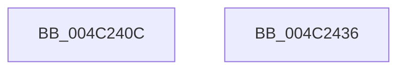

# KiInitializeAvailableCpusWorkItem

- RVA: `0x004C240C`–`0x004C2437` (길이 `43` bytes)
- VA: `0x00000001404C240C`
- 실행 섹션: `.text`
- PDB 이름 있음: `예`; PDB Function 태그: `아니요`
- unwind 정보 RVA: `0x000DB714`
- 디코드: `12`개 명령, `43/43` bytes 표시
- 미해석 바이트: `0` (있으면 어셈블리에 `.byte`로 보존)

> 이 문서는 커널 이미지의 기계어와 PDB 기호를 분석해 생성했습니다. 4번과 5번은 함수 원형과 자료형을 바이너리 사용 방식에서 추정한 C 해석이며 원본 소스 복구 결과는 아닙니다.

## 1. Dependencies

- 직접 호출 지점: **0**; 고유 호출 대상: **0**
- 직접 호출자로 확인된 함수: **1**
- RIP 상대 이미지 참조: **1**

### Outgoing calls
- 직접 디코드된 call 명령이 없습니다.

### Direct callers
- [KeRegisterAvailableCpusChangeNotification](../../page/74/KeRegisterAvailableCpusChangeNotification_function_00745D7C.md) at `0x00745DD8`

### Static image references
- `0x004C240F` → RVA `0x005B9A90` (`KiAvailableCpusWorkItemCallbackWrapper`; read)

## 2. Other-region calls and transfers

- 다른 실행 섹션으로 향하는 call: **0**
- 별도 외부 분기/꼬리 이동을 확인하지 못했습니다.

## 3. Assembly (complete function range)

```asm
004C240C  45 33 C9                        xor r9d, r9d
004C240F  48 8D 05 7A 76 0F 00            lea rax, [rip + 0xf767a]
004C2416  4C 89 49 08                     mov qword ptr [rcx + 8], r9
004C241A  4C 89 49 28                     mov qword ptr [rcx + 0x28], r9
004C241E  48 89 41 10                     mov qword ptr [rcx + 0x10], rax
004C2422  48 89 49 18                     mov qword ptr [rcx + 0x18], rcx
004C2426  4C 89 09                        mov qword ptr [rcx], r9
004C2429  4C 89 49 20                     mov qword ptr [rcx + 0x20], r9
004C242D  48 89 51 30                     mov qword ptr [rcx + 0x30], rdx
004C2431  4C 89 41 38                     mov qword ptr [rcx + 0x38], r8
004C2435  C3                              ret
004C2436  CC                              int3
```

## 4. C-style interpretation (structured pseudocode)

```c
__int64 __fastcall KiInitializeAvailableCpusWorkItem(__int64 a1, __int64 a2, __int64 a3, int a4)
{
    a4 = 0;
    *(unsigned __int64 *)(a1 + 8) = 0;
    *(unsigned __int64 *)(a1 + 40) = 0;
    *(unsigned __int64 *)(a1 + 16) = v_rip + 1013370;
    *(unsigned __int64 *)(a1 + 24) = a1;
    *(unsigned __int64 *)(a1) = 0;
    *(unsigned __int64 *)(a1 + 32) = 0;
    *(unsigned __int64 *)(a1 + 48) = a2;
    *(unsigned __int64 *)(a1 + 56) = a3;
    return v_rip + 1013370;
}
```

## 5. (Beta) C Style

```c
int64_t KiInitializeAvailableCpusWorkItem(void *Arg1, int64_t Arg2, int64_t Arg3, int32_t Arg4)
{
    uint8_t *arg1 = (uint8_t *)Arg1;

    Arg4 = 0;
    *(uint64_t *)(arg1 + 0x8) = 0;
    *(uint64_t *)(arg1 + 0x28) = 0;
    *(uint64_t *)(arg1 + 0x10) = v_rip + 1013370;
    *(void **)(arg1 + 0x18) = Arg1;
    *(uint64_t *)(arg1) = 0;
    *(uint64_t *)(arg1 + 0x20) = 0;
    *(uint64_t *)(arg1 + 0x30) = Arg2;
    *(uint64_t *)(arg1 + 0x38) = Arg3;
    return v_rip + 1013370;
}
```

### 관측된 메모리 오프셋

구조체 형식이 확인되지 않은 접근은 인자 기준의 오프셋으로만 기록했습니다.

| 기준 인자 | 오프셋 표현 | 폭 (bit) | 접근 |
|---|---:|---:|---|
| `Arg1` | `+ 0x0` | `64` | `W` |
| `Arg1` | `+ 0x8` | `64` | `W` |
| `Arg1` | `+ 0x10` | `64` | `W` |
| `Arg1` | `+ 0x18` | `64` | `W` |
| `Arg1` | `+ 0x20` | `64` | `W` |
| `Arg1` | `+ 0x28` | `64` | `W` |
| `Arg1` | `+ 0x30` | `64` | `W` |
| `Arg1` | `+ 0x38` | `64` | `W` |

## 6. Execution-region graph

[열기: 2D/3D 그래프와 함수 탐색 컨트롤 패널](../../../control-panel.html?section=text&rva=0x004C240C&view=graph)

- 2D 그래프는 위에서 아래로 흐르고, 3D 그래프는 빈 공간을 드래그해 회전합니다. Shift+드래그는 이동, 휠은 확대·축소, 함수 노드 선택은 대상 보고서 이동입니다.

### Static fallback


