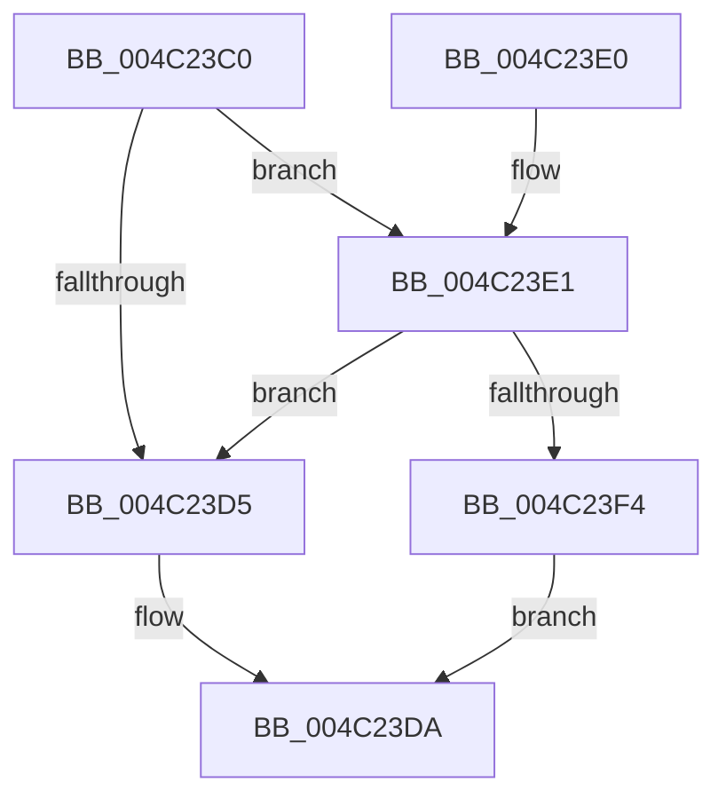

# KiOpGetPciConfigSpaceAccessInfoFromPhysicalAddress

- RVA: `0x004C23C0`–`0x004C2405` (길이 `69` bytes)
- VA: `0x00000001404C23C0`
- 실행 섹션: `.text`
- PDB 이름 있음: `예`; PDB Function 태그: `아니요`
- unwind 정보 RVA: `0x000BCA68`
- 디코드: `21`개 명령, `69/69` bytes 표시
- 미해석 바이트: `0` (있으면 어셈블리에 `.byte`로 보존)

> 이 문서는 커널 이미지의 기계어와 PDB 기호를 분석해 생성했습니다. 4번과 5번은 함수 원형과 자료형을 바이너리 사용 방식에서 추정한 C 해석이며 원본 소스 복구 결과는 아닙니다.

## 1. Dependencies

- 직접 호출 지점: **1**; 고유 호출 대상: **1**
- 직접 호출자로 확인된 함수: **2**
- RIP 상대 이미지 참조: **1**

### Outgoing calls
- `0x004C23EB` → [guard_dispatch_icall](../6B/guard_dispatch_icall_function_006BAAD0.md) (function, `0x006BAAD0`)

### Direct callers
- [KiOpCheckUnhandledSecurePciAccessViolation](../5C/KiOpCheckUnhandledSecurePciAccessViolation_function_005C6708.md) at `0x005C675A`
- [KiOpPciConfigSpaceAccessCommon](../5C/KiOpPciConfigSpaceAccessCommon_function_005C6AAC.md) at `0x005C6B1B`

### Static image references
- `0x004C23C6` → RVA `0x00E00CC0` (`.data`; read)

## 2. Other-region calls and transfers

- 다른 실행 섹션으로 향하는 call: **0**
- 별도 외부 분기/꼬리 이동을 확인하지 못했습니다.

## 3. Assembly (complete function range)

```asm
004C23C0  40 53                           push rbx
004C23C2  48 83 EC 30                     sub rsp, 0x30
004C23C6  48 8B 05 F3 E8 93 00            mov rax, qword ptr [rip + 0x93e8f3]
004C23CD  48 8B D9                        mov rbx, rcx
004C23D0  48 85 C0                        test rax, rax
004C23D3  75 0C                           jne 0x1404c23e1
004C23D5  B8 01 00 00 C0                  mov eax, 0xc0000001
004C23DA  48 83 C4 30                     add rsp, 0x30
004C23DE  5B                              pop rbx
004C23DF  C3                              ret
004C23E0  CC                              int3
004C23E1  4C 8B 54 24 60                  mov r10, qword ptr [rsp + 0x60]
004C23E6  4C 89 54 24 20                  mov qword ptr [rsp + 0x20], r10
004C23EB  E8 E0 86 1F 00                  call 0x1406baad0
004C23F0  84 C0                           test al, al
004C23F2  74 E1                           je 0x1404c23d5
004C23F4  48 8B 44 24 68                  mov rax, qword ptr [rsp + 0x68]
004C23F9  81 E3 FF 0F 00 00               and ebx, 0xfff
004C23FF  89 18                           mov dword ptr [rax], ebx
004C2401  33 C0                           xor eax, eax
004C2403  EB D5                           jmp 0x1404c23da
```

## 4. C-style interpretation (structured pseudocode)

```c
__int64 __fastcall KiOpGetPciConfigSpaceAccessInfoFromPhysicalAddress(__int64 a1, __int64 a2, __int64 a3, __int64 a4, __int64 a5, __int64 a6)
{
    __int64 result;
    __int64 v_rbx;
    __int64 v_rsp;
    unsigned __int64 v_stack_p20;

    v_rsp = (v_rsp) - (48);
    if (*(unsigned __int64 *)(v_rip + 9693427) != 0) goto loc_004C23E1;
loc_004C23D5:
loc_004C23DA:
    v_rsp = (v_rsp) + (48);
    return (unsigned int)(0xC0000001ULL);
loc_004C23E1:
    v_stack_p20 = a5;
    result = guard_dispatch_icall(a1, a2, a3, a4);
    if ((unsigned __int8)(result) == 0) goto loc_004C23D5;
    v_rbx = (unsigned int)((a1) & (0xFFFULL));
    *(unsigned int *)(a6) = (unsigned int)(v_rbx);
    result = 0;
    goto loc_004C23DA;
}
```

## 5. (Beta) C Style

```c
int64_t KiOpGetPciConfigSpaceAccessInfoFromPhysicalAddress(int64_t Arg1, int64_t Arg2, int64_t Arg3, int64_t Arg4, int64_t Arg5, void *Arg6)
{
    uint8_t *arg6 = (uint8_t *)Arg6;

    int64_t result;
    int64_t local_rbx;
    int64_t local_rsp;
    uint64_t v_stack_p20;

    local_rsp = (local_rsp) - (48);
    if (*(uint64_t *)(v_rip + 0x93E8F3) != 0) goto loc_004C23E1;
loc_004C23D5:
loc_004C23DA:
    local_rsp = (local_rsp) + (48);
    return (uint32_t)(0xC0000001ULL);
loc_004C23E1:
    v_stack_p20 = Arg5;
    result = guard_dispatch_icall(Arg1, Arg2, Arg3, Arg4);
    if ((uint8_t)(result) == 0) goto loc_004C23D5;
    local_rbx = (uint32_t)((Arg1) & (0xFFFULL));
    *(uint32_t *)(arg6) = (uint32_t)(local_rbx);
    result = 0;
    goto loc_004C23DA;
}
```

### 관측된 메모리 오프셋

구조체 형식이 확인되지 않은 접근은 인자 기준의 오프셋으로만 기록했습니다.

| 기준 인자 | 오프셋 표현 | 폭 (bit) | 접근 |
|---|---:|---:|---|
| `Arg6` | `+ 0x0` | `32` | `W` |

## 6. Execution-region graph

[열기: 2D/3D 그래프와 함수 탐색 컨트롤 패널](../../../control-panel.html?section=text&rva=0x004C23C0&view=graph)

- 2D 그래프는 위에서 아래로 흐르고, 3D 그래프는 빈 공간을 드래그해 회전합니다. Shift+드래그는 이동, 휠은 확대·축소, 함수 노드 선택은 대상 보고서 이동입니다.

### Static fallback


