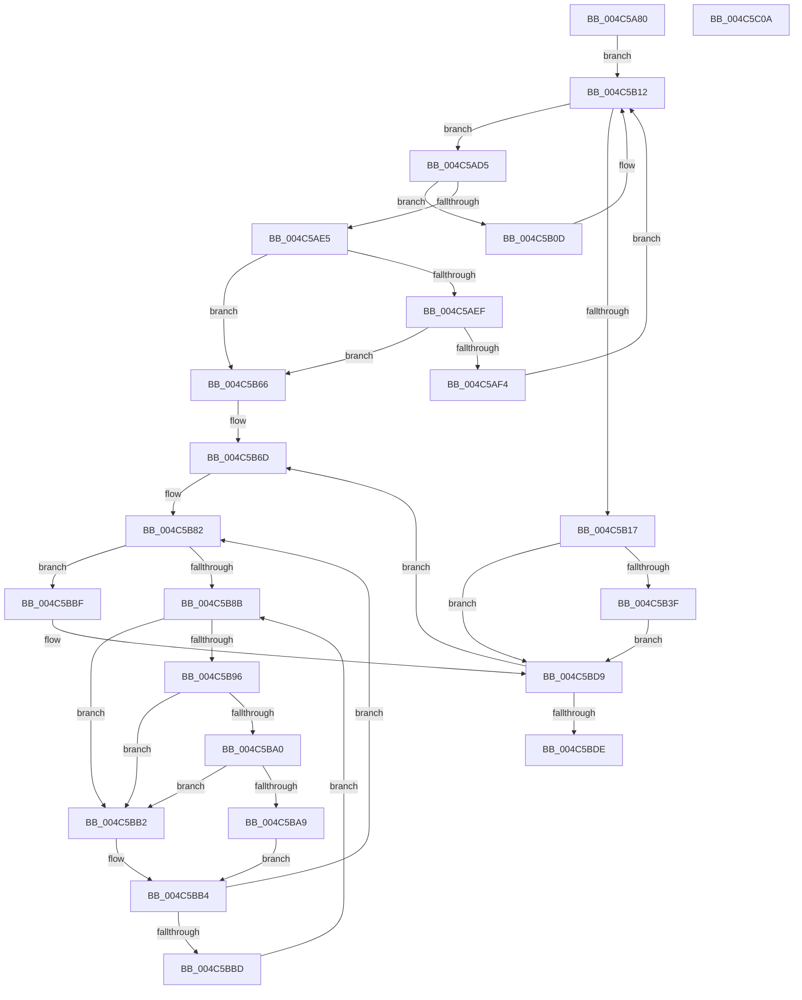

# KiProcessPendingForegroundBoosts

- RVA: `0x004C5A80`–`0x004C5C0B` (길이 `395` bytes)
- VA: `0x00000001404C5A80`
- 실행 섹션: `.text`
- PDB 이름 있음: `예`; PDB Function 태그: `아니요`
- unwind 정보 RVA: `0x00093E28`
- 디코드: `107`개 명령, `395/395` bytes 표시
- 미해석 바이트: `0` (있으면 어셈블리에 `.byte`로 보존)

> 이 문서는 커널 이미지의 기계어와 PDB 기호를 분석해 생성했습니다. 4번과 5번은 함수 원형과 자료형을 바이너리 사용 방식에서 추정한 C 해석이며 원본 소스 복구 결과는 아닙니다.

## 1. Dependencies

- 직접 호출 지점: **7**; 고유 호출 대상: **7**
- 직접 호출자로 확인된 함수: **0**
- RIP 상대 이미지 참조: **5**

### Outgoing calls
- `0x004C5ABC` → [KeAcquireSpinLockAtDpcLevel](../20/KeAcquireSpinLockAtDpcLevel_function_00208430.md) (function, `0x00208430`)
- `0x004C5B2D` → [KxReleaseSpinLock](../20/KxReleaseSpinLock_function_00206670.md) (function, `0x00206670`)
- `0x004C5B5F` → [KeSetTimer2](../3A/KeSetTimer2_function_003A08E0.md) (function, `0x003A08E0`)
- `0x004C5BA0` → [KiCheckVpBackingLongSpinWaitHypercall](../30/KiCheckVpBackingLongSpinWaitHypercall_function_0030F490.md) (function, `0x0030F490`)
- `0x004C5BAB` → [HvlNotifyLongSpinWait](../30/HvlNotifyLongSpinWait_function_0030F460.md) (function, `0x0030F460`)
- `0x004C5BC7` → [KiApplyForegroundBoostThread](../4F/KiApplyForegroundBoostThread_function_004F7DC0.md) (function, `0x004F7DC0`)
- `0x004C5BEC` → [KiReadyDeferredReadyList](../30/KiReadyDeferredReadyList_function_0030DD80.md) (function, `0x0030DD80`)

### Direct callers
- 이 함수 시작 RVA로 연결되는 직접 call은 확인되지 않았습니다. 간접 호출은 완전히 역산할 수 없습니다.

### Static image references
- `0x004C5A9A` → RVA `0x00F22D38` (`.data`; read)
- `0x004C5AC1` → RVA `0x00F22D28` (`.data`; read)
- `0x004C5B58` → RVA `0x00F22C20` (`.data`; read)
- `0x004C5B8E` → RVA `0x00FC52AC` (`ALMOSTRO`; reference)
- `0x004C5B96` → RVA `0x00FC6AB8` (`ALMOSTRO`; read)

## 2. Other-region calls and transfers

- 다른 실행 섹션으로 향하는 call: **0**
- 별도 외부 분기/꼬리 이동을 확인하지 못했습니다.

## 3. Assembly (complete function range)

```asm
004C5A80  48 8B C4                        mov rax, rsp
004C5A83  48 89 58 08                     mov qword ptr [rax + 8], rbx
004C5A87  48 89 68 10                     mov qword ptr [rax + 0x10], rbp
004C5A8B  48 89 70 18                     mov qword ptr [rax + 0x18], rsi
004C5A8F  57                              push rdi
004C5A90  41 56                           push r14
004C5A92  41 57                           push r15
004C5A94  48 83 EC 40                     sub rsp, 0x40
004C5A98  33 ED                           xor ebp, ebp
004C5A9A  48 8D 0D 97 D2 A5 00            lea rcx, [rip + 0xa5d297]
004C5AA1  0F 57 C0                        xorps xmm0, xmm0
004C5AA4  48 89 68 C8                     mov qword ptr [rax - 0x38], rbp
004C5AA8  48 BF 20 03 00 00 80 F7 FF FF   movabs rdi, 0xfffff78000000320
004C5AB2  8B DD                           mov ebx, ebp
004C5AB4  0F 11 40 D0                     movups xmmword ptr [rax - 0x30], xmm0
004C5AB8  8B F5                           mov esi, ebp
004C5ABA  8B 3F                           mov edi, dword ptr [rdi]
004C5ABC  E8 6F 29 D4 FF                  call 0x140208430
004C5AC1  48 8B 0D 60 D2 A5 00            mov rcx, qword ptr [rip + 0xa5d260]
004C5AC8  4C 8D 05 59 D2 A5 00            lea r8, [rip + 0xa5d259]
004C5ACF  44 8D 75 01                     lea r14d, [rbp + 1]
004C5AD3  EB 3D                           jmp 0x1404c5b12
004C5AD5  48 8B C1                        mov rax, rcx
004C5AD8  8B D7                           mov edx, edi
004C5ADA  48 8B 09                        mov rcx, qword ptr [rcx]
004C5ADD  2B 50 F8                        sub edx, dword ptr [rax - 8]
004C5AE0  41 3B D6                        cmp edx, r14d
004C5AE3  72 28                           jb 0x1404c5b0d
004C5AE5  48 8B 50 08                     mov rdx, qword ptr [rax + 8]
004C5AE9  48 39 41 08                     cmp qword ptr [rcx + 8], rax
004C5AED  75 77                           jne 0x1404c5b66
004C5AEF  48 39 02                        cmp qword ptr [rdx], rax
004C5AF2  75 72                           jne 0x1404c5b66
004C5AF4  48 89 0A                        mov qword ptr [rdx], rcx
004C5AF7  48 89 51 08                     mov qword ptr [rcx + 8], rdx
004C5AFB  48 89 18                        mov qword ptr [rax], rbx
004C5AFE  48 8B D8                        mov rbx, rax
004C5B01  48 89 68 08                     mov qword ptr [rax + 8], rbp
004C5B05  66 F0 44 01 70 F4               lock add word ptr [rax - 0xc], r14w
004C5B0B  EB 05                           jmp 0x1404c5b12
004C5B0D  3B D6                           cmp edx, esi
004C5B0F  0F 47 F2                        cmova esi, edx
004C5B12  49 3B C8                        cmp rcx, r8
004C5B15  75 BE                           jne 0x1404c5ad5
004C5B17  4C 39 05 0A D2 A5 00            cmp qword ptr [rip + 0xa5d20a], r8
004C5B1E  48 8D 0D 13 D2 A5 00            lea rcx, [rip + 0xa5d213]
004C5B25  40 0F B6 FD                     movzx edi, bpl
004C5B29  41 0F 45 FE                     cmovne edi, r14d
004C5B2D  E8 3E 0B D4 FF                  call 0x140206670
004C5B32  49 83 CF FF                     or r15, 0xffffffffffffffff
004C5B36  40 84 FF                        test dil, dil
004C5B39  0F 84 9A 00 00 00               je 0x1404c5bd9
004C5B3F  41 8B C6                        mov eax, r14d
004C5B42  4C 89 7C 24 30                  mov qword ptr [rsp + 0x30], r15
004C5B47  2B C6                           sub eax, esi
004C5B49  4C 8D 4C 24 28                  lea r9, [rsp + 0x28]
004C5B4E  48 69 D0 10 B6 FD FF            imul rdx, rax, -0x249f0
004C5B55  45 33 C0                        xor r8d, r8d
004C5B58  48 8D 0D C1 D0 A5 00            lea rcx, [rip + 0xa5d0c1]
004C5B5F  E8 7C AD ED FF                  call 0x1403a08e0
004C5B64  EB 73                           jmp 0x1404c5bd9
004C5B66  B9 03 00 00 00                  mov ecx, 3
004C5B6B  CD 29                           int 0x29
004C5B6D  48 8B CB                        mov rcx, rbx
004C5B70  48 8B FB                        mov rdi, rbx
004C5B73  48 8B 1B                        mov rbx, qword ptr [rbx]
004C5B76  48 81 C7 90 FC FF FF            add rdi, -0x370
004C5B7D  8B F5                           mov esi, ebp
004C5B7F  4C 89 31                        mov qword ptr [rcx], r14
004C5B82  F0 48 0F BA 6F 40 00            lock bts qword ptr [rdi + 0x40], 0
004C5B89  73 34                           jae 0x1404c5bbf
004C5B8B  41 03 F6                        add esi, r14d
004C5B8E  85 35 18 F7 AF 00               test dword ptr [rip + 0xaff718], esi
004C5B94  75 1C                           jne 0x1404c5bb2
004C5B96  8B 05 1C 0F B0 00               mov eax, dword ptr [rip + 0xb00f1c]
004C5B9C  A8 40                           test al, 0x40
004C5B9E  74 12                           je 0x1404c5bb2
004C5BA0  E8 EB 98 E4 FF                  call 0x14030f490
004C5BA5  84 C0                           test al, al
004C5BA7  74 09                           je 0x1404c5bb2
004C5BA9  8B CE                           mov ecx, esi
004C5BAB  E8 B0 98 E4 FF                  call 0x14030f460
004C5BB0  EB 02                           jmp 0x1404c5bb4
004C5BB2  F3 90                           pause
004C5BB4  48 8B 47 40                     mov rax, qword ptr [rdi + 0x40]
004C5BB8  48 85 C0                        test rax, rax
004C5BBB  74 C5                           je 0x1404c5b82
004C5BBD  EB CC                           jmp 0x1404c5b8b
004C5BBF  48 8D 54 24 20                  lea rdx, [rsp + 0x20]
004C5BC4  48 8B CF                        mov rcx, rdi
004C5BC7  E8 F4 21 03 00                  call 0x1404f7dc0
004C5BCC  48 89 6F 40                     mov qword ptr [rdi + 0x40], rbp
004C5BD0  66 F0 44 01 BF 64 03 00 00      lock add word ptr [rdi + 0x364], r15w
004C5BD9  48 85 DB                        test rbx, rbx
004C5BDC  75 8F                           jne 0x1404c5b6d
004C5BDE  65 48 8B 0C 25 20 00 00 00      mov rcx, qword ptr gs:[0x20]
004C5BE7  48 8D 54 24 20                  lea rdx, [rsp + 0x20]
004C5BEC  E8 8F 81 E4 FF                  call 0x14030dd80
004C5BF1  48 8B 5C 24 60                  mov rbx, qword ptr [rsp + 0x60]
004C5BF6  48 8B 6C 24 68                  mov rbp, qword ptr [rsp + 0x68]
004C5BFB  48 8B 74 24 70                  mov rsi, qword ptr [rsp + 0x70]
004C5C00  48 83 C4 40                     add rsp, 0x40
004C5C04  41 5F                           pop r15
004C5C06  41 5E                           pop r14
004C5C08  5F                              pop rdi
004C5C09  C3                              ret
004C5C0A  CC                              int3
```

## 4. C-style interpretation (structured pseudocode)

```c
__int64 __fastcall KiProcessPendingForegroundBoosts(void)
{
    __int64 result;
    __int64 v_r15;
    __int64 v_rbp;
    __int64 v_rdi;
    __int64 v_rsi;
    __int64 v_rsp;
    unsigned __int64 v_stack_m28;
    unsigned __int64 v_stack_m30;
    unsigned __int64 v_stack_m38;
    unsigned __int64 v_stack_p10;
    unsigned __int64 v_stack_p18;
    unsigned __int64 v_stack_p8;

    *(unsigned __int64 *)(v_rsp + 8) = v_rbx;
    *(unsigned __int64 *)(v_rsp + 16) = v_rbp;
    *(unsigned __int64 *)(v_rsp + 24) = v_rsi;
    v_rsp = (v_rsp) - (64);
    v_rbp = 0;
    *(unsigned __int64 *)(v_rsp - 56) = 0;
    *(unsigned __int64 *)(v_rsp - 48) = v_xmm0;
    result = KeAcquireSpinLockAtDpcLevel(v_rip + 10867351, a2, a3, a4);
    goto loc_004C5B12;
loc_004C5AD5:
    a2 = (unsigned int)(((unsigned int)((unsigned int)((unsigned int)(*(unsigned int *)(v_rdi))))) - (*(unsigned int *)(*(unsigned __int64 *)(v_rip + 10867296) - 8)));
    if (((unsigned int)(a2)) < ((unsigned int)(v_rbp + 1))) goto loc_004C5B0D;
    if ((*(unsigned __int64 *)(*(unsigned __int64 *)(*(unsigned __int64 *)(v_rip + 10867296)) + 8)) != (*(unsigned __int64 *)(v_rip + 10867296))) goto loc_004C5B66;
    if ((*(unsigned __int64 *)(*(unsigned __int64 *)(*(unsigned __int64 *)(v_rip + 10867296) + 8))) != (*(unsigned __int64 *)(v_rip + 10867296))) goto loc_004C5B66;
    *(unsigned __int64 *)(*(unsigned __int64 *)(*(unsigned __int64 *)(v_rip + 10867296) + 8)) = *(unsigned __int64 *)(*(unsigned __int64 *)(v_rip + 10867296));
    *(unsigned __int64 *)(*(unsigned __int64 *)(*(unsigned __int64 *)(v_rip + 10867296)) + 8) = *(unsigned __int64 *)(*(unsigned __int64 *)(v_rip + 10867296) + 8);
    *(unsigned __int64 *)(*(unsigned __int64 *)(v_rip + 10867296)) = 0;
    *(unsigned __int64 *)(*(unsigned __int64 *)(v_rip + 10867296) + 8) = 0;
    goto loc_004C5B12;
loc_004C5B0D:
    v_rsi = 0;
    if (((unsigned int)(*(unsigned __int64 *)(*(unsigned __int64 *)(v_rip + 10867296) + 8))) > 0) { v_rsi = (unsigned int)(*(unsigned __int64 *)(*(unsigned __int64 *)(v_rip + 10867296) + 8)); }
loc_004C5B12:
    if ((*(unsigned __int64 *)(*(unsigned __int64 *)(v_rip + 10867296))) != (v_rip + 10867289)) goto loc_004C5AD5;
    v_rdi = 0;
    if ((*(unsigned __int64 *)(v_rip + 10867210)) != (v_rip + 10867289)) { v_rdi = (unsigned int)(v_rbp + 1); }
    result = KxReleaseSpinLock(v_rip + 10867219, *(unsigned __int64 *)(*(unsigned __int64 *)(v_rip + 10867296) + 8), v_rip + 10867289, a4);
    v_r15 = (v_r15) | (-1);
    if ((unsigned __int8)(v_rdi) == 0) goto loc_004C5BD9;
    v_stack_m28 = v_r15;
    result = (unsigned int)(((unsigned int)((unsigned int)(v_rbp + 1))) - ((unsigned int)(v_rsi)));
    a2 = (*(unsigned __int64 *)(*(unsigned __int64 *)(v_rip + 10867296) + 8)) * (result);
    a3 = 0;
    result = KeSetTimer2(v_rip + 10866881, a2, a3, v_stack_m30);
    goto loc_004C5BD9;
loc_004C5B66:
loc_004C5B6D:
    v_rdi = (*(unsigned __int64 *)(v_rip + 10867296)) + (-880);
    *(unsigned __int64 *)(*(unsigned __int64 *)(v_rip + 10867296)) = v_rbp + 1;
loc_004C5B82:
    if (condition_is_above_or_equal) goto loc_004C5BBF;
loc_004C5B8B:
    v_rsi = (unsigned int)((0) + ((unsigned int)(v_rbp + 1)));
    if (((*(unsigned int *)(v_rip + 11532056)) & ((unsigned int)(v_rsi))) != 0) goto loc_004C5BB2;
    if ((((unsigned __int8)((unsigned int)(*(unsigned int *)(v_rip + 11538204)))) & (64)) == 0) goto loc_004C5BB2;
    result = KiCheckVpBackingLongSpinWaitHypercall(*(unsigned __int64 *)(v_rip + 10867296), a2, a3, v_stack_m30);
    if ((unsigned __int8)(result) == 0) goto loc_004C5BB2;
    result = HvlNotifyLongSpinWait((unsigned int)((unsigned int)(v_rsi)), a2, a3, v_stack_m30);
    goto loc_004C5BB4;
loc_004C5BB2:
loc_004C5BB4:
    if (*(unsigned __int64 *)(v_rdi + 64) == 0) goto loc_004C5B82;
    goto loc_004C5B8B;
loc_004C5BBF:
    result = KiApplyForegroundBoostThread(v_rdi, v_stack_m38, a3, v_stack_m30);
    *(unsigned __int64 *)(v_rdi + 64) = 0;
loc_004C5BD9:
    if (*(unsigned __int64 *)(*(unsigned __int64 *)(v_rip + 10867296)) != 0) goto loc_004C5B6D;
    result = KiReadyDeferredReadyList(*(unsigned __int64 *)(gs_base + (0 + 32)), v_stack_m38, a3, v_stack_m30);
    v_rsp = (v_rsp) + (64);
    return result;
}
```

## 5. (Beta) C Style

```c
void KiProcessPendingForegroundBoosts(void)
{
    int64_t result;
    int64_t local_r15;
    int64_t local_rbp;
    int64_t local_rdi;
    int64_t local_rsi;
    int64_t local_rsp;
    uint64_t v_stack_m28;
    uint64_t v_stack_m30;
    uint64_t v_stack_m38;
    uint64_t v_stack_p10;
    uint64_t v_stack_p18;
    uint64_t v_stack_p8;

    *(uint64_t *)(local_rsp + 0x8) = local_rbx;
    *(uint64_t *)(local_rsp + 0x10) = local_rbp;
    *(uint64_t *)(local_rsp + 0x18) = local_rsi;
    local_rsp = (local_rsp) - (64);
    local_rbp = 0;
    *(uint64_t *)(local_rsp - 0x38) = 0;
    *(uint64_t *)(local_rsp - 0x30) = v_xmm0;
    result = KeAcquireSpinLockAtDpcLevel(v_rip + 10867351, a2, a3, a4);
    goto loc_004C5B12;
loc_004C5AD5:
    a2 = (uint32_t)(((uint32_t)((uint32_t)((uint32_t)(*(uint32_t *)(local_rdi))))) - (*(uint32_t *)(*(uint64_t *)(v_rip + 0xA5D260) - 0x8)));
    if (((uint32_t)(a2)) < ((uint32_t)(local_rbp + 1))) goto loc_004C5B0D;
    if ((*(uint64_t *)(*(uint64_t *)(*(uint64_t *)(v_rip + 0xA5D260)) + 0x8)) != (*(uint64_t *)(v_rip + 0xA5D260))) goto loc_004C5B66;
    if ((*(uint64_t *)(*(uint64_t *)(*(uint64_t *)(v_rip + 0xA5D260) + 0x8))) != (*(uint64_t *)(v_rip + 0xA5D260))) goto loc_004C5B66;
    *(uint64_t *)(*(uint64_t *)(*(uint64_t *)(v_rip + 0xA5D260) + 0x8)) = *(uint64_t *)(*(uint64_t *)(v_rip + 0xA5D260));
    *(uint64_t *)(*(uint64_t *)(*(uint64_t *)(v_rip + 0xA5D260)) + 0x8) = *(uint64_t *)(*(uint64_t *)(v_rip + 0xA5D260) + 0x8);
    *(uint64_t *)(*(uint64_t *)(v_rip + 0xA5D260)) = 0;
    *(uint64_t *)(*(uint64_t *)(v_rip + 0xA5D260) + 0x8) = 0;
    goto loc_004C5B12;
loc_004C5B0D:
    local_rsi = 0;
    if (((uint32_t)(*(uint64_t *)(*(uint64_t *)(v_rip + 0xA5D260) + 0x8))) > 0) { local_rsi = (uint32_t)(*(uint64_t *)(*(uint64_t *)(v_rip + 0xA5D260) + 0x8)); }
loc_004C5B12:
    if ((*(uint64_t *)(*(uint64_t *)(v_rip + 0xA5D260))) != (v_rip + 10867289)) goto loc_004C5AD5;
    local_rdi = 0;
    if ((*(uint64_t *)(v_rip + 0xA5D20A)) != (v_rip + 10867289)) { local_rdi = (uint32_t)(local_rbp + 1); }
    result = KxReleaseSpinLock(v_rip + 10867219, *(uint64_t *)(*(uint64_t *)(v_rip + 0xA5D260) + 0x8), v_rip + 10867289, a4);
    local_r15 = (local_r15) | (-1);
    if ((uint8_t)(local_rdi) == 0) goto loc_004C5BD9;
    v_stack_m28 = local_r15;
    result = (uint32_t)(((uint32_t)((uint32_t)(local_rbp + 1))) - ((uint32_t)(local_rsi)));
    a2 = (*(uint64_t *)(*(uint64_t *)(v_rip + 0xA5D260) + 0x8)) * (result);
    a3 = 0;
    result = KeSetTimer2(v_rip + 10866881, a2, a3, v_stack_m30);
    goto loc_004C5BD9;
loc_004C5B66:
loc_004C5B6D:
    local_rdi = (*(uint64_t *)(v_rip + 0xA5D260)) + (-880);
    *(uint64_t *)(*(uint64_t *)(v_rip + 0xA5D260)) = local_rbp + 1;
loc_004C5B82:
    if (condition_is_above_or_equal) goto loc_004C5BBF;
loc_004C5B8B:
    local_rsi = (uint32_t)((0) + ((uint32_t)(local_rbp + 1)));
    if (((*(uint32_t *)(v_rip + 0xAFF718)) & ((uint32_t)(local_rsi))) != 0) goto loc_004C5BB2;
    if ((((uint8_t)((uint32_t)(*(uint32_t *)(v_rip + 0xB00F1C)))) & (64)) == 0) goto loc_004C5BB2;
    result = KiCheckVpBackingLongSpinWaitHypercall(*(uint64_t *)(v_rip + 0xA5D260), a2, a3, v_stack_m30);
    if ((uint8_t)(result) == 0) goto loc_004C5BB2;
    result = HvlNotifyLongSpinWait((uint32_t)((uint32_t)(local_rsi)), a2, a3, v_stack_m30);
    goto loc_004C5BB4;
loc_004C5BB2:
loc_004C5BB4:
    if (*(uint64_t *)(local_rdi + 0x40) == 0) goto loc_004C5B82;
    goto loc_004C5B8B;
loc_004C5BBF:
    result = KiApplyForegroundBoostThread(local_rdi, v_stack_m38, a3, v_stack_m30);
    *(uint64_t *)(local_rdi + 0x40) = 0;
loc_004C5BD9:
    if (*(uint64_t *)(*(uint64_t *)(v_rip + 0xA5D260)) != 0) goto loc_004C5B6D;
    result = KiReadyDeferredReadyList(*(uint64_t *)(gs_base + (0 + 0x20)), v_stack_m38, a3, v_stack_m30);
    local_rsp = (local_rsp) + (64);
    return result;
}
```

## 6. Execution-region graph

[열기: 2D/3D 그래프와 함수 탐색 컨트롤 패널](../../../control-panel.html?section=text&rva=0x004C5A80&view=graph)

- 2D 그래프는 위에서 아래로 흐르고, 3D 그래프는 빈 공간을 드래그해 회전합니다. Shift+드래그는 이동, 휠은 확대·축소, 함수 노드 선택은 대상 보고서 이동입니다.

### Static fallback


