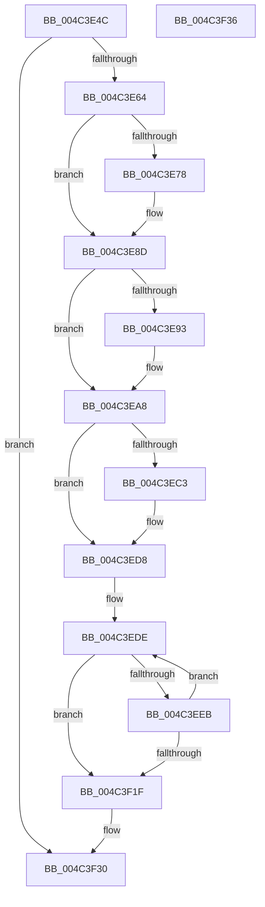

# KiRestoreIptState

- RVA: `0x004C3E4C`–`0x004C3F37` (길이 `235` bytes)
- VA: `0x00000001404C3E4C`
- 실행 섹션: `.text`
- PDB 이름 있음: `예`; PDB Function 태그: `아니요`
- unwind 정보 RVA: `0x00071750`
- 디코드: `66`개 명령, `235/235` bytes 표시
- 미해석 바이트: `0` (있으면 어셈블리에 `.byte`로 보존)

> 이 문서는 커널 이미지의 기계어와 PDB 기호를 분석해 생성했습니다. 4번과 5번은 함수 원형과 자료형을 바이너리 사용 방식에서 추정한 C 해석이며 원본 소스 복구 결과는 아닙니다.

## 1. Dependencies

- 직접 호출 지점: **0**; 고유 호출 대상: **0**
- 직접 호출자로 확인된 함수: **3**
- RIP 상대 이미지 참조: **2**

### Outgoing calls
- 직접 디코드된 call 명령이 없습니다.

### Direct callers
- [KeRestoreIptStateAfterProcessorComesOnline](../4B/KeRestoreIptStateAfterProcessorComesOnline_function_004BE824.md) at `0x004BE855`
- [KeRestoreSupervisorState](../5B/KeRestoreSupervisorState_function_005B9C30.md) at `0x005B9CA1`
- [KiRestoreThreadIptState](../5B/KiRestoreThreadIptState_function_005BA0F0.md) at `0x005BA10F`

### Static image references
- `0x004C3E57` → RVA `0x00FC5110` (`ALMOSTRO`; read)
- `0x004C3E64` → RVA `0x00FC6B94` (`ALMOSTRO`; read)

## 2. Other-region calls and transfers

- 다른 실행 섹션으로 향하는 call: **0**
- 별도 외부 분기/꼬리 이동을 확인하지 못했습니다.

## 3. Assembly (complete function range)

```asm
004C3E4C  48 89 5C 24 08                  mov qword ptr [rsp + 8], rbx
004C3E51  45 33 D2                        xor r10d, r10d
004C3E54  4C 8B C1                        mov r8, rcx
004C3E57  44 39 15 B2 12 B0 00            cmp dword ptr [rip + 0xb012b2], r10d
004C3E5E  0F 84 CC 00 00 00               je 0x1404c3f30
004C3E64  44 8B 0D 29 2D B0 00            mov r9d, dword ptr [rip + 0xb02d29]
004C3E6B  49 83 C0 08                     add r8, 8
004C3E6F  48 8B 19                        mov rbx, qword ptr [rcx]
004C3E72  41 F6 C1 02                     test r9b, 2
004C3E76  74 15                           je 0x1404c3e8d
004C3E78  49 8B 10                        mov rdx, qword ptr [r8]
004C3E7B  B9 60 05 00 00                  mov ecx, 0x560
004C3E80  48 8B C2                        mov rax, rdx
004C3E83  48 C1 EA 20                     shr rdx, 0x20
004C3E87  0F 30                           wrmsr
004C3E89  49 83 C0 08                     add r8, 8
004C3E8D  41 F6 C1 04                     test r9b, 4
004C3E91  74 15                           je 0x1404c3ea8
004C3E93  49 8B 10                        mov rdx, qword ptr [r8]
004C3E96  B9 61 05 00 00                  mov ecx, 0x561
004C3E9B  48 8B C2                        mov rax, rdx
004C3E9E  48 C1 EA 20                     shr rdx, 0x20
004C3EA2  0F 30                           wrmsr
004C3EA4  49 83 C0 08                     add r8, 8
004C3EA8  49 8B 10                        mov rdx, qword ptr [r8]
004C3EAB  B9 71 05 00 00                  mov ecx, 0x571
004C3EB0  48 8B C2                        mov rax, rdx
004C3EB3  48 C1 EA 20                     shr rdx, 0x20
004C3EB7  0F 30                           wrmsr
004C3EB9  49 83 C0 08                     add r8, 8
004C3EBD  41 F6 C1 10                     test r9b, 0x10
004C3EC1  74 15                           je 0x1404c3ed8
004C3EC3  49 8B 10                        mov rdx, qword ptr [r8]
004C3EC6  B9 72 05 00 00                  mov ecx, 0x572
004C3ECB  48 8B C2                        mov rax, rdx
004C3ECE  48 C1 EA 20                     shr rdx, 0x20
004C3ED2  0F 30                           wrmsr
004C3ED4  49 83 C0 08                     add r8, 8
004C3ED8  41 BB 81 05 00 00               mov r11d, 0x581
004C3EDE  41 8D 4A 05                     lea ecx, [r10 + 5]
004C3EE2  0F B6 C1                        movzx eax, cl
004C3EE5  41 0F A3 C1                     bt r9d, eax
004C3EE9  73 34                           jae 0x1404c3f1f
004C3EEB  49 8B 10                        mov rdx, qword ptr [r8]
004C3EEE  41 8D 4B FF                     lea ecx, [r11 - 1]
004C3EF2  48 8B C2                        mov rax, rdx
004C3EF5  48 C1 EA 20                     shr rdx, 0x20
004C3EF9  0F 30                           wrmsr
004C3EFB  49 8B 50 08                     mov rdx, qword ptr [r8 + 8]
004C3EFF  41 8B CB                        mov ecx, r11d
004C3F02  48 8B C2                        mov rax, rdx
004C3F05  48 C1 EA 20                     shr rdx, 0x20
004C3F09  0F 30                           wrmsr
004C3F0B  49 83 C0 10                     add r8, 0x10
004C3F0F  41 FF C2                        inc r10d
004C3F12  41 83 C3 02                     add r11d, 2
004C3F16  41 81 FB 89 05 00 00            cmp r11d, 0x589
004C3F1D  72 BF                           jb 0x1404c3ede
004C3F1F  48 8B D3                        mov rdx, rbx
004C3F22  48 8B C3                        mov rax, rbx
004C3F25  48 C1 EA 20                     shr rdx, 0x20
004C3F29  B9 70 05 00 00                  mov ecx, 0x570
004C3F2E  0F 30                           wrmsr
004C3F30  48 8B 5C 24 08                  mov rbx, qword ptr [rsp + 8]
004C3F35  C3                              ret
004C3F36  CC                              int3
```

## 4. C-style interpretation (structured pseudocode)

```c
__int64 __fastcall KiRestoreIptState(__int64 a1)
{
    __int64 result;
    __int64 v_r10;
    __int64 v_r11;
    unsigned __int64 v_stack_p8;

    v_stack_p8 = v_rbx;
    v_r10 = 0;
    if ((*(unsigned int *)(v_rip + 11539122)) == 0) goto loc_004C3F30;
    a3 = (a1) + (8);
    if ((((unsigned __int8)((unsigned int)(*(unsigned int *)(v_rip + 11545897)))) & (2)) != 0) {
        a2 = *(unsigned __int64 *)(a3);
        a1 = 0x560ULL;
        result = a2;
        a2 = (a2) >> (32);
        a3 = (a3) + (8);
    }
    if ((((unsigned __int8)((unsigned int)(*(unsigned int *)(v_rip + 11545897)))) & (4)) != 0) {
        a2 = *(unsigned __int64 *)(a3);
        a1 = 0x561ULL;
        result = a2;
        a2 = (a2) >> (32);
        a3 = (a3) + (8);
    }
    a2 = (*(unsigned __int64 *)(a3)) >> (32);
    a3 = (a3) + (8);
    result = *(unsigned __int64 *)(a3);
    if ((((unsigned __int8)((unsigned int)(*(unsigned int *)(v_rip + 11545897)))) & (16)) != 0) {
        a2 = *(unsigned __int64 *)(a3);
        a1 = 0x572ULL;
        result = a2;
        a2 = (a2) >> (32);
        a3 = (a3) + (8);
    }
loc_004C3EDE:
    if (condition_is_above_or_equal) goto loc_004C3F1F;
    a2 = (*(unsigned __int64 *)(a3)) >> (32);
    a2 = (*(unsigned __int64 *)(a3 + 8)) >> (32);
    a3 = (a3) + (16);
    v_r10 = (unsigned int)((v_r10) + 1);
    v_r11 = (unsigned int)(((unsigned int)(0x581ULL)) + (2));
    if (((unsigned int)(v_r11)) < 0x589ULL) goto loc_004C3EDE;
loc_004C3F1F:
    a2 = (*(unsigned __int64 *)(a1)) >> (32);
loc_004C3F30:
    return *(unsigned __int64 *)(a1);
}
```

## 5. (Beta) C Style

```c
int64_t KiRestoreIptState(void *Arg1)
{
    uint8_t *arg1 = (uint8_t *)Arg1;

    int64_t result;
    int64_t local_r10;
    int64_t local_r11;
    uint64_t v_stack_p8;

    v_stack_p8 = local_rbx;
    local_r10 = 0;
    if ((*(uint32_t *)(v_rip + 0xB012B2)) == 0) goto loc_004C3F30;
    a3 = (Arg1) + (8);
    if ((((uint8_t)((uint32_t)(*(uint32_t *)(v_rip + 0xB02D29)))) & (2)) != 0) {
        a2 = *(uint64_t *)(a3);
        Arg1 = 0x560ULL;
        result = a2;
        a2 = (a2) >> (32);
        a3 = (a3) + (8);
    }
    if ((((uint8_t)((uint32_t)(*(uint32_t *)(v_rip + 0xB02D29)))) & (4)) != 0) {
        a2 = *(uint64_t *)(a3);
        Arg1 = 0x561ULL;
        result = a2;
        a2 = (a2) >> (32);
        a3 = (a3) + (8);
    }
    a2 = (*(uint64_t *)(a3)) >> (32);
    a3 = (a3) + (8);
    result = *(uint64_t *)(a3);
    if ((((uint8_t)((uint32_t)(*(uint32_t *)(v_rip + 0xB02D29)))) & (16)) != 0) {
        a2 = *(uint64_t *)(a3);
        Arg1 = 0x572ULL;
        result = a2;
        a2 = (a2) >> (32);
        a3 = (a3) + (8);
    }
loc_004C3EDE:
    if (condition_is_above_or_equal) goto loc_004C3F1F;
    a2 = (*(uint64_t *)(a3)) >> (32);
    a2 = (*(uint64_t *)(a3 + 0x8)) >> (32);
    a3 = (a3) + (16);
    local_r10 = (uint32_t)((local_r10) + 1);
    local_r11 = (uint32_t)(((uint32_t)(0x581ULL)) + (2));
    if (((uint32_t)(local_r11)) < 0x589ULL) goto loc_004C3EDE;
loc_004C3F1F:
    a2 = (*(uint64_t *)(arg1)) >> (32);
loc_004C3F30:
    return *(uint64_t *)(arg1);
}
```

### 관측된 메모리 오프셋

구조체 형식이 확인되지 않은 접근은 인자 기준의 오프셋으로만 기록했습니다.

| 기준 인자 | 오프셋 표현 | 폭 (bit) | 접근 |
|---|---:|---:|---|
| `Arg1` | `+ 0x0` | `64` | `R` |
| `Arg1` | `+ 0x8` | `64` | `R` |

## 6. Execution-region graph

[열기: 2D/3D 그래프와 함수 탐색 컨트롤 패널](../../../control-panel.html?section=text&rva=0x004C3E4C&view=graph)

- 2D 그래프는 위에서 아래로 흐르고, 3D 그래프는 빈 공간을 드래그해 회전합니다. Shift+드래그는 이동, 휠은 확대·축소, 함수 노드 선택은 대상 보고서 이동입니다.

### Static fallback


