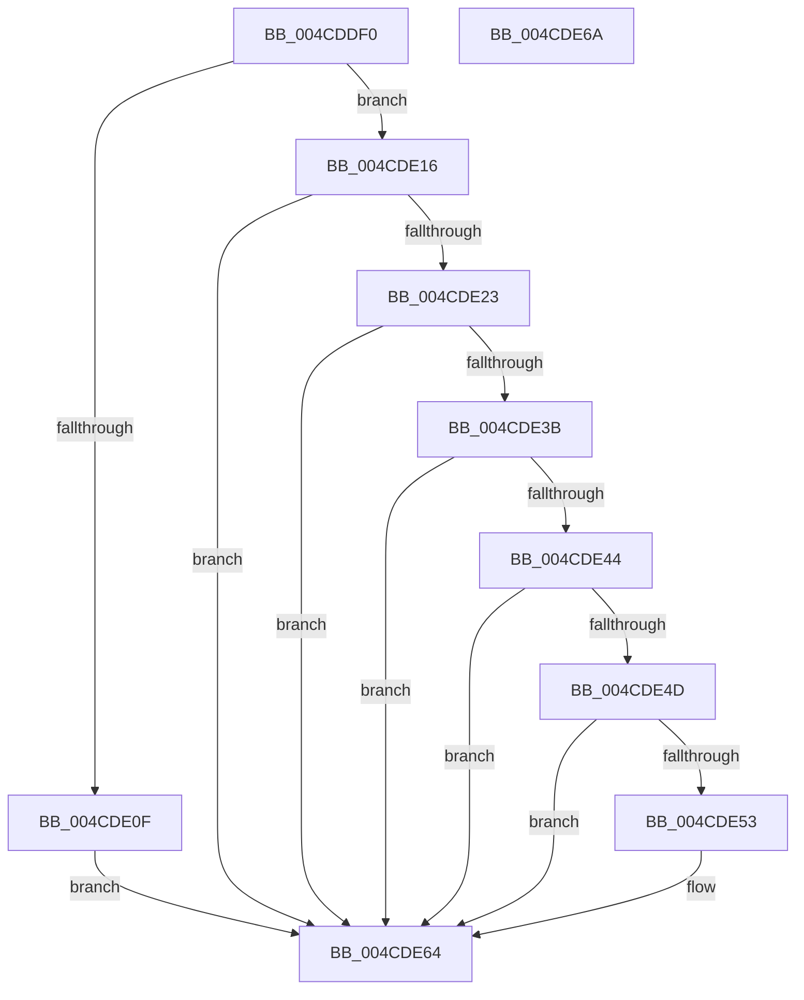

# KiRollbackSlistPops

- RVA: `0x004CDDF0`–`0x004CDE6B` (길이 `123` bytes)
- VA: `0x00000001404CDDF0`
- 실행 섹션: `.text`
- PDB 이름 있음: `예`; PDB Function 태그: `아니요`
- unwind 정보 RVA: `0x0005CF00`
- 디코드: `30`개 명령, `123/123` bytes 표시
- 미해석 바이트: `0` (있으면 어셈블리에 `.byte`로 보존)

> 이 문서는 커널 이미지의 기계어와 PDB 기호를 분석해 생성했습니다. 4번과 5번은 함수 원형과 자료형을 바이너리 사용 방식에서 추정한 C 해석이며 원본 소스 복구 결과는 아닙니다.

## 1. Dependencies

- 직접 호출 지점: **3**; 고유 호출 대상: **3**
- 직접 호출자로 확인된 함수: **0**
- RIP 상대 이미지 참조: **2**

### Outgoing calls
- `0x004CDE0F` → [KiCheckForSListAddress](../40/KiCheckForSListAddress_function_0040B810.md) (function, `0x0040B810`)
- `0x004CDE25` → [PspGetBaseTrapFrame](../43/PspGetBaseTrapFrame_function_0043DBC0.md) (function, `0x0043DBC0`)
- `0x004CDE5F` → [KeInsertQueueDpc](../20/KeInsertQueueDpc_function_00207C50.md) (function, `0x00207C50`)

### Direct callers
- 이 함수 시작 RVA로 연결되는 직접 call은 확인되지 않았습니다. 간접 호출은 완전히 역산할 수 없습니다.

### Static image references
- `0x004CDE3B` → RVA `0x00FC74C8` (`ALMOSTRO`; read)
- `0x004CDE44` → RVA `0x00FC74B8` (`ALMOSTRO`; read)

## 2. Other-region calls and transfers

- 다른 실행 섹션으로 향하는 call: **0**
- 별도 외부 분기/꼬리 이동을 확인하지 못했습니다.

## 3. Assembly (complete function range)

```asm
004CDDF0  40 53                           push rbx
004CDDF2  48 83 EC 20                     sub rsp, 0x20
004CDDF6  65 48 8B 1C 25 20 00 00 00      mov rbx, qword ptr gs:[0x20]
004CDDFF  48 8B 8B 98 9A 00 00            mov rcx, qword ptr [rbx + 0x9a98]
004CDE06  F6 81 70 01 00 00 01            test byte ptr [rcx + 0x170], 1
004CDE0D  74 07                           je 0x1404cde16
004CDE0F  E8 FC D9 F3 FF                  call 0x14040b810
004CDE14  EB 4E                           jmp 0x1404cde64
004CDE16  48 8B 4B 08                     mov rcx, qword ptr [rbx + 8]
004CDE1A  F7 41 74 00 04 00 00            test dword ptr [rcx + 0x74], 0x400
004CDE21  75 41                           jne 0x1404cde64
004CDE23  33 D2                           xor edx, edx
004CDE25  E8 96 FD F6 FF                  call 0x14043dbc0
004CDE2A  66 83 B8 70 01 00 00 33         cmp word ptr [rax + 0x170], 0x33
004CDE32  48 8B 88 68 01 00 00            mov rcx, qword ptr [rax + 0x168]
004CDE39  75 29                           jne 0x1404cde64
004CDE3B  48 3B 0D 86 96 AF 00            cmp rcx, qword ptr [rip + 0xaf9686]
004CDE42  76 20                           jbe 0x1404cde64
004CDE44  48 3B 0D 6D 96 AF 00            cmp rcx, qword ptr [rip + 0xaf966d]
004CDE4B  77 17                           ja 0x1404cde64
004CDE4D  80 78 2B 00                     cmp byte ptr [rax + 0x2b], 0
004CDE51  75 11                           jne 0x1404cde64
004CDE53  48 8D 8B 90 A1 00 00            lea rcx, [rbx + 0xa190]
004CDE5A  45 33 C0                        xor r8d, r8d
004CDE5D  33 D2                           xor edx, edx
004CDE5F  E8 EC 9D D3 FF                  call 0x140207c50
004CDE64  48 83 C4 20                     add rsp, 0x20
004CDE68  5B                              pop rbx
004CDE69  C3                              ret
004CDE6A  CC                              int3
```

## 4. C-style interpretation (structured pseudocode)

```c
__int64 __fastcall KiRollbackSlistPops(__int64 a1, int a2, int a3)
{
    __int64 result;
    __int64 v_rsp;

    v_rsp = (v_rsp) - (32);
    if (((*(unsigned __int8 *)(*(unsigned __int64 *)(*(unsigned __int64 *)(gs_base + (0 + 32)) + 39576) + 368)) & (1)) == 0) goto loc_004CDE16;
    result = KiCheckForSListAddress(*(unsigned __int64 *)(*(unsigned __int64 *)(gs_base + (0 + 32)) + 39576), a2, a3, a4);
    goto loc_004CDE64;
loc_004CDE16:
    if (((*(unsigned int *)(*(unsigned __int64 *)(*(unsigned __int64 *)(gs_base + (0 + 32)) + 8) + 116)) & (0x400ULL)) != 0) goto loc_004CDE64;
    a2 = 0;
    result = PspGetBaseTrapFrame(*(unsigned __int64 *)(*(unsigned __int64 *)(gs_base + (0 + 32)) + 8), a2, a3, a4);
    if ((*(unsigned __int16 *)(result + 368)) != 51) goto loc_004CDE64;
    if ((*(unsigned __int64 *)(result + 360)) <= (*(unsigned __int64 *)(v_rip + 11507334))) goto loc_004CDE64;
    if ((*(unsigned __int64 *)(result + 360)) > (*(unsigned __int64 *)(v_rip + 11507309))) goto loc_004CDE64;
    if ((*(unsigned __int8 *)(result + 43)) == 0) {
        a1 = *(unsigned __int64 *)(gs_base + (0 + 32)) + 41360;
        a3 = 0;
        a2 = 0;
        result = KeInsertQueueDpc(a1, a2, a3, a4);
    }
    v_rsp = (v_rsp) + (32);
    return result;
}
```

## 5. (Beta) C Style

```c
int64_t KiRollbackSlistPops(int64_t Arg1, int32_t Arg2, int32_t Arg3)
{
    int64_t result;
    int64_t local_rsp;

    local_rsp = (local_rsp) - (32);
    if (((*(uint8_t *)(*(uint64_t *)(*(uint64_t *)(gs_base + (0 + 0x20)) + 0x9A98) + 0x170)) & (1)) == 0) goto loc_004CDE16;
    result = KiCheckForSListAddress(*(uint64_t *)(*(uint64_t *)(gs_base + (0 + 0x20)) + 0x9A98), Arg2, Arg3, a4);
    goto loc_004CDE64;
loc_004CDE16:
    if (((*(uint32_t *)(*(uint64_t *)(*(uint64_t *)(gs_base + (0 + 0x20)) + 0x8) + 0x74)) & (0x400ULL)) != 0) goto loc_004CDE64;
    Arg2 = 0;
    result = PspGetBaseTrapFrame(*(uint64_t *)(*(uint64_t *)(gs_base + (0 + 0x20)) + 0x8), Arg2, Arg3, a4);
    if ((*(uint16_t *)(result + 0x170)) != 51) goto loc_004CDE64;
    if ((*(uint64_t *)(result + 0x168)) <= (*(uint64_t *)(v_rip + 0xAF9686))) goto loc_004CDE64;
    if ((*(uint64_t *)(result + 0x168)) > (*(uint64_t *)(v_rip + 0xAF966D))) goto loc_004CDE64;
    if ((*(uint8_t *)(result + 0x2B)) == 0) {
        Arg1 = *(uint64_t *)(gs_base + (0 + 0x20)) + 41360;
        Arg3 = 0;
        Arg2 = 0;
        result = KeInsertQueueDpc(Arg1, Arg2, Arg3, a4);
    }
    local_rsp = (local_rsp) + (32);
    return result;
}
```

## 6. Execution-region graph

[열기: 2D/3D 그래프와 함수 탐색 컨트롤 패널](../../../control-panel.html?section=text&rva=0x004CDDF0&view=graph)

- 2D 그래프는 위에서 아래로 흐르고, 3D 그래프는 빈 공간을 드래그해 회전합니다. Shift+드래그는 이동, 휠은 확대·축소, 함수 노드 선택은 대상 보고서 이동입니다.

### Static fallback


