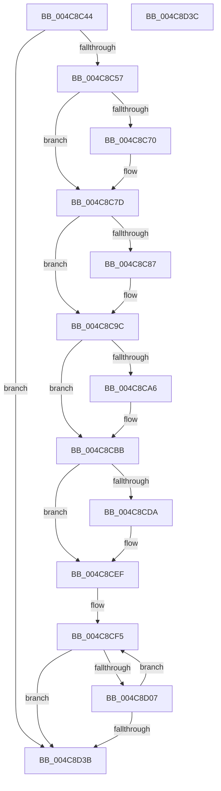

# KiSaveIptState

- RVA: `0x004C8C44`–`0x004C8D3D` (길이 `249` bytes)
- VA: `0x00000001404C8C44`
- 실행 섹션: `.text`
- PDB 이름 있음: `예`; PDB Function 태그: `아니요`
- unwind 정보 RVA: `0x000DB714`
- 디코드: `72`개 명령, `249/249` bytes 표시
- 미해석 바이트: `0` (있으면 어셈블리에 `.byte`로 보존)

> 이 문서는 커널 이미지의 기계어와 PDB 기호를 분석해 생성했습니다. 4번과 5번은 함수 원형과 자료형을 바이너리 사용 방식에서 추정한 C 해석이며 원본 소스 복구 결과는 아닙니다.

## 1. Dependencies

- 직접 호출 지점: **0**; 고유 호출 대상: **0**
- 직접 호출자로 확인된 함수: **3**
- RIP 상대 이미지 참조: **2**

### Outgoing calls
- 직접 디코드된 call 명령이 없습니다.

### Direct callers
- [KeSaveIptStateBeforeProcessorGoesOffline](../4D/KeSaveIptStateBeforeProcessorGoesOffline_function_004D9D40.md) at `0x004D9D6B`
- [KeSaveSupervisorState](../5B/KeSaveSupervisorState_function_005B9CB4.md) at `0x005B9CF6`
- [KiSaveThreadIptState](../5B/KiSaveThreadIptState_function_005BA120.md) at `0x005BA12B`

### Static image references
- `0x004C8C4A` → RVA `0x00FC5110` (`ALMOSTRO`; read)
- `0x004C8C7D` → RVA `0x00FC6B94` (`ALMOSTRO`; read)

## 2. Other-region calls and transfers

- 다른 실행 섹션으로 향하는 call: **0**
- 별도 외부 분기/꼬리 이동을 확인하지 못했습니다.

## 3. Assembly (complete function range)

```asm
004C8C44  45 33 C9                        xor r9d, r9d
004C8C47  4C 8B C1                        mov r8, rcx
004C8C4A  44 39 0D BF C4 AF 00            cmp dword ptr [rip + 0xafc4bf], r9d
004C8C51  0F 84 E4 00 00 00               je 0x1404c8d3b
004C8C57  B9 70 05 00 00                  mov ecx, 0x570
004C8C5C  0F 32                           rdmsr
004C8C5E  48 C1 E2 20                     shl rdx, 0x20
004C8C62  48 0B C2                        or rax, rdx
004C8C65  49 89 00                        mov qword ptr [r8], rax
004C8C68  49 83 C0 08                     add r8, 8
004C8C6C  A8 01                           test al, 1
004C8C6E  74 0D                           je 0x1404c8c7d
004C8C70  48 8D 50 FF                     lea rdx, [rax - 1]
004C8C74  48 8B C2                        mov rax, rdx
004C8C77  48 C1 EA 20                     shr rdx, 0x20
004C8C7B  0F 30                           wrmsr
004C8C7D  8B 05 11 DF AF 00               mov eax, dword ptr [rip + 0xafdf11]
004C8C83  A8 02                           test al, 2
004C8C85  74 15                           je 0x1404c8c9c
004C8C87  B9 60 05 00 00                  mov ecx, 0x560
004C8C8C  0F 32                           rdmsr
004C8C8E  48 C1 E2 20                     shl rdx, 0x20
004C8C92  48 0B C2                        or rax, rdx
004C8C95  49 89 00                        mov qword ptr [r8], rax
004C8C98  49 83 C0 08                     add r8, 8
004C8C9C  8B 05 F2 DE AF 00               mov eax, dword ptr [rip + 0xafdef2]
004C8CA2  A8 04                           test al, 4
004C8CA4  74 15                           je 0x1404c8cbb
004C8CA6  B9 61 05 00 00                  mov ecx, 0x561
004C8CAB  0F 32                           rdmsr
004C8CAD  48 C1 E2 20                     shl rdx, 0x20
004C8CB1  48 0B C2                        or rax, rdx
004C8CB4  49 89 00                        mov qword ptr [r8], rax
004C8CB7  49 83 C0 08                     add r8, 8
004C8CBB  B9 71 05 00 00                  mov ecx, 0x571
004C8CC0  0F 32                           rdmsr
004C8CC2  48 C1 E2 20                     shl rdx, 0x20
004C8CC6  48 0B C2                        or rax, rdx
004C8CC9  49 89 00                        mov qword ptr [r8], rax
004C8CCC  49 83 C0 08                     add r8, 8
004C8CD0  8B 05 BE DE AF 00               mov eax, dword ptr [rip + 0xafdebe]
004C8CD6  A8 10                           test al, 0x10
004C8CD8  74 15                           je 0x1404c8cef
004C8CDA  B9 72 05 00 00                  mov ecx, 0x572
004C8CDF  0F 32                           rdmsr
004C8CE1  48 C1 E2 20                     shl rdx, 0x20
004C8CE5  48 0B C2                        or rax, rdx
004C8CE8  49 89 00                        mov qword ptr [r8], rax
004C8CEB  49 83 C0 08                     add r8, 8
004C8CEF  41 BA 81 05 00 00               mov r10d, 0x581
004C8CF5  8B 05 99 DE AF 00               mov eax, dword ptr [rip + 0xafde99]
004C8CFB  41 8D 49 05                     lea ecx, [r9 + 5]
004C8CFF  0F B6 D1                        movzx edx, cl
004C8D02  0F A3 D0                        bt eax, edx
004C8D05  73 34                           jae 0x1404c8d3b
004C8D07  41 8D 4A FF                     lea ecx, [r10 - 1]
004C8D0B  0F 32                           rdmsr
004C8D0D  48 C1 E2 20                     shl rdx, 0x20
004C8D11  41 8B CA                        mov ecx, r10d
004C8D14  48 0B C2                        or rax, rdx
004C8D17  49 89 00                        mov qword ptr [r8], rax
004C8D1A  0F 32                           rdmsr
004C8D1C  48 C1 E2 20                     shl rdx, 0x20
004C8D20  41 FF C1                        inc r9d
004C8D23  48 0B C2                        or rax, rdx
004C8D26  41 83 C2 02                     add r10d, 2
004C8D2A  49 89 40 08                     mov qword ptr [r8 + 8], rax
004C8D2E  49 83 C0 10                     add r8, 0x10
004C8D32  41 81 FA 89 05 00 00            cmp r10d, 0x589
004C8D39  72 BA                           jb 0x1404c8cf5
004C8D3B  C3                              ret
004C8D3C  CC                              int3
```

## 4. C-style interpretation (structured pseudocode)

```c
__int64 __fastcall KiSaveIptState(__int64 a1, __int64 a2, __int64 a3, int a4)
{
    __int64 result;
    __int64 v_r10;

    a4 = 0;
    if ((*(unsigned int *)(v_rip + 11519167)) == 0) goto loc_004C8D3B;
    a2 = (a2) << (32);
    result = (result) | (a2);
    *(unsigned __int64 *)(a1) = result;
    a3 = (a1) + (8);
    if ((((unsigned __int8)(result)) & (1)) != 0) {
        a2 = result - 1;
        result = a2;
        a2 = (a2) >> (32);
    }
    result = (unsigned int)(*(unsigned int *)(v_rip + 11525905));
    if ((((unsigned __int8)((unsigned int)(*(unsigned int *)(v_rip + 11525905)))) & (2)) != 0) {
        a1 = 0x560ULL;
        a2 = (a2) << (32);
        result = ((unsigned int)(*(unsigned int *)(v_rip + 11525905))) | (a2);
        *(unsigned __int64 *)(a3) = result;
        a3 = (a3) + (8);
    }
    result = (unsigned int)(*(unsigned int *)(v_rip + 11525874));
    if ((((unsigned __int8)((unsigned int)(*(unsigned int *)(v_rip + 11525874)))) & (4)) != 0) {
        a1 = 0x561ULL;
        a2 = (a2) << (32);
        result = ((unsigned int)(*(unsigned int *)(v_rip + 11525874))) | (a2);
        *(unsigned __int64 *)(a3) = result;
        a3 = (a3) + (8);
    }
    a2 = (a2) << (32);
    result = (result) | (a2);
    *(unsigned __int64 *)(a3) = result;
    a3 = (a3) + (8);
    result = (unsigned int)(*(unsigned int *)(v_rip + 11525822));
    if ((((unsigned __int8)((unsigned int)(*(unsigned int *)(v_rip + 11525822)))) & (16)) != 0) {
        a1 = 0x572ULL;
        a2 = (a2) << (32);
        result = ((unsigned int)(*(unsigned int *)(v_rip + 11525822))) | (a2);
        *(unsigned __int64 *)(a3) = result;
        a3 = (a3) + (8);
    }
loc_004C8CF5:
    if (condition_is_above_or_equal) goto loc_004C8D3B;
    a2 = ((unsigned __int8)(a4 + 5)) << (32);
    result = ((unsigned int)(*(unsigned int *)(v_rip + 11525785))) | (a2);
    *(unsigned __int64 *)(a3) = result;
    a2 = (a2) << (32);
    a4 = (unsigned int)((a4) + 1);
    result = (result) | (a2);
    v_r10 = (unsigned int)(((unsigned int)(0x581ULL)) + (2));
    *(unsigned __int64 *)(a3 + 8) = result;
    a3 = (a3) + (16);
    if (((unsigned int)(v_r10)) < 0x589ULL) goto loc_004C8CF5;
loc_004C8D3B:
    return result;
}
```

## 5. (Beta) C Style

```c
int64_t KiSaveIptState(void *Arg1, int64_t Arg2, int64_t Arg3, int32_t Arg4)
{
    uint8_t *arg1 = (uint8_t *)Arg1;

    int64_t result;
    int64_t local_r10;

    Arg4 = 0;
    if ((*(uint32_t *)(v_rip + 0xAFC4BF)) == 0) goto loc_004C8D3B;
    Arg2 = (Arg2) << (32);
    result = (result) | (Arg2);
    *(uint64_t *)(arg1) = result;
    Arg3 = (Arg1) + (8);
    if ((((uint8_t)(result)) & (1)) != 0) {
        Arg2 = result - 1;
        result = Arg2;
        Arg2 = (Arg2) >> (32);
    }
    result = (uint32_t)(*(uint32_t *)(v_rip + 0xAFDF11));
    if ((((uint8_t)((uint32_t)(*(uint32_t *)(v_rip + 0xAFDF11)))) & (2)) != 0) {
        Arg1 = 0x560ULL;
        Arg2 = (Arg2) << (32);
        result = ((uint32_t)(*(uint32_t *)(v_rip + 0xAFDF11))) | (Arg2);
        *(uint64_t *)(Arg3) = result;
        Arg3 = (Arg3) + (8);
    }
    result = (uint32_t)(*(uint32_t *)(v_rip + 0xAFDEF2));
    if ((((uint8_t)((uint32_t)(*(uint32_t *)(v_rip + 0xAFDEF2)))) & (4)) != 0) {
        Arg1 = 0x561ULL;
        Arg2 = (Arg2) << (32);
        result = ((uint32_t)(*(uint32_t *)(v_rip + 0xAFDEF2))) | (Arg2);
        *(uint64_t *)(Arg3) = result;
        Arg3 = (Arg3) + (8);
    }
    Arg2 = (Arg2) << (32);
    result = (result) | (Arg2);
    *(uint64_t *)(Arg3) = result;
    Arg3 = (Arg3) + (8);
    result = (uint32_t)(*(uint32_t *)(v_rip + 0xAFDEBE));
    if ((((uint8_t)((uint32_t)(*(uint32_t *)(v_rip + 0xAFDEBE)))) & (16)) != 0) {
        Arg1 = 0x572ULL;
        Arg2 = (Arg2) << (32);
        result = ((uint32_t)(*(uint32_t *)(v_rip + 0xAFDEBE))) | (Arg2);
        *(uint64_t *)(Arg3) = result;
        Arg3 = (Arg3) + (8);
    }
loc_004C8CF5:
    if (condition_is_above_or_equal) goto loc_004C8D3B;
    Arg2 = ((uint8_t)(Arg4 + 5)) << (32);
    result = ((uint32_t)(*(uint32_t *)(v_rip + 0xAFDE99))) | (Arg2);
    *(uint64_t *)(Arg3) = result;
    Arg2 = (Arg2) << (32);
    Arg4 = (uint32_t)((Arg4) + 1);
    result = (result) | (Arg2);
    local_r10 = (uint32_t)(((uint32_t)(0x581ULL)) + (2));
    *(uint64_t *)(Arg3 + 0x8) = result;
    Arg3 = (Arg3) + (16);
    if (((uint32_t)(local_r10)) < 0x589ULL) goto loc_004C8CF5;
loc_004C8D3B:
    return result;
}
```

### 관측된 메모리 오프셋

구조체 형식이 확인되지 않은 접근은 인자 기준의 오프셋으로만 기록했습니다.

| 기준 인자 | 오프셋 표현 | 폭 (bit) | 접근 |
|---|---:|---:|---|
| `Arg1` | `+ 0x0` | `64` | `W` |
| `Arg1` | `+ 0x8` | `64` | `W` |

## 6. Execution-region graph

[열기: 2D/3D 그래프와 함수 탐색 컨트롤 패널](../../../control-panel.html?section=text&rva=0x004C8C44&view=graph)

- 2D 그래프는 위에서 아래로 흐르고, 3D 그래프는 빈 공간을 드래그해 회전합니다. Shift+드래그는 이동, 휠은 확대·축소, 함수 노드 선택은 대상 보고서 이동입니다.

### Static fallback


