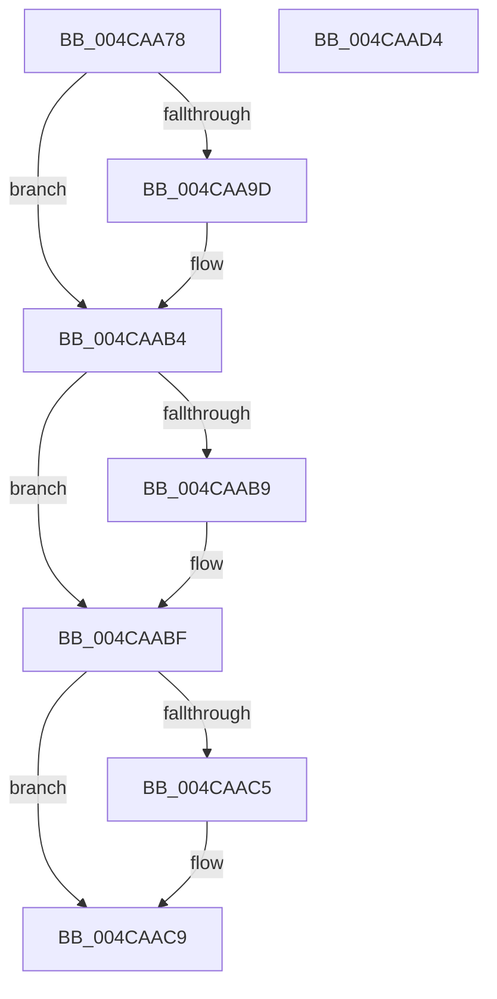

# KiSuspendClockTimer

- RVA: `0x004CAA78`–`0x004CAAD5` (길이 `93` bytes)
- VA: `0x00000001404CAA78`
- 실행 섹션: `.text`
- PDB 이름 있음: `예`; PDB Function 태그: `아니요`
- unwind 정보 RVA: `0x0005CAAC`
- 디코드: `23`개 명령, `93/93` bytes 표시
- 미해석 바이트: `0` (있으면 어셈블리에 `.byte`로 보존)

> 이 문서는 커널 이미지의 기계어와 PDB 기호를 분석해 생성했습니다. 4번과 5번은 함수 원형과 자료형을 바이너리 사용 방식에서 추정한 C 해석이며 원본 소스 복구 결과는 아닙니다.

## 1. Dependencies

- 직접 호출 지점: **1**; 고유 호출 대상: **1**
- 직접 호출자로 확인된 함수: **1**
- RIP 상대 이미지 참조: **4**

### Outgoing calls
- `0x004CAAA4` → [guard_dispatch_icall](../6B/guard_dispatch_icall_function_006BAAD0.md) (function, `0x006BAAD0`)

### Direct callers
- [KeSuspendClockTimer](KeSuspendClockTimer_function_004CAA60.md) at `0x004CAA64`

### Static image references
- `0x004CAA8B` → RVA `0x00FCF000` (`CACHEALI`; read)
- `0x004CAA91` → RVA `0x00F21FB0` (`.data`; read)
- `0x004CAA9D` → RVA `0x00E00AE8` (`.data`; read)
- `0x004CAAB9` → RVA `0x00F21F24` (`.data`; read/write)

## 2. Other-region calls and transfers

- 다른 실행 섹션으로 향하는 call: **0**
- 별도 외부 분기/꼬리 이동을 확인하지 못했습니다.

## 3. Assembly (complete function range)

```asm
004CAA78  48 89 5C 24 08                  mov qword ptr [rsp + 8], rbx
004CAA7D  57                              push rdi
004CAA7E  48 83 EC 20                     sub rsp, 0x20
004CAA82  65 48 8B 1C 25 20 00 00 00      mov rbx, qword ptr gs:[0x20]
004CAA8B  8B 05 6F 45 B0 00               mov eax, dword ptr [rip + 0xb0456f]
004CAA91  8B 3D 19 75 A5 00               mov edi, dword ptr [rip + 0xa57519]
004CAA97  F6 43 22 01                     test byte ptr [rbx + 0x22], 1
004CAA9B  74 17                           je 0x1404caab4
004CAA9D  48 8B 05 44 60 93 00            mov rax, qword ptr [rip + 0x936044]
004CAAA4  E8 27 00 1F 00                  call 0x1406baad0
004CAAA9  C6 83 08 96 00 00 00            mov byte ptr [rbx + 0x9608], 0
004CAAB0  80 63 22 FE                     and byte ptr [rbx + 0x22], 0xfe
004CAAB4  39 7B 24                        cmp dword ptr [rbx + 0x24], edi
004CAAB7  75 06                           jne 0x1404caabf
004CAAB9  FF 05 65 74 A5 00               inc dword ptr [rip + 0xa57465]
004CAABF  80 7B 21 00                     cmp byte ptr [rbx + 0x21], 0
004CAAC3  74 04                           je 0x1404caac9
004CAAC5  C6 43 21 00                     mov byte ptr [rbx + 0x21], 0
004CAAC9  48 8B 5C 24 30                  mov rbx, qword ptr [rsp + 0x30]
004CAACE  48 83 C4 20                     add rsp, 0x20
004CAAD2  5F                              pop rdi
004CAAD3  C3                              ret
004CAAD4  CC                              int3
```

## 4. C-style interpretation (structured pseudocode)

```c
__int64 __fastcall KiSuspendClockTimer(void)
{
    __int64 result;
    __int64 v_rsp;
    unsigned __int64 v_stack_p8;

    v_stack_p8 = v_rbx;
    v_rsp = (v_rsp) - (32);
    result = (unsigned int)(*(unsigned int *)(v_rip + 11552111));
    if (((*(unsigned __int8 *)(*(unsigned __int64 *)(gs_base + (0 + 32)) + 34)) & (1)) != 0) {
        result = *(unsigned __int64 *)(v_rip + 9658436);
        result = guard_dispatch_icall(a1, a2, a3, a4);
        *(unsigned __int8 *)(*(unsigned __int64 *)(gs_base + (0 + 32)) + 38408) = 0;
    }
    if ((*(unsigned int *)(*(unsigned __int64 *)(gs_base + (0 + 32)) + 36)) == ((unsigned int)((unsigned int)(*(unsigned int *)(v_rip + 10843417))))) {
    }
    if ((*(unsigned __int8 *)(*(unsigned __int64 *)(gs_base + (0 + 32)) + 33)) != 0) {
        *(unsigned __int8 *)(*(unsigned __int64 *)(gs_base + (0 + 32)) + 33) = 0;
    }
    v_rsp = (v_rsp) + (32);
    return result;
}
```

## 5. (Beta) C Style

```c
void KiSuspendClockTimer(void)
{
    int64_t result;
    int64_t local_rsp;
    uint64_t v_stack_p8;

    v_stack_p8 = local_rbx;
    local_rsp = (local_rsp) - (32);
    result = (uint32_t)(*(uint32_t *)(v_rip + 0xB0456F));
    if (((*(uint8_t *)(*(uint64_t *)(gs_base + (0 + 0x20)) + 0x22)) & (1)) != 0) {
        result = *(uint64_t *)(v_rip + 0x936044);
        result = guard_dispatch_icall(a1, a2, a3, a4);
        *(uint8_t *)(*(uint64_t *)(gs_base + (0 + 0x20)) + 0x9608) = 0;
    }
    if ((*(uint32_t *)(*(uint64_t *)(gs_base + (0 + 0x20)) + 0x24)) == ((uint32_t)((uint32_t)(*(uint32_t *)(v_rip + 0xA57519))))) {
    }
    if ((*(uint8_t *)(*(uint64_t *)(gs_base + (0 + 0x20)) + 0x21)) != 0) {
        *(uint8_t *)(*(uint64_t *)(gs_base + (0 + 0x20)) + 0x21) = 0;
    }
    local_rsp = (local_rsp) + (32);
    return result;
}
```

## 6. Execution-region graph

[열기: 2D/3D 그래프와 함수 탐색 컨트롤 패널](../../../control-panel.html?section=text&rva=0x004CAA78&view=graph)

- 2D 그래프는 위에서 아래로 흐르고, 3D 그래프는 빈 공간을 드래그해 회전합니다. Shift+드래그는 이동, 휠은 확대·축소, 함수 노드 선택은 대상 보고서 이동입니다.

### Static fallback


