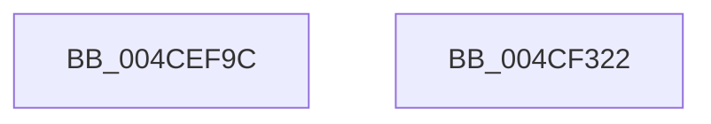

# McTemplateK0jxxxxxxxxxxxxxxxxxxxxxxxxxxxxxxxxxxxx_EtwWriteTransfer

- RVA: `0x004CEF9C`–`0x004CF323` (길이 `903` bytes)
- VA: `0x00000001404CEF9C`
- 실행 섹션: `.text`
- PDB 이름 있음: `예`; PDB Function 태그: `아니요`
- unwind 정보 RVA: `0x000BDA84`
- 디코드: `130`개 명령, `903/903` bytes 표시
- 미해석 바이트: `0` (있으면 어셈블리에 `.byte`로 보존)

> 이 문서는 커널 이미지의 기계어와 PDB 기호를 분석해 생성했습니다. 4번과 5번은 함수 원형과 자료형을 바이너리 사용 방식에서 추정한 C 해석이며 원본 소스 복구 결과는 아닙니다.

## 1. Dependencies

- 직접 호출 지점: **2**; 고유 호출 대상: **2**
- 직접 호출자로 확인된 함수: **1**
- RIP 상대 이미지 참조: **3**

### Outgoing calls
- `0x004CF305` → [McGenEventWrite_EtwWriteTransfer](../42/McGenEventWrite_EtwWriteTransfer_function_00424FC8.md) (function, `0x00424FC8`)
- `0x004CF314` → [_security_check_cookie](../6A/_security_check_cookie_function_006AC640.md) (function, `0x006AC640`)

### Direct callers
- [CcPostVolumeTelemetry](../42/CcPostVolumeTelemetry_function_00420FF8.md) at `0x0042196B`

### Static image references
- `0x004CEFAD` → RVA `0x00E0A740` (`.data`; read)
- `0x004CF1F8` → RVA `0x0001E938` (`.rdata`; read)
- `0x004CF218` → RVA `0x00E06BD0` (`.data`; read)

## 2. Other-region calls and transfers

- 다른 실행 섹션으로 향하는 call: **0**
- 별도 외부 분기/꼬리 이동을 확인하지 못했습니다.

## 3. Assembly (complete function range)

```asm
004CEF9C  40 55                           push rbp
004CEF9E  48 8D AC 24 60 FE FF FF         lea rbp, [rsp - 0x1a0]
004CEFA6  48 81 EC A0 02 00 00            sub rsp, 0x2a0
004CEFAD  48 8B 05 8C B7 93 00            mov rax, qword ptr [rip + 0x93b78c]
004CEFB4  48 33 C4                        xor rax, rsp
004CEFB7  48 89 85 90 01 00 00            mov qword ptr [rbp + 0x190], rax
004CEFBE  48 8D 85 D0 01 00 00            lea rax, [rbp + 0x1d0]
004CEFC5  4C 89 4C 24 40                  mov qword ptr [rsp + 0x40], r9
004CEFCA  48 89 44 24 50                  mov qword ptr [rsp + 0x50], rax
004CEFCF  48 8D 85 D8 01 00 00            lea rax, [rbp + 0x1d8]
004CEFD6  48 89 44 24 60                  mov qword ptr [rsp + 0x60], rax
004CEFDB  48 8D 85 E0 01 00 00            lea rax, [rbp + 0x1e0]
004CEFE2  48 89 44 24 70                  mov qword ptr [rsp + 0x70], rax
004CEFE7  48 8D 85 E8 01 00 00            lea rax, [rbp + 0x1e8]
004CEFEE  48 89 45 80                     mov qword ptr [rbp - 0x80], rax
004CEFF2  48 8D 85 F0 01 00 00            lea rax, [rbp + 0x1f0]
004CEFF9  48 89 45 90                     mov qword ptr [rbp - 0x70], rax
004CEFFD  48 8D 85 F8 01 00 00            lea rax, [rbp + 0x1f8]
004CF004  48 89 45 A0                     mov qword ptr [rbp - 0x60], rax
004CF008  48 8D 85 00 02 00 00            lea rax, [rbp + 0x200]
004CF00F  48 89 45 B0                     mov qword ptr [rbp - 0x50], rax
004CF013  48 8D 85 08 02 00 00            lea rax, [rbp + 0x208]
004CF01A  48 89 45 C0                     mov qword ptr [rbp - 0x40], rax
004CF01E  48 8D 85 10 02 00 00            lea rax, [rbp + 0x210]
004CF025  48 89 45 D0                     mov qword ptr [rbp - 0x30], rax
004CF029  48 8D 85 18 02 00 00            lea rax, [rbp + 0x218]
004CF030  48 89 45 E0                     mov qword ptr [rbp - 0x20], rax
004CF034  48 8D 85 20 02 00 00            lea rax, [rbp + 0x220]
004CF03B  48 89 45 F0                     mov qword ptr [rbp - 0x10], rax
004CF03F  48 8D 85 28 02 00 00            lea rax, [rbp + 0x228]
004CF046  48 89 45 00                     mov qword ptr [rbp], rax
004CF04A  48 8D 85 30 02 00 00            lea rax, [rbp + 0x230]
004CF051  48 89 45 10                     mov qword ptr [rbp + 0x10], rax
004CF055  48 8D 85 38 02 00 00            lea rax, [rbp + 0x238]
004CF05C  48 89 45 20                     mov qword ptr [rbp + 0x20], rax
004CF060  48 8D 85 40 02 00 00            lea rax, [rbp + 0x240]
004CF067  48 89 45 30                     mov qword ptr [rbp + 0x30], rax
004CF06B  48 8D 85 48 02 00 00            lea rax, [rbp + 0x248]
004CF072  48 89 45 40                     mov qword ptr [rbp + 0x40], rax
004CF076  48 8D 85 50 02 00 00            lea rax, [rbp + 0x250]
004CF07D  48 89 45 50                     mov qword ptr [rbp + 0x50], rax
004CF081  48 8D 85 58 02 00 00            lea rax, [rbp + 0x258]
004CF088  48 89 45 60                     mov qword ptr [rbp + 0x60], rax
004CF08C  48 8D 85 60 02 00 00            lea rax, [rbp + 0x260]
004CF093  48 89 45 70                     mov qword ptr [rbp + 0x70], rax
004CF097  48 8D 85 68 02 00 00            lea rax, [rbp + 0x268]
004CF09E  48 89 85 80 00 00 00            mov qword ptr [rbp + 0x80], rax
004CF0A5  48 8D 85 70 02 00 00            lea rax, [rbp + 0x270]
004CF0AC  48 89 85 90 00 00 00            mov qword ptr [rbp + 0x90], rax
004CF0B3  48 8D 85 78 02 00 00            lea rax, [rbp + 0x278]
004CF0BA  48 89 85 A0 00 00 00            mov qword ptr [rbp + 0xa0], rax
004CF0C1  48 8D 85 80 02 00 00            lea rax, [rbp + 0x280]
004CF0C8  48 89 85 B0 00 00 00            mov qword ptr [rbp + 0xb0], rax
004CF0CF  48 8D 85 88 02 00 00            lea rax, [rbp + 0x288]
004CF0D6  48 89 85 C0 00 00 00            mov qword ptr [rbp + 0xc0], rax
004CF0DD  48 8D 85 90 02 00 00            lea rax, [rbp + 0x290]
004CF0E4  48 89 85 D0 00 00 00            mov qword ptr [rbp + 0xd0], rax
004CF0EB  48 8D 85 98 02 00 00            lea rax, [rbp + 0x298]
004CF0F2  48 89 85 E0 00 00 00            mov qword ptr [rbp + 0xe0], rax
004CF0F9  48 8D 85 A0 02 00 00            lea rax, [rbp + 0x2a0]
004CF100  48 C7 44 24 48 10 00 00 00      mov qword ptr [rsp + 0x48], 0x10
004CF109  48 C7 44 24 58 08 00 00 00      mov qword ptr [rsp + 0x58], 8
004CF112  48 C7 44 24 68 08 00 00 00      mov qword ptr [rsp + 0x68], 8
004CF11B  48 C7 44 24 78 08 00 00 00      mov qword ptr [rsp + 0x78], 8
004CF124  48 C7 45 88 08 00 00 00         mov qword ptr [rbp - 0x78], 8
004CF12C  48 C7 45 98 08 00 00 00         mov qword ptr [rbp - 0x68], 8
004CF134  48 C7 45 A8 08 00 00 00         mov qword ptr [rbp - 0x58], 8
004CF13C  48 C7 45 B8 08 00 00 00         mov qword ptr [rbp - 0x48], 8
004CF144  48 C7 45 C8 08 00 00 00         mov qword ptr [rbp - 0x38], 8
004CF14C  48 C7 45 D8 08 00 00 00         mov qword ptr [rbp - 0x28], 8
004CF154  48 C7 45 E8 08 00 00 00         mov qword ptr [rbp - 0x18], 8
004CF15C  48 C7 45 F8 08 00 00 00         mov qword ptr [rbp - 8], 8
004CF164  48 C7 45 08 08 00 00 00         mov qword ptr [rbp + 8], 8
004CF16C  48 C7 45 18 08 00 00 00         mov qword ptr [rbp + 0x18], 8
004CF174  48 C7 45 28 08 00 00 00         mov qword ptr [rbp + 0x28], 8
004CF17C  48 C7 45 38 08 00 00 00         mov qword ptr [rbp + 0x38], 8
004CF184  48 C7 45 48 08 00 00 00         mov qword ptr [rbp + 0x48], 8
004CF18C  48 C7 45 58 08 00 00 00         mov qword ptr [rbp + 0x58], 8
004CF194  48 C7 45 68 08 00 00 00         mov qword ptr [rbp + 0x68], 8
004CF19C  48 C7 45 78 08 00 00 00         mov qword ptr [rbp + 0x78], 8
004CF1A4  48 C7 85 88 00 00 00 08 00 00 00  mov qword ptr [rbp + 0x88], 8
004CF1AF  48 C7 85 98 00 00 00 08 00 00 00  mov qword ptr [rbp + 0x98], 8
004CF1BA  48 C7 85 A8 00 00 00 08 00 00 00  mov qword ptr [rbp + 0xa8], 8
004CF1C5  48 C7 85 B8 00 00 00 08 00 00 00  mov qword ptr [rbp + 0xb8], 8
004CF1D0  48 C7 85 C8 00 00 00 08 00 00 00  mov qword ptr [rbp + 0xc8], 8
004CF1DB  48 C7 85 D8 00 00 00 08 00 00 00  mov qword ptr [rbp + 0xd8], 8
004CF1E6  48 C7 85 E8 00 00 00 08 00 00 00  mov qword ptr [rbp + 0xe8], 8
004CF1F1  48 89 85 F0 00 00 00            mov qword ptr [rbp + 0xf0], rax
004CF1F8  48 8D 15 39 F7 B4 FF            lea rdx, [rip - 0x4b08c7]
004CF1FF  48 8D 85 A8 02 00 00            lea rax, [rbp + 0x2a8]
004CF206  48 C7 85 F8 00 00 00 08 00 00 00  mov qword ptr [rbp + 0xf8], 8
004CF211  48 89 85 00 01 00 00            mov qword ptr [rbp + 0x100], rax
004CF218  48 8D 0D B1 79 93 00            lea rcx, [rip + 0x9379b1]
004CF21F  48 8D 85 B0 02 00 00            lea rax, [rbp + 0x2b0]
004CF226  48 C7 85 08 01 00 00 08 00 00 00  mov qword ptr [rbp + 0x108], 8
004CF231  48 89 85 10 01 00 00            mov qword ptr [rbp + 0x110], rax
004CF238  41 B9 26 00 00 00               mov r9d, 0x26
004CF23E  48 8D 85 B8 02 00 00            lea rax, [rbp + 0x2b8]
004CF245  48 C7 85 18 01 00 00 08 00 00 00  mov qword ptr [rbp + 0x118], 8
004CF250  48 89 85 20 01 00 00            mov qword ptr [rbp + 0x120], rax
004CF257  45 33 C0                        xor r8d, r8d
004CF25A  48 8D 85 C0 02 00 00            lea rax, [rbp + 0x2c0]
004CF261  48 C7 85 28 01 00 00 08 00 00 00  mov qword ptr [rbp + 0x128], 8
004CF26C  48 89 85 30 01 00 00            mov qword ptr [rbp + 0x130], rax
004CF273  48 8D 85 C8 02 00 00            lea rax, [rbp + 0x2c8]
004CF27A  48 89 85 40 01 00 00            mov qword ptr [rbp + 0x140], rax
004CF281  48 8D 85 D0 02 00 00            lea rax, [rbp + 0x2d0]
004CF288  48 89 85 50 01 00 00            mov qword ptr [rbp + 0x150], rax
004CF28F  48 8D 85 D8 02 00 00            lea rax, [rbp + 0x2d8]
004CF296  48 89 85 60 01 00 00            mov qword ptr [rbp + 0x160], rax
004CF29D  48 8D 85 E0 02 00 00            lea rax, [rbp + 0x2e0]
004CF2A4  48 89 85 70 01 00 00            mov qword ptr [rbp + 0x170], rax
004CF2AB  48 8D 85 E8 02 00 00            lea rax, [rbp + 0x2e8]
004CF2B2  48 89 85 80 01 00 00            mov qword ptr [rbp + 0x180], rax
004CF2B9  48 8D 44 24 30                  lea rax, [rsp + 0x30]
004CF2BE  48 89 44 24 20                  mov qword ptr [rsp + 0x20], rax
004CF2C3  48 C7 85 38 01 00 00 08 00 00 00  mov qword ptr [rbp + 0x138], 8
004CF2CE  48 C7 85 48 01 00 00 08 00 00 00  mov qword ptr [rbp + 0x148], 8
004CF2D9  48 C7 85 58 01 00 00 08 00 00 00  mov qword ptr [rbp + 0x158], 8
004CF2E4  48 C7 85 68 01 00 00 08 00 00 00  mov qword ptr [rbp + 0x168], 8
004CF2EF  48 C7 85 78 01 00 00 08 00 00 00  mov qword ptr [rbp + 0x178], 8
004CF2FA  48 C7 85 88 01 00 00 08 00 00 00  mov qword ptr [rbp + 0x188], 8
004CF305  E8 BE 5C F5 FF                  call 0x140424fc8
004CF30A  48 8B 8D 90 01 00 00            mov rcx, qword ptr [rbp + 0x190]
004CF311  48 33 CC                        xor rcx, rsp
004CF314  E8 27 D3 1D 00                  call 0x1406ac640
004CF319  48 81 C4 A0 02 00 00            add rsp, 0x2a0
004CF320  5D                              pop rbp
004CF321  C3                              ret
004CF322  CC                              int3
```

## 4. C-style interpretation (structured pseudocode)

```c
__int64 __fastcall McTemplateK0jxxxxxxxxxxxxxxxxxxxxxxxxxxxxxxxxxxxx_EtwWriteTransfer(__int64 a1, __int64 a2, int a3, __int64 a4, __int64 a5, __int64 a6, __int64 a7, __int64 a8, __int64 a9, __int64 a10, __int64 a11, __int64 a12, __int64 a13, __int64 a14, __int64 a15, __int64 a16, __int64 a17, __int64 a18, __int64 a19, __int64 a20, __int64 a21, __int64 a22, __int64 a23, __int64 a24, __int64 a25, __int64 a26, __int64 a27, __int64 a28, __int64 a29, __int64 a30, __int64 a31, __int64 a32, __int64 a33, __int64 a34, __int64 a35, __int64 a36, __int64 a37, __int64 a38, __int64 a39, __int64 a40)
{
    __int64 result;
    __int64 v_rsp;
    unsigned __int64 v_stack_m100;
    unsigned __int64 v_stack_m108;
    unsigned __int64 v_stack_m110;
    unsigned __int64 v_stack_m118;
    unsigned __int64 v_stack_m120;
    unsigned __int64 v_stack_m128;
    unsigned __int64 v_stack_m130;
    unsigned __int64 v_stack_m138;
    unsigned __int64 v_stack_m140;
    unsigned __int64 v_stack_m148;
    unsigned __int64 v_stack_m150;
    unsigned __int64 v_stack_m158;
    unsigned __int64 v_stack_m160;
    unsigned __int64 v_stack_m168;
    unsigned __int64 v_stack_m170;
    unsigned __int64 v_stack_m178;
    unsigned __int64 v_stack_m18;
    unsigned __int64 v_stack_m180;
    unsigned __int64 v_stack_m188;
    unsigned __int64 v_stack_m190;
    unsigned __int64 v_stack_m198;
    unsigned __int64 v_stack_m1A0;
    unsigned __int64 v_stack_m1A8;
    unsigned __int64 v_stack_m1B0;
    unsigned __int64 v_stack_m1B8;
    unsigned __int64 v_stack_m1C0;
    unsigned __int64 v_stack_m1C8;
    unsigned __int64 v_stack_m1D0;
    unsigned __int64 v_stack_m1D8;
    unsigned __int64 v_stack_m1E0;
    unsigned __int64 v_stack_m1E8;
    unsigned __int64 v_stack_m1F0;
    unsigned __int64 v_stack_m1F8;
    unsigned __int64 v_stack_m20;
    unsigned __int64 v_stack_m200;
    unsigned __int64 v_stack_m208;
    unsigned __int64 v_stack_m210;
    unsigned __int64 v_stack_m218;
    unsigned __int64 v_stack_m220;
    unsigned __int64 v_stack_m228;
    unsigned __int64 v_stack_m230;
    unsigned __int64 v_stack_m238;
    unsigned __int64 v_stack_m240;
    unsigned __int64 v_stack_m248;
    unsigned __int64 v_stack_m250;
    unsigned __int64 v_stack_m258;
    unsigned __int64 v_stack_m260;
    unsigned __int64 v_stack_m268;
    unsigned __int64 v_stack_m278;
    unsigned __int64 v_stack_m28;
    unsigned __int64 v_stack_m288;
    unsigned __int64 v_stack_m30;
    unsigned __int64 v_stack_m38;
    unsigned __int64 v_stack_m40;
    unsigned __int64 v_stack_m48;
    unsigned __int64 v_stack_m50;
    unsigned __int64 v_stack_m58;
    unsigned __int64 v_stack_m60;
    unsigned __int64 v_stack_m68;
    unsigned __int64 v_stack_m70;
    unsigned __int64 v_stack_m78;
    unsigned __int64 v_stack_m80;
    unsigned __int64 v_stack_m88;
    unsigned __int64 v_stack_m90;
    unsigned __int64 v_stack_m98;
    unsigned __int64 v_stack_mA0;
    unsigned __int64 v_stack_mA8;
    unsigned __int64 v_stack_mB0;
    unsigned __int64 v_stack_mB8;
    unsigned __int64 v_stack_mC0;
    unsigned __int64 v_stack_mC8;
    unsigned __int64 v_stack_mD0;
    unsigned __int64 v_stack_mD8;
    unsigned __int64 v_stack_mE0;
    unsigned __int64 v_stack_mE8;
    unsigned __int64 v_stack_mF0;
    unsigned __int64 v_stack_mF8;

    v_rsp = (v_rsp) - (672);
    result = (*(unsigned __int64 *)(v_rip + 9680780)) ^ (v_rsp);
    v_stack_m18 = result;
    v_stack_m268 = a4;
    v_stack_m258 = a5;
    v_stack_m248 = a6;
    v_stack_m238 = a7;
    v_stack_m228 = a8;
    v_stack_m218 = a9;
    v_stack_m208 = a10;
    v_stack_m1F8 = a11;
    v_stack_m1E8 = a12;
    v_stack_m1D8 = a13;
    v_stack_m1C8 = a14;
    v_stack_m1B8 = a15;
    v_stack_m1A8 = a16;
    v_stack_m198 = a17;
    v_stack_m188 = a18;
    v_stack_m178 = a19;
    v_stack_m168 = a20;
    v_stack_m158 = a21;
    v_stack_m148 = a22;
    v_stack_m138 = a23;
    v_stack_m128 = a24;
    v_stack_m118 = a25;
    v_stack_m108 = a26;
    v_stack_mF8 = a27;
    v_stack_mE8 = a28;
    v_stack_mD8 = a29;
    v_stack_mC8 = a30;
    v_stack_m260 = 16;
    v_stack_m250 = 8;
    v_stack_m240 = 8;
    v_stack_m230 = 8;
    v_stack_m220 = 8;
    v_stack_m210 = 8;
    v_stack_m200 = 8;
    v_stack_m1F0 = 8;
    v_stack_m1E0 = 8;
    v_stack_m1D0 = 8;
    v_stack_m1C0 = 8;
    v_stack_m1B0 = 8;
    v_stack_m1A0 = 8;
    v_stack_m190 = 8;
    v_stack_m180 = 8;
    v_stack_m170 = 8;
    v_stack_m160 = 8;
    v_stack_m150 = 8;
    v_stack_m140 = 8;
    v_stack_m130 = 8;
    v_stack_m120 = 8;
    v_stack_m110 = 8;
    v_stack_m100 = 8;
    v_stack_mF0 = 8;
    v_stack_mE0 = 8;
    v_stack_mD0 = 8;
    v_stack_mC0 = 8;
    v_stack_mB8 = a31;
    v_stack_mB0 = 8;
    v_stack_mA8 = a32;
    v_stack_mA0 = 8;
    v_stack_m98 = a33;
    v_stack_m90 = 8;
    v_stack_m88 = a34;
    a3 = 0;
    v_stack_m80 = 8;
    v_stack_m78 = a35;
    v_stack_m68 = a36;
    v_stack_m58 = a37;
    v_stack_m48 = a38;
    v_stack_m38 = a39;
    v_stack_m28 = a40;
    v_stack_m288 = v_stack_m278;
    v_stack_m70 = 8;
    v_stack_m60 = 8;
    v_stack_m50 = 8;
    v_stack_m40 = 8;
    v_stack_m30 = 8;
    v_stack_m20 = 8;
    result = McGenEventWrite_EtwWriteTransfer(v_rip + 9664945, v_rip - 4917447, a3, 38);
    a1 = (v_stack_m18) ^ (v_rsp);
    result = _security_check_cookie(a1, v_rip - 4917447, a3, 38);
    v_rsp = (v_rsp) + (672);
    return result;
}
```

## 5. (Beta) C Style

```c
int64_t McTemplateK0jxxxxxxxxxxxxxxxxxxxxxxxxxxxxxxxxxxxx_EtwWriteTransfer(int64_t Arg1, int64_t Arg2, int32_t Arg3, int64_t Arg4, int64_t Arg5, int64_t Arg6, int64_t Arg7, int64_t Arg8, int64_t Arg9, int64_t Arg10, int64_t Arg11, int64_t Arg12, int64_t Arg13, int64_t Arg14, int64_t Arg15, int64_t Arg16, int64_t Arg17, int64_t Arg18, int64_t Arg19, int64_t Arg20, int64_t Arg21, int64_t Arg22, int64_t Arg23, int64_t Arg24, int64_t Arg25, int64_t Arg26, int64_t Arg27, int64_t Arg28, int64_t Arg29, int64_t Arg30, int64_t Arg31, int64_t Arg32, int64_t Arg33, int64_t Arg34, int64_t Arg35, int64_t Arg36, int64_t Arg37, int64_t Arg38, int64_t Arg39, int64_t Arg40)
{
    int64_t result;
    int64_t local_rsp;
    uint64_t v_stack_m100;
    uint64_t v_stack_m108;
    uint64_t v_stack_m110;
    uint64_t v_stack_m118;
    uint64_t v_stack_m120;
    uint64_t v_stack_m128;
    uint64_t v_stack_m130;
    uint64_t v_stack_m138;
    uint64_t v_stack_m140;
    uint64_t v_stack_m148;
    uint64_t v_stack_m150;
    uint64_t v_stack_m158;
    uint64_t v_stack_m160;
    uint64_t v_stack_m168;
    uint64_t v_stack_m170;
    uint64_t v_stack_m178;
    uint64_t v_stack_m18;
    uint64_t v_stack_m180;
    uint64_t v_stack_m188;
    uint64_t v_stack_m190;
    uint64_t v_stack_m198;
    uint64_t v_stack_m1A0;
    uint64_t v_stack_m1A8;
    uint64_t v_stack_m1B0;
    uint64_t v_stack_m1B8;
    uint64_t v_stack_m1C0;
    uint64_t v_stack_m1C8;
    uint64_t v_stack_m1D0;
    uint64_t v_stack_m1D8;
    uint64_t v_stack_m1E0;
    uint64_t v_stack_m1E8;
    uint64_t v_stack_m1F0;
    uint64_t v_stack_m1F8;
    uint64_t v_stack_m20;
    uint64_t v_stack_m200;
    uint64_t v_stack_m208;
    uint64_t v_stack_m210;
    uint64_t v_stack_m218;
    uint64_t v_stack_m220;
    uint64_t v_stack_m228;
    uint64_t v_stack_m230;
    uint64_t v_stack_m238;
    uint64_t v_stack_m240;
    uint64_t v_stack_m248;
    uint64_t v_stack_m250;
    uint64_t v_stack_m258;
    uint64_t v_stack_m260;
    uint64_t v_stack_m268;
    uint64_t v_stack_m278;
    uint64_t v_stack_m28;
    uint64_t v_stack_m288;
    uint64_t v_stack_m30;
    uint64_t v_stack_m38;
    uint64_t v_stack_m40;
    uint64_t v_stack_m48;
    uint64_t v_stack_m50;
    uint64_t v_stack_m58;
    uint64_t v_stack_m60;
    uint64_t v_stack_m68;
    uint64_t v_stack_m70;
    uint64_t v_stack_m78;
    uint64_t v_stack_m80;
    uint64_t v_stack_m88;
    uint64_t v_stack_m90;
    uint64_t v_stack_m98;
    uint64_t v_stack_mA0;
    uint64_t v_stack_mA8;
    uint64_t v_stack_mB0;
    uint64_t v_stack_mB8;
    uint64_t v_stack_mC0;
    uint64_t v_stack_mC8;
    uint64_t v_stack_mD0;
    uint64_t v_stack_mD8;
    uint64_t v_stack_mE0;
    uint64_t v_stack_mE8;
    uint64_t v_stack_mF0;
    uint64_t v_stack_mF8;

    local_rsp = (local_rsp) - (672);
    result = (*(uint64_t *)(v_rip + 0x93B78C)) ^ (local_rsp);
    v_stack_m18 = result;
    v_stack_m268 = Arg4;
    v_stack_m258 = Arg5;
    v_stack_m248 = Arg6;
    v_stack_m238 = Arg7;
    v_stack_m228 = Arg8;
    v_stack_m218 = Arg9;
    v_stack_m208 = Arg10;
    v_stack_m1F8 = Arg11;
    v_stack_m1E8 = Arg12;
    v_stack_m1D8 = Arg13;
    v_stack_m1C8 = Arg14;
    v_stack_m1B8 = Arg15;
    v_stack_m1A8 = Arg16;
    v_stack_m198 = Arg17;
    v_stack_m188 = Arg18;
    v_stack_m178 = Arg19;
    v_stack_m168 = Arg20;
    v_stack_m158 = Arg21;
    v_stack_m148 = Arg22;
    v_stack_m138 = Arg23;
    v_stack_m128 = Arg24;
    v_stack_m118 = Arg25;
    v_stack_m108 = Arg26;
    v_stack_mF8 = Arg27;
    v_stack_mE8 = Arg28;
    v_stack_mD8 = Arg29;
    v_stack_mC8 = Arg30;
    v_stack_m260 = 16;
    v_stack_m250 = 8;
    v_stack_m240 = 8;
    v_stack_m230 = 8;
    v_stack_m220 = 8;
    v_stack_m210 = 8;
    v_stack_m200 = 8;
    v_stack_m1F0 = 8;
    v_stack_m1E0 = 8;
    v_stack_m1D0 = 8;
    v_stack_m1C0 = 8;
    v_stack_m1B0 = 8;
    v_stack_m1A0 = 8;
    v_stack_m190 = 8;
    v_stack_m180 = 8;
    v_stack_m170 = 8;
    v_stack_m160 = 8;
    v_stack_m150 = 8;
    v_stack_m140 = 8;
    v_stack_m130 = 8;
    v_stack_m120 = 8;
    v_stack_m110 = 8;
    v_stack_m100 = 8;
    v_stack_mF0 = 8;
    v_stack_mE0 = 8;
    v_stack_mD0 = 8;
    v_stack_mC0 = 8;
    v_stack_mB8 = Arg31;
    v_stack_mB0 = 8;
    v_stack_mA8 = Arg32;
    v_stack_mA0 = 8;
    v_stack_m98 = Arg33;
    v_stack_m90 = 8;
    v_stack_m88 = Arg34;
    Arg3 = 0;
    v_stack_m80 = 8;
    v_stack_m78 = Arg35;
    v_stack_m68 = Arg36;
    v_stack_m58 = Arg37;
    v_stack_m48 = Arg38;
    v_stack_m38 = Arg39;
    v_stack_m28 = Arg40;
    v_stack_m288 = v_stack_m278;
    v_stack_m70 = 8;
    v_stack_m60 = 8;
    v_stack_m50 = 8;
    v_stack_m40 = 8;
    v_stack_m30 = 8;
    v_stack_m20 = 8;
    result = McGenEventWrite_EtwWriteTransfer(v_rip + 9664945, v_rip - 4917447, Arg3, 38);
    Arg1 = (v_stack_m18) ^ (local_rsp);
    result = _security_check_cookie(Arg1, v_rip - 4917447, Arg3, 38);
    local_rsp = (local_rsp) + (672);
    return result;
}
```

## 6. Execution-region graph

[열기: 2D/3D 그래프와 함수 탐색 컨트롤 패널](../../../control-panel.html?section=text&rva=0x004CEF9C&view=graph)

- 2D 그래프는 위에서 아래로 흐르고, 3D 그래프는 빈 공간을 드래그해 회전합니다. Shift+드래그는 이동, 휠은 확대·축소, 함수 노드 선택은 대상 보고서 이동입니다.

### Static fallback


