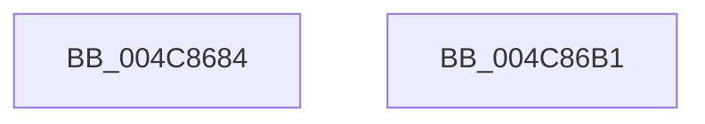

# MiCaptureStackTraceCallout

- RVA: `0x004C8684`–`0x004C86B2` (길이 `46` bytes)
- VA: `0x00000001404C8684`
- 실행 섹션: `.text`
- PDB 이름 있음: `예`; PDB Function 태그: `아니요`
- unwind 정보 RVA: `0x0005CF00`
- 디코드: `15`개 명령, `46/46` bytes 표시
- 미해석 바이트: `0` (있으면 어셈블리에 `.byte`로 보존)

> 이 문서는 커널 이미지의 기계어와 PDB 기호를 분석해 생성했습니다. 4번과 5번은 함수 원형과 자료형을 바이너리 사용 방식에서 추정한 C 해석이며 원본 소스 복구 결과는 아닙니다.

## 1. Dependencies

- 직접 호출 지점: **1**; 고유 호출 대상: **1**
- 직접 호출자로 확인된 함수: **1**
- RIP 상대 이미지 참조: **0**

### Outgoing calls
- `0x004C86A0` → [RtlCaptureStackBackTrace](../2F/RtlCaptureStackBackTrace_function_002F9FF0.md) (function, `0x002F9FF0`)

### Direct callers
- [MiCaptureStackTraceEx](../69/MiCaptureStackTraceEx_function_0069709C.md) at `0x00697104`

### Static image references
- 디코드된 RIP-relative 메모리 참조가 없습니다.

## 2. Other-region calls and transfers

- 다른 실행 섹션으로 향하는 call: **0**
- 별도 외부 분기/꼬리 이동을 확인하지 못했습니다.

## 3. Assembly (complete function range)

```asm
004C8684  40 53                           push rbx
004C8686  48 83 EC 20                     sub rsp, 0x20
004C868A  4C 8B 01                        mov r8, qword ptr [rcx]
004C868D  4C 8D 4C 24 30                  lea r9, [rsp + 0x30]
004C8692  8B 51 08                        mov edx, dword ptr [rcx + 8]
004C8695  48 8B D9                        mov rbx, rcx
004C8698  8B 49 0C                        mov ecx, dword ptr [rcx + 0xc]
004C869B  83 64 24 30 00                  and dword ptr [rsp + 0x30], 0
004C86A0  E8 4B 19 E3 FF                  call 0x1402f9ff0
004C86A5  0F B7 C0                        movzx eax, ax
004C86A8  89 43 10                        mov dword ptr [rbx + 0x10], eax
004C86AB  48 83 C4 20                     add rsp, 0x20
004C86AF  5B                              pop rbx
004C86B0  C3                              ret
004C86B1  CC                              int3
```

## 4. C-style interpretation (structured pseudocode)

```c
__int64 __fastcall MiCaptureStackTraceCallout(__int64 a1)
{
    __int64 result;
    __int64 v_rsp;
    unsigned __int64 v_stack_p8;

    v_rsp = (v_rsp) - (32);
    result = RtlCaptureStackBackTrace((unsigned int)(*(unsigned int *)(a1 + 12)), (unsigned int)(*(unsigned int *)(a1 + 8)), *(unsigned __int64 *)(a1), v_stack_p8);
    *(unsigned int *)(a1 + 16) = (unsigned int)((unsigned __int16)(result));
    v_rsp = (v_rsp) + (32);
    return (unsigned __int16)(result);
}
```

## 5. (Beta) C Style

```c
int64_t MiCaptureStackTraceCallout(void *Arg1)
{
    uint8_t *arg1 = (uint8_t *)Arg1;

    int64_t result;
    int64_t local_rsp;
    uint64_t v_stack_p8;

    local_rsp = (local_rsp) - (32);
    result = RtlCaptureStackBackTrace((uint32_t)(*(uint32_t *)(arg1 + 0xC)), (uint32_t)(*(uint32_t *)(arg1 + 0x8)), *(uint64_t *)(arg1), v_stack_p8);
    *(uint32_t *)(arg1 + 0x10) = (uint32_t)((uint16_t)(result));
    local_rsp = (local_rsp) + (32);
    return (uint16_t)(result);
}
```

### 관측된 메모리 오프셋

구조체 형식이 확인되지 않은 접근은 인자 기준의 오프셋으로만 기록했습니다.

| 기준 인자 | 오프셋 표현 | 폭 (bit) | 접근 |
|---|---:|---:|---|
| `Arg1` | `+ 0x0` | `64` | `R` |
| `Arg1` | `+ 0x8` | `32` | `R` |
| `Arg1` | `+ 0xC` | `32` | `R` |
| `Arg1` | `+ 0x10` | `32` | `W` |

## 6. Execution-region graph

[열기: 2D/3D 그래프와 함수 탐색 컨트롤 패널](../../../control-panel.html?section=text&rva=0x004C8684&view=graph)

- 2D 그래프는 위에서 아래로 흐르고, 3D 그래프는 빈 공간을 드래그해 회전합니다. Shift+드래그는 이동, 휠은 확대·축소, 함수 노드 선택은 대상 보고서 이동입니다.

### Static fallback


