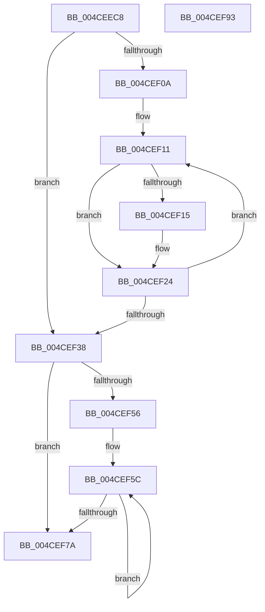

# MiConvertIoPfnTreeLockExclusiveToShared

- RVA: `0x004CEEC8`–`0x004CEF94` (길이 `204` bytes)
- VA: `0x00000001404CEEC8`
- 실행 섹션: `.text`
- PDB 이름 있음: `예`; PDB Function 태그: `아니요`
- unwind 정보 RVA: `0x00060300`
- 디코드: `50`개 명령, `204/204` bytes 표시
- 미해석 바이트: `0` (있으면 어셈블리에 `.byte`로 보존)

> 이 문서는 커널 이미지의 기계어와 PDB 기호를 분석해 생성했습니다. 4번과 5번은 함수 원형과 자료형을 바이너리 사용 방식에서 추정한 C 해석이며 원본 소스 복구 결과는 아닙니다.

## 1. Dependencies

- 직접 호출 지점: **1**; 고유 호출 대상: **1**
- 직접 호출자로 확인된 함수: **2**
- RIP 상대 이미지 참조: **2**

### Outgoing calls
- `0x004CEF1F` → [ExReleaseSpinLockExclusiveFromDpcLevel](../24/ExReleaseSpinLockExclusiveFromDpcLevel_function_002497E0.md) (function, `0x002497E0`)

### Direct callers
- [MiDeleteStaleCacheMaps](../67/MiDeleteStaleCacheMaps_function_0067B780.md) at `0x0067B8D8`
- [sub_006D79AA](../6D/Unknown_function_006D79AA.md) at `0x006D7A30`

### Static image references
- `0x004CEEEC` → RVA `0x00FC5000` (`ALMOSTRO`; read)
- `0x004CEEF7` → RVA `0x00E2DBF8` (`.data`; read)

## 2. Other-region calls and transfers

- 다른 실행 섹션으로 향하는 call: **0**
- 별도 외부 분기/꼬리 이동을 확인하지 못했습니다.

## 3. Assembly (complete function range)

```asm
004CEEC8  48 89 5C 24 08                  mov qword ptr [rsp + 8], rbx
004CEECD  48 89 6C 24 10                  mov qword ptr [rsp + 0x10], rbp
004CEED2  48 89 74 24 18                  mov qword ptr [rsp + 0x18], rsi
004CEED7  57                              push rdi
004CEED8  41 56                           push r14
004CEEDA  41 57                           push r15
004CEEDC  48 83 EC 20                     sub rsp, 0x20
004CEEE0  65 48 8B 2C 25 20 00 00 00      mov rbp, qword ptr gs:[0x20]
004CEEE9  45 33 FF                        xor r15d, r15d
004CEEEC  66 44 3B 3D 0C 61 AF 00         cmp r15w, word ptr [rip + 0xaf610c]
004CEEF4  41 8B DF                        mov ebx, r15d
004CEEF7  4C 8B 35 FA EC 95 00            mov r14, qword ptr [rip + 0x95ecfa]
004CEEFE  8B BD 54 87 00 00               mov edi, dword ptr [rbp + 0x8754]
004CEF04  41 8D 77 01                     lea esi, [r15 + 1]
004CEF08  73 2E                           jae 0x1404cef38
004CEF0A  49 81 C6 78 01 00 00            add r14, 0x178
004CEF11  3B DF                           cmp ebx, edi
004CEF13  74 0F                           je 0x1404cef24
004CEF15  49 8B 0E                        mov rcx, qword ptr [r14]
004CEF18  48 81 C1 80 02 00 00            add rcx, 0x280
004CEF1F  E8 BC A8 D7 FF                  call 0x1402497e0
004CEF24  0F B7 05 D5 60 AF 00            movzx eax, word ptr [rip + 0xaf60d5]
004CEF2B  49 81 C6 80 01 00 00            add r14, 0x180
004CEF32  03 DE                           add ebx, esi
004CEF34  3B D8                           cmp ebx, eax
004CEF36  72 D9                           jb 0x1404cef11
004CEF38  48 8B 85 38 88 00 00            mov rax, qword ptr [rbp + 0x8838]
004CEF3F  4C 8B 80 48 01 00 00            mov r8, qword ptr [rax + 0x148]
004CEF46  B8 00 00 00 80                  mov eax, 0x80000000
004CEF4B  F0 41 0F B1 B0 80 02 00 00      lock cmpxchg dword ptr [r8 + 0x280], esi
004CEF54  74 24                           je 0x1404cef7a
004CEF56  41 B9 00 00 00 40               mov r9d, 0x40000000
004CEF5C  8B CE                           mov ecx, esi
004CEF5E  41 0B F1                        or esi, r9d
004CEF61  0F BA F1 1E                     btr ecx, 0x1e
004CEF65  41 85 C1                        test r9d, eax
004CEF68  0F 44 F1                        cmove esi, ecx
004CEF6B  8B C8                           mov ecx, eax
004CEF6D  F0 41 0F B1 B0 80 02 00 00      lock cmpxchg dword ptr [r8 + 0x280], esi
004CEF76  3B C1                           cmp eax, ecx
004CEF78  75 E2                           jne 0x1404cef5c
004CEF7A  48 8B 5C 24 40                  mov rbx, qword ptr [rsp + 0x40]
004CEF7F  48 8B 6C 24 48                  mov rbp, qword ptr [rsp + 0x48]
004CEF84  48 8B 74 24 50                  mov rsi, qword ptr [rsp + 0x50]
004CEF89  48 83 C4 20                     add rsp, 0x20
004CEF8D  41 5F                           pop r15
004CEF8F  41 5E                           pop r14
004CEF91  5F                              pop rdi
004CEF92  C3                              ret
004CEF93  CC                              int3
```

## 4. C-style interpretation (structured pseudocode)

```c
__int64 __fastcall MiConvertIoPfnTreeLockExclusiveToShared(void)
{
    __int64 result;
    __int64 v_r14;
    __int64 v_r15;
    __int64 v_rbx;
    __int64 v_rsi;
    __int64 v_rsp;
    unsigned __int64 v_stack_p10;
    unsigned __int64 v_stack_p18;
    unsigned __int64 v_stack_p8;

    v_stack_p8 = v_rbx;
    v_stack_p10 = v_rbp;
    v_stack_p18 = v_rsi;
    v_rsp = (v_rsp) - (32);
    v_r15 = 0;
    if (0 >= (*(unsigned __int16 *)(v_rip + 11493644))) goto loc_004CEF38;
    v_r14 = (*(unsigned __int64 *)(v_rip + 9825530)) + (376);
loc_004CEF11:
    if (0 != ((unsigned int)((unsigned int)(*(unsigned int *)(*(unsigned __int64 *)(gs_base + (0 + 32)) + 34644))))) {
        a1 = *(unsigned __int64 *)(v_r14);
        a1 = (a1) + (640);
        result = ExReleaseSpinLockExclusiveFromDpcLevel(a1, a2, a3, a4);
    }
    v_r14 = (v_r14) + (384);
    v_rbx = (unsigned int)((0) + ((unsigned int)(v_r15 + 1)));
    if (((unsigned int)(v_rbx)) < ((unsigned int)(*(unsigned __int16 *)(v_rip + 11493589)))) goto loc_004CEF11;
loc_004CEF38:
    if (((unsigned int)(v_rbx)) == ((unsigned int)(*(unsigned __int16 *)(v_rip + 11493589)))) goto loc_004CEF7A;
loc_004CEF5C:
    v_rsi = (unsigned int)((v_r15 + 1) | ((unsigned int)((unsigned int)(0x40000000ULL))));
    if ((((unsigned int)((unsigned int)(0x40000000ULL))) & ((unsigned int)((unsigned int)(0x80000000ULL)))) == 0) { v_rsi = (unsigned int)((unsigned int)((unsigned int)(v_r15 + 1))); }
    if (((unsigned int)((unsigned int)(0x80000000ULL))) != ((unsigned int)((unsigned int)((unsigned int)((unsigned int)(0x80000000ULL)))))) goto loc_004CEF5C;
loc_004CEF7A:
    v_rsp = (v_rsp) + (32);
    return (unsigned int)(0x80000000ULL);
}
```

## 5. (Beta) C Style

```c
void MiConvertIoPfnTreeLockExclusiveToShared(void)
{
    int64_t result;
    int64_t local_r14;
    int64_t local_r15;
    int64_t local_rbx;
    int64_t local_rsi;
    int64_t local_rsp;
    uint64_t v_stack_p10;
    uint64_t v_stack_p18;
    uint64_t v_stack_p8;

    v_stack_p8 = local_rbx;
    v_stack_p10 = local_rbp;
    v_stack_p18 = local_rsi;
    local_rsp = (local_rsp) - (32);
    local_r15 = 0;
    if (0 >= (*(uint16_t *)(v_rip + 0xAF610C))) goto loc_004CEF38;
    local_r14 = (*(uint64_t *)(v_rip + 0x95ECFA)) + (376);
loc_004CEF11:
    if (0 != ((uint32_t)((uint32_t)(*(uint32_t *)(*(uint64_t *)(gs_base + (0 + 0x20)) + 0x8754))))) {
        a1 = *(uint64_t *)(local_r14);
        a1 = (a1) + (640);
        result = ExReleaseSpinLockExclusiveFromDpcLevel(a1, a2, a3, a4);
    }
    local_r14 = (local_r14) + (384);
    local_rbx = (uint32_t)((0) + ((uint32_t)(local_r15 + 1)));
    if (((uint32_t)(local_rbx)) < ((uint32_t)(*(uint16_t *)(v_rip + 0xAF60D5)))) goto loc_004CEF11;
loc_004CEF38:
    if (((uint32_t)(local_rbx)) == ((uint32_t)(*(uint16_t *)(v_rip + 0xAF60D5)))) goto loc_004CEF7A;
loc_004CEF5C:
    local_rsi = (uint32_t)((local_r15 + 1) | ((uint32_t)((uint32_t)(0x40000000ULL))));
    if ((((uint32_t)((uint32_t)(0x40000000ULL))) & ((uint32_t)((uint32_t)(0x80000000ULL)))) == 0) { local_rsi = (uint32_t)((uint32_t)((uint32_t)(local_r15 + 1))); }
    if (((uint32_t)((uint32_t)(0x80000000ULL))) != ((uint32_t)((uint32_t)((uint32_t)((uint32_t)(0x80000000ULL)))))) goto loc_004CEF5C;
loc_004CEF7A:
    local_rsp = (local_rsp) + (32);
    return (uint32_t)(0x80000000ULL);
}
```

## 6. Execution-region graph

[열기: 2D/3D 그래프와 함수 탐색 컨트롤 패널](../../../control-panel.html?section=text&rva=0x004CEEC8&view=graph)

- 2D 그래프는 위에서 아래로 흐르고, 3D 그래프는 빈 공간을 드래그해 회전합니다. Shift+드래그는 이동, 휠은 확대·축소, 함수 노드 선택은 대상 보고서 이동입니다.

### Static fallback


