# MiDeleteLargeUserPde

- RVA: `0x004C4D54`–`0x004C4F33` (길이 `479` bytes)
- VA: `0x00000001404C4D54`
- 실행 섹션: `.text`
- PDB 이름 있음: `예`; PDB Function 태그: `아니요`
- unwind 정보 RVA: `0x000A315C`
- 디코드: `134`개 명령, `479/479` bytes 표시
- 미해석 바이트: `0` (있으면 어셈블리에 `.byte`로 보존)

> 이 문서는 커널 이미지의 기계어와 PDB 기호를 분석해 생성했습니다. 4번과 5번은 함수 원형과 자료형을 바이너리 사용 방식에서 추정한 C 해석이며 원본 소스 복구 결과는 아닙니다.

## 1. Dependencies

- 직접 호출 지점: **4**; 고유 호출 대상: **4**
- 직접 호출자로 확인된 함수: **1**
- RIP 상대 이미지 참조: **2**

### Outgoing calls
- `0x004C4DCD` → [MiDeleteVadAwePtes](MiDeleteVadAwePtes_function_004C4F3C.md) (function, `0x004C4F3C`)
- `0x004C4E10` → [MiRewritePteWithLockBit](../32/MiRewritePteWithLockBit_function_00322FEC.md) (function, `0x00322FEC`)
- `0x004C4E8A` → [MiDecommitAddTbFlushEntries](../4F/MiDecommitAddTbFlushEntries_function_004FB798.md) (function, `0x004FB798`)
- `0x004C4EBD` → [KeYieldProcessorEx](../3F/KeYieldProcessorEx_function_003FBD00.md) (function, `0x003FBD00`)

### Direct callers
- [MiDeleteVa](../27/MiDeleteVa_function_002789E0.md) at `0x00278F44`
- [MiDeleteVa](../27/MiDeleteVa_function_002789E0.md) at `0x0027902E`

### Static image references
- `0x004C4D94` → RVA `0x00E2DC80` (`.data`; read)
- `0x004C4DDF` → RVA `0x00010880` (`.rdata`; read)

## 2. Other-region calls and transfers

- 다른 실행 섹션으로 향하는 call: **0**
- 별도 외부 분기/꼬리 이동을 확인하지 못했습니다.

## 3. Assembly (complete function range)

```asm
004C4D54  40 53                           push rbx
004C4D56  55                              push rbp
004C4D57  56                              push rsi
004C4D58  57                              push rdi
004C4D59  41 54                           push r12
004C4D5B  41 55                           push r13
004C4D5D  41 56                           push r14
004C4D5F  41 57                           push r15
004C4D61  48 83 EC 28                     sub rsp, 0x28
004C4D65  48 8B 1A                        mov rbx, qword ptr [rdx]
004C4D68  4C 8B E9                        mov r13, rcx
004C4D6B  48 8B 89 B8 00 00 00            mov rcx, qword ptr [rcx + 0xb8]
004C4D72  48 8B EB                        mov rbp, rbx
004C4D75  48 89 4C 24 70                  mov qword ptr [rsp + 0x70], rcx
004C4D7A  45 8B F0                        mov r14d, r8d
004C4D7D  48 8B F2                        mov rsi, rdx
004C4D80  BF 10 00 00 00                  mov edi, 0x10
004C4D85  48 8B 01                        mov rax, qword ptr [rcx]
004C4D88  44 8B A0 A0 00 00 00            mov r12d, dword ptr [rax + 0xa0]
004C4D8F  83 E5 01                        and ebp, 1
004C4D92  75 1D                           jne 0x1404c4db1
004C4D94  48 8B 05 E5 8E 96 00            mov rax, qword ptr [rip + 0x968ee5]
004C4D9B  48 85 C0                        test rax, rax
004C4D9E  74 11                           je 0x1404c4db1
004C4DA0  40 84 DF                        test dil, bl
004C4DA3  75 08                           jne 0x1404c4dad
004C4DA5  48 F7 D0                        not rax
004C4DA8  48 23 D8                        and rbx, rax
004C4DAB  EB 04                           jmp 0x1404c4db1
004C4DAD  48 83 E3 EF                     and rbx, 0xffffffffffffffef
004C4DB1  48 C1 EB 0C                     shr rbx, 0xc
004C4DB5  48 B8 FF FF FF FF FF 00 00 00   movabs rax, 0xffffffffff
004C4DBF  48 23 D8                        and rbx, rax
004C4DC2  45 8B FC                        mov r15d, r12d
004C4DC5  44 23 FF                        and r15d, edi
004C4DC8  74 10                           je 0x1404c4dda
004C4DCA  49 8B CD                        mov rcx, r13
004C4DCD  E8 6A 01 00 00                  call 0x1404c4f3c
004C4DD2  48 8B F8                        mov rdi, rax
004C4DD5  E9 85 00 00 00                  jmp 0x1404c4e5f
004C4DDA  45 85 F6                        test r14d, r14d
004C4DDD  75 17                           jne 0x1404c4df6
004C4DDF  48 8B 05 9A BA B4 FF            mov rax, qword ptr [rip - 0x4b4566]
004C4DE6  33 C9                           xor ecx, ecx
004C4DE8  48 89 04 CA                     mov qword ptr [rdx + rcx*8], rax
004C4DEC  48 FF C1                        inc rcx
004C4DEF  48 3B CF                        cmp rcx, rdi
004C4DF2  72 F4                           jb 0x1404c4de8
004C4DF4  EB 1F                           jmp 0x1404c4e15
004C4DF6  BF 01 00 00 00                  mov edi, 1
004C4DFB  48 85 ED                        test rbp, rbp
004C4DFE  74 1C                           je 0x1404c4e1c
004C4E00  4C 8B 0D 79 BA B4 FF            mov r9, qword ptr [rip - 0x4b4587]
004C4E07  4C 8B C6                        mov r8, rsi
004C4E0A  49 8B 4D 20                     mov rcx, qword ptr [r13 + 0x20]
004C4E0E  33 D2                           xor edx, edx
004C4E10  E8 D7 E1 E5 FF                  call 0x140322fec
004C4E15  48 8B 4C 24 70                  mov rcx, qword ptr [rsp + 0x70]
004C4E1A  EB 0A                           jmp 0x1404c4e26
004C4E1C  48 8B 05 5D BA B4 FF            mov rax, qword ptr [rip - 0x4b45a3]
004C4E23  48 89 02                        mov qword ptr [rdx], rax
004C4E26  41 0F BA E4 0C                  bt r12d, 0xc
004C4E2B  73 32                           jae 0x1404c4e5f
004C4E2D  48 8B 09                        mov rcx, qword ptr [rcx]
004C4E30  48 8B 91 D0 00 00 00            mov rdx, qword ptr [rcx + 0xd0]
004C4E37  48 85 D2                        test rdx, rdx
004C4E3A  75 0A                           jne 0x1404c4e46
004C4E3C  48 89 B1 D0 00 00 00            mov qword ptr [rcx + 0xd0], rsi
004C4E43  48 8B D6                        mov rdx, rsi
004C4E46  48 8D 04 FD 00 00 00 00         lea rax, [rdi*8]
004C4E4E  48 2B C2                        sub rax, rdx
004C4E51  48 03 C6                        add rax, rsi
004C4E54  48 C1 F8 03                     sar rax, 3
004C4E58  48 89 81 D8 00 00 00            mov qword ptr [rcx + 0xd8], rax
004C4E5F  48 8D 1C 5B                     lea rbx, [rbx + rbx*2]
004C4E63  48 C1 E3 04                     shl rbx, 4
004C4E67  48 B8 00 00 00 00 00 DE FF FF   movabs rax, 0xffffde0000000000
004C4E71  48 03 D8                        add rbx, rax
004C4E74  48 85 ED                        test rbp, rbp
004C4E77  74 18                           je 0x1404c4e91
004C4E79  48 8B D6                        mov rdx, rsi
004C4E7C  4C 8B CF                        mov r9, rdi
004C4E7F  48 8B 74 24 70                  mov rsi, qword ptr [rsp + 0x70]
004C4E84  45 8B C6                        mov r8d, r14d
004C4E87  48 8B 0E                        mov rcx, qword ptr [rsi]
004C4E8A  E8 09 69 03 00                  call 0x1404fb798
004C4E8F  EB 05                           jmp 0x1404c4e96
004C4E91  48 8B 74 24 70                  mov rsi, qword ptr [rsp + 0x70]
004C4E96  45 85 FF                        test r15d, r15d
004C4E99  75 71                           jne 0x1404c4f0c
004C4E9B  48 8B 43 28                     mov rax, qword ptr [rbx + 0x28]
004C4E9F  48 85 C0                        test rax, rax
004C4EA2  78 68                           js 0x1404c4f0c
004C4EA4  44 21 BC 24 80 00 00 00         and dword ptr [rsp + 0x80], r15d
004C4EAC  F0 48 0F BA 6B 18 3F            lock bts qword ptr [rbx + 0x18], 0x3f
004C4EB3  73 18                           jae 0x1404c4ecd
004C4EB5  48 8D 8C 24 80 00 00 00         lea rcx, [rsp + 0x80]
004C4EBD  E8 3E 6E F3 FF                  call 0x1403fbd00
004C4EC2  48 8B 43 18                     mov rax, qword ptr [rbx + 0x18]
004C4EC6  48 85 C0                        test rax, rax
004C4EC9  78 EA                           js 0x1404c4eb5
004C4ECB  EB DF                           jmp 0x1404c4eac
004C4ECD  48 8B 46 08                     mov rax, qword ptr [rsi + 8]
004C4ED1  48 8B 50 30                     mov rdx, qword ptr [rax + 0x30]
004C4ED5  48 8B 03                        mov rax, qword ptr [rbx]
004C4ED8  48 C1 EA 03                     shr rdx, 3
004C4EDC  48 8B CA                        mov rcx, rdx
004C4EDF  48 33 C8                        xor rcx, rax
004C4EE2  48 B8 01 00 00 00 00 F0 FF FF   movabs rax, 0xfffff00000000001
004C4EEC  48 23 C8                        and rcx, rax
004C4EEF  48 33 CA                        xor rcx, rdx
004C4EF2  48 89 0B                        mov qword ptr [rbx], rcx
004C4EF5  48 8B 46 08                     mov rax, qword ptr [rsi + 8]
004C4EF9  48 89 58 30                     mov qword ptr [rax + 0x30], rbx
004C4EFD  48 B8 FF FF FF FF FF FF FF 7F   movabs rax, 0x7fffffffffffffff
004C4F07  F0 48 21 43 18                  lock and qword ptr [rbx + 0x18], rax
004C4F0C  41 0F BA E4 0B                  bt r12d, 0xb
004C4F11  73 0C                           jae 0x1404c4f1f
004C4F13  45 85 F6                        test r14d, r14d
004C4F16  75 07                           jne 0x1404c4f1f
004C4F18  8D 47 FF                        lea eax, [rdi - 1]
004C4F1B  41 89 45 0C                     mov dword ptr [r13 + 0xc], eax
004C4F1F  8B C7                           mov eax, edi
004C4F21  48 83 C4 28                     add rsp, 0x28
004C4F25  41 5F                           pop r15
004C4F27  41 5E                           pop r14
004C4F29  41 5D                           pop r13
004C4F2B  41 5C                           pop r12
004C4F2D  5F                              pop rdi
004C4F2E  5E                              pop rsi
004C4F2F  5D                              pop rbp
004C4F30  5B                              pop rbx
004C4F31  C3                              ret
004C4F32  CC                              int3
```

## 4. C-style interpretation (structured pseudocode)

```c
__int64 __fastcall MiDeleteLargeUserPde(__int64 a1, __int64 a2, int a3)
{
    __int64 result;
    __int64 v_r15;
    __int64 v_rbp;
    __int64 v_rbx;
    __int64 v_rsp;
    unsigned int v_stack_p18;
    unsigned __int64 v_stack_p8;

    v_rsp = (v_rsp) - (40);
    v_stack_p8 = *(unsigned __int64 *)(a1 + 184);
    v_rbp = (unsigned int)((*(unsigned __int64 *)(a2)) & (1));
    if (condition_is_not_equal) goto loc_004C4DB1;
    if (*(unsigned __int64 *)(v_rip + 9866981) == 0) goto loc_004C4DB1;
    if (((16) & ((unsigned __int8)(*(unsigned __int64 *)(a2)))) != 0) goto loc_004C4DAD;
    result = ~(*(unsigned __int64 *)(v_rip + 9866981));
    v_rbx = (*(unsigned __int64 *)(a2)) & (result);
    goto loc_004C4DB1;
loc_004C4DAD:
    v_rbx = (v_rbx) & (-17);
loc_004C4DB1:
    v_rbx = (v_rbx) >> (12);
    v_rbx = (v_rbx) & (result);
    v_r15 = (unsigned int)(((unsigned int)((unsigned int)((unsigned int)(*(unsigned int *)(*(unsigned __int64 *)(*(unsigned __int64 *)(a1 + 184)) + 160))))) & (16));
    if (condition_is_equal) goto loc_004C4DDA;
    result = MiDeleteVadAwePtes(a1, a2, a3, a4);
    goto loc_004C4E5F;
loc_004C4DDA:
    if ((unsigned int)((unsigned int)(a3)) != 0) goto loc_004C4DF6;
    a1 = 0;
loc_004C4DE8:
    *(unsigned __int64 *)(a2 + a1 * 8) = *(unsigned __int64 *)(v_rip - 4932966);
    a1 = (a1) + 1;
    if (a1 < result) goto loc_004C4DE8;
    goto loc_004C4E15;
loc_004C4DF6:
    if (v_rbp == 0) goto loc_004C4E1C;
    a2 = 0;
    result = MiRewritePteWithLockBit(*(unsigned __int64 *)(a1 + 32), a2, a2, *(unsigned __int64 *)(v_rip - 4932999));
loc_004C4E15:
    goto loc_004C4E26;
loc_004C4E1C:
    *(unsigned __int64 *)(a2) = *(unsigned __int64 *)(v_rip - 4933027);
loc_004C4E26:
    if (condition_is_above_or_equal) goto loc_004C4E5F;
    if (*(unsigned __int64 *)(*(unsigned __int64 *)(v_stack_p8) + 208) == 0) {
        *(unsigned __int64 *)(*(unsigned __int64 *)(v_stack_p8) + 208) = 0;
        a2 = 0;
    }
    result = (1 * 8) - (a2);
    result = (result) + (a2);
    result = (result) >> (3);
    *(unsigned __int64 *)(*(unsigned __int64 *)(v_stack_p8) + 216) = result;
loc_004C4E5F:
    v_rbx = (v_rbx + v_rbx * 2) << (4);
    v_rbx = (v_rbx) + (result);
    if (v_rbp == 0) goto loc_004C4E91;
    result = MiDecommitAddTbFlushEntries(*(unsigned __int64 *)(v_stack_p8), a2, (unsigned int)((unsigned int)((unsigned int)(a3))), 1);
    goto loc_004C4E96;
loc_004C4E91:
loc_004C4E96:
    if ((unsigned int)(v_r15) != 0) goto loc_004C4F0C;
    if (sign_flag) goto loc_004C4F0C;
loc_004C4EAC:
    if (condition_is_above_or_equal) goto loc_004C4ECD;
loc_004C4EB5:
    result = KeYieldProcessorEx(v_stack_p18, a2, (unsigned int)((unsigned int)((unsigned int)(a3))), 1);
    if (sign_flag) goto loc_004C4EB5;
    goto loc_004C4EAC;
loc_004C4ECD:
    a2 = (*(unsigned __int64 *)(*(unsigned __int64 *)(v_stack_p8 + 8) + 48)) >> (3);
    a1 = (a2) ^ (*(unsigned __int64 *)(v_rbx));
    a1 = (a1) & (*(unsigned __int64 *)(v_rbx));
    a1 = (a1) ^ (a2);
    *(unsigned __int64 *)(v_rbx) = a1;
    *(unsigned __int64 *)(*(unsigned __int64 *)(v_stack_p8 + 8) + 48) = v_rbx;
loc_004C4F0C:
    if (condition_is_above_or_equal) goto loc_004C4F1F;
    result = *(unsigned __int64 *)(v_stack_p8 + 8);
    if ((unsigned int)((unsigned int)(a3)) == 0) {
        result = 1 - 1;
        *(unsigned int *)(a1 + 12) = (unsigned int)(result);
    }
    v_rsp = (v_rsp) + (40);
    return 1;
}
```

## 5. (Beta) C Style

```c
int64_t MiDeleteLargeUserPde(void *Arg1, void *Arg2, int32_t Arg3)
{
    uint8_t *arg1 = (uint8_t *)Arg1;
    uint8_t *arg2 = (uint8_t *)Arg2;

    int64_t result;
    int64_t local_r15;
    int64_t local_rbp;
    int64_t local_rbx;
    int64_t local_rsp;
    uint32_t v_stack_p18;
    uint64_t v_stack_p8;

    local_rsp = (local_rsp) - (40);
    v_stack_p8 = *(uint64_t *)(arg1 + 0xB8);
    local_rbp = (uint32_t)((*(uint64_t *)(arg2)) & (1));
    if (condition_is_not_equal) goto loc_004C4DB1;
    if (*(uint64_t *)(v_rip + 0x968EE5) == 0) goto loc_004C4DB1;
    if (((16) & ((uint8_t)(*(uint64_t *)(arg2)))) != 0) goto loc_004C4DAD;
    result = ~(*(uint64_t *)(v_rip + 0x968EE5));
    local_rbx = (*(uint64_t *)(arg2)) & (result);
    goto loc_004C4DB1;
loc_004C4DAD:
    local_rbx = (local_rbx) & (-17);
loc_004C4DB1:
    local_rbx = (local_rbx) >> (12);
    local_rbx = (local_rbx) & (result);
    local_r15 = (uint32_t)(((uint32_t)((uint32_t)((uint32_t)(*(uint32_t *)(*(uint64_t *)(*(uint64_t *)(arg1 + 0xB8)) + 0xA0))))) & (16));
    if (condition_is_equal) goto loc_004C4DDA;
    result = MiDeleteVadAwePtes(Arg1, Arg2, Arg3, a4);
    goto loc_004C4E5F;
loc_004C4DDA:
    if ((uint32_t)((uint32_t)(Arg3)) != 0) goto loc_004C4DF6;
    Arg1 = 0;
loc_004C4DE8:
    *(uint64_t *)(arg2 + arg1 * 8) = *(uint64_t *)(v_rip - 0x4B4566);
    Arg1 = (Arg1) + 1;
    if (Arg1 < result) goto loc_004C4DE8;
    goto loc_004C4E15;
loc_004C4DF6:
    if (local_rbp == 0) goto loc_004C4E1C;
    Arg2 = 0;
    result = MiRewritePteWithLockBit(*(uint64_t *)(arg1 + 0x20), Arg2, Arg2, *(uint64_t *)(v_rip - 0x4B4587));
loc_004C4E15:
    goto loc_004C4E26;
loc_004C4E1C:
    *(uint64_t *)(arg2) = *(uint64_t *)(v_rip - 0x4B45A3);
loc_004C4E26:
    if (condition_is_above_or_equal) goto loc_004C4E5F;
    if (*(uint64_t *)(*(uint64_t *)(v_stack_p8) + 0xD0) == 0) {
        *(uint64_t *)(*(uint64_t *)(v_stack_p8) + 0xD0) = 0;
        Arg2 = 0;
    }
    result = (1 * 8) - (Arg2);
    result = (result) + (Arg2);
    result = (result) >> (3);
    *(uint64_t *)(*(uint64_t *)(v_stack_p8) + 0xD8) = result;
loc_004C4E5F:
    local_rbx = (local_rbx + local_rbx * 2) << (4);
    local_rbx = (local_rbx) + (result);
    if (local_rbp == 0) goto loc_004C4E91;
    result = MiDecommitAddTbFlushEntries(*(uint64_t *)(v_stack_p8), Arg2, (uint32_t)((uint32_t)((uint32_t)(Arg3))), 1);
    goto loc_004C4E96;
loc_004C4E91:
loc_004C4E96:
    if ((uint32_t)(local_r15) != 0) goto loc_004C4F0C;
    if (sign_flag) goto loc_004C4F0C;
loc_004C4EAC:
    if (condition_is_above_or_equal) goto loc_004C4ECD;
loc_004C4EB5:
    result = KeYieldProcessorEx(v_stack_p18, Arg2, (uint32_t)((uint32_t)((uint32_t)(Arg3))), 1);
    if (sign_flag) goto loc_004C4EB5;
    goto loc_004C4EAC;
loc_004C4ECD:
    Arg2 = (*(uint64_t *)(*(uint64_t *)(v_stack_p8 + 0x8) + 0x30)) >> (3);
    Arg1 = (Arg2) ^ (*(uint64_t *)(local_rbx));
    Arg1 = (Arg1) & (*(uint64_t *)(local_rbx));
    Arg1 = (Arg1) ^ (Arg2);
    *(void **)(local_rbx) = Arg1;
    *(uint64_t *)(*(uint64_t *)(v_stack_p8 + 0x8) + 0x30) = local_rbx;
loc_004C4F0C:
    if (condition_is_above_or_equal) goto loc_004C4F1F;
    result = *(uint64_t *)(v_stack_p8 + 0x8);
    if ((uint32_t)((uint32_t)(Arg3)) == 0) {
        result = 1 - 1;
        *(uint32_t *)(arg1 + 0xC) = (uint32_t)(result);
    }
    local_rsp = (local_rsp) + (40);
    return 1;
}
```

### 관측된 메모리 오프셋

구조체 형식이 확인되지 않은 접근은 인자 기준의 오프셋으로만 기록했습니다.

| 기준 인자 | 오프셋 표현 | 폭 (bit) | 접근 |
|---|---:|---:|---|
| `Arg1` | `+ 0xC` | `32` | `W` |
| `Arg1` | `+ 0x20` | `64` | `R` |
| `Arg1` | `+ 0xB8` | `64` | `R` |
| `Arg2` | `+ 0x0` | `64` | `R` |
| `Arg2` | `+ 0x0` | `64` | `W` |
| `Arg2` | `+ 0x0 + rcx*8` | `64` | `W` |

## 6. Execution-region graph

[열기: 2D/3D 그래프와 함수 탐색 컨트롤 패널](../../../control-panel.html?section=text&rva=0x004C4D54&view=graph)

- 2D 그래프는 위에서 아래로 흐르고, 3D 그래프는 빈 공간을 드래그해 회전합니다. Shift+드래그는 이동, 휠은 확대·축소, 함수 노드 선택은 대상 보고서 이동입니다.

### Static fallback

```mermaid
flowchart TD
  bb_004C4D54[BB_004C4D54]
  bb_004C4D94[BB_004C4D94]
  bb_004C4DA0[BB_004C4DA0]
  bb_004C4DA5[BB_004C4DA5]
  bb_004C4DAD[BB_004C4DAD]
  bb_004C4DB1[BB_004C4DB1]
  bb_004C4DCA[BB_004C4DCA]
  bb_004C4DDA[BB_004C4DDA]
  bb_004C4DDF[BB_004C4DDF]
  bb_004C4DE8[BB_004C4DE8]
  bb_004C4DF4[BB_004C4DF4]
  bb_004C4DF6[BB_004C4DF6]
  bb_004C4E00[BB_004C4E00]
  bb_004C4E15[BB_004C4E15]
  bb_004C4E1C[BB_004C4E1C]
  bb_004C4E26[BB_004C4E26]
  bb_004C4E2D[BB_004C4E2D]
  bb_004C4E3C[BB_004C4E3C]
  bb_004C4E46[BB_004C4E46]
  bb_004C4E5F[BB_004C4E5F]
  bb_004C4E79[BB_004C4E79]
  bb_004C4E91[BB_004C4E91]
  bb_004C4E96[BB_004C4E96]
  bb_004C4E9B[BB_004C4E9B]
  bb_004C4EA4[BB_004C4EA4]
  bb_004C4EAC[BB_004C4EAC]
  bb_004C4EB5[BB_004C4EB5]
  bb_004C4ECB[BB_004C4ECB]
  bb_004C4ECD[BB_004C4ECD]
  bb_004C4F0C[BB_004C4F0C]
  bb_004C4F13[BB_004C4F13]
  bb_004C4F18[BB_004C4F18]
  bb_004C4F1F[BB_004C4F1F]
  bb_004C4F32[BB_004C4F32]
  bb_004C4D54 -->|branch| bb_004C4DB1
  bb_004C4D54 -->|fallthrough| bb_004C4D94
  bb_004C4D94 -->|branch| bb_004C4DB1
  bb_004C4D94 -->|fallthrough| bb_004C4DA0
  bb_004C4DA0 -->|branch| bb_004C4DAD
  bb_004C4DA0 -->|fallthrough| bb_004C4DA5
  bb_004C4DA5 -->|branch| bb_004C4DB1
  bb_004C4DAD -->|flow| bb_004C4DB1
  bb_004C4DB1 -->|branch| bb_004C4DDA
  bb_004C4DB1 -->|fallthrough| bb_004C4DCA
  bb_004C4DCA -->|branch| bb_004C4E5F
  bb_004C4DDA -->|branch| bb_004C4DF6
  bb_004C4DDA -->|fallthrough| bb_004C4DDF
  bb_004C4DDF -->|flow| bb_004C4DE8
  bb_004C4DE8 -->|branch| bb_004C4DE8
  bb_004C4DE8 -->|fallthrough| bb_004C4DF4
  bb_004C4DF4 -->|branch| bb_004C4E15
  bb_004C4DF6 -->|branch| bb_004C4E1C
  bb_004C4DF6 -->|fallthrough| bb_004C4E00
  bb_004C4E00 -->|flow| bb_004C4E15
  bb_004C4E15 -->|branch| bb_004C4E26
  bb_004C4E1C -->|flow| bb_004C4E26
  bb_004C4E26 -->|branch| bb_004C4E5F
  bb_004C4E26 -->|fallthrough| bb_004C4E2D
  bb_004C4E2D -->|branch| bb_004C4E46
  bb_004C4E2D -->|fallthrough| bb_004C4E3C
  bb_004C4E3C -->|flow| bb_004C4E46
  bb_004C4E46 -->|flow| bb_004C4E5F
  bb_004C4E5F -->|branch| bb_004C4E91
  bb_004C4E5F -->|fallthrough| bb_004C4E79
  bb_004C4E79 -->|branch| bb_004C4E96
  bb_004C4E91 -->|flow| bb_004C4E96
  bb_004C4E96 -->|branch| bb_004C4F0C
  bb_004C4E96 -->|fallthrough| bb_004C4E9B
  bb_004C4E9B -->|branch| bb_004C4F0C
  bb_004C4E9B -->|fallthrough| bb_004C4EA4
  bb_004C4EA4 -->|flow| bb_004C4EAC
  bb_004C4EAC -->|branch| bb_004C4ECD
  bb_004C4EAC -->|fallthrough| bb_004C4EB5
  bb_004C4EB5 -->|branch| bb_004C4EB5
  bb_004C4EB5 -->|fallthrough| bb_004C4ECB
  bb_004C4ECB -->|branch| bb_004C4EAC
  bb_004C4ECD -->|flow| bb_004C4F0C
  bb_004C4F0C -->|branch| bb_004C4F1F
  bb_004C4F0C -->|fallthrough| bb_004C4F13
  bb_004C4F13 -->|branch| bb_004C4F1F
  bb_004C4F13 -->|fallthrough| bb_004C4F18
  bb_004C4F18 -->|flow| bb_004C4F1F
```


