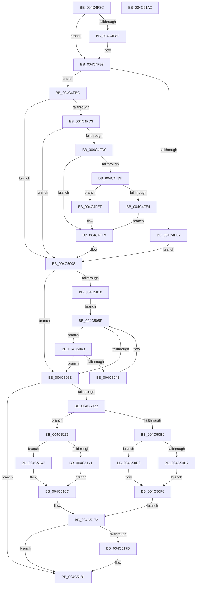

# MiDeleteVadAwePtes

- RVA: `0x004C4F3C`–`0x004C51A3` (길이 `615` bytes)
- VA: `0x00000001404C4F3C`
- 실행 섹션: `.text`
- PDB 이름 있음: `예`; PDB Function 태그: `아니요`
- unwind 정보 RVA: `0x000BCE40`
- 디코드: `171`개 명령, `615/615` bytes 표시
- 미해석 바이트: `0` (있으면 어셈블리에 `.byte`로 보존)

> 이 문서는 커널 이미지의 기계어와 PDB 기호를 분석해 생성했습니다. 4번과 5번은 함수 원형과 자료형을 바이너리 사용 방식에서 추정한 C 해석이며 원본 소스 복구 결과는 아닙니다.

## 1. Dependencies

- 직접 호출 지점: **5**; 고유 호출 대상: **5**
- 직접 호출자로 확인된 함수: **2**
- RIP 상대 이미지 참조: **3**

### Outgoing calls
- `0x004C4F85` → [MiGetAweViewPageSize](MiGetAweViewPageSize_function_004C51AC.md) (function, `0x004C51AC`)
- `0x004C4FA6` → [MI_READ_PTE_LOCK_FREE](../28/MI_READ_PTE_LOCK_FREE_function_002828A0.md) (function, `0x002828A0`)
- `0x004C4FF7` → [MiCompareTbFlushTimeStamp](../31/MiCompareTbFlushTimeStamp_function_0031ADE4.md) (function, `0x0031ADE4`)
- `0x004C509F` → [MiWriteAwePtes](MiWriteAwePtes_function_004C51E0.md) (function, `0x004C51E0`)
- `0x004C50C0` → [MiLockHugePfnInternal](../3F/MiLockHugePfnInternal_function_003FBC80.md) (function, `0x003FBC80`)

### Direct callers
- [MiDeleteVa](../27/MiDeleteVa_function_002789E0.md) at `0x00278FB8`
- [MiDeleteVa](../27/MiDeleteVa_function_002789E0.md) at `0x00279001`
- [MiDeleteLargeUserPde](MiDeleteLargeUserPde_function_004C4D54.md) at `0x004C4DCD`

### Static image references
- `0x004C4FD0` → RVA `0x00E2DC80` (`.data`; read)
- `0x004C50E0` → RVA `0x00E300C0` (`.data`; read)
- `0x004C5122` → RVA `0x00E300C8` (`.data`; read)

## 2. Other-region calls and transfers

- 다른 실행 섹션으로 향하는 call: **0**
- 별도 외부 분기/꼬리 이동을 확인하지 못했습니다.

## 3. Assembly (complete function range)

```asm
004C4F3C  48 8B C4                        mov rax, rsp
004C4F3F  48 89 58 10                     mov qword ptr [rax + 0x10], rbx
004C4F43  48 89 68 18                     mov qword ptr [rax + 0x18], rbp
004C4F47  48 89 70 20                     mov qword ptr [rax + 0x20], rsi
004C4F4B  48 89 48 08                     mov qword ptr [rax + 8], rcx
004C4F4F  57                              push rdi
004C4F50  41 54                           push r12
004C4F52  41 55                           push r13
004C4F54  41 56                           push r14
004C4F56  41 57                           push r15
004C4F58  48 83 EC 60                     sub rsp, 0x60
004C4F5C  48 8B B1 B8 00 00 00            mov rsi, qword ptr [rcx + 0xb8]
004C4F63  0F 57 C0                        xorps xmm0, xmm0
004C4F66  0F 11 40 B8                     movups xmmword ptr [rax - 0x48], xmm0
004C4F6A  33 C9                           xor ecx, ecx
004C4F6C  45 8B F8                        mov r15d, r8d
004C4F6F  48 89 48 C8                     mov qword ptr [rax - 0x38], rcx
004C4F73  4C 8B E2                        mov r12, rdx
004C4F76  48 8B 46 08                     mov rax, qword ptr [rsi + 8]
004C4F7A  4C 8B 68 28                     mov r13, qword ptr [rax + 0x28]
004C4F7E  49 8B CD                        mov rcx, r13
004C4F81  49 8B 7D 20                     mov rdi, qword ptr [r13 + 0x20]
004C4F85  E8 22 02 00 00                  call 0x1404c51ac
004C4F8A  48 85 C0                        test rax, rax
004C4F8D  75 04                           jne 0x1404c4f93
004C4F8F  48 8B 47 10                     mov rax, qword ptr [rdi + 0x10]
004C4F93  48 83 F8 10                     cmp rax, 0x10
004C4F97  41 BE 01 00 00 00               mov r14d, 1
004C4F9D  49 8B CC                        mov rcx, r12
004C4FA0  44 0F 44 F0                     cmove r14d, eax
004C4FA4  33 ED                           xor ebp, ebp
004C4FA6  E8 F5 D8 DB FF                  call 0x1402828a0
004C4FAB  44 8D 5D 01                     lea r11d, [rbp + 1]
004C4FAF  48 8B D8                        mov rbx, rax
004C4FB2  41 84 C3                        test r11b, al
004C4FB5  74 05                           je 0x1404c4fbc
004C4FB7  41 8B EB                        mov ebp, r11d
004C4FBA  EB 4C                           jmp 0x1404c5008
004C4FBC  48 0F BA E3 0B                  bt rbx, 0xb
004C4FC1  72 45                           jb 0x1404c5008
004C4FC3  25 E0 03 00 00                  and eax, 0x3e0
004C4FC8  48 3D 00 03 00 00               cmp rax, 0x300
004C4FCE  75 38                           jne 0x1404c5008
004C4FD0  48 8B 05 A9 8C 96 00            mov rax, qword ptr [rip + 0x968ca9]
004C4FD7  48 8B CB                        mov rcx, rbx
004C4FDA  48 85 C0                        test rax, rax
004C4FDD  74 14                           je 0x1404c4ff3
004C4FDF  F6 C3 10                        test bl, 0x10
004C4FE2  75 0B                           jne 0x1404c4fef
004C4FE4  48 8B C8                        mov rcx, rax
004C4FE7  48 F7 D1                        not rcx
004C4FEA  48 23 CB                        and rcx, rbx
004C4FED  EB 04                           jmp 0x1404c4ff3
004C4FEF  48 83 E1 EF                     and rcx, 0xffffffffffffffef
004C4FF3  48 C1 E9 20                     shr rcx, 0x20
004C4FF7  E8 E8 5D E5 FF                  call 0x14031ade4
004C4FFC  84 C0                           test al, al
004C4FFE  41 BB 01 00 00 00               mov r11d, 1
004C5004  49 0F 45 EB                     cmovne rbp, r11
004C5008  4C 8B 94 24 90 00 00 00         mov r10, qword ptr [rsp + 0x90]
004C5010  45 33 C0                        xor r8d, r8d
004C5013  45 85 FF                        test r15d, r15d
004C5016  75 53                           jne 0x1404c506b
004C5018  49 8B 92 80 00 00 00            mov rdx, qword ptr [r10 + 0x80]
004C501F  4E 8D 0C F5 00 00 00 00         lea r9, [r14*8]
004C5027  49 8B C4                        mov rax, r12
004C502A  4B 8D 0C 21                     lea rcx, [r9 + r12]
004C502E  48 25 00 F0 FF FF               and rax, 0xfffffffffffff000
004C5034  48 05 F8 0F 00 00               add rax, 0xff8
004C503A  48 3B D0                        cmp rdx, rax
004C503D  48 0F 47 D0                     cmova rdx, rax
004C5041  EB 1C                           jmp 0x1404c505f
004C5043  48 8B 01                        mov rax, qword ptr [rcx]
004C5046  48 3B C3                        cmp rax, rbx
004C5049  75 20                           jne 0x1404c506b
004C504B  48 8D 45 01                     lea rax, [rbp + 1]
004C504F  4D 03 C3                        add r8, r11
004C5052  49 03 C9                        add rcx, r9
004C5055  48 85 ED                        test rbp, rbp
004C5058  48 0F 44 C5                     cmove rax, rbp
004C505C  48 8B E8                        mov rbp, rax
004C505F  48 8D 41 F8                     lea rax, [rcx - 8]
004C5063  49 03 C1                        add rax, r9
004C5066  48 3B C2                        cmp rax, rdx
004C5069  76 D8                           jbe 0x1404c5043
004C506B  49 FF C0                        inc r8
004C506E  45 33 C9                        xor r9d, r9d
004C5071  41 8B C0                        mov eax, r8d
004C5074  33 D2                           xor edx, edx
004C5076  41 0F AF C6                     imul eax, r14d
004C507A  49 8B CD                        mov rcx, r13
004C507D  41 2B C3                        sub eax, r11d
004C5080  41 89 42 0C                     mov dword ptr [r10 + 0xc], eax
004C5084  41 8B C6                        mov eax, r14d
004C5087  48 0F AF E8                     imul rbp, rax
004C508B  48 8D 44 24 40                  lea rax, [rsp + 0x40]
004C5090  48 89 44 24 30                  mov qword ptr [rsp + 0x30], rax
004C5095  83 64 24 28 00                  and dword ptr [rsp + 0x28], 0
004C509A  4C 89 64 24 20                  mov qword ptr [rsp + 0x20], r12
004C509F  E8 3C 01 00 00                  call 0x1404c51e0
004C50A4  48 8B 5C 24 40                  mov rbx, qword ptr [rsp + 0x40]
004C50A9  48 85 DB                        test rbx, rbx
004C50AC  0F 84 CF 00 00 00               je 0x1404c5181
004C50B2  8B 47 08                        mov eax, dword ptr [rdi + 8]
004C50B5  A8 08                           test al, 8
004C50B7  74 7A                           je 0x1404c5133
004C50B9  48 8B 7E 60                     mov rdi, qword ptr [rsi + 0x60]
004C50BD  48 8B CB                        mov rcx, rbx
004C50C0  E8 BB 6B F3 FF                  call 0x1403fbc80
004C50C5  48 8B 03                        mov rax, qword ptr [rbx]
004C50C8  48 BA FF FF 01 00 80 FF FF FF   movabs rdx, 0xffffff800001ffff
004C50D2  48 85 FF                        test rdi, rdi
004C50D5  75 09                           jne 0x1404c50e0
004C50D7  48 89 5E 68                     mov qword ptr [rsi + 0x68], rbx
004C50DB  48 23 C2                        and rax, rdx
004C50DE  EB 18                           jmp 0x1404c50f8
004C50E0  48 2B 3D D9 AF 96 00            sub rdi, qword ptr [rip + 0x96afd9]
004C50E7  48 C1 FF 03                     sar rdi, 3
004C50EB  48 C1 E7 11                     shl rdi, 0x11
004C50EF  48 33 C7                        xor rax, rdi
004C50F2  48 23 C2                        and rax, rdx
004C50F5  48 33 C7                        xor rax, rdi
004C50F8  48 89 03                        mov qword ptr [rbx], rax
004C50FB  41 B8 01 00 00 00               mov r8d, 1
004C5101  48 8B C3                        mov rax, rbx
004C5104  41 8B D0                        mov edx, r8d
004C5107  48 2B 05 B2 AF 96 00            sub rax, qword ptr [rip + 0x96afb2]
004C510E  48 C1 F8 03                     sar rax, 3
004C5112  25 FF FF 3F 00                  and eax, 0x3fffff
004C5117  8B C8                           mov ecx, eax
004C5119  83 E1 1F                        and ecx, 0x1f
004C511C  D3 E2                           shl edx, cl
004C511E  8B C8                           mov ecx, eax
004C5120  F7 D2                           not edx
004C5122  48 8B 05 9F AF 96 00            mov rax, qword ptr [rip + 0x96af9f]
004C5129  48 C1 E9 05                     shr rcx, 5
004C512D  F0 21 14 88                     lock and dword ptr [rax + rcx*4], edx
004C5131  EB 3F                           jmp 0x1404c5172
004C5133  48 8B 4E 60                     mov rcx, qword ptr [rsi + 0x60]
004C5137  48 8B 44 24 48                  mov rax, qword ptr [rsp + 0x48]
004C513C  48 85 C9                        test rcx, rcx
004C513F  75 06                           jne 0x1404c5147
004C5141  48 89 46 68                     mov qword ptr [rsi + 0x68], rax
004C5145  EB 25                           jmp 0x1404c516c
004C5147  48 8B 00                        mov rax, qword ptr [rax]
004C514A  48 C1 E9 03                     shr rcx, 3
004C514E  48 8B D1                        mov rdx, rcx
004C5151  48 33 D0                        xor rdx, rax
004C5154  48 B8 01 00 00 00 00 F0 FF FF   movabs rax, 0xfffff00000000001
004C515E  48 23 D0                        and rdx, rax
004C5161  48 33 D1                        xor rdx, rcx
004C5164  48 8B 4C 24 48                  mov rcx, qword ptr [rsp + 0x48]
004C5169  48 89 11                        mov qword ptr [rcx], rdx
004C516C  41 B8 01 00 00 00               mov r8d, 1
004C5172  48 89 5E 60                     mov qword ptr [rsi + 0x60], rbx
004C5176  80 7C 24 54 00                  cmp byte ptr [rsp + 0x54], 0
004C517B  74 04                           je 0x1404c5181
004C517D  44 88 46 74                     mov byte ptr [rsi + 0x74], r8b
004C5181  4C 8D 5C 24 60                  lea r11, [rsp + 0x60]
004C5186  48 8B C5                        mov rax, rbp
004C5189  49 8B 5B 38                     mov rbx, qword ptr [r11 + 0x38]
004C518D  49 8B 6B 40                     mov rbp, qword ptr [r11 + 0x40]
004C5191  49 8B 73 48                     mov rsi, qword ptr [r11 + 0x48]
004C5195  49 8B E3                        mov rsp, r11
004C5198  41 5F                           pop r15
004C519A  41 5E                           pop r14
004C519C  41 5D                           pop r13
004C519E  41 5C                           pop r12
004C51A0  5F                              pop rdi
004C51A1  C3                              ret
004C51A2  CC                              int3
```

## 4. C-style interpretation (structured pseudocode)

```c
__int64 __fastcall MiDeleteVadAwePtes(__int64 a1, __int64 a2, int a3)
{
    __int64 result;
    __int64 v_r14;
    __int64 v_rbp;
    __int64 v_rdi;
    __int64 v_rsp;
    unsigned __int64 v_stack_m28;
    unsigned __int8 v_stack_m34;
    unsigned __int64 v_stack_m40;
    unsigned __int64 v_stack_m48;
    unsigned __int64 v_stack_m58;
    unsigned int v_stack_m60;
    unsigned __int64 v_stack_m68;
    unsigned __int64 v_stack_p8;

    *(unsigned __int64 *)(v_rsp + 16) = v_rbx;
    *(unsigned __int64 *)(v_rsp + 24) = v_rbp;
    *(unsigned __int64 *)(v_rsp + 32) = v_rsi;
    *(unsigned __int64 *)(v_rsp + 8) = a1;
    v_rsp = (v_rsp) - (96);
    *(unsigned __int64 *)(v_rsp - 72) = v_xmm0;
    a1 = 0;
    *(unsigned __int64 *)(v_rsp - 56) = 0;
    result = MiGetAweViewPageSize(*(unsigned __int64 *)(*(unsigned __int64 *)(*(unsigned __int64 *)(a1 + 184) + 8) + 40), a2, a3, a4);
    if (result == 0) {
        result = *(unsigned __int64 *)(*(unsigned __int64 *)(*(unsigned __int64 *)(*(unsigned __int64 *)(*(unsigned __int64 *)(a1 + 184) + 8) + 40) + 32) + 16);
    }
    v_r14 = 1;
    if (result == 16) { v_r14 = (unsigned int)(result); }
    v_rbp = 0;
    result = MI_READ_PTE_LOCK_FREE(a2, a2, a3, a4);
    if ((((unsigned __int8)(v_rbp + 1)) & ((unsigned __int8)(result))) == 0) goto loc_004C4FBC;
    goto loc_004C5008;
loc_004C4FBC:
    if (condition_is_below) goto loc_004C5008;
    result = (unsigned int)((result) & (992));
    if (result != 768) goto loc_004C5008;
    if (*(unsigned __int64 *)(v_rip + 9866409) == 0) goto loc_004C4FF3;
    if ((((unsigned __int8)(result)) & (16)) != 0) goto loc_004C4FEF;
    a1 = ~(*(unsigned __int64 *)(v_rip + 9866409));
    a1 = (a1) & (result);
    goto loc_004C4FF3;
loc_004C4FEF:
    a1 = (a1) & (-17);
loc_004C4FF3:
    a1 = (a1) >> (32);
    result = MiCompareTbFlushTimeStamp(a1, a2, a3, a4);
    v_rbp = (unsigned int)((unsigned int)(v_rbp + 1));
    if ((unsigned __int8)(result) != 0) { v_rbp = 1; }
loc_004C5008:
    a3 = 0;
    if ((unsigned int)((unsigned int)(a3)) != 0) goto loc_004C506B;
    result = (a2) & (0xFFFFFFFFFFFFF000ULL);
    result = (result) + (0xFF8ULL);
    a2 = *(unsigned __int64 *)(v_stack_p8 + 128);
    if ((*(unsigned __int64 *)(v_stack_p8 + 128)) > result) { a2 = result; }
    goto loc_004C505F;
loc_004C5043:
    if ((*(unsigned __int64 *)(v_r14 * 8 + a2 * 1)) != result) goto loc_004C506B;
    a3 = (a3) + (1);
    a1 = (v_r14 * 8 + a2 * 1) + (v_r14 * 8);
    result = v_rbp + 1;
    if (v_rbp == 0) { result = v_rbp; }
loc_004C505F:
    result = (a1 - 8) + (v_r14 * 8);
    if (result <= a2) goto loc_004C5043;
loc_004C506B:
    a3 = (a3) + 1;
    a4 = 0;
    a2 = 0;
    result = (unsigned int)(((unsigned int)(a3)) * ((unsigned int)(v_r14)));
    result = (unsigned int)((result) - (1));
    *(unsigned int *)(v_stack_p8 + 12) = (unsigned int)(result);
    v_rbp = (result) * ((unsigned int)((unsigned int)(v_r14)));
    v_stack_m58 = v_stack_m48;
    v_stack_m68 = 0;
    result = MiWriteAwePtes(*(unsigned __int64 *)(*(unsigned __int64 *)(*(unsigned __int64 *)(a1 + 184) + 8) + 40), a2, a3, a4);
    if (v_stack_m48 == 0) goto loc_004C5181;
    if ((((unsigned __int8)((unsigned int)(*(unsigned int *)(*(unsigned __int64 *)(*(unsigned __int64 *)(*(unsigned __int64 *)(*(unsigned __int64 *)(a1 + 184) + 8) + 40) + 32) + 8)))) & (8)) == 0) goto loc_004C5133;
    result = MiLockHugePfnInternal(v_stack_m48, a2, a3, a4);
    if (*(unsigned __int64 *)(*(unsigned __int64 *)(a1 + 184) + 96) != 0) goto loc_004C50E0;
    *(unsigned __int64 *)(*(unsigned __int64 *)(a1 + 184) + 104) = v_stack_m48;
    result = (*(unsigned __int64 *)(v_stack_m48)) & (0);
    goto loc_004C50F8;
loc_004C50E0:
    v_rdi = (*(unsigned __int64 *)(*(unsigned __int64 *)(a1 + 184) + 96)) - (*(unsigned __int64 *)(v_rip + 9875417));
    v_rdi = (v_rdi) >> (3);
    v_rdi = (v_rdi) << (17);
    result = (result) ^ (v_rdi);
    result = (result) & (0);
    result = (result) ^ (v_rdi);
loc_004C50F8:
    *(unsigned __int64 *)(v_stack_m48) = result;
    result = (v_stack_m48) - (*(unsigned __int64 *)(v_rip + 9875378));
    result = (result) >> (3);
    result = (unsigned int)((result) & (0x3FFFFFULL));
    a1 = (unsigned int)(((unsigned int)((unsigned int)(result))) & (31));
    a2 = (unsigned int)((1) << ((unsigned __int8)(a1)));
    a2 = (unsigned int)(~(a2));
    a1 = ((unsigned int)((unsigned int)(result))) >> (5);
    goto loc_004C5172;
loc_004C5133:
    if (*(unsigned __int64 *)(*(unsigned __int64 *)(a1 + 184) + 96) != 0) goto loc_004C5147;
    *(unsigned __int64 *)(*(unsigned __int64 *)(a1 + 184) + 104) = v_stack_m40;
    goto loc_004C516C;
loc_004C5147:
    a1 = (*(unsigned __int64 *)(*(unsigned __int64 *)(a1 + 184) + 96)) >> (3);
    a2 = (a1) ^ (*(unsigned __int64 *)(v_stack_m40));
    a2 = (a2) & (*(unsigned __int64 *)(v_stack_m40));
    a2 = (a2) ^ (a1);
    *(unsigned __int64 *)(v_stack_m40) = a2;
loc_004C516C:
loc_004C5172:
    *(unsigned __int64 *)(*(unsigned __int64 *)(a1 + 184) + 96) = v_stack_m48;
    if (v_stack_m34 != 0) {
        *(unsigned __int8 *)(*(unsigned __int64 *)(a1 + 184) + 116) = 1;
    }
    return v_rbp;
}
```

## 5. (Beta) C Style

```c
int64_t MiDeleteVadAwePtes(void *Arg1, int64_t Arg2, int32_t Arg3)
{
    uint8_t *arg1 = (uint8_t *)Arg1;

    int64_t result;
    int64_t local_r14;
    int64_t local_rbp;
    int64_t local_rdi;
    int64_t local_rsp;
    uint64_t v_stack_m28;
    uint8_t v_stack_m34;
    uint64_t v_stack_m40;
    uint64_t v_stack_m48;
    uint64_t v_stack_m58;
    uint32_t v_stack_m60;
    uint64_t v_stack_m68;
    uint64_t v_stack_p8;

    *(uint64_t *)(local_rsp + 0x10) = local_rbx;
    *(uint64_t *)(local_rsp + 0x18) = local_rbp;
    *(uint64_t *)(local_rsp + 0x20) = local_rsi;
    *(void **)(local_rsp + 0x8) = Arg1;
    local_rsp = (local_rsp) - (96);
    *(uint64_t *)(local_rsp - 0x48) = v_xmm0;
    Arg1 = 0;
    *(uint64_t *)(local_rsp - 0x38) = 0;
    result = MiGetAweViewPageSize(*(uint64_t *)(*(uint64_t *)(*(uint64_t *)(arg1 + 0xB8) + 0x8) + 0x28), Arg2, Arg3, a4);
    if (result == 0) {
        result = *(uint64_t *)(*(uint64_t *)(*(uint64_t *)(*(uint64_t *)(*(uint64_t *)(arg1 + 0xB8) + 0x8) + 0x28) + 0x20) + 0x10);
    }
    local_r14 = 1;
    if (result == 16) { local_r14 = (uint32_t)(result); }
    local_rbp = 0;
    result = MI_READ_PTE_LOCK_FREE(Arg2, Arg2, Arg3, a4);
    if ((((uint8_t)(local_rbp + 1)) & ((uint8_t)(result))) == 0) goto loc_004C4FBC;
    goto loc_004C5008;
loc_004C4FBC:
    if (condition_is_below) goto loc_004C5008;
    result = (uint32_t)((result) & (992));
    if (result != 768) goto loc_004C5008;
    if (*(uint64_t *)(v_rip + 0x968CA9) == 0) goto loc_004C4FF3;
    if ((((uint8_t)(result)) & (16)) != 0) goto loc_004C4FEF;
    Arg1 = ~(*(uint64_t *)(v_rip + 0x968CA9));
    Arg1 = (Arg1) & (result);
    goto loc_004C4FF3;
loc_004C4FEF:
    Arg1 = (Arg1) & (-17);
loc_004C4FF3:
    Arg1 = (Arg1) >> (32);
    result = MiCompareTbFlushTimeStamp(Arg1, Arg2, Arg3, a4);
    local_rbp = (uint32_t)((uint32_t)(local_rbp + 1));
    if ((uint8_t)(result) != 0) { local_rbp = 1; }
loc_004C5008:
    Arg3 = 0;
    if ((uint32_t)((uint32_t)(Arg3)) != 0) goto loc_004C506B;
    result = (Arg2) & (0xFFFFFFFFFFFFF000ULL);
    result = (result) + (0xFF8ULL);
    Arg2 = *(uint64_t *)(v_stack_p8 + 0x80);
    if ((*(uint64_t *)(v_stack_p8 + 0x80)) > result) { Arg2 = result; }
    goto loc_004C505F;
loc_004C5043:
    if ((*(uint64_t *)(local_r14 * 8 + Arg2 * 1)) != result) goto loc_004C506B;
    Arg3 = (Arg3) + (1);
    Arg1 = (local_r14 * 8 + Arg2 * 1) + (local_r14 * 8);
    result = local_rbp + 1;
    if (local_rbp == 0) { result = local_rbp; }
loc_004C505F:
    result = (Arg1 - 8) + (local_r14 * 8);
    if (result <= Arg2) goto loc_004C5043;
loc_004C506B:
    Arg3 = (Arg3) + 1;
    a4 = 0;
    Arg2 = 0;
    result = (uint32_t)(((uint32_t)(Arg3)) * ((uint32_t)(local_r14)));
    result = (uint32_t)((result) - (1));
    *(uint32_t *)(v_stack_p8 + 0xC) = (uint32_t)(result);
    local_rbp = (result) * ((uint32_t)((uint32_t)(local_r14)));
    v_stack_m58 = v_stack_m48;
    v_stack_m68 = 0;
    result = MiWriteAwePtes(*(uint64_t *)(*(uint64_t *)(*(uint64_t *)(arg1 + 0xB8) + 0x8) + 0x28), Arg2, Arg3, a4);
    if (v_stack_m48 == 0) goto loc_004C5181;
    if ((((uint8_t)((uint32_t)(*(uint32_t *)(*(uint64_t *)(*(uint64_t *)(*(uint64_t *)(*(uint64_t *)(arg1 + 0xB8) + 0x8) + 0x28) + 0x20) + 0x8)))) & (8)) == 0) goto loc_004C5133;
    result = MiLockHugePfnInternal(v_stack_m48, Arg2, Arg3, a4);
    if (*(uint64_t *)(*(uint64_t *)(arg1 + 0xB8) + 0x60) != 0) goto loc_004C50E0;
    *(uint64_t *)(*(uint64_t *)(arg1 + 0xB8) + 0x68) = v_stack_m48;
    result = (*(uint64_t *)(v_stack_m48)) & (0);
    goto loc_004C50F8;
loc_004C50E0:
    local_rdi = (*(uint64_t *)(*(uint64_t *)(arg1 + 0xB8) + 0x60)) - (*(uint64_t *)(v_rip + 0x96AFD9));
    local_rdi = (local_rdi) >> (3);
    local_rdi = (local_rdi) << (17);
    result = (result) ^ (local_rdi);
    result = (result) & (0);
    result = (result) ^ (local_rdi);
loc_004C50F8:
    *(uint64_t *)(v_stack_m48) = result;
    result = (v_stack_m48) - (*(uint64_t *)(v_rip + 0x96AFB2));
    result = (result) >> (3);
    result = (uint32_t)((result) & (0x3FFFFFULL));
    Arg1 = (uint32_t)(((uint32_t)((uint32_t)(result))) & (31));
    Arg2 = (uint32_t)((1) << ((uint8_t)(Arg1)));
    Arg2 = (uint32_t)(~(Arg2));
    Arg1 = ((uint32_t)((uint32_t)(result))) >> (5);
    goto loc_004C5172;
loc_004C5133:
    if (*(uint64_t *)(*(uint64_t *)(arg1 + 0xB8) + 0x60) != 0) goto loc_004C5147;
    *(uint64_t *)(*(uint64_t *)(arg1 + 0xB8) + 0x68) = v_stack_m40;
    goto loc_004C516C;
loc_004C5147:
    Arg1 = (*(uint64_t *)(*(uint64_t *)(arg1 + 0xB8) + 0x60)) >> (3);
    Arg2 = (Arg1) ^ (*(uint64_t *)(v_stack_m40));
    Arg2 = (Arg2) & (*(uint64_t *)(v_stack_m40));
    Arg2 = (Arg2) ^ (Arg1);
    *(uint64_t *)(v_stack_m40) = Arg2;
loc_004C516C:
loc_004C5172:
    *(uint64_t *)(*(uint64_t *)(arg1 + 0xB8) + 0x60) = v_stack_m48;
    if (v_stack_m34 != 0) {
        *(uint8_t *)(*(uint64_t *)(arg1 + 0xB8) + 0x74) = 1;
    }
    return local_rbp;
}
```

### 관측된 메모리 오프셋

구조체 형식이 확인되지 않은 접근은 인자 기준의 오프셋으로만 기록했습니다.

| 기준 인자 | 오프셋 표현 | 폭 (bit) | 접근 |
|---|---:|---:|---|
| `Arg1` | `+ 0xB8` | `64` | `R` |

## 6. Execution-region graph

[열기: 2D/3D 그래프와 함수 탐색 컨트롤 패널](../../../control-panel.html?section=text&rva=0x004C4F3C&view=graph)

- 2D 그래프는 위에서 아래로 흐르고, 3D 그래프는 빈 공간을 드래그해 회전합니다. Shift+드래그는 이동, 휠은 확대·축소, 함수 노드 선택은 대상 보고서 이동입니다.

### Static fallback


