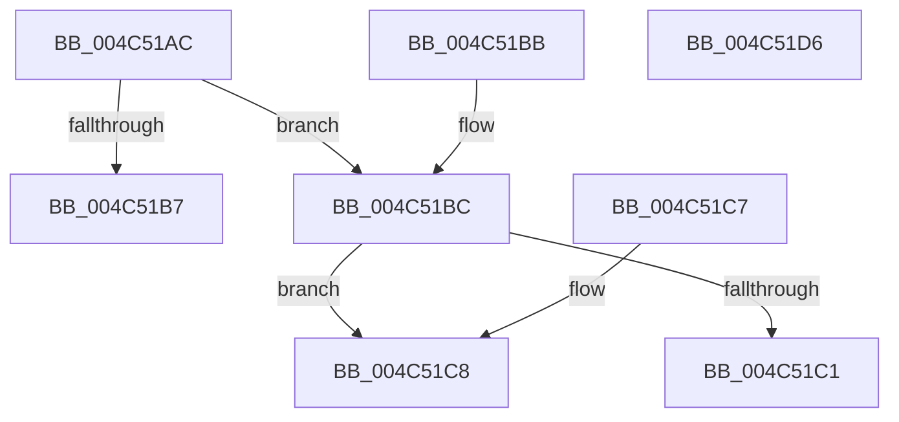

# MiGetAweViewPageSize

- RVA: `0x004C51AC`–`0x004C51D7` (길이 `43` bytes)
- VA: `0x00000001404C51AC`
- 실행 섹션: `.text`
- PDB 이름 있음: `예`; PDB Function 태그: `아니요`
- unwind 정보 RVA: `0x000DB714`
- 디코드: `18`개 명령, `43/43` bytes 표시
- 미해석 바이트: `0` (있으면 어셈블리에 `.byte`로 보존)

> 이 문서는 커널 이미지의 기계어와 PDB 기호를 분석해 생성했습니다. 4번과 5번은 함수 원형과 자료형을 바이너리 사용 방식에서 추정한 C 해석이며 원본 소스 복구 결과는 아닙니다.

## 1. Dependencies

- 직접 호출 지점: **0**; 고유 호출 대상: **0**
- 직접 호출자로 확인된 함수: **8**
- RIP 상대 이미지 참조: **0**

### Outgoing calls
- 직접 디코드된 call 명령이 없습니다.

### Direct callers
- [MiDeleteVadAwePtes](MiDeleteVadAwePtes_function_004C4F3C.md) at `0x004C4F85`
- [MiWriteAwePtes](MiWriteAwePtes_function_004C51E0.md) at `0x004C5286`
- [MiProtectAweRegion](MiProtectAweRegion_function_004CE62C.md) at `0x004CE87C`
- [MiGetAwePageSizeFromVa](../68/MiGetAwePageSizeFromVa_function_00688D74.md) at `0x00688D88`
- [MiReferenceIncomingPhysicalPages](../68/MiReferenceIncomingPhysicalPages_function_006892C0.md) at `0x00689328`
- [MiReferenceIncomingPhysicalPages](../68/MiReferenceIncomingPhysicalPages_function_006892C0.md) at `0x0068945A`
- [MiComputeAweCharges](../../page/6F/MiComputeAweCharges_function_006FE84C.md) at `0x006FE86F`
- [NtMapUserPhysicalPages](../../page/80/NtMapUserPhysicalPages_function_0080B460.md) at `0x0080B57B`
- [MiGetAweVadPageSize](../../page/AD/MiGetAweVadPageSize_function_00AD58F8.md) at `0x00AD5928`

### Static image references
- 디코드된 RIP-relative 메모리 참조가 없습니다.

## 2. Other-region calls and transfers

- 다른 실행 섹션으로 향하는 call: **0**
- 별도 외부 분기/꼬리 이동을 확인하지 못했습니다.

## 3. Assembly (complete function range)

```asm
004C51AC  8B 51 28                        mov edx, dword ptr [rcx + 0x28]
004C51AF  83 E2 03                        and edx, 3
004C51B2  83 FA 01                        cmp edx, 1
004C51B5  75 05                           jne 0x1404c51bc
004C51B7  8D 42 0F                        lea eax, [rdx + 0xf]
004C51BA  C3                              ret
004C51BB  CC                              int3
004C51BC  83 FA 02                        cmp edx, 2
004C51BF  75 07                           jne 0x1404c51c8
004C51C1  B8 00 02 00 00                  mov eax, 0x200
004C51C6  C3                              ret
004C51C7  CC                              int3
004C51C8  33 C0                           xor eax, eax
004C51CA  B9 00 00 04 00                  mov ecx, 0x40000
004C51CF  83 FA 03                        cmp edx, 3
004C51D2  0F 44 C1                        cmove eax, ecx
004C51D5  C3                              ret
004C51D6  CC                              int3
```

## 4. C-style interpretation (structured pseudocode)

```c
__int64 __fastcall MiGetAweViewPageSize(__int64 a1)
{
    __int64 result;

    a2 = (unsigned int)(((unsigned int)(*(unsigned int *)(a1 + 40))) & (3));
    if (((unsigned int)(a2)) != 1) goto loc_004C51BC;
    return a2 + 15;
loc_004C51BC:
    if (((unsigned int)(a2)) != 2) goto loc_004C51C8;
    return 512;
loc_004C51C8:
    result = 0;
    if (((unsigned int)(a2)) == 3) { result = (unsigned int)((unsigned int)(0x40000ULL)); }
    return result;
}
```

## 5. (Beta) C Style

```c
int64_t MiGetAweViewPageSize(void *Arg1)
{
    uint8_t *arg1 = (uint8_t *)Arg1;

    int64_t result;

    a2 = (uint32_t)(((uint32_t)(*(uint32_t *)(arg1 + 0x28))) & (3));
    if (((uint32_t)(a2)) != 1) goto loc_004C51BC;
    return a2 + 15;
loc_004C51BC:
    if (((uint32_t)(a2)) != 2) goto loc_004C51C8;
    return 512;
loc_004C51C8:
    result = 0;
    if (((uint32_t)(a2)) == 3) { result = (uint32_t)((uint32_t)(0x40000ULL)); }
    return result;
}
```

### 관측된 메모리 오프셋

구조체 형식이 확인되지 않은 접근은 인자 기준의 오프셋으로만 기록했습니다.

| 기준 인자 | 오프셋 표현 | 폭 (bit) | 접근 |
|---|---:|---:|---|
| `Arg1` | `+ 0x28` | `32` | `R` |

## 6. Execution-region graph

[열기: 2D/3D 그래프와 함수 탐색 컨트롤 패널](../../../control-panel.html?section=text&rva=0x004C51AC&view=graph)

- 2D 그래프는 위에서 아래로 흐르고, 3D 그래프는 빈 공간을 드래그해 회전합니다. Shift+드래그는 이동, 휠은 확대·축소, 함수 노드 선택은 대상 보고서 이동입니다.

### Static fallback


