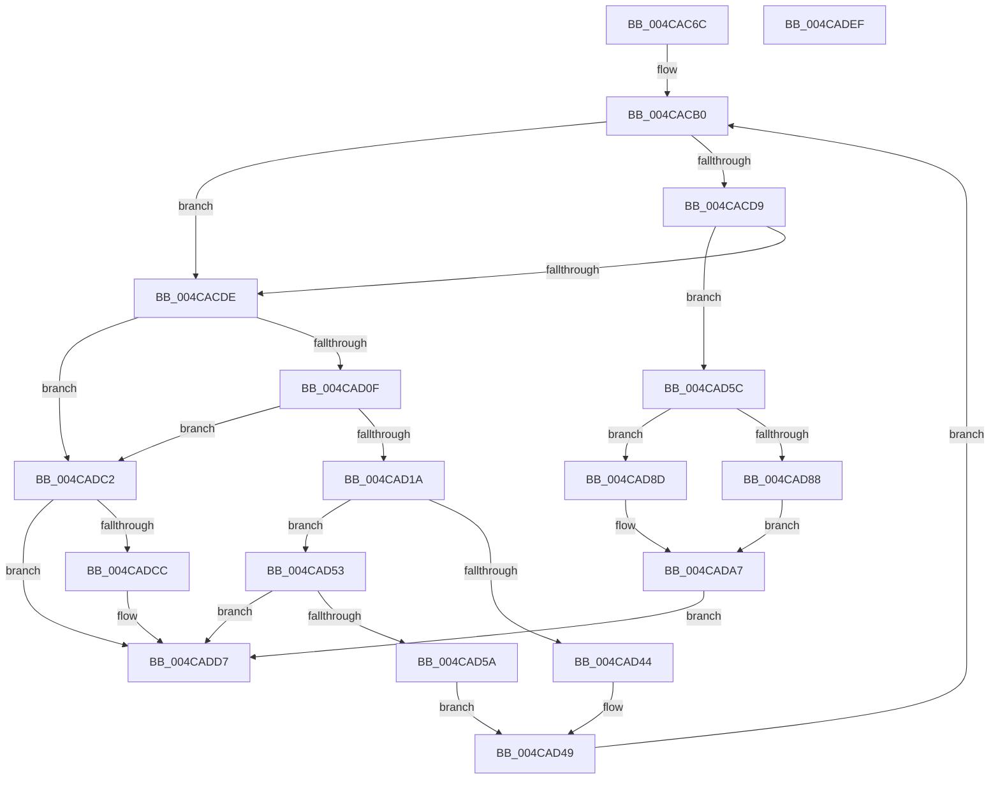

# MiInitializeCachedExtentWalker

- RVA: `0x004CAC6C`–`0x004CADF0` (길이 `388` bytes)
- VA: `0x00000001404CAC6C`
- 실행 섹션: `.text`
- PDB 이름 있음: `예`; PDB Function 태그: `아니요`
- unwind 정보 RVA: `0x000BBDE4`
- 디코드: `105`개 명령, `388/388` bytes 표시
- 미해석 바이트: `0` (있으면 어셈블리에 `.byte`로 보존)

> 이 문서는 커널 이미지의 기계어와 PDB 기호를 분석해 생성했습니다. 4번과 5번은 함수 원형과 자료형을 바이너리 사용 방식에서 추정한 C 해석이며 원본 소스 복구 결과는 아닙니다.

## 1. Dependencies

- 직접 호출 지점: **6**; 고유 호출 대상: **5**
- 직접 호출자로 확인된 함수: **2**
- RIP 상대 이미지 참조: **0**

### Outgoing calls
- `0x004CACB3` → [ExAcquireSpinLockShared](../24/ExAcquireSpinLockShared_function_0024DCE0.md) (function, `0x0024DCE0`)
- `0x004CACC8` → [MiLocateCachedExtent](MiLocateCachedExtent_function_004CADF8.md) (function, `0x004CADF8`)
- `0x004CACFC` → [MiReleaseSpinLockShared](../34/MiReleaseSpinLockShared_function_00348BF0.md) (function, `0x00348BF0`)
- `0x004CAD3B` → [MiAllocateFileExtents](../../page/AB/MiAllocateFileExtents_function_00ABDF54.md) (function, `0x00ABDF54`)
- `0x004CAD7B` → [MiStartingOffset](../34/MiStartingOffset_function_003482E0.md) (function, `0x003482E0`)
- `0x004CADB9` → [MiReleaseSpinLockShared](../34/MiReleaseSpinLockShared_function_00348BF0.md) (function, `0x00348BF0`)

### Direct callers
- [MiTransferFileExtent](MiTransferFileExtent_function_004CAADC.md) at `0x004CAB45`
- [MiGetCachedExtentWalkerNextPage](../68/MiGetCachedExtentWalkerNextPage_function_00681234.md) at `0x0068128B`

### Static image references
- 디코드된 RIP-relative 메모리 참조가 없습니다.

## 2. Other-region calls and transfers

- 다른 실행 섹션으로 향하는 call: **1**
  - `0x004CAD3B` → [MiAllocateFileExtents](../../page/AB/MiAllocateFileExtents_function_00ABDF54.md) (`.text` → `PAGE`)
- 별도 외부 분기/꼬리 이동을 확인하지 못했습니다.

## 3. Assembly (complete function range)

```asm
004CAC6C  48 89 5C 24 08                  mov qword ptr [rsp + 8], rbx
004CAC71  44 89 4C 24 20                  mov dword ptr [rsp + 0x20], r9d
004CAC76  55                              push rbp
004CAC77  56                              push rsi
004CAC78  57                              push rdi
004CAC79  41 54                           push r12
004CAC7B  41 55                           push r13
004CAC7D  41 56                           push r14
004CAC7F  41 57                           push r15
004CAC81  48 83 EC 40                     sub rsp, 0x40
004CAC85  48 8B 02                        mov rax, qword ptr [rdx]
004CAC88  4C 8D 7A 08                     lea r15, [rdx + 8]
004CAC8C  48 83 C0 48                     add rax, 0x48
004CAC90  C7 44 24 30 01 00 00 00         mov dword ptr [rsp + 0x30], 1
004CAC98  48 89 44 24 38                  mov qword ptr [rsp + 0x38], rax
004CAC9D  49 8B E8                        mov rbp, r8
004CACA0  48 8B F2                        mov rsi, rdx
004CACA3  4C 8B E1                        mov r12, rcx
004CACA6  48 BB 00 00 00 00 00 00 00 80   movabs rbx, 0x8000000000000000
004CACB0  48 8B C8                        mov rcx, rax
004CACB3  E8 28 30 D8 FF                  call 0x14024dce0
004CACB8  48 8B D5                        mov rdx, rbp
004CACBB  88 84 24 88 00 00 00            mov byte ptr [rsp + 0x88], al
004CACC2  48 8B CE                        mov rcx, rsi
004CACC5  44 8A E8                        mov r13b, al
004CACC8  E8 2B 01 00 00                  call 0x1404cadf8
004CACCD  4C 8B F0                        mov r14, rax
004CACD0  48 8D 78 20                     lea rdi, [rax + 0x20]
004CACD4  48 85 C0                        test rax, rax
004CACD7  74 05                           je 0x1404cacde
004CACD9  48 39 1F                        cmp qword ptr [rdi], rbx
004CACDC  75 7E                           jne 0x1404cad5c
004CACDE  44 8B 6E 34                     mov r13d, dword ptr [rsi + 0x34]
004CACE2  8B 46 2C                        mov eax, dword ptr [rsi + 0x2c]
004CACE5  41 81 E5 FF FF FF 3F            and r13d, 0x3fffffff
004CACEC  8A 94 24 88 00 00 00            mov dl, byte ptr [rsp + 0x88]
004CACF3  48 8B 4C 24 38                  mov rcx, qword ptr [rsp + 0x38]
004CACF8  89 44 24 34                     mov dword ptr [rsp + 0x34], eax
004CACFC  E8 EF DE E7 FF                  call 0x140348bf0
004CAD01  83 BC 24 98 00 00 00 00         cmp dword ptr [rsp + 0x98], 0
004CAD09  0F 84 B3 00 00 00               je 0x1404cadc2
004CAD0F  83 7C 24 30 00                  cmp dword ptr [rsp + 0x30], 0
004CAD14  0F 84 A8 00 00 00               je 0x1404cadc2
004CAD1A  44 8B 4C 24 34                  mov r9d, dword ptr [rsp + 0x34]
004CAD1F  4C 8D 7E 08                     lea r15, [rsi + 8]
004CAD23  4D 8B 07                        mov r8, qword ptr [r15]
004CAD26  45 2B CD                        sub r9d, r13d
004CAD29  83 4C 24 28 FF                  or dword ptr [rsp + 0x28], 0xffffffff
004CAD2E  33 D2                           xor edx, edx
004CAD30  48 8B CE                        mov rcx, rsi
004CAD33  C7 44 24 20 02 00 00 00         mov dword ptr [rsp + 0x20], 2
004CAD3B  E8 14 32 5F 00                  call 0x140abdf54
004CAD40  85 C0                           test eax, eax
004CAD42  78 0F                           js 0x1404cad53
004CAD44  83 64 24 30 00                  and dword ptr [rsp + 0x30], 0
004CAD49  48 8B 44 24 38                  mov rax, qword ptr [rsp + 0x38]
004CAD4E  E9 5D FF FF FF                  jmp 0x1404cacb0
004CAD53  3D 0A 02 00 C0                  cmp eax, 0xc000020a
004CAD58  75 7D                           jne 0x1404cadd7
004CAD5A  EB ED                           jmp 0x1404cad49
004CAD5C  8B 84 24 98 00 00 00            mov eax, dword ptr [rsp + 0x98]
004CAD63  41 83 C8 FF                     or r8d, 0xffffffff
004CAD67  49 8B 17                        mov rdx, qword ptr [r15]
004CAD6A  48 8B CE                        mov rcx, rsi
004CAD6D  41 89 44 24 20                  mov dword ptr [r12 + 0x20], eax
004CAD72  49 89 34 24                     mov qword ptr [r12], rsi
004CAD76  49 89 6C 24 08                  mov qword ptr [r12 + 8], rbp
004CAD7B  E8 60 D5 E7 FF                  call 0x1403482e0
004CAD80  48 8B 17                        mov rdx, qword ptr [rdi]
004CAD83  48 3B D3                        cmp rdx, rbx
004CAD86  75 05                           jne 0x1404cad8d
004CAD88  48 8B CB                        mov rcx, rbx
004CAD8B  EB 1A                           jmp 0x1404cada7
004CAD8D  49 8B 5E 28                     mov rbx, qword ptr [r14 + 0x28]
004CAD91  48 2B E8                        sub rbp, rax
004CAD94  41 8B 46 18                     mov eax, dword ptr [r14 + 0x18]
004CAD98  48 03 DA                        add rbx, rdx
004CAD9B  48 C1 ED 0C                     shr rbp, 0xc
004CAD9F  8B CD                           mov ecx, ebp
004CADA1  48 2B C8                        sub rcx, rax
004CADA4  48 03 CA                        add rcx, rdx
004CADA7  49 89 4C 24 10                  mov qword ptr [r12 + 0x10], rcx
004CADAC  41 8A D5                        mov dl, r13b
004CADAF  48 8B 4C 24 38                  mov rcx, qword ptr [rsp + 0x38]
004CADB4  49 89 5C 24 18                  mov qword ptr [r12 + 0x18], rbx
004CADB9  E8 32 DE E7 FF                  call 0x140348bf0
004CADBE  33 C0                           xor eax, eax
004CADC0  EB 15                           jmp 0x1404cadd7
004CADC2  B8 9A 00 00 C0                  mov eax, 0xc000009a
004CADC7  4D 85 F6                        test r14, r14
004CADCA  74 0B                           je 0x1404cadd7
004CADCC  48 39 1F                        cmp qword ptr [rdi], rbx
004CADCF  B9 09 07 00 C0                  mov ecx, 0xc0000709
004CADD4  0F 44 C1                        cmove eax, ecx
004CADD7  48 8B 9C 24 80 00 00 00         mov rbx, qword ptr [rsp + 0x80]
004CADDF  48 83 C4 40                     add rsp, 0x40
004CADE3  41 5F                           pop r15
004CADE5  41 5E                           pop r14
004CADE7  41 5D                           pop r13
004CADE9  41 5C                           pop r12
004CADEB  5F                              pop rdi
004CADEC  5E                              pop rsi
004CADED  5D                              pop rbp
004CADEE  C3                              ret
004CADEF  CC                              int3
```

## 4. C-style interpretation (structured pseudocode)

```c
__int64 __fastcall MiInitializeCachedExtentWalker(__int64 a1, __int64 a2, __int64 a3, int a4)
{
    __int64 result;
    __int64 v_r13;
    __int64 v_rbp;
    __int64 v_rbx;
    __int64 v_rsp;
    unsigned __int64 v_stack_m40;
    unsigned int v_stack_m44;
    unsigned int v_stack_m48;
    unsigned int v_stack_m50;
    unsigned int v_stack_m58;
    unsigned __int8 v_stack_p10;
    unsigned int v_stack_p20;
    unsigned __int64 v_stack_p8;

    v_stack_p8 = v_rbx;
    v_stack_p20 = a4;
    v_rsp = (v_rsp) - (64);
    result = (*(unsigned __int64 *)(a2)) + (72);
    v_stack_m48 = 1;
    v_stack_m40 = result;
loc_004CACB0:
    result = ExAcquireSpinLockShared(result, a2, a3, a4);
    v_stack_p10 = (unsigned __int8)(result);
    result = MiLocateCachedExtent(a2, a3, a3, a4);
    if (result == 0) goto loc_004CACDE;
    if ((*(unsigned __int64 *)(result + 32)) != v_rbx) goto loc_004CAD5C;
loc_004CACDE:
    v_r13 = (unsigned int)(((unsigned int)(*(unsigned int *)(a2 + 52))) & (0x3FFFFFFFULL));
    v_stack_m44 = (unsigned int)((unsigned int)(*(unsigned int *)(a2 + 44)));
    result = MiReleaseSpinLockShared(v_stack_m40, v_stack_p10, a3, a4);
    if (v_stack_p20 == 0) goto loc_004CADC2;
    if (v_stack_m48 == 0) goto loc_004CADC2;
    a4 = (unsigned int)(((unsigned int)(v_stack_m44)) - ((unsigned int)(v_r13)));
    a2 = 0;
    v_stack_m58 = 2;
    result = MiAllocateFileExtents(0, a2, *(unsigned __int64 *)(a2 + 8), a4);
    if (sign_flag) goto loc_004CAD53;
loc_004CAD49:
    goto loc_004CACB0;
loc_004CAD53:
    if (((unsigned int)(v_stack_m40)) != 0xC000020AULL) goto loc_004CADD7;
    goto loc_004CAD49;
loc_004CAD5C:
    a3 = (unsigned int)((*(unsigned __int64 *)(a2 + 8)) | (0xFFFFFFFFULL));
    *(unsigned int *)(a1 + 32) = (unsigned int)((unsigned int)(v_stack_p20));
    *(unsigned __int64 *)(a1) = 0;
    *(unsigned __int64 *)(a1 + 8) = a3;
    result = MiStartingOffset(0, *(unsigned __int64 *)(a2 + 8), a3, a4);
    if ((*(unsigned __int64 *)(result + 32)) != v_rbx) goto loc_004CAD8D;
    goto loc_004CADA7;
loc_004CAD8D:
    v_rbp = (a3) - (result);
    v_rbx = (*(unsigned __int64 *)(result + 40)) + (*(unsigned __int64 *)(result + 32));
    v_rbp = (v_rbp) >> (12);
    a1 = ((unsigned int)((unsigned int)(v_rbp))) - ((unsigned int)(*(unsigned int *)(result + 24)));
    a1 = (a1) + (*(unsigned __int64 *)(result + 32));
loc_004CADA7:
    *(unsigned __int64 *)(a1 + 16) = a1;
    *(unsigned __int64 *)(a1 + 24) = v_rbx;
    result = MiReleaseSpinLockShared(v_stack_m40, (unsigned __int8)(v_r13), a3, a4);
    result = 0;
    goto loc_004CADD7;
loc_004CADC2:
    result = (unsigned int)(0xC000009AULL);
    if (0 != 0) {
        a1 = 0xC0000709ULL;
        result = (unsigned int)(0xC000009AULL);
        if ((*(unsigned __int64 *)(result + 32)) == v_rbx) { result = (unsigned int)(a1); }
    }
    v_rsp = (v_rsp) + (64);
    return result;
}
```

## 5. (Beta) C Style

```c
int64_t MiInitializeCachedExtentWalker(void *Arg1, void *Arg2, int64_t Arg3, int32_t Arg4)
{
    uint8_t *arg1 = (uint8_t *)Arg1;
    uint8_t *arg2 = (uint8_t *)Arg2;

    int64_t result;
    int64_t local_r13;
    int64_t local_rbp;
    int64_t local_rbx;
    int64_t local_rsp;
    uint64_t v_stack_m40;
    uint32_t v_stack_m44;
    uint32_t v_stack_m48;
    uint32_t v_stack_m50;
    uint32_t v_stack_m58;
    uint8_t v_stack_p10;
    uint32_t v_stack_p20;
    uint64_t v_stack_p8;

    v_stack_p8 = local_rbx;
    v_stack_p20 = Arg4;
    local_rsp = (local_rsp) - (64);
    result = (*(uint64_t *)(arg2)) + (72);
    v_stack_m48 = 1;
    v_stack_m40 = result;
loc_004CACB0:
    result = ExAcquireSpinLockShared(result, Arg2, Arg3, Arg4);
    v_stack_p10 = (uint8_t)(result);
    result = MiLocateCachedExtent(Arg2, Arg3, Arg3, Arg4);
    if (result == 0) goto loc_004CACDE;
    if ((*(uint64_t *)(result + 0x20)) != local_rbx) goto loc_004CAD5C;
loc_004CACDE:
    local_r13 = (uint32_t)(((uint32_t)(*(uint32_t *)(arg2 + 0x34))) & (0x3FFFFFFFULL));
    v_stack_m44 = (uint32_t)((uint32_t)(*(uint32_t *)(arg2 + 0x2C)));
    result = MiReleaseSpinLockShared(v_stack_m40, v_stack_p10, Arg3, Arg4);
    if (v_stack_p20 == 0) goto loc_004CADC2;
    if (v_stack_m48 == 0) goto loc_004CADC2;
    Arg4 = (uint32_t)(((uint32_t)(v_stack_m44)) - ((uint32_t)(local_r13)));
    Arg2 = 0;
    v_stack_m58 = 2;
    result = MiAllocateFileExtents(0, Arg2, *(uint64_t *)(arg2 + 0x8), Arg4);
    if (sign_flag) goto loc_004CAD53;
loc_004CAD49:
    goto loc_004CACB0;
loc_004CAD53:
    if (((uint32_t)(v_stack_m40)) != 0xC000020AULL) goto loc_004CADD7;
    goto loc_004CAD49;
loc_004CAD5C:
    Arg3 = (uint32_t)((*(uint64_t *)(arg2 + 0x8)) | (0xFFFFFFFFULL));
    *(uint32_t *)(arg1 + 0x20) = (uint32_t)((uint32_t)(v_stack_p20));
    *(uint64_t *)(arg1) = 0;
    *(uint64_t *)(arg1 + 0x8) = Arg3;
    result = MiStartingOffset(0, *(uint64_t *)(arg2 + 0x8), Arg3, Arg4);
    if ((*(uint64_t *)(result + 0x20)) != local_rbx) goto loc_004CAD8D;
    goto loc_004CADA7;
loc_004CAD8D:
    local_rbp = (Arg3) - (result);
    local_rbx = (*(uint64_t *)(result + 0x28)) + (*(uint64_t *)(result + 0x20));
    local_rbp = (local_rbp) >> (12);
    Arg1 = ((uint32_t)((uint32_t)(local_rbp))) - ((uint32_t)(*(uint32_t *)(result + 0x18)));
    Arg1 = (Arg1) + (*(uint64_t *)(result + 0x20));
loc_004CADA7:
    *(void **)(arg1 + 0x10) = Arg1;
    *(uint64_t *)(arg1 + 0x18) = local_rbx;
    result = MiReleaseSpinLockShared(v_stack_m40, (uint8_t)(local_r13), Arg3, Arg4);
    result = 0;
    goto loc_004CADD7;
loc_004CADC2:
    result = (uint32_t)(0xC000009AULL);
    if (0 != 0) {
        Arg1 = 0xC0000709ULL;
        result = (uint32_t)(0xC000009AULL);
        if ((*(uint64_t *)(result + 0x20)) == local_rbx) { result = (uint32_t)(Arg1); }
    }
    local_rsp = (local_rsp) + (64);
    return result;
}
```

### 관측된 메모리 오프셋

구조체 형식이 확인되지 않은 접근은 인자 기준의 오프셋으로만 기록했습니다.

| 기준 인자 | 오프셋 표현 | 폭 (bit) | 접근 |
|---|---:|---:|---|
| `Arg1` | `+ 0x0` | `64` | `W` |
| `Arg1` | `+ 0x8` | `64` | `W` |
| `Arg1` | `+ 0x10` | `64` | `W` |
| `Arg1` | `+ 0x18` | `64` | `W` |
| `Arg1` | `+ 0x20` | `32` | `W` |
| `Arg2` | `+ 0x0` | `64` | `R` |
| `Arg2` | `+ 0x8` | `64` | `R` |
| `Arg2` | `+ 0x2C` | `32` | `R` |
| `Arg2` | `+ 0x34` | `32` | `R` |

## 6. Execution-region graph

[열기: 2D/3D 그래프와 함수 탐색 컨트롤 패널](../../../control-panel.html?section=text&rva=0x004CAC6C&view=graph)

- 2D 그래프는 위에서 아래로 흐르고, 3D 그래프는 빈 공간을 드래그해 회전합니다. Shift+드래그는 이동, 휠은 확대·축소, 함수 노드 선택은 대상 보고서 이동입니다.

### Static fallback


