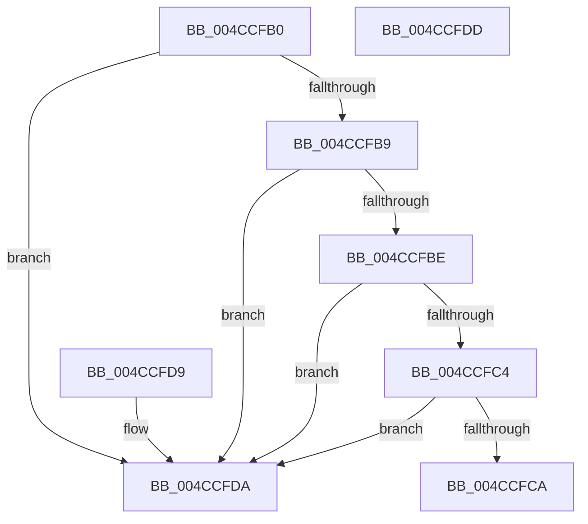

# MiIsKernelHalPadSection

- RVA: `0x004CCFB0`–`0x004CCFDE` (길이 `46` bytes)
- VA: `0x00000001404CCFB0`
- 실행 섹션: `.text`
- PDB 이름 있음: `예`; PDB Function 태그: `아니요`
- unwind 정보 RVA: `0x000DB714`
- 디코드: `18`개 명령, `46/46` bytes 표시
- 미해석 바이트: `0` (있으면 어셈블리에 `.byte`로 보존)

> 이 문서는 커널 이미지의 기계어와 PDB 기호를 분석해 생성했습니다. 4번과 5번은 함수 원형과 자료형을 바이너리 사용 방식에서 추정한 C 해석이며 원본 소스 복구 결과는 아닙니다.

## 1. Dependencies

- 직접 호출 지점: **0**; 고유 호출 대상: **0**
- 직접 호출자로 확인된 함수: **2**
- RIP 상대 이미지 참조: **0**

### Outgoing calls
- 직접 디코드된 call 명령이 없습니다.

### Direct callers
- [MiSnapDriverRange](../../page/A4/MiSnapDriverRange_function_00A4B328.md) at `0x00A4B6B8`
- [MiFreeKernelPadSections](../../init/C6/MiFreeKernelPadSections_function_00C6B5CC.md) at `0x00C6B64B`

### Static image references
- 디코드된 RIP-relative 메모리 참조가 없습니다.

## 2. Other-region calls and transfers

- 다른 실행 섹션으로 향하는 call: **0**
- 별도 외부 분기/꼬리 이동을 확인하지 못했습니다.

## 3. Assembly (complete function range)

```asm
004CCFB0  F7 41 24 00 00 00 02            test dword ptr [rcx + 0x24], 0x2000000
004CCFB7  74 21                           je 0x1404ccfda
004CCFB9  80 39 50                        cmp byte ptr [rcx], 0x50
004CCFBC  75 1C                           jne 0x1404ccfda
004CCFBE  80 79 01 61                     cmp byte ptr [rcx + 1], 0x61
004CCFC2  75 16                           jne 0x1404ccfda
004CCFC4  80 79 02 64                     cmp byte ptr [rcx + 2], 0x64
004CCFC8  75 10                           jne 0x1404ccfda
004CCFCA  8A 49 03                        mov cl, byte ptr [rcx + 3]
004CCFCD  33 C0                           xor eax, eax
004CCFCF  80 E9 30                        sub cl, 0x30
004CCFD2  80 F9 09                        cmp cl, 9
004CCFD5  0F 96 C0                        setbe al
004CCFD8  C3                              ret
004CCFD9  CC                              int3
004CCFDA  33 C0                           xor eax, eax
004CCFDC  C3                              ret
004CCFDD  CC                              int3
```

## 4. C-style interpretation (structured pseudocode)

```c
__int64 __fastcall MiIsKernelHalPadSection(__int64 a1)
{
    __int64 result;

    if (((*(unsigned int *)(a1 + 36)) & (0x2000000ULL)) == 0) goto loc_004CCFDA;
    if ((*(unsigned __int8 *)(a1)) != 80) goto loc_004CCFDA;
    if ((*(unsigned __int8 *)(a1 + 1)) != 97) goto loc_004CCFDA;
    if ((*(unsigned __int8 *)(a1 + 2)) != 100) goto loc_004CCFDA;
    result = 0;
    a1 = (unsigned __int8)((*(unsigned __int8 *)(a1 + 3)) - (48));
    result = (((unsigned __int8)(a1)) <= 9) ? 1 : 0;
    return result;
loc_004CCFDA:
    result = 0;
    return result;
}
```

## 5. (Beta) C Style

```c
int64_t MiIsKernelHalPadSection(void *Arg1)
{
    uint8_t *arg1 = (uint8_t *)Arg1;

    int64_t result;

    if (((*(uint32_t *)(arg1 + 0x24)) & (0x2000000ULL)) == 0) goto loc_004CCFDA;
    if ((*(uint8_t *)(arg1)) != 80) goto loc_004CCFDA;
    if ((*(uint8_t *)(arg1 + 0x1)) != 97) goto loc_004CCFDA;
    if ((*(uint8_t *)(arg1 + 0x2)) != 100) goto loc_004CCFDA;
    result = 0;
    Arg1 = (uint8_t)((*(uint8_t *)(arg1 + 0x3)) - (48));
    result = (((uint8_t)(Arg1)) <= 9) ? 1 : 0;
    return result;
loc_004CCFDA:
    result = 0;
    return result;
}
```

### 관측된 메모리 오프셋

구조체 형식이 확인되지 않은 접근은 인자 기준의 오프셋으로만 기록했습니다.

| 기준 인자 | 오프셋 표현 | 폭 (bit) | 접근 |
|---|---:|---:|---|
| `Arg1` | `+ 0x0` | `8` | `R` |
| `Arg1` | `+ 0x1` | `8` | `R` |
| `Arg1` | `+ 0x2` | `8` | `R` |
| `Arg1` | `+ 0x3` | `8` | `R` |
| `Arg1` | `+ 0x24` | `32` | `R` |

## 6. Execution-region graph

[열기: 2D/3D 그래프와 함수 탐색 컨트롤 패널](../../../control-panel.html?section=text&rva=0x004CCFB0&view=graph)

- 2D 그래프는 위에서 아래로 흐르고, 3D 그래프는 빈 공간을 드래그해 회전합니다. Shift+드래그는 이동, 휠은 확대·축소, 함수 노드 선택은 대상 보고서 이동입니다.

### Static fallback


