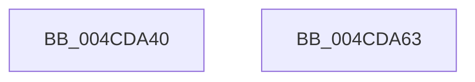

# MiIsTargetFullyRetpolined

- RVA: `0x004CDA40`–`0x004CDA64` (길이 `36` bytes)
- VA: `0x00000001404CDA40`
- 실행 섹션: `.text`
- PDB 이름 있음: `예`; PDB Function 태그: `아니요`
- unwind 정보 RVA: `0x000DB714`
- 디코드: `9`개 명령, `36/36` bytes 표시
- 미해석 바이트: `0` (있으면 어셈블리에 `.byte`로 보존)

> 이 문서는 커널 이미지의 기계어와 PDB 기호를 분석해 생성했습니다. 4번과 5번은 함수 원형과 자료형을 바이너리 사용 방식에서 추정한 C 해석이며 원본 소스 복구 결과는 아닙니다.

## 1. Dependencies

- 직접 호출 지점: **0**; 고유 호출 대상: **0**
- 직접 호출자로 확인된 함수: **0**
- RIP 상대 이미지 참조: **1**

### Outgoing calls
- 직접 디코드된 call 명령이 없습니다.

### Direct callers
- 이 함수 시작 RVA로 연결되는 직접 call은 확인되지 않았습니다. 간접 호출은 완전히 역산할 수 없습니다.

### Static image references
- `0x004CDA40` → RVA `0x00E2D860` (`.data`; read)

## 2. Other-region calls and transfers

- 다른 실행 섹션으로 향하는 call: **0**
- 별도 외부 분기/꼬리 이동을 확인하지 못했습니다.

## 3. Assembly (complete function range)

```asm
004CDA40  48 8B 05 19 FE 95 00            mov rax, qword ptr [rip + 0x95fe19]
004CDA47  48 BA 00 00 00 00 00 80 00 00   movabs rdx, 0x800000000000
004CDA51  48 03 D1                        add rdx, rcx
004CDA54  48 C1 EA 10                     shr rdx, 0x10
004CDA58  48 0F A3 10                     bt qword ptr [rax], rdx
004CDA5C  0F 92 C0                        setb al
004CDA5F  0F B6 C0                        movzx eax, al
004CDA62  C3                              ret
004CDA63  CC                              int3
```

## 4. C-style interpretation (structured pseudocode)

```c
__int64 __fastcall MiIsTargetFullyRetpolined(__int64 a1)
{
    __int64 result;

    a2 = (a2) + (a1);
    a2 = (a2) >> (16);
    result = (condition_is_below) ? 1 : 0;
    return (unsigned __int8)(result);
}
```

## 5. (Beta) C Style

```c
int64_t MiIsTargetFullyRetpolined(int64_t Arg1)
{
    int64_t result;

    a2 = (a2) + (Arg1);
    a2 = (a2) >> (16);
    result = (condition_is_below) ? 1 : 0;
    return (uint8_t)(result);
}
```

## 6. Execution-region graph

[열기: 2D/3D 그래프와 함수 탐색 컨트롤 패널](../../../control-panel.html?section=text&rva=0x004CDA40&view=graph)

- 2D 그래프는 위에서 아래로 흐르고, 3D 그래프는 빈 공간을 드래그해 회전합니다. Shift+드래그는 이동, 휠은 확대·축소, 함수 노드 선택은 대상 보고서 이동입니다.

### Static fallback


