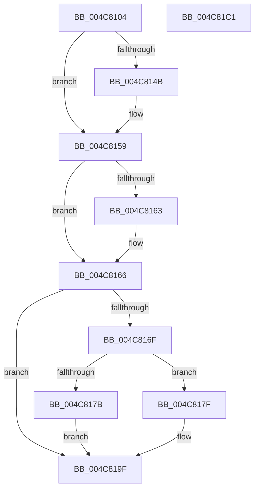

# MiLateInitializeSystemCache

- RVA: `0x004C8104`–`0x004C81C2` (길이 `190` bytes)
- VA: `0x00000001404C8104`
- 실행 섹션: `.text`
- PDB 이름 있음: `예`; PDB Function 태그: `아니요`
- unwind 정보 RVA: `0x0005C954`
- 디코드: `50`개 명령, `190/190` bytes 표시
- 미해석 바이트: `0` (있으면 어셈블리에 `.byte`로 보존)

> 이 문서는 커널 이미지의 기계어와 PDB 기호를 분석해 생성했습니다. 4번과 5번은 함수 원형과 자료형을 바이너리 사용 방식에서 추정한 C 해석이며 원본 소스 복구 결과는 아닙니다.

## 1. Dependencies

- 직접 호출 지점: **6**; 고유 호출 대상: **6**
- 직접 호출자로 확인된 함수: **1**
- RIP 상대 이미지 참조: **1**

### Outgoing calls
- `0x004C813B` → [KeAbPreAcquire](../21/KeAbPreAcquire_function_00210230.md) (function, `0x00210230`)
- `0x004C8154` → [ExfAcquirePushLockExclusiveEx](../20/ExfAcquirePushLockExclusiveEx_function_0020FC90.md) (function, `0x0020FC90`)
- `0x004C8172` → [MiInitializeSystemCache](../../page/7F/MiInitializeSystemCache_function_007FE1F0.md) (function, `0x007FE1F0`)
- `0x004C8186` → [ExAcquireSpinLockExclusive](../24/ExAcquireSpinLockExclusive_function_00248690.md) (function, `0x00248690`)
- `0x004C819A` → [MiReleaseSpinLockExclusive](../24/MiReleaseSpinLockExclusive_function_002482C0.md) (function, `0x002482C0`)
- `0x004C81A5` → [MiUnlockSystemCacheInit](MiUnlockSystemCacheInit_function_004C81C8.md) (function, `0x004C81C8`)

### Direct callers
- [sub_00238C83](../23/Unknown_function_00238C83.md) at `0x00238C96`

### Static image references
- `0x004C817F` → RVA `0x00E2F3B8` (`.data`; read)

## 2. Other-region calls and transfers

- 다른 실행 섹션으로 향하는 call: **1**
  - `0x004C8172` → [MiInitializeSystemCache](../../page/7F/MiInitializeSystemCache_function_007FE1F0.md) (`.text` → `PAGE`)
- 별도 외부 분기/꼬리 이동을 확인하지 못했습니다.

## 3. Assembly (complete function range)

```asm
004C8104  48 89 5C 24 08                  mov qword ptr [rsp + 8], rbx
004C8109  48 89 6C 24 10                  mov qword ptr [rsp + 0x10], rbp
004C810E  48 89 74 24 18                  mov qword ptr [rsp + 0x18], rsi
004C8113  57                              push rdi
004C8114  48 83 EC 20                     sub rsp, 0x20
004C8118  65 48 8B 2C 25 88 01 00 00      mov rbp, qword ptr gs:[0x188]
004C8121  48 8D 99 70 09 00 00            lea rbx, [rcx + 0x970]
004C8128  48 8B F9                        mov rdi, rcx
004C812B  45 33 C0                        xor r8d, r8d
004C812E  33 D2                           xor edx, edx
004C8130  48 8B CB                        mov rcx, rbx
004C8133  66 FF 8D E6 01 00 00            dec word ptr [rbp + 0x1e6]
004C813A  90                              nop
004C813B  E8 F0 80 D4 FF                  call 0x140210230
004C8140  F0 48 0F BA 2B 00               lock bts qword ptr [rbx], 0
004C8146  48 8B F0                        mov rsi, rax
004C8149  73 0E                           jae 0x1404c8159
004C814B  4C 8B C3                        mov r8, rbx
004C814E  48 8B D0                        mov rdx, rax
004C8151  48 8B CB                        mov rcx, rbx
004C8154  E8 37 7B D4 FF                  call 0x14020fc90
004C8159  BB 01 00 00 00                  mov ebx, 1
004C815E  48 85 F6                        test rsi, rsi
004C8161  74 03                           je 0x1404c8166
004C8163  88 5E 0A                        mov byte ptr [rsi + 0xa], bl
004C8166  80 BF 5C 48 00 00 00            cmp byte ptr [rdi + 0x485c], 0
004C816D  75 30                           jne 0x1404c819f
004C816F  48 8B CF                        mov rcx, rdi
004C8172  E8 79 60 33 00                  call 0x1407fe1f0
004C8177  85 C0                           test eax, eax
004C8179  75 04                           jne 0x1404c817f
004C817B  33 DB                           xor ebx, ebx
004C817D  EB 20                           jmp 0x1404c819f
004C817F  48 8D 0D 32 72 96 00            lea rcx, [rip + 0x967232]
004C8186  E8 05 05 D8 FF                  call 0x140248690
004C818B  8A D0                           mov dl, al
004C818D  88 9F 5C 48 00 00               mov byte ptr [rdi + 0x485c], bl
004C8193  48 8D 0D 1E 72 96 00            lea rcx, [rip + 0x96721e]
004C819A  E8 21 01 D8 FF                  call 0x1402482c0
004C819F  48 8B D5                        mov rdx, rbp
004C81A2  48 8B CF                        mov rcx, rdi
004C81A5  E8 1E 00 00 00                  call 0x1404c81c8
004C81AA  48 8B 6C 24 38                  mov rbp, qword ptr [rsp + 0x38]
004C81AF  8B C3                           mov eax, ebx
004C81B1  48 8B 5C 24 30                  mov rbx, qword ptr [rsp + 0x30]
004C81B6  48 8B 74 24 40                  mov rsi, qword ptr [rsp + 0x40]
004C81BB  48 83 C4 20                     add rsp, 0x20
004C81BF  5F                              pop rdi
004C81C0  C3                              ret
004C81C1  CC                              int3
```

## 4. C-style interpretation (structured pseudocode)

```c
__int64 __fastcall MiLateInitializeSystemCache(__int64 a1, int a2, int a3)
{
    __int64 result;
    __int64 v_rbx;
    __int64 v_rsp;
    unsigned __int64 v_stack_p10;
    unsigned __int64 v_stack_p18;
    unsigned __int64 v_stack_p8;

    v_stack_p8 = v_rbx;
    v_stack_p10 = v_rbp;
    v_stack_p18 = v_rsi;
    v_rsp = (v_rsp) - (32);
    a3 = 0;
    a2 = 0;
    result = KeAbPreAcquire(a1 + 2416, a2, a3, a4);
    if (!(condition_is_above_or_equal)) {
        a3 = a1 + 2416;
        a2 = result;
        a1 = a1 + 2416;
        result = ExfAcquirePushLockExclusiveEx(a1, a2, a3, a4);
    }
    if (result != 0) {
        *(unsigned __int8 *)(result + 10) = 1;
    }
    if ((*(unsigned __int8 *)(a1 + 18524)) != 0) goto loc_004C819F;
    result = MiInitializeSystemCache(a1, a2, a3, a4);
    if ((unsigned int)(result) != 0) goto loc_004C817F;
    v_rbx = 0;
    goto loc_004C819F;
loc_004C817F:
    result = ExAcquireSpinLockExclusive(v_rip + 9859634, a2, a3, a4);
    *(unsigned __int8 *)(a1 + 18524) = 0;
    result = MiReleaseSpinLockExclusive(v_rip + 9859614, (unsigned __int8)(result), a3, a4);
loc_004C819F:
    result = MiUnlockSystemCacheInit(a1, *(unsigned __int64 *)(gs_base + (0 + 392)), a3, a4);
    v_rsp = (v_rsp) + (32);
    return 0;
}
```

## 5. (Beta) C Style

```c
int64_t MiLateInitializeSystemCache(void *Arg1, int32_t Arg2, int32_t Arg3)
{
    uint8_t *arg1 = (uint8_t *)Arg1;

    int64_t result;
    int64_t local_rbx;
    int64_t local_rsp;
    uint64_t v_stack_p10;
    uint64_t v_stack_p18;
    uint64_t v_stack_p8;

    v_stack_p8 = local_rbx;
    v_stack_p10 = local_rbp;
    v_stack_p18 = local_rsi;
    local_rsp = (local_rsp) - (32);
    Arg3 = 0;
    Arg2 = 0;
    result = KeAbPreAcquire(Arg1 + 2416, Arg2, Arg3, a4);
    if (!(condition_is_above_or_equal)) {
        Arg3 = Arg1 + 2416;
        Arg2 = result;
        Arg1 = Arg1 + 2416;
        result = ExfAcquirePushLockExclusiveEx(Arg1, Arg2, Arg3, a4);
    }
    if (result != 0) {
        *(uint8_t *)(result + 0xA) = 1;
    }
    if ((*(uint8_t *)(arg1 + 0x485C)) != 0) goto loc_004C819F;
    result = MiInitializeSystemCache(Arg1, Arg2, Arg3, a4);
    if ((uint32_t)(result) != 0) goto loc_004C817F;
    local_rbx = 0;
    goto loc_004C819F;
loc_004C817F:
    result = ExAcquireSpinLockExclusive(v_rip + 9859634, Arg2, Arg3, a4);
    *(uint8_t *)(arg1 + 0x485C) = 0;
    result = MiReleaseSpinLockExclusive(v_rip + 9859614, (uint8_t)(result), Arg3, a4);
loc_004C819F:
    result = MiUnlockSystemCacheInit(Arg1, *(uint64_t *)(gs_base + (0 + 0x188)), Arg3, a4);
    local_rsp = (local_rsp) + (32);
    return 0;
}
```

### 관측된 메모리 오프셋

구조체 형식이 확인되지 않은 접근은 인자 기준의 오프셋으로만 기록했습니다.

| 기준 인자 | 오프셋 표현 | 폭 (bit) | 접근 |
|---|---:|---:|---|
| `Arg1` | `+ 0x0` | `64` | `R/W` |
| `Arg1` | `+ 0x970` | `64` | `R` |
| `Arg1` | `+ 0x485C` | `8` | `R` |
| `Arg1` | `+ 0x485C` | `8` | `W` |

## 6. Execution-region graph

[열기: 2D/3D 그래프와 함수 탐색 컨트롤 패널](../../../control-panel.html?section=text&rva=0x004C8104&view=graph)

- 2D 그래프는 위에서 아래로 흐르고, 3D 그래프는 빈 공간을 드래그해 회전합니다. Shift+드래그는 이동, 휠은 확대·축소, 함수 노드 선택은 대상 보고서 이동입니다.

### Static fallback


