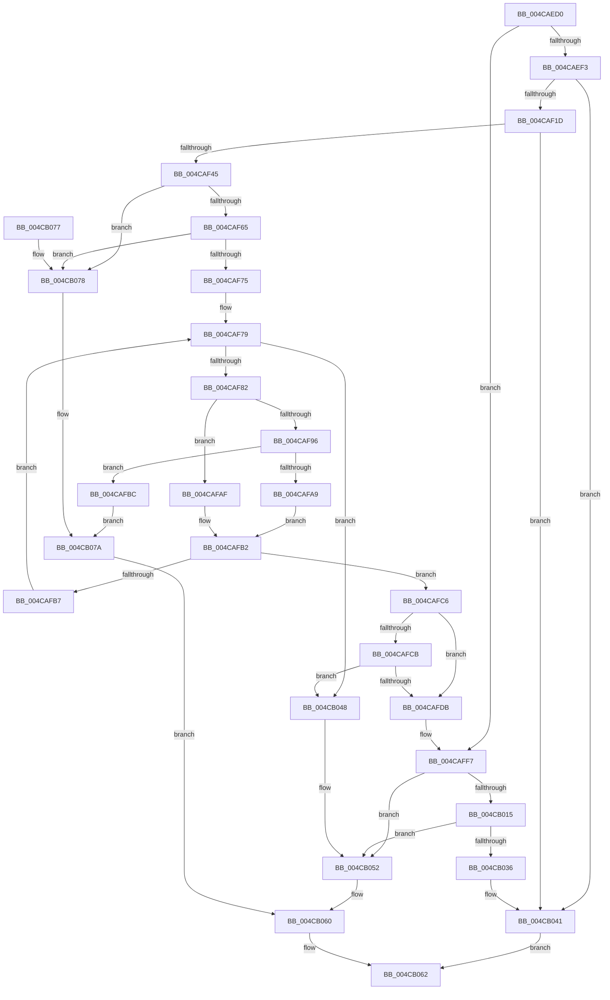

# MiLeapPrefetch

- RVA: `0x004CAED0`–`0x004CB086` (길이 `438` bytes)
- VA: `0x00000001404CAED0`
- 실행 섹션: `.text`
- PDB 이름 있음: `예`; PDB Function 태그: `아니요`
- unwind 정보 RVA: `0x0007A3F0`
- 디코드: `115`개 명령, `438/438` bytes 표시
- 미해석 바이트: `0` (있으면 어셈블리에 `.byte`로 보존)

> 이 문서는 커널 이미지의 기계어와 PDB 기호를 분석해 생성했습니다. 4번과 5번은 함수 원형과 자료형을 바이너리 사용 방식에서 추정한 C 해석이며 원본 소스 복구 결과는 아닙니다.

## 1. Dependencies

- 직접 호출 지점: **5**; 고유 호출 대상: **3**
- 직접 호출자로 확인된 함수: **4**
- RIP 상대 이미지 참조: **0**

### Outgoing calls
- `0x004CAF4E` → [MiLockVadTree](../27/MiLockVadTree_function_0027C0F0.md) (function, `0x0027C0F0`)
- `0x004CAFCE` → [MiGetNextVad](../29/MiGetNextVad_function_00297224.md) (function, `0x00297224`)
- `0x004CAFF2` → [MiUnlockVadTree](../29/MiUnlockVadTree_function_00297020.md) (function, `0x00297020`)
- `0x004CB04D` → [MiUnlockVadTree](../29/MiUnlockVadTree_function_00297020.md) (function, `0x00297020`)
- `0x004CB07F` → [MiUnlockVadTree](../29/MiUnlockVadTree_function_00297020.md) (function, `0x00297020`)

### Direct callers
- [sub_0036CE62](../36/Unknown_function_0036CE62.md) at `0x0036CE98`
- [MiInPagePageTable](../3E/MiInPagePageTable_function_003EF8DC.md) at `0x003EFDD0`
- [MiPrefetchJumpVad](../4D/MiPrefetchJumpVad_function_004D7A28.md) at `0x004D7B45`
- [sub_006EAE58](../6E/Unknown_function_006EAE58.md) at `0x006EAE5E`

### Static image references
- 디코드된 RIP-relative 메모리 참조가 없습니다.

## 2. Other-region calls and transfers

- 다른 실행 섹션으로 향하는 call: **0**
- 별도 외부 분기/꼬리 이동을 확인하지 못했습니다.

## 3. Assembly (complete function range)

```asm
004CAED0  48 89 5C 24 08                  mov qword ptr [rsp + 8], rbx
004CAED5  48 89 6C 24 10                  mov qword ptr [rsp + 0x10], rbp
004CAEDA  48 89 74 24 18                  mov qword ptr [rsp + 0x18], rsi
004CAEDF  57                              push rdi
004CAEE0  48 83 EC 20                     sub rsp, 0x20
004CAEE4  48 8B DA                        mov rbx, rdx
004CAEE7  48 8B F9                        mov rdi, rcx
004CAEEA  48 85 D2                        test rdx, rdx
004CAEED  0F 85 04 01 00 00               jne 0x1404caff7
004CAEF3  48 8B 41 08                     mov rax, qword ptr [rcx + 8]
004CAEF7  48 8B 51 18                     mov rdx, qword ptr [rcx + 0x18]
004CAEFB  48 8B 59 20                     mov rbx, qword ptr [rcx + 0x20]
004CAEFF  48 03 D2                        add rdx, rdx
004CAF02  48 C1 E3 0C                     shl rbx, 0xc
004CAF06  48 03 1C D0                     add rbx, qword ptr [rax + rdx*8]
004CAF0A  48 B8 FF FF FE FF FF 7F 00 00   movabs rax, 0x7ffffffeffff
004CAF14  48 3B D8                        cmp rbx, rax
004CAF17  0F 87 24 01 00 00               ja 0x1404cb041
004CAF1D  65 48 8B 14 25 88 01 00 00      mov rdx, qword ptr gs:[0x188]
004CAF26  F7 82 A8 05 00 00 80 40 00 00   test dword ptr [rdx + 0x5a8], 0x4080
004CAF30  0F 94 C1                        sete cl
004CAF33  F6 82 A8 05 00 00 03            test byte ptr [rdx + 0x5a8], 3
004CAF3A  0F 94 C0                        sete al
004CAF3D  84 C8                           test al, cl
004CAF3F  0F 84 FC 00 00 00               je 0x1404cb041
004CAF45  48 8B AA B8 00 00 00            mov rbp, qword ptr [rdx + 0xb8]
004CAF4C  33 C9                           xor ecx, ecx
004CAF4E  E8 9D 11 DB FF                  call 0x14027c0f0
004CAF53  8B 8D F4 01 00 00               mov ecx, dword ptr [rbp + 0x1f4]
004CAF59  44 8A C8                        mov r9b, al
004CAF5C  F6 C1 20                        test cl, 0x20
004CAF5F  0F 85 13 01 00 00               jne 0x1404cb078
004CAF65  48 8B 95 58 05 00 00            mov rdx, qword ptr [rbp + 0x558]
004CAF6C  48 85 D2                        test rdx, rdx
004CAF6F  0F 84 03 01 00 00               je 0x1404cb078
004CAF75  48 C1 EB 0C                     shr rbx, 0xc
004CAF79  48 85 D2                        test rdx, rdx
004CAF7C  0F 84 C6 00 00 00               je 0x1404cb048
004CAF82  44 0F B6 42 20                  movzx r8d, byte ptr [rdx + 0x20]
004CAF87  8B 42 18                        mov eax, dword ptr [rdx + 0x18]
004CAF8A  49 C1 E0 20                     shl r8, 0x20
004CAF8E  4C 0B C0                        or r8, rax
004CAF91  49 3B D8                        cmp rbx, r8
004CAF94  72 19                           jb 0x1404cafaf
004CAF96  0F B6 4A 21                     movzx ecx, byte ptr [rdx + 0x21]
004CAF9A  8B 42 1C                        mov eax, dword ptr [rdx + 0x1c]
004CAF9D  48 C1 E1 20                     shl rcx, 0x20
004CAFA1  48 0B C8                        or rcx, rax
004CAFA4  48 3B D9                        cmp rbx, rcx
004CAFA7  76 13                           jbe 0x1404cafbc
004CAFA9  48 8B 42 08                     mov rax, qword ptr [rdx + 8]
004CAFAD  EB 03                           jmp 0x1404cafb2
004CAFAF  48 8B 02                        mov rax, qword ptr [rdx]
004CAFB2  48 85 C0                        test rax, rax
004CAFB5  74 0F                           je 0x1404cafc6
004CAFB7  48 8B D0                        mov rdx, rax
004CAFBA  EB BD                           jmp 0x1404caf79
004CAFBC  BB 01 00 00 00                  mov ebx, 1
004CAFC1  E9 B4 00 00 00                  jmp 0x1404cb07a
004CAFC6  4C 3B C3                        cmp r8, rbx
004CAFC9  73 10                           jae 0x1404cafdb
004CAFCB  48 8B CA                        mov rcx, rdx
004CAFCE  E8 51 C2 DC FF                  call 0x140297224
004CAFD3  48 8B D0                        mov rdx, rax
004CAFD6  48 85 C0                        test rax, rax
004CAFD9  74 6D                           je 0x1404cb048
004CAFDB  0F B6 5A 20                     movzx ebx, byte ptr [rdx + 0x20]
004CAFDF  33 C9                           xor ecx, ecx
004CAFE1  8B 42 18                        mov eax, dword ptr [rdx + 0x18]
004CAFE4  41 8A D1                        mov dl, r9b
004CAFE7  48 C1 E3 20                     shl rbx, 0x20
004CAFEB  48 0B D8                        or rbx, rax
004CAFEE  48 C1 E3 0C                     shl rbx, 0xc
004CAFF2  E8 29 C0 DC FF                  call 0x140297020
004CAFF7  48 8B 47 18                     mov rax, qword ptr [rdi + 0x18]
004CAFFB  49 C7 C1 00 F0 FF FF            mov r9, 0xfffffffffffff000
004CB002  48 C1 E0 04                     shl rax, 4
004CB006  48 03 47 08                     add rax, qword ptr [rdi + 8]
004CB00A  4C 8B 00                        mov r8, qword ptr [rax]
004CB00D  4D 23 C1                        and r8, r9
004CB010  49 3B D8                        cmp rbx, r8
004CB013  72 3D                           jb 0x1404cb052
004CB015  8B 08                           mov ecx, dword ptr [rax]
004CB017  48 8B 50 08                     mov rdx, qword ptr [rax + 8]
004CB01B  81 E1 FF 0F 00 00               and ecx, 0xfff
004CB021  48 81 C2 FF 0F 00 00            add rdx, 0xfff
004CB028  48 03 D1                        add rdx, rcx
004CB02B  49 23 D1                        and rdx, r9
004CB02E  49 03 D0                        add rdx, r8
004CB031  48 3B DA                        cmp rbx, rdx
004CB034  73 1C                           jae 0x1404cb052
004CB036  49 2B D8                        sub rbx, r8
004CB039  48 C1 EB 0C                     shr rbx, 0xc
004CB03D  48 89 5F 20                     mov qword ptr [rdi + 0x20], rbx
004CB041  B8 01 00 00 00                  mov eax, 1
004CB046  EB 1A                           jmp 0x1404cb062
004CB048  41 8A D1                        mov dl, r9b
004CB04B  33 C9                           xor ecx, ecx
004CB04D  E8 CE BF DC FF                  call 0x140297020
004CB052  BB 01 00 00 00                  mov ebx, 1
004CB057  48 01 5F 18                     add qword ptr [rdi + 0x18], rbx
004CB05B  48 83 67 20 00                  and qword ptr [rdi + 0x20], 0
004CB060  8B C3                           mov eax, ebx
004CB062  48 8B 5C 24 30                  mov rbx, qword ptr [rsp + 0x30]
004CB067  48 8B 6C 24 38                  mov rbp, qword ptr [rsp + 0x38]
004CB06C  48 8B 74 24 40                  mov rsi, qword ptr [rsp + 0x40]
004CB071  48 83 C4 20                     add rsp, 0x20
004CB075  5F                              pop rdi
004CB076  C3                              ret
004CB077  CC                              int3
004CB078  33 DB                           xor ebx, ebx
004CB07A  41 8A D1                        mov dl, r9b
004CB07D  33 C9                           xor ecx, ecx
004CB07F  E8 9C BF DC FF                  call 0x140297020
004CB084  EB DA                           jmp 0x1404cb060
```

## 4. C-style interpretation (structured pseudocode)

```c
__int64 __fastcall MiLeapPrefetch(__int64 a1, __int64 a2)
{
    __int64 result;
    __int64 v_rbx;
    __int64 v_rsp;
    unsigned __int64 v_stack_p10;
    unsigned __int64 v_stack_p18;
    unsigned __int64 v_stack_p8;

    v_stack_p8 = v_rbx;
    v_stack_p10 = v_rbp;
    v_stack_p18 = v_rsi;
    v_rsp = (v_rsp) - (32);
    if (a2 != 0) goto loc_004CAFF7;
    a2 = (*(unsigned __int64 *)(a1 + 24)) + (*(unsigned __int64 *)(a1 + 24));
    v_rbx = (*(unsigned __int64 *)(a1 + 32)) << (12);
    v_rbx = (v_rbx) + (*(unsigned __int64 *)(*(unsigned __int64 *)(a1 + 8) + a2 * 8));
    if (v_rbx > (*(unsigned __int64 *)(a1 + 8))) goto loc_004CB041;
    a1 = (((*(unsigned int *)(*(unsigned __int64 *)(gs_base + (0 + 392)) + 1448)) & (0x4080ULL)) == 0) ? 1 : 0;
    result = (((*(unsigned __int8 *)(*(unsigned __int64 *)(gs_base + (0 + 392)) + 1448)) & (3)) == 0) ? 1 : 0;
    if ((((unsigned __int8)(result)) & ((unsigned __int8)(a1))) == 0) goto loc_004CB041;
    a1 = 0;
    result = MiLockVadTree(a1, *(unsigned __int64 *)(gs_base + (0 + 392)), a3, a4);
    if ((((unsigned __int8)((unsigned int)(*(unsigned int *)(*(unsigned __int64 *)(*(unsigned __int64 *)(gs_base + (0 + 392)) + 184) + 500)))) & (32)) != 0) goto loc_004CB078;
    if (*(unsigned __int64 *)(*(unsigned __int64 *)(*(unsigned __int64 *)(gs_base + (0 + 392)) + 184) + 1368) == 0) goto loc_004CB078;
    v_rbx = (v_rbx) >> (12);
loc_004CAF79:
    if (*(unsigned __int64 *)(*(unsigned __int64 *)(*(unsigned __int64 *)(gs_base + (0 + 392)) + 184) + 1368) == 0) goto loc_004CB048;
    a3 = (*(unsigned __int8 *)(*(unsigned __int64 *)(*(unsigned __int64 *)(*(unsigned __int64 *)(gs_base + (0 + 392)) + 184) + 1368) + 32)) << (32);
    a3 = (a3) | ((unsigned int)(*(unsigned int *)(*(unsigned __int64 *)(*(unsigned __int64 *)(*(unsigned __int64 *)(gs_base + (0 + 392)) + 184) + 1368) + 24)));
    if (v_rbx < a3) goto loc_004CAFAF;
    a1 = (*(unsigned __int8 *)(*(unsigned __int64 *)(*(unsigned __int64 *)(*(unsigned __int64 *)(gs_base + (0 + 392)) + 184) + 1368) + 33)) << (32);
    a1 = (a1) | ((unsigned int)(*(unsigned int *)(*(unsigned __int64 *)(*(unsigned __int64 *)(*(unsigned __int64 *)(gs_base + (0 + 392)) + 184) + 1368) + 28)));
    if (v_rbx <= a1) goto loc_004CAFBC;
    goto loc_004CAFB2;
loc_004CAFAF:
loc_004CAFB2:
    if (*(unsigned __int64 *)(*(unsigned __int64 *)(*(unsigned __int64 *)(*(unsigned __int64 *)(gs_base + (0 + 392)) + 184) + 1368)) == 0) goto loc_004CAFC6;
    goto loc_004CAF79;
loc_004CAFBC:
    goto loc_004CB07A;
loc_004CAFC6:
    if (a3 >= 1) goto loc_004CAFDB;
    result = MiGetNextVad(*(unsigned __int64 *)(*(unsigned __int64 *)(*(unsigned __int64 *)(*(unsigned __int64 *)(gs_base + (0 + 392)) + 184) + 1368)), *(unsigned __int64 *)(*(unsigned __int64 *)(*(unsigned __int64 *)(*(unsigned __int64 *)(gs_base + (0 + 392)) + 184) + 1368)), a3, (unsigned __int8)(result));
    if (result == 0) goto loc_004CB048;
loc_004CAFDB:
    a1 = 0;
    v_rbx = (*(unsigned __int8 *)(result + 32)) << (32);
    v_rbx = (v_rbx) | ((unsigned int)(*(unsigned int *)(result + 24)));
    v_rbx = (v_rbx) << (12);
    result = MiUnlockVadTree(a1, (unsigned __int8)((unsigned __int8)(result)), a3, (unsigned __int8)(result));
loc_004CAFF7:
    result = (*(unsigned __int64 *)(a1 + 24)) << (4);
    result = (result) + (*(unsigned __int64 *)(a1 + 8));
    a3 = (*(unsigned __int64 *)(result)) & (0xFFFFFFFFFFFFF000ULL);
    if (v_rbx < a3) goto loc_004CB052;
    a1 = (unsigned int)(((unsigned int)(*(unsigned int *)(result))) & (0xFFFULL));
    a2 = (*(unsigned __int64 *)(result + 8)) + (0xFFFULL);
    a2 = (a2) + (a1);
    a2 = (a2) & (0xFFFFFFFFFFFFF000ULL);
    a2 = (a2) + (a3);
    if (v_rbx >= a2) goto loc_004CB052;
    v_rbx = (v_rbx) - (a3);
    v_rbx = (v_rbx) >> (12);
    *(unsigned __int64 *)(a1 + 32) = v_rbx;
loc_004CB041:
    goto loc_004CB062;
loc_004CB048:
    a1 = 0;
    result = MiUnlockVadTree(a1, (unsigned __int8)(0xFFFFFFFFFFFFF000ULL), a3, 0xFFFFFFFFFFFFF000ULL);
loc_004CB052:
loc_004CB060:
loc_004CB062:
    v_rsp = (v_rsp) + (32);
    return 1;
loc_004CB078:
    v_rbx = 0;
loc_004CB07A:
    a1 = 0;
    result = MiUnlockVadTree(a1, (unsigned __int8)(0xFFFFFFFFFFFFF000ULL), a3, 0xFFFFFFFFFFFFF000ULL);
    goto loc_004CB060;
}
```

## 5. (Beta) C Style

```c
int64_t MiLeapPrefetch(void *Arg1, int64_t Arg2)
{
    uint8_t *arg1 = (uint8_t *)Arg1;

    int64_t result;
    int64_t local_rbx;
    int64_t local_rsp;
    uint64_t v_stack_p10;
    uint64_t v_stack_p18;
    uint64_t v_stack_p8;

    v_stack_p8 = local_rbx;
    v_stack_p10 = local_rbp;
    v_stack_p18 = local_rsi;
    local_rsp = (local_rsp) - (32);
    if (Arg2 != 0) goto loc_004CAFF7;
    Arg2 = (*(uint64_t *)(arg1 + 0x18)) + (*(uint64_t *)(arg1 + 0x18));
    local_rbx = (*(uint64_t *)(arg1 + 0x20)) << (12);
    local_rbx = (local_rbx) + (*(uint64_t *)(*(uint64_t *)(arg1 + 0x8) + Arg2 * 8));
    if (local_rbx > (*(uint64_t *)(arg1 + 0x8))) goto loc_004CB041;
    Arg1 = (((*(uint32_t *)(*(uint64_t *)(gs_base + (0 + 0x188)) + 0x5A8)) & (0x4080ULL)) == 0) ? 1 : 0;
    result = (((*(uint8_t *)(*(uint64_t *)(gs_base + (0 + 0x188)) + 0x5A8)) & (3)) == 0) ? 1 : 0;
    if ((((uint8_t)(result)) & ((uint8_t)(Arg1))) == 0) goto loc_004CB041;
    Arg1 = 0;
    result = MiLockVadTree(Arg1, *(uint64_t *)(gs_base + (0 + 0x188)), a3, a4);
    if ((((uint8_t)((uint32_t)(*(uint32_t *)(*(uint64_t *)(*(uint64_t *)(gs_base + (0 + 0x188)) + 0xB8) + 0x1F4)))) & (32)) != 0) goto loc_004CB078;
    if (*(uint64_t *)(*(uint64_t *)(*(uint64_t *)(gs_base + (0 + 0x188)) + 0xB8) + 0x558) == 0) goto loc_004CB078;
    local_rbx = (local_rbx) >> (12);
loc_004CAF79:
    if (*(uint64_t *)(*(uint64_t *)(*(uint64_t *)(gs_base + (0 + 0x188)) + 0xB8) + 0x558) == 0) goto loc_004CB048;
    a3 = (*(uint8_t *)(*(uint64_t *)(*(uint64_t *)(*(uint64_t *)(gs_base + (0 + 0x188)) + 0xB8) + 0x558) + 0x20)) << (32);
    a3 = (a3) | ((uint32_t)(*(uint32_t *)(*(uint64_t *)(*(uint64_t *)(*(uint64_t *)(gs_base + (0 + 0x188)) + 0xB8) + 0x558) + 0x18)));
    if (local_rbx < a3) goto loc_004CAFAF;
    Arg1 = (*(uint8_t *)(*(uint64_t *)(*(uint64_t *)(*(uint64_t *)(gs_base + (0 + 0x188)) + 0xB8) + 0x558) + 0x21)) << (32);
    Arg1 = (Arg1) | ((uint32_t)(*(uint32_t *)(*(uint64_t *)(*(uint64_t *)(*(uint64_t *)(gs_base + (0 + 0x188)) + 0xB8) + 0x558) + 0x1C)));
    if (local_rbx <= Arg1) goto loc_004CAFBC;
    goto loc_004CAFB2;
loc_004CAFAF:
loc_004CAFB2:
    if (*(uint64_t *)(*(uint64_t *)(*(uint64_t *)(*(uint64_t *)(gs_base + (0 + 0x188)) + 0xB8) + 0x558)) == 0) goto loc_004CAFC6;
    goto loc_004CAF79;
loc_004CAFBC:
    goto loc_004CB07A;
loc_004CAFC6:
    if (a3 >= 1) goto loc_004CAFDB;
    result = MiGetNextVad(*(uint64_t *)(*(uint64_t *)(*(uint64_t *)(*(uint64_t *)(gs_base + (0 + 0x188)) + 0xB8) + 0x558)), *(uint64_t *)(*(uint64_t *)(*(uint64_t *)(*(uint64_t *)(gs_base + (0 + 0x188)) + 0xB8) + 0x558)), a3, (uint8_t)(result));
    if (result == 0) goto loc_004CB048;
loc_004CAFDB:
    Arg1 = 0;
    local_rbx = (*(uint8_t *)(result + 0x20)) << (32);
    local_rbx = (local_rbx) | ((uint32_t)(*(uint32_t *)(result + 0x18)));
    local_rbx = (local_rbx) << (12);
    result = MiUnlockVadTree(Arg1, (uint8_t)((uint8_t)(result)), a3, (uint8_t)(result));
loc_004CAFF7:
    result = (*(uint64_t *)(arg1 + 0x18)) << (4);
    result = (result) + (*(uint64_t *)(arg1 + 0x8));
    a3 = (*(uint64_t *)(result)) & (0xFFFFFFFFFFFFF000ULL);
    if (local_rbx < a3) goto loc_004CB052;
    Arg1 = (uint32_t)(((uint32_t)(*(uint32_t *)(result))) & (0xFFFULL));
    Arg2 = (*(uint64_t *)(result + 0x8)) + (0xFFFULL);
    Arg2 = (Arg2) + (Arg1);
    Arg2 = (Arg2) & (0xFFFFFFFFFFFFF000ULL);
    Arg2 = (Arg2) + (a3);
    if (local_rbx >= Arg2) goto loc_004CB052;
    local_rbx = (local_rbx) - (a3);
    local_rbx = (local_rbx) >> (12);
    *(uint64_t *)(arg1 + 0x20) = local_rbx;
loc_004CB041:
    goto loc_004CB062;
loc_004CB048:
    Arg1 = 0;
    result = MiUnlockVadTree(Arg1, (uint8_t)(0xFFFFFFFFFFFFF000ULL), a3, 0xFFFFFFFFFFFFF000ULL);
loc_004CB052:
loc_004CB060:
loc_004CB062:
    local_rsp = (local_rsp) + (32);
    return 1;
loc_004CB078:
    local_rbx = 0;
loc_004CB07A:
    Arg1 = 0;
    result = MiUnlockVadTree(Arg1, (uint8_t)(0xFFFFFFFFFFFFF000ULL), a3, 0xFFFFFFFFFFFFF000ULL);
    goto loc_004CB060;
}
```

### 관측된 메모리 오프셋

구조체 형식이 확인되지 않은 접근은 인자 기준의 오프셋으로만 기록했습니다.

| 기준 인자 | 오프셋 표현 | 폭 (bit) | 접근 |
|---|---:|---:|---|
| `Arg1` | `+ 0x8` | `64` | `R` |
| `Arg1` | `+ 0x18` | `64` | `R` |
| `Arg1` | `+ 0x18` | `64` | `R/W` |
| `Arg1` | `+ 0x20` | `64` | `R` |
| `Arg1` | `+ 0x20` | `64` | `R/W` |
| `Arg1` | `+ 0x20` | `64` | `W` |

## 6. Execution-region graph

[열기: 2D/3D 그래프와 함수 탐색 컨트롤 패널](../../../control-panel.html?section=text&rva=0x004CAED0&view=graph)

- 2D 그래프는 위에서 아래로 흐르고, 3D 그래프는 빈 공간을 드래그해 회전합니다. Shift+드래그는 이동, 휠은 확대·축소, 함수 노드 선택은 대상 보고서 이동입니다.

### Static fallback


