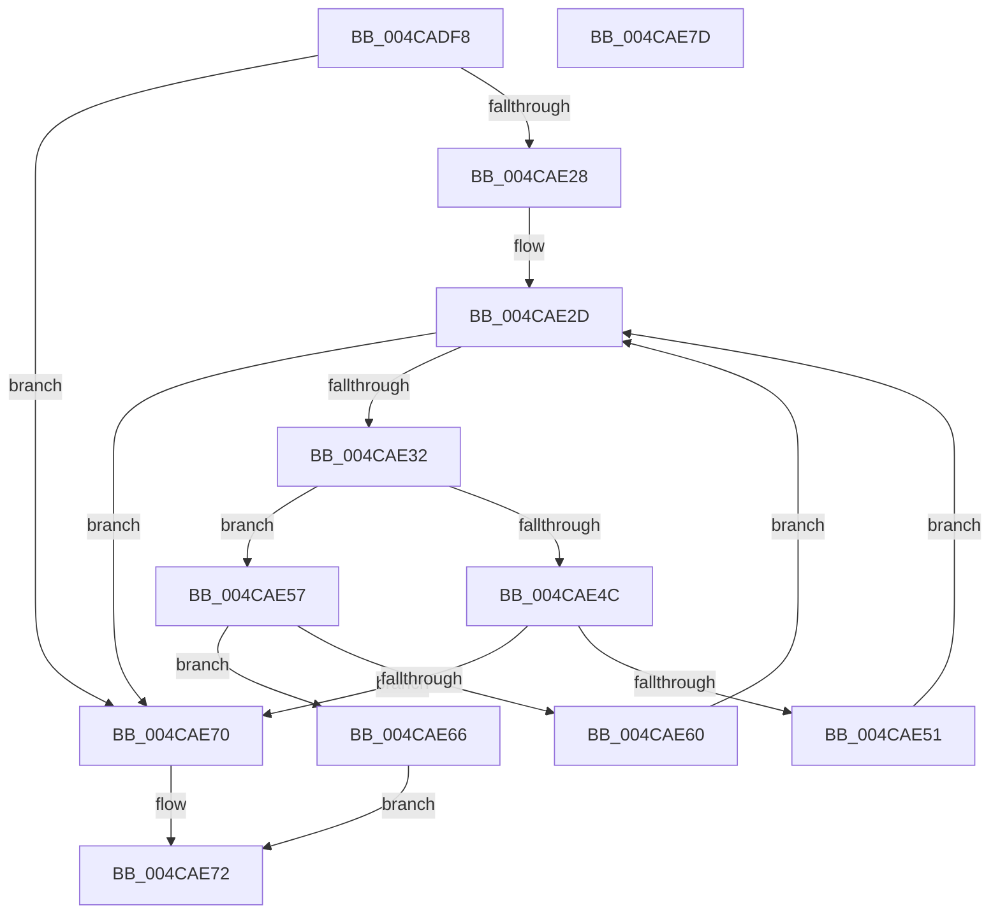

# MiLocateCachedExtent

- RVA: `0x004CADF8`–`0x004CAE7E` (길이 `134` bytes)
- VA: `0x00000001404CADF8`
- 실행 섹션: `.text`
- PDB 이름 있음: `예`; PDB Function 태그: `아니요`
- unwind 정보 RVA: `0x0005CAAC`
- 디코드: `44`개 명령, `134/134` bytes 표시
- 미해석 바이트: `0` (있으면 어셈블리에 `.byte`로 보존)

> 이 문서는 커널 이미지의 기계어와 PDB 기호를 분석해 생성했습니다. 4번과 5번은 함수 원형과 자료형을 바이너리 사용 방식에서 추정한 C 해석이며 원본 소스 복구 결과는 아닙니다.

## 1. Dependencies

- 직접 호출 지점: **1**; 고유 호출 대상: **1**
- 직접 호출자로 확인된 함수: **1**
- RIP 상대 이미지 참조: **0**

### Outgoing calls
- `0x004CAE10` → [MiStartingOffset](../34/MiStartingOffset_function_003482E0.md) (function, `0x003482E0`)

### Direct callers
- [MiInitializeCachedExtentWalker](MiInitializeCachedExtentWalker_function_004CAC6C.md) at `0x004CACC8`

### Static image references
- 디코드된 RIP-relative 메모리 참조가 없습니다.

## 2. Other-region calls and transfers

- 다른 실행 섹션으로 향하는 call: **0**
- 별도 외부 분기/꼬리 이동을 확인하지 못했습니다.

## 3. Assembly (complete function range)

```asm
004CADF8  48 89 5C 24 08                  mov qword ptr [rsp + 8], rbx
004CADFD  57                              push rdi
004CADFE  48 83 EC 20                     sub rsp, 0x20
004CAE02  48 8B FA                        mov rdi, rdx
004CAE05  41 83 C8 FF                     or r8d, 0xffffffff
004CAE09  48 8B 51 08                     mov rdx, qword ptr [rcx + 8]
004CAE0D  48 8B D9                        mov rbx, rcx
004CAE10  E8 CB D4 E7 FF                  call 0x1403482e0
004CAE15  4C 8B 5B 70                     mov r11, qword ptr [rbx + 0x70]
004CAE19  48 2B F8                        sub rdi, rax
004CAE1C  48 C1 EF 0C                     shr rdi, 0xc
004CAE20  45 33 D2                        xor r10d, r10d
004CAE23  4D 85 DB                        test r11, r11
004CAE26  74 48                           je 0x1404cae70
004CAE28  41 8B 13                        mov edx, dword ptr [r11]
004CAE2B  FF CA                           dec edx
004CAE2D  41 3B D2                        cmp edx, r10d
004CAE30  7C 3E                           jl 0x1404cae70
004CAE32  45 8D 04 12                     lea r8d, [r10 + rdx]
004CAE36  41 D1 F8                        sar r8d, 1
004CAE39  49 63 C0                        movsxd rax, r8d
004CAE3C  4C 8D 0C 40                     lea r9, [rax + rax*2]
004CAE40  4D 03 C9                        add r9, r9
004CAE43  43 8B 4C CB 20                  mov ecx, dword ptr [r11 + r9*8 + 0x20]
004CAE48  3B F9                           cmp edi, ecx
004CAE4A  73 0B                           jae 0x1404cae57
004CAE4C  45 85 C0                        test r8d, r8d
004CAE4F  74 1F                           je 0x1404cae70
004CAE51  41 8D 50 FF                     lea edx, [r8 - 1]
004CAE55  EB D6                           jmp 0x1404cae2d
004CAE57  43 03 4C CB 30                  add ecx, dword ptr [r11 + r9*8 + 0x30]
004CAE5C  3B F9                           cmp edi, ecx
004CAE5E  72 06                           jb 0x1404cae66
004CAE60  45 8D 50 01                     lea r10d, [r8 + 1]
004CAE64  EB C7                           jmp 0x1404cae2d
004CAE66  49 8D 43 08                     lea rax, [r11 + 8]
004CAE6A  4A 8D 04 C8                     lea rax, [rax + r9*8]
004CAE6E  EB 02                           jmp 0x1404cae72
004CAE70  33 C0                           xor eax, eax
004CAE72  48 8B 5C 24 30                  mov rbx, qword ptr [rsp + 0x30]
004CAE77  48 83 C4 20                     add rsp, 0x20
004CAE7B  5F                              pop rdi
004CAE7C  C3                              ret
004CAE7D  CC                              int3
```

## 4. C-style interpretation (structured pseudocode)

```c
__int64 __fastcall MiLocateCachedExtent(__int64 a1, __int64 a2, int a3)
{
    __int64 result;
    __int64 v_r10;
    __int64 v_rdi;
    __int64 v_rsp;
    unsigned __int64 v_stack_p8;

    v_stack_p8 = v_rbx;
    v_rsp = (v_rsp) - (32);
    a3 = (unsigned int)((a3) | (0xFFFFFFFFULL));
    result = MiStartingOffset(a1, *(unsigned __int64 *)(a1 + 8), a3, a4);
    v_rdi = (a2) - (result);
    v_rdi = (v_rdi) >> (12);
    v_r10 = 0;
    if (*(unsigned __int64 *)(a1 + 112) == 0) goto loc_004CAE70;
    a2 = (unsigned int)(((unsigned int)(*(unsigned int *)(*(unsigned __int64 *)(a1 + 112)))) - 1);
loc_004CAE2D:
    if (((unsigned int)(a2)) < 0) goto loc_004CAE70;
    a3 = (unsigned int)((v_r10 + a2 * 1) >> (1));
    a4 = ((int)(a3) + (int)(a3) * 2) + ((int)(a3) + (int)(a3) * 2);
    if (((unsigned int)(v_rdi)) >= ((unsigned int)((unsigned int)(*(unsigned int *)(*(unsigned __int64 *)(a1 + 112) + a4 * 8 + 32))))) goto loc_004CAE57;
    if (a3 == 0) goto loc_004CAE70;
    goto loc_004CAE2D;
loc_004CAE57:
    a1 = (unsigned int)(((unsigned int)(*(unsigned int *)(*(unsigned __int64 *)(a1 + 112) + a4 * 8 + 32))) + (*(unsigned int *)(*(unsigned __int64 *)(a1 + 112) + a4 * 8 + 48)));
    if (((unsigned int)(v_rdi)) < ((unsigned int)(a1))) goto loc_004CAE66;
    goto loc_004CAE2D;
loc_004CAE66:
    goto loc_004CAE72;
loc_004CAE70:
    result = 0;
loc_004CAE72:
    v_rsp = (v_rsp) + (32);
    return result;
}
```

## 5. (Beta) C Style

```c
int64_t MiLocateCachedExtent(void *Arg1, int64_t Arg2, int32_t Arg3)
{
    uint8_t *arg1 = (uint8_t *)Arg1;

    int64_t result;
    int64_t local_r10;
    int64_t local_rdi;
    int64_t local_rsp;
    uint64_t v_stack_p8;

    v_stack_p8 = local_rbx;
    local_rsp = (local_rsp) - (32);
    Arg3 = (uint32_t)((Arg3) | (0xFFFFFFFFULL));
    result = MiStartingOffset(Arg1, *(uint64_t *)(arg1 + 0x8), Arg3, a4);
    local_rdi = (Arg2) - (result);
    local_rdi = (local_rdi) >> (12);
    local_r10 = 0;
    if (*(uint64_t *)(arg1 + 0x70) == 0) goto loc_004CAE70;
    Arg2 = (uint32_t)(((uint32_t)(*(uint32_t *)(*(uint64_t *)(arg1 + 0x70)))) - 1);
loc_004CAE2D:
    if (((uint32_t)(Arg2)) < 0) goto loc_004CAE70;
    Arg3 = (uint32_t)((local_r10 + Arg2 * 1) >> (1));
    a4 = ((int32_t)(Arg3) + (int32_t)(Arg3) * 2) + ((int32_t)(Arg3) + (int32_t)(Arg3) * 2);
    if (((uint32_t)(local_rdi)) >= ((uint32_t)((uint32_t)(*(uint32_t *)(*(uint64_t *)(arg1 + 0x70) + a4 * 8 + 0x20))))) goto loc_004CAE57;
    if (Arg3 == 0) goto loc_004CAE70;
    goto loc_004CAE2D;
loc_004CAE57:
    Arg1 = (uint32_t)(((uint32_t)(*(uint32_t *)(*(uint64_t *)(arg1 + 0x70) + a4 * 8 + 0x20))) + (*(uint32_t *)(*(uint64_t *)(arg1 + 0x70) + a4 * 8 + 0x30)));
    if (((uint32_t)(local_rdi)) < ((uint32_t)(Arg1))) goto loc_004CAE66;
    goto loc_004CAE2D;
loc_004CAE66:
    goto loc_004CAE72;
loc_004CAE70:
    result = 0;
loc_004CAE72:
    local_rsp = (local_rsp) + (32);
    return result;
}
```

### 관측된 메모리 오프셋

구조체 형식이 확인되지 않은 접근은 인자 기준의 오프셋으로만 기록했습니다.

| 기준 인자 | 오프셋 표현 | 폭 (bit) | 접근 |
|---|---:|---:|---|
| `Arg1` | `+ 0x8` | `64` | `R` |
| `Arg1` | `+ 0x70` | `64` | `R` |

## 6. Execution-region graph

[열기: 2D/3D 그래프와 함수 탐색 컨트롤 패널](../../../control-panel.html?section=text&rva=0x004CADF8&view=graph)

- 2D 그래프는 위에서 아래로 흐르고, 3D 그래프는 빈 공간을 드래그해 회전합니다. Shift+드래그는 이동, 휠은 확대·축소, 함수 노드 선택은 대상 보고서 이동입니다.

### Static fallback


