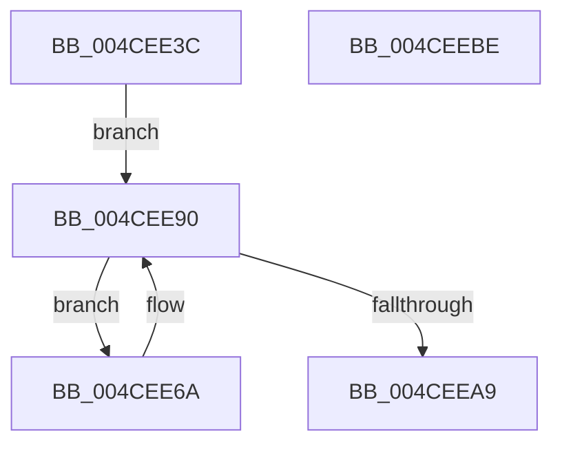

# MiLockAweVadsShared

- RVA: `0x004CEE3C`–`0x004CEEBF` (길이 `131` bytes)
- VA: `0x00000001404CEE3C`
- 실행 섹션: `.text`
- PDB 이름 있음: `예`; PDB Function 태그: `아니요`
- unwind 정보 RVA: `0x0005C954`
- 디코드: `31`개 명령, `131/131` bytes 표시
- 미해석 바이트: `0` (있으면 어셈블리에 `.byte`로 보존)

> 이 문서는 커널 이미지의 기계어와 PDB 기호를 분석해 생성했습니다. 4번과 5번은 함수 원형과 자료형을 바이너리 사용 방식에서 추정한 C 해석이며 원본 소스 복구 결과는 아닙니다.

## 1. Dependencies

- 직접 호출 지점: **3**; 고유 호출 대상: **3**
- 직접 호출자로 확인된 함수: **4**
- RIP 상대 이미지 참조: **0**

### Outgoing calls
- `0x004CEE70` → [MiUnlockAwePagesShared](MiUnlockAwePagesShared_function_004C66C4.md) (function, `0x004C66C4`)
- `0x004CEE84` → [MiCopyOnWriteCheckConditions](../2A/MiCopyOnWriteCheckConditions_function_002A750C.md) (function, `0x002A750C`)
- `0x004CEE9A` → [ExAcquireAutoExpandPushLockShared](../20/ExAcquireAutoExpandPushLockShared_function_0020FAF0.md) (function, `0x0020FAF0`)

### Direct callers
- [MiProtectAweRegion](MiProtectAweRegion_function_004CE62C.md) at `0x004CE6D3`
- [MiBuildPhysicalPageFreeChain](../68/MiBuildPhysicalPageFreeChain_function_00687C80.md) at `0x00687D2F`
- [NtMapUserPhysicalPages](../../page/80/NtMapUserPhysicalPages_function_0080B460.md) at `0x0080B51F`
- [NtMapUserPhysicalPagesScatter](../../page/80/NtMapUserPhysicalPagesScatter_function_0080B750.md) at `0x0080B8B5`

### Static image references
- 디코드된 RIP-relative 메모리 참조가 없습니다.

## 2. Other-region calls and transfers

- 다른 실행 섹션으로 향하는 call: **0**
- 별도 외부 분기/꼬리 이동을 확인하지 못했습니다.

## 3. Assembly (complete function range)

```asm
004CEE3C  48 89 5C 24 08                  mov qword ptr [rsp + 8], rbx
004CEE41  48 89 6C 24 10                  mov qword ptr [rsp + 0x10], rbp
004CEE46  48 89 74 24 18                  mov qword ptr [rsp + 0x18], rsi
004CEE4B  57                              push rdi
004CEE4C  48 83 EC 20                     sub rsp, 0x20
004CEE50  48 8B 99 B8 00 00 00            mov rbx, qword ptr [rcx + 0xb8]
004CEE57  48 8B F9                        mov rdi, rcx
004CEE5A  48 8B AB 10 04 00 00            mov rbp, qword ptr [rbx + 0x410]
004CEE61  66 FF 89 E6 01 00 00            dec word ptr [rcx + 0x1e6]
004CEE68  EB 26                           jmp 0x1404cee90
004CEE6A  48 8B D0                        mov rdx, rax
004CEE6D  48 8B CF                        mov rcx, rdi
004CEE70  E8 4F 78 FF FF                  call 0x1404c66c4
004CEE75  45 33 C0                        xor r8d, r8d
004CEE78  48 8D 8B 00 04 00 00            lea rcx, [rbx + 0x400]
004CEE7F  BA 34 04 00 C0                  mov edx, 0xc0000434
004CEE84  E8 83 86 DD FF                  call 0x1402a750c
004CEE89  66 FF 8F E6 01 00 00            dec word ptr [rdi + 0x1e6]
004CEE90  33 D2                           xor edx, edx
004CEE92  48 8D 8D 58 04 00 00            lea rcx, [rbp + 0x458]
004CEE99  90                              nop
004CEE9A  E8 51 0C D4 FF                  call 0x14020faf0
004CEE9F  48 83 BB 70 02 00 00 00         cmp qword ptr [rbx + 0x270], 0
004CEEA7  75 C1                           jne 0x1404cee6a
004CEEA9  48 8B 5C 24 30                  mov rbx, qword ptr [rsp + 0x30]
004CEEAE  48 8B 6C 24 38                  mov rbp, qword ptr [rsp + 0x38]
004CEEB3  48 8B 74 24 40                  mov rsi, qword ptr [rsp + 0x40]
004CEEB8  48 83 C4 20                     add rsp, 0x20
004CEEBC  5F                              pop rdi
004CEEBD  C3                              ret
004CEEBE  CC                              int3
```

## 4. C-style interpretation (structured pseudocode)

```c
__int64 __fastcall MiLockAweVadsShared(__int64 a1, __int64 a2, int a3)
{
    __int64 result;
    __int64 v_rsp;
    unsigned __int64 v_stack_p10;
    unsigned __int64 v_stack_p18;
    unsigned __int64 v_stack_p8;

    v_stack_p8 = v_rbx;
    v_stack_p10 = v_rbp;
    v_stack_p18 = v_rsi;
    v_rsp = (v_rsp) - (32);
    goto loc_004CEE90;
loc_004CEE6A:
    result = MiUnlockAwePagesShared(a1, result, a3, a4);
    a3 = 0;
    result = MiCopyOnWriteCheckConditions(*(unsigned __int64 *)(a1 + 184) + 1024, (unsigned int)(0xC0000434ULL), a3, a4);
loc_004CEE90:
    a2 = 0;
    result = ExAcquireAutoExpandPushLockShared(*(unsigned __int64 *)(*(unsigned __int64 *)(a1 + 184) + 1040) + 1112, a2, a3, a4);
    if ((*(unsigned __int64 *)(*(unsigned __int64 *)(a1 + 184) + 624)) != 0) goto loc_004CEE6A;
    v_rsp = (v_rsp) + (32);
    return result;
}
```

## 5. (Beta) C Style

```c
int64_t MiLockAweVadsShared(void *Arg1, int64_t Arg2, int32_t Arg3)
{
    uint8_t *arg1 = (uint8_t *)Arg1;

    int64_t result;
    int64_t local_rsp;
    uint64_t v_stack_p10;
    uint64_t v_stack_p18;
    uint64_t v_stack_p8;

    v_stack_p8 = local_rbx;
    v_stack_p10 = local_rbp;
    v_stack_p18 = local_rsi;
    local_rsp = (local_rsp) - (32);
    goto loc_004CEE90;
loc_004CEE6A:
    result = MiUnlockAwePagesShared(Arg1, result, Arg3, a4);
    Arg3 = 0;
    result = MiCopyOnWriteCheckConditions(*(uint64_t *)(arg1 + 0xB8) + 1024, (uint32_t)(0xC0000434ULL), Arg3, a4);
loc_004CEE90:
    Arg2 = 0;
    result = ExAcquireAutoExpandPushLockShared(*(uint64_t *)(*(uint64_t *)(arg1 + 0xB8) + 0x410) + 1112, Arg2, Arg3, a4);
    if ((*(uint64_t *)(*(uint64_t *)(arg1 + 0xB8) + 0x270)) != 0) goto loc_004CEE6A;
    local_rsp = (local_rsp) + (32);
    return result;
}
```

### 관측된 메모리 오프셋

구조체 형식이 확인되지 않은 접근은 인자 기준의 오프셋으로만 기록했습니다.

| 기준 인자 | 오프셋 표현 | 폭 (bit) | 접근 |
|---|---:|---:|---|
| `Arg1` | `+ 0xB8` | `64` | `R` |
| `Arg1` | `+ 0x1E6` | `16` | `R/W` |

## 6. Execution-region graph

[열기: 2D/3D 그래프와 함수 탐색 컨트롤 패널](../../../control-panel.html?section=text&rva=0x004CEE3C&view=graph)

- 2D 그래프는 위에서 아래로 흐르고, 3D 그래프는 빈 공간을 드래그해 회전합니다. Shift+드래그는 이동, 휠은 확대·축소, 함수 노드 선택은 대상 보고서 이동입니다.

### Static fallback


