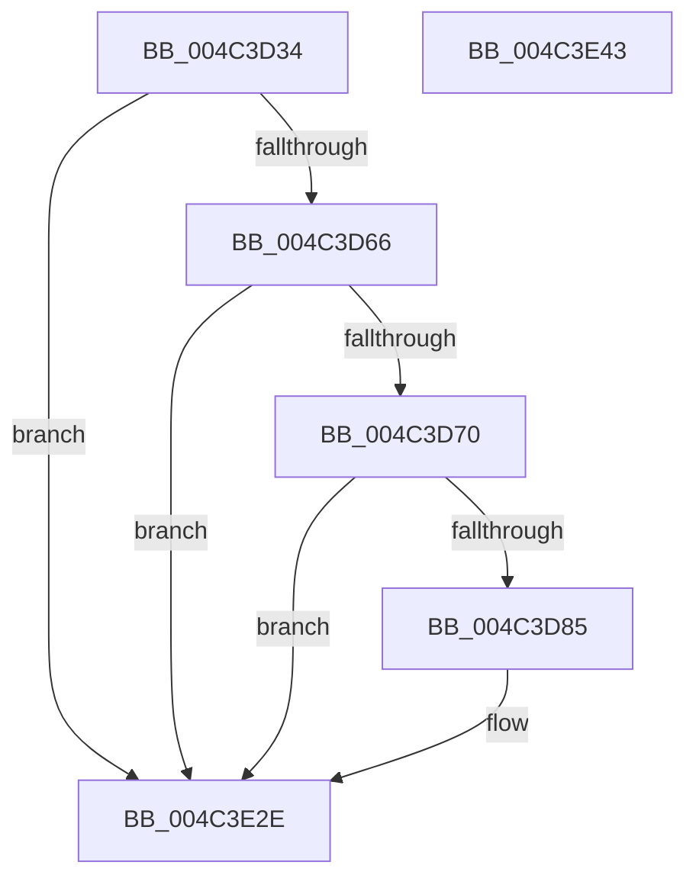

# MiLogContinueTrim

- RVA: `0x004C3D34`–`0x004C3E44` (길이 `272` bytes)
- VA: `0x00000001404C3D34`
- 실행 섹션: `.text`
- PDB 이름 있음: `예`; PDB Function 태그: `아니요`
- unwind 정보 RVA: `0x000BCC84`
- 디코드: `65`개 명령, `272/272` bytes 표시
- 미해석 바이트: `0` (있으면 어셈블리에 `.byte`로 보존)

> 이 문서는 커널 이미지의 기계어와 PDB 기호를 분석해 생성했습니다. 4번과 5번은 함수 원형과 자료형을 바이너리 사용 방식에서 추정한 C 해석이며 원본 소스 복구 결과는 아닙니다.

## 1. Dependencies

- 직접 호출 지점: **3**; 고유 호출 대상: **3**
- 직접 호출자로 확인된 함수: **1**
- RIP 상대 이미지 참조: **3**

### Outgoing calls
- `0x004C3D78` → [tlgKeywordOn](../42/tlgKeywordOn_function_0042EAA0.md) (function, `0x0042EAA0`)
- `0x004C3E29` → [tlgWriteTransfer_EtwWriteTransfer](../42/tlgWriteTransfer_EtwWriteTransfer_function_004260E0.md) (function, `0x004260E0`)
- `0x004C3E35` → [_security_check_cookie](../6A/_security_check_cookie_function_006AC640.md) (function, `0x006AC640`)

### Direct callers
- [MiCheckSystemTrimEndCriteria](../34/MiCheckSystemTrimEndCriteria_function_0034EDC8.md) at `0x0034EF7D`

### Static image references
- `0x004C3D42` → RVA `0x00E0A740` (`.data`; read)
- `0x004C3D50` → RVA `0x00E37618` (`.data`; read)
- `0x004C3D8F` → RVA `0x000580E6` (`.rdata`; read)

## 2. Other-region calls and transfers

- 다른 실행 섹션으로 향하는 call: **0**
- 별도 외부 분기/꼬리 이동을 확인하지 못했습니다.

## 3. Assembly (complete function range)

```asm
004C3D34  40 55                           push rbp
004C3D36  48 8D 6C 24 A9                  lea rbp, [rsp - 0x57]
004C3D3B  48 81 EC F0 00 00 00            sub rsp, 0xf0
004C3D42  48 8B 05 F7 69 94 00            mov rax, qword ptr [rip + 0x9469f7]
004C3D49  48 33 C4                        xor rax, rsp
004C3D4C  48 89 45 47                     mov qword ptr [rbp + 0x47], rax
004C3D50  4C 8B 15 C1 38 97 00            mov r10, qword ptr [rip + 0x9738c1]
004C3D57  4C 8B C2                        mov r8, rdx
004C3D5A  4C 8B C9                        mov r9, rcx
004C3D5D  4D 85 D2                        test r10, r10
004C3D60  0F 84 C8 00 00 00               je 0x1404c3e2e
004C3D66  41 83 3A 05                     cmp dword ptr [r10], 5
004C3D6A  0F 86 BE 00 00 00               jbe 0x1404c3e2e
004C3D70  BA 01 00 00 00                  mov edx, 1
004C3D75  49 8B CA                        mov rcx, r10
004C3D78  E8 23 AD F6 FF                  call 0x14042eaa0
004C3D7D  84 C0                           test al, al
004C3D7F  0F 84 A9 00 00 00               je 0x1404c3e2e
004C3D85  41 0F B7 01                     movzx eax, word ptr [r9]
004C3D89  8D 4A 07                        lea ecx, [rdx + 7]
004C3D8C  89 45 97                        mov dword ptr [rbp - 0x69], eax
004C3D8F  48 8D 15 50 43 B9 FF            lea rdx, [rip - 0x46bcb0]
004C3D96  48 8D 45 97                     lea rax, [rbp - 0x69]
004C3D9A  48 89 4D 0F                     mov qword ptr [rbp + 0xf], rcx
004C3D9E  48 89 45 E7                     mov qword ptr [rbp - 0x19], rax
004C3DA2  41 0F B6 00                     movzx eax, byte ptr [r8]
004C3DA6  83 E0 7F                        and eax, 0x7f
004C3DA9  48 89 4D 1F                     mov qword ptr [rbp + 0x1f], rcx
004C3DAD  89 45 9B                        mov dword ptr [rbp - 0x65], eax
004C3DB0  48 8D 45 9B                     lea rax, [rbp - 0x65]
004C3DB4  48 89 45 F7                     mov qword ptr [rbp - 9], rax
004C3DB8  49 8B 40 60                     mov rax, qword ptr [r8 + 0x60]
004C3DBC  48 89 45 9F                     mov qword ptr [rbp - 0x61], rax
004C3DC0  48 8D 45 9F                     lea rax, [rbp - 0x61]
004C3DC4  48 89 45 07                     mov qword ptr [rbp + 7], rax
004C3DC8  49 8B 40 50                     mov rax, qword ptr [r8 + 0x50]
004C3DCC  48 89 45 A7                     mov qword ptr [rbp - 0x59], rax
004C3DD0  48 8D 45 A7                     lea rax, [rbp - 0x59]
004C3DD4  48 89 45 17                     mov qword ptr [rbp + 0x17], rax
004C3DD8  49 8B 40 48                     mov rax, qword ptr [r8 + 0x48]
004C3DDC  45 33 C0                        xor r8d, r8d
004C3DDF  48 89 45 AF                     mov qword ptr [rbp - 0x51], rax
004C3DE3  48 8D 45 AF                     lea rax, [rbp - 0x51]
004C3DE7  48 89 45 27                     mov qword ptr [rbp + 0x27], rax
004C3DEB  49 8B 81 00 49 00 00            mov rax, qword ptr [r9 + 0x4900]
004C3DF2  45 33 C9                        xor r9d, r9d
004C3DF5  48 89 45 B7                     mov qword ptr [rbp - 0x49], rax
004C3DF9  48 8D 45 B7                     lea rax, [rbp - 0x49]
004C3DFD  48 89 45 37                     mov qword ptr [rbp + 0x37], rax
004C3E01  48 8D 45 C7                     lea rax, [rbp - 0x39]
004C3E05  48 89 44 24 28                  mov qword ptr [rsp + 0x28], rax
004C3E0A  89 4C 24 20                     mov dword ptr [rsp + 0x20], ecx
004C3E0E  48 89 4D 2F                     mov qword ptr [rbp + 0x2f], rcx
004C3E12  48 89 4D 3F                     mov qword ptr [rbp + 0x3f], rcx
004C3E16  49 8B CA                        mov rcx, r10
004C3E19  48 C7 45 EF 04 00 00 00         mov qword ptr [rbp - 0x11], 4
004C3E21  48 C7 45 FF 04 00 00 00         mov qword ptr [rbp - 1], 4
004C3E29  E8 B2 22 F6 FF                  call 0x1404260e0
004C3E2E  48 8B 4D 47                     mov rcx, qword ptr [rbp + 0x47]
004C3E32  48 33 CC                        xor rcx, rsp
004C3E35  E8 06 88 1E 00                  call 0x1406ac640
004C3E3A  48 81 C4 F0 00 00 00            add rsp, 0xf0
004C3E41  5D                              pop rbp
004C3E42  C3                              ret
004C3E43  CC                              int3
```

## 4. C-style interpretation (structured pseudocode)

```c
__int64 __fastcall MiLogContinueTrim(__int64 a1, __int64 a2)
{
    __int64 result;
    __int64 v_rsp;
    unsigned __int64 v_stack_m18;
    unsigned __int64 v_stack_m20;
    unsigned __int64 v_stack_m28;
    unsigned __int64 v_stack_m30;
    unsigned __int64 v_stack_m38;
    unsigned __int64 v_stack_m40;
    unsigned __int64 v_stack_m48;
    unsigned __int64 v_stack_m50;
    unsigned __int64 v_stack_m58;
    unsigned __int64 v_stack_m5F;
    unsigned __int64 v_stack_m60;
    unsigned __int64 v_stack_m68;
    unsigned __int64 v_stack_m70;
    unsigned __int64 v_stack_m78;
    unsigned __int64 v_stack_m98;
    unsigned __int64 v_stack_mA8;
    unsigned __int64 v_stack_mB0;
    unsigned __int64 v_stack_mB8;
    unsigned __int64 v_stack_mC0;
    unsigned int v_stack_mC4;
    unsigned int v_stack_mC8;
    unsigned __int64 v_stack_mD0;
    unsigned int v_stack_mD8;

    v_rsp = (v_rsp) - (240);
    result = (*(unsigned __int64 *)(v_rip + 9726455)) ^ (v_rsp);
    v_stack_m18 = result;
    if (*(unsigned __int64 *)(v_rip + 9910465) == 0) goto loc_004C3E2E;
    if ((*(unsigned int *)(*(unsigned __int64 *)(v_rip + 9910465))) <= 5) goto loc_004C3E2E;
    result = tlgKeywordOn(*(unsigned __int64 *)(v_rip + 9910465), 1, a2, a1);
    if ((unsigned __int8)(result) != 0) {
        result = *(unsigned __int16 *)(a1);
        a1 = 1 + 7;
        v_stack_mC8 = (unsigned int)(result);
        a2 = v_rip - 4635824;
        result = v_stack_mC8;
        v_stack_m50 = a1;
        v_stack_m78 = result;
        result = *(unsigned __int8 *)(a2);
        result = (unsigned int)((result) & (127));
        v_stack_m40 = a1;
        v_stack_mC4 = (unsigned int)(result);
        result = v_stack_mC4;
        v_stack_m68 = result;
        result = *(unsigned __int64 *)(a2 + 96);
        v_stack_mC0 = result;
        result = v_stack_mC0;
        v_stack_m58 = result;
        result = *(unsigned __int64 *)(a2 + 80);
        v_stack_mB8 = result;
        result = v_stack_mB8;
        v_stack_m48 = result;
        result = *(unsigned __int64 *)(a2 + 72);
        a3 = 0;
        v_stack_mB0 = result;
        result = v_stack_mB0;
        v_stack_m38 = result;
        result = *(unsigned __int64 *)(a1 + 18688);
        a4 = 0;
        v_stack_mA8 = result;
        result = v_stack_mA8;
        v_stack_m28 = result;
        result = v_stack_m98;
        v_stack_mD0 = result;
        v_stack_mD8 = (unsigned int)(a1);
        v_stack_m30 = a1;
        v_stack_m20 = a1;
        a1 = *(unsigned __int64 *)(v_rip + 9910465);
        v_stack_m70 = 4;
        v_stack_m60 = 4;
        result = tlgWriteTransfer_EtwWriteTransfer(a1, a2, a3, a4);
    }
    a1 = (v_stack_m18) ^ (v_rsp);
    result = _security_check_cookie(a1, a2, a3, a4);
    v_rsp = (v_rsp) + (240);
    return result;
}
```

## 5. (Beta) C Style

```c
int64_t MiLogContinueTrim(int64_t Arg1, int64_t Arg2)
{
    int64_t result;
    int64_t local_rsp;
    uint64_t v_stack_m18;
    uint64_t v_stack_m20;
    uint64_t v_stack_m28;
    uint64_t v_stack_m30;
    uint64_t v_stack_m38;
    uint64_t v_stack_m40;
    uint64_t v_stack_m48;
    uint64_t v_stack_m50;
    uint64_t v_stack_m58;
    uint64_t v_stack_m5F;
    uint64_t v_stack_m60;
    uint64_t v_stack_m68;
    uint64_t v_stack_m70;
    uint64_t v_stack_m78;
    uint64_t v_stack_m98;
    uint64_t v_stack_mA8;
    uint64_t v_stack_mB0;
    uint64_t v_stack_mB8;
    uint64_t v_stack_mC0;
    uint32_t v_stack_mC4;
    uint32_t v_stack_mC8;
    uint64_t v_stack_mD0;
    uint32_t v_stack_mD8;

    local_rsp = (local_rsp) - (240);
    result = (*(uint64_t *)(v_rip + 0x9469F7)) ^ (local_rsp);
    v_stack_m18 = result;
    if (*(uint64_t *)(v_rip + 0x9738C1) == 0) goto loc_004C3E2E;
    if ((*(uint32_t *)(*(uint64_t *)(v_rip + 0x9738C1))) <= 5) goto loc_004C3E2E;
    result = tlgKeywordOn(*(uint64_t *)(v_rip + 0x9738C1), 1, Arg2, Arg1);
    if ((uint8_t)(result) != 0) {
        result = *(uint16_t *)(Arg1);
        Arg1 = 1 + 7;
        v_stack_mC8 = (uint32_t)(result);
        Arg2 = v_rip - 4635824;
        result = v_stack_mC8;
        v_stack_m50 = Arg1;
        v_stack_m78 = result;
        result = *(uint8_t *)(Arg2);
        result = (uint32_t)((result) & (127));
        v_stack_m40 = Arg1;
        v_stack_mC4 = (uint32_t)(result);
        result = v_stack_mC4;
        v_stack_m68 = result;
        result = *(uint64_t *)(Arg2 + 0x60);
        v_stack_mC0 = result;
        result = v_stack_mC0;
        v_stack_m58 = result;
        result = *(uint64_t *)(Arg2 + 0x50);
        v_stack_mB8 = result;
        result = v_stack_mB8;
        v_stack_m48 = result;
        result = *(uint64_t *)(Arg2 + 0x48);
        a3 = 0;
        v_stack_mB0 = result;
        result = v_stack_mB0;
        v_stack_m38 = result;
        result = *(uint64_t *)(Arg1 + 0x4900);
        a4 = 0;
        v_stack_mA8 = result;
        result = v_stack_mA8;
        v_stack_m28 = result;
        result = v_stack_m98;
        v_stack_mD0 = result;
        v_stack_mD8 = (uint32_t)(Arg1);
        v_stack_m30 = Arg1;
        v_stack_m20 = Arg1;
        Arg1 = *(uint64_t *)(v_rip + 0x9738C1);
        v_stack_m70 = 4;
        v_stack_m60 = 4;
        result = tlgWriteTransfer_EtwWriteTransfer(Arg1, Arg2, a3, a4);
    }
    Arg1 = (v_stack_m18) ^ (local_rsp);
    result = _security_check_cookie(Arg1, Arg2, a3, a4);
    local_rsp = (local_rsp) + (240);
    return result;
}
```

## 6. Execution-region graph

[열기: 2D/3D 그래프와 함수 탐색 컨트롤 패널](../../../control-panel.html?section=text&rva=0x004C3D34&view=graph)

- 2D 그래프는 위에서 아래로 흐르고, 3D 그래프는 빈 공간을 드래그해 회전합니다. Shift+드래그는 이동, 휠은 확대·축소, 함수 노드 선택은 대상 보고서 이동입니다.

### Static fallback


