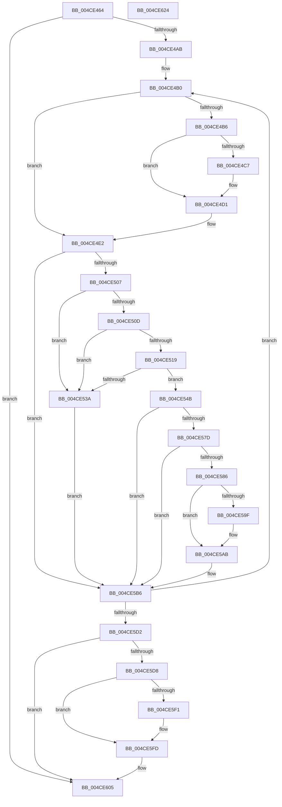

# MiPurgeZeroListHead

- RVA: `0x004CE464`–`0x004CE625` (길이 `449` bytes)
- VA: `0x00000001404CE464`
- 실행 섹션: `.text`
- PDB 이름 있음: `예`; PDB Function 태그: `아니요`
- unwind 정보 RVA: `0x0005FEF8`
- 디코드: `115`개 명령, `449/449` bytes 표시
- 미해석 바이트: `0` (있으면 어셈블리에 `.byte`로 보존)

> 이 문서는 커널 이미지의 기계어와 PDB 기호를 분석해 생성했습니다. 4번과 5번은 함수 원형과 자료형을 바이너리 사용 방식에서 추정한 C 해석이며 원본 소스 복구 결과는 아닙니다.

## 1. Dependencies

- 직접 호출 지점: **11**; 고유 호출 대상: **8**
- 직접 호출자로 확인된 함수: **1**
- RIP 상대 이미지 참조: **2**

### Outgoing calls
- `0x004CE4CC` → [KiRaiseIrqlProcessIrqlFlags](../4F/KiRaiseIrqlProcessIrqlFlags_function_004F56FC.md) (function, `0x004F56FC`)
- `0x004CE4DD` → [MiUpdatePageMoveInProgressInternal](../43/MiUpdatePageMoveInProgressInternal_function_0043F5A0.md) (function, `0x0043F5A0`)
- `0x004CE4FA` → [MiSafeLockPageAtDpc](../31/MiSafeLockPageAtDpc_function_0031C67C.md) (function, `0x0031C67C`)
- `0x004CE510` → [MiGetPfnPageSizeIndex](../31/MiGetPfnPageSizeIndex_function_0031C710.md) (function, `0x0031C710`)
- `0x004CE553` → [MiUnlinkFreeOrZeroedPage](../33/MiUnlinkFreeOrZeroedPage_function_00336C40.md) (function, `0x00336C40`)
- `0x004CE560` → [MiInsertPageInFreeOrZeroedList](../33/MiInsertPageInFreeOrZeroedList_function_00334D20.md) (function, `0x00334D20`)
- `0x004CE57D` → [KeShouldYieldProcessor](../27/KeShouldYieldProcessor_function_002773E0.md) (function, `0x002773E0`)
- `0x004CE591` → [MiUpdatePageMoveInProgressInternal](../43/MiUpdatePageMoveInProgressInternal_function_0043F5A0.md) (function, `0x0043F5A0`)
- `0x004CE5A6` → [KiLowerIrqlProcessIrqlFlags](../4F/KiLowerIrqlProcessIrqlFlags_function_004F5698.md) (function, `0x004F5698`)
- `0x004CE5E3` → [MiUpdatePageMoveInProgressInternal](../43/MiUpdatePageMoveInProgressInternal_function_0043F5A0.md) (function, `0x0043F5A0`)
- `0x004CE5F8` → [KiLowerIrqlProcessIrqlFlags](../4F/KiLowerIrqlProcessIrqlFlags_function_004F5698.md) (function, `0x004F5698`)

### Direct callers
- [MiPurgeZeroListHeads](MiPurgeZeroListHeads_function_004CE410.md) at `0x004CE43A`

### Static image references
- `0x004CE4BE` → RVA `0x00FC6D20` (`ALMOSTRO`; read)
- `0x004CE51D` → RVA `0x00E30088` (`.data`; read)

## 2. Other-region calls and transfers

- 다른 실행 섹션으로 향하는 call: **0**
- 별도 외부 분기/꼬리 이동을 확인하지 못했습니다.

## 3. Assembly (complete function range)

```asm
004CE464  48 8B C4                        mov rax, rsp
004CE467  48 89 58 08                     mov qword ptr [rax + 8], rbx
004CE46B  48 89 68 10                     mov qword ptr [rax + 0x10], rbp
004CE46F  48 89 70 18                     mov qword ptr [rax + 0x18], rsi
004CE473  48 89 78 20                     mov qword ptr [rax + 0x20], rdi
004CE477  41 54                           push r12
004CE479  41 56                           push r14
004CE47B  41 57                           push r15
004CE47D  48 83 EC 20                     sub rsp, 0x20
004CE481  0F B7 6A 0A                     movzx ebp, word ptr [rdx + 0xa]
004CE485  45 33 E4                        xor r12d, r12d
004CE488  48 8B 72 10                     mov rsi, qword ptr [rdx + 0x10]
004CE48C  83 E5 03                        and ebp, 3
004CE48F  48 B8 FF FF FF FF 3F 00 00 00   movabs rax, 0x3fffffffff
004CE499  4C 8B FA                        mov r15, rdx
004CE49C  4C 8B F1                        mov r14, rcx
004CE49F  40 B7 11                        mov dil, 0x11
004CE4A2  48 3B F0                        cmp rsi, rax
004CE4A5  0F 84 5A 01 00 00               je 0x1404ce605
004CE4AB  41 8D 4C 24 02                  lea ecx, [r12 + 2]
004CE4B0  40 80 FF 11                     cmp dil, 0x11
004CE4B4  75 2C                           jne 0x1404ce4e2
004CE4B6  44 0F 20 C7                     mov rdi, cr8
004CE4BA  44 0F 22 C1                     mov cr8, rcx
004CE4BE  83 3D 5B 88 AF 00 00            cmp dword ptr [rip + 0xaf885b], 0
004CE4C5  74 0A                           je 0x1404ce4d1
004CE4C7  8A D1                           mov dl, cl
004CE4C9  40 8A CF                        mov cl, dil
004CE4CC  E8 2B 72 02 00                  call 0x1404f56fc
004CE4D1  45 33 C9                        xor r9d, r9d
004CE4D4  8B D5                           mov edx, ebp
004CE4D6  49 8B CE                        mov rcx, r14
004CE4D9  45 8D 41 01                     lea r8d, [r9 + 1]
004CE4DD  E8 BE 10 F7 FF                  call 0x14043f5a0
004CE4E2  48 8D 1C 76                     lea rbx, [rsi + rsi*2]
004CE4E6  48 C1 E3 04                     shl rbx, 4
004CE4EA  48 B8 00 00 00 00 00 DE FF FF   movabs rax, 0xffffde0000000000
004CE4F4  48 8B CE                        mov rcx, rsi
004CE4F7  48 03 D8                        add rbx, rax
004CE4FA  E8 7D E1 E4 FF                  call 0x14031c67c
004CE4FF  3C 11                           cmp al, 0x11
004CE501  0F 84 AF 00 00 00               je 0x1404ce5b6
004CE507  F6 43 22 07                     test byte ptr [rbx + 0x22], 7
004CE50B  75 2D                           jne 0x1404ce53a
004CE50D  48 8B CB                        mov rcx, rbx
004CE510  E8 FB E1 E4 FF                  call 0x14031c710
004CE515  3B C5                           cmp eax, ebp
004CE517  75 21                           jne 0x1404ce53a
004CE519  48 8B 43 28                     mov rax, qword ptr [rbx + 0x28]
004CE51D  48 8B 0D 64 1B 96 00            mov rcx, qword ptr [rip + 0x961b64]
004CE524  49 8B 96 88 3A 00 00            mov rdx, qword ptr [r14 + 0x3a88]
004CE52B  48 C1 E8 2B                     shr rax, 0x2b
004CE52F  25 FF 03 00 00                  and eax, 0x3ff
004CE534  48 39 14 C1                     cmp qword ptr [rcx + rax*8], rdx
004CE538  74 11                           je 0x1404ce54b
004CE53A  48 B8 FF FF FF FF FF FF FF 7F   movabs rax, 0x7fffffffffffffff
004CE544  F0 48 21 43 18                  lock and qword ptr [rbx + 0x18], rax
004CE549  EB 6B                           jmp 0x1404ce5b6
004CE54B  45 33 C0                        xor r8d, r8d
004CE54E  33 D2                           xor edx, edx
004CE550  48 8B CE                        mov rcx, rsi
004CE553  E8 E8 86 E6 FF                  call 0x140336c40
004CE558  BA 02 00 00 00                  mov edx, 2
004CE55D  48 8B CE                        mov rcx, rsi
004CE560  E8 BB 67 E6 FF                  call 0x140334d20
004CE565  48 B8 FF FF FF FF FF FF FF 7F   movabs rax, 0x7fffffffffffffff
004CE56F  F0 48 21 43 18                  lock and qword ptr [rbx + 0x18], rax
004CE574  49 FF C4                        inc r12
004CE577  41 F6 C4 3F                     test r12b, 0x3f
004CE57B  75 39                           jne 0x1404ce5b6
004CE57D  E8 5E 8E DA FF                  call 0x1402773e0
004CE582  85 C0                           test eax, eax
004CE584  74 30                           je 0x1404ce5b6
004CE586  45 33 C9                        xor r9d, r9d
004CE589  45 33 C0                        xor r8d, r8d
004CE58C  8B D5                           mov edx, ebp
004CE58E  49 8B CE                        mov rcx, r14
004CE591  E8 0A 10 F7 FF                  call 0x14043f5a0
004CE596  44 39 05 83 87 AF 00            cmp dword ptr [rip + 0xaf8783], r8d
004CE59D  74 0C                           je 0x1404ce5ab
004CE59F  44 0F 20 C1                     mov rcx, cr8
004CE5A3  40 8A D7                        mov dl, dil
004CE5A6  E8 ED 70 02 00                  call 0x1404f5698
004CE5AB  40 0F B6 C7                     movzx eax, dil
004CE5AF  44 0F 22 C0                     mov cr8, rax
004CE5B3  40 B7 11                        mov dil, 0x11
004CE5B6  49 8B 77 10                     mov rsi, qword ptr [r15 + 0x10]
004CE5BA  48 B8 FF FF FF FF 3F 00 00 00   movabs rax, 0x3fffffffff
004CE5C4  B9 02 00 00 00                  mov ecx, 2
004CE5C9  48 3B F0                        cmp rsi, rax
004CE5CC  0F 85 DE FE FF FF               jne 0x1404ce4b0
004CE5D2  40 80 FF 11                     cmp dil, 0x11
004CE5D6  74 2D                           je 0x1404ce605
004CE5D8  45 33 C9                        xor r9d, r9d
004CE5DB  45 33 C0                        xor r8d, r8d
004CE5DE  8B D5                           mov edx, ebp
004CE5E0  49 8B CE                        mov rcx, r14
004CE5E3  E8 B8 0F F7 FF                  call 0x14043f5a0
004CE5E8  44 39 05 31 87 AF 00            cmp dword ptr [rip + 0xaf8731], r8d
004CE5EF  74 0C                           je 0x1404ce5fd
004CE5F1  44 0F 20 C1                     mov rcx, cr8
004CE5F5  40 8A D7                        mov dl, dil
004CE5F8  E8 9B 70 02 00                  call 0x1404f5698
004CE5FD  40 0F B6 C7                     movzx eax, dil
004CE601  44 0F 22 C0                     mov cr8, rax
004CE605  48 8B 5C 24 40                  mov rbx, qword ptr [rsp + 0x40]
004CE60A  48 8B 6C 24 48                  mov rbp, qword ptr [rsp + 0x48]
004CE60F  48 8B 74 24 50                  mov rsi, qword ptr [rsp + 0x50]
004CE614  48 8B 7C 24 58                  mov rdi, qword ptr [rsp + 0x58]
004CE619  48 83 C4 20                     add rsp, 0x20
004CE61D  41 5F                           pop r15
004CE61F  41 5E                           pop r14
004CE621  41 5C                           pop r12
004CE623  C3                              ret
004CE624  CC                              int3
```

## 4. C-style interpretation (structured pseudocode)

```c
__int64 __fastcall MiPurgeZeroListHead(__int64 a1, __int64 a2, __int64 a3, int a4)
{
    __int64 result;
    __int64 v_r12;
    __int64 v_rbp;
    __int64 v_rbx;
    __int64 v_rsp;
    unsigned __int64 v_stack_p10;
    unsigned __int64 v_stack_p18;
    unsigned __int64 v_stack_p20;
    unsigned __int64 v_stack_p8;

    *(unsigned __int64 *)(v_rsp + 8) = v_rbx;
    *(unsigned __int64 *)(v_rsp + 16) = v_rbp;
    *(unsigned __int64 *)(v_rsp + 24) = v_rsi;
    *(unsigned __int64 *)(v_rsp + 32) = v_rdi;
    v_rsp = (v_rsp) - (32);
    v_r12 = 0;
    v_rbp = (unsigned int)((*(unsigned __int16 *)(a2 + 10)) & (3));
    if ((*(unsigned __int64 *)(a2 + 16)) == v_rsp) goto loc_004CE605;
loc_004CE4B0:
    if (17 != 17) goto loc_004CE4E2;
    result = v_rsp;
    if ((*(unsigned int *)(v_rip + 11503707)) != 0) {
        a2 = (unsigned __int8)(v_r12 + 2);
        a1 = (unsigned __int8)(v_cr8);
        result = KiRaiseIrqlProcessIrqlFlags(a1, a2, a3, a4);
    }
    a4 = 0;
    result = MiUpdatePageMoveInProgressInternal(a1, (unsigned int)((unsigned int)(v_rbp)), a4 + 1, a4);
loc_004CE4E2:
    v_rbx = (*(unsigned __int64 *)(a2 + 16) + *(unsigned __int64 *)(a2 + 16) * 2) << (4);
    v_rbx = (v_rbx) + (result);
    result = MiSafeLockPageAtDpc(*(unsigned __int64 *)(a2 + 16), (unsigned int)((unsigned int)(v_rbp)), a4 + 1, a4);
    if (((unsigned __int8)(result)) == 17) goto loc_004CE5B6;
    if (((*(unsigned __int8 *)(v_rbx + 34)) & (7)) != 0) goto loc_004CE53A;
    result = MiGetPfnPageSizeIndex(v_rbx, (unsigned int)((unsigned int)(v_rbp)), a4 + 1, a4);
    if (((unsigned int)(result)) != ((unsigned int)(v_rbp))) goto loc_004CE53A;
    result = (*(unsigned __int64 *)(v_rbx + 40)) >> (43);
    result = (unsigned int)((result) & (0x3FFULL));
    if ((*(unsigned __int64 *)(*(unsigned __int64 *)(v_rip + 9837412) + result * 8)) == (*(unsigned __int64 *)(a1 + 14984))) goto loc_004CE54B;
loc_004CE53A:
    goto loc_004CE5B6;
loc_004CE54B:
    a3 = 0;
    a2 = 0;
    result = MiUnlinkFreeOrZeroedPage(*(unsigned __int64 *)(a2 + 16), a2, a3, a4);
    result = MiInsertPageInFreeOrZeroedList(*(unsigned __int64 *)(a2 + 16), 2, a3, a4);
    v_r12 = (v_r12) + 1;
    if ((((unsigned __int8)(v_r12)) & (63)) != 0) goto loc_004CE5B6;
    result = KeShouldYieldProcessor(*(unsigned __int64 *)(a2 + 16), 2, a3, a4);
    if ((unsigned int)(result) == 0) goto loc_004CE5B6;
    a4 = 0;
    a3 = 0;
    result = MiUpdatePageMoveInProgressInternal(a1, (unsigned int)((unsigned int)(v_rbp)), a3, a4);
    if ((*(unsigned int *)(v_rip + 11503491)) != 0) {
        a1 = v_r12 + 2;
        a2 = (unsigned __int8)(v_cr8);
        result = KiLowerIrqlProcessIrqlFlags(a1, a2, a3, a4);
    }
loc_004CE5B6:
    if ((*(unsigned __int64 *)(a2 + 16)) != ((unsigned __int8)(v_cr8))) goto loc_004CE4B0;
    if (17 == 17) goto loc_004CE605;
    a4 = 0;
    a3 = 0;
    result = MiUpdatePageMoveInProgressInternal(a1, (unsigned int)((unsigned int)(v_rbp)), a3, a4);
    if ((*(unsigned int *)(v_rip + 11503409)) != 0) {
        a1 = (unsigned __int8)(v_cr8);
        a2 = 17;
        result = KiLowerIrqlProcessIrqlFlags(a1, a2, a3, a4);
    }
loc_004CE605:
    v_rsp = (v_rsp) + (32);
    return 17;
}
```

## 5. (Beta) C Style

```c
int64_t MiPurgeZeroListHead(void *Arg1, void *Arg2, int64_t Arg3, int32_t Arg4)
{
    uint8_t *arg1 = (uint8_t *)Arg1;
    uint8_t *arg2 = (uint8_t *)Arg2;

    int64_t result;
    int64_t local_r12;
    int64_t local_rbp;
    int64_t local_rbx;
    int64_t local_rsp;
    uint64_t v_stack_p10;
    uint64_t v_stack_p18;
    uint64_t v_stack_p20;
    uint64_t v_stack_p8;

    *(uint64_t *)(local_rsp + 0x8) = local_rbx;
    *(uint64_t *)(local_rsp + 0x10) = local_rbp;
    *(uint64_t *)(local_rsp + 0x18) = local_rsi;
    *(uint64_t *)(local_rsp + 0x20) = local_rdi;
    local_rsp = (local_rsp) - (32);
    local_r12 = 0;
    local_rbp = (uint32_t)((*(uint16_t *)(arg2 + 0xA)) & (3));
    if ((*(uint64_t *)(arg2 + 0x10)) == local_rsp) goto loc_004CE605;
loc_004CE4B0:
    if (17 != 17) goto loc_004CE4E2;
    result = local_rsp;
    if ((*(uint32_t *)(v_rip + 0xAF885B)) != 0) {
        Arg2 = (uint8_t)(local_r12 + 2);
        Arg1 = (uint8_t)(v_cr8);
        result = KiRaiseIrqlProcessIrqlFlags(Arg1, Arg2, Arg3, Arg4);
    }
    Arg4 = 0;
    result = MiUpdatePageMoveInProgressInternal(Arg1, (uint32_t)((uint32_t)(local_rbp)), Arg4 + 1, Arg4);
loc_004CE4E2:
    local_rbx = (*(uint64_t *)(arg2 + 0x10) + *(uint64_t *)(arg2 + 0x10) * 2) << (4);
    local_rbx = (local_rbx) + (result);
    result = MiSafeLockPageAtDpc(*(uint64_t *)(arg2 + 0x10), (uint32_t)((uint32_t)(local_rbp)), Arg4 + 1, Arg4);
    if (((uint8_t)(result)) == 17) goto loc_004CE5B6;
    if (((*(uint8_t *)(local_rbx + 0x22)) & (7)) != 0) goto loc_004CE53A;
    result = MiGetPfnPageSizeIndex(local_rbx, (uint32_t)((uint32_t)(local_rbp)), Arg4 + 1, Arg4);
    if (((uint32_t)(result)) != ((uint32_t)(local_rbp))) goto loc_004CE53A;
    result = (*(uint64_t *)(local_rbx + 0x28)) >> (43);
    result = (uint32_t)((result) & (0x3FFULL));
    if ((*(uint64_t *)(*(uint64_t *)(v_rip + 0x961B64) + result * 8)) == (*(uint64_t *)(arg1 + 0x3A88))) goto loc_004CE54B;
loc_004CE53A:
    goto loc_004CE5B6;
loc_004CE54B:
    Arg3 = 0;
    Arg2 = 0;
    result = MiUnlinkFreeOrZeroedPage(*(uint64_t *)(arg2 + 0x10), Arg2, Arg3, Arg4);
    result = MiInsertPageInFreeOrZeroedList(*(uint64_t *)(arg2 + 0x10), 2, Arg3, Arg4);
    local_r12 = (local_r12) + 1;
    if ((((uint8_t)(local_r12)) & (63)) != 0) goto loc_004CE5B6;
    result = KeShouldYieldProcessor(*(uint64_t *)(arg2 + 0x10), 2, Arg3, Arg4);
    if ((uint32_t)(result) == 0) goto loc_004CE5B6;
    Arg4 = 0;
    Arg3 = 0;
    result = MiUpdatePageMoveInProgressInternal(Arg1, (uint32_t)((uint32_t)(local_rbp)), Arg3, Arg4);
    if ((*(uint32_t *)(v_rip + 0xAF8783)) != 0) {
        Arg1 = local_r12 + 2;
        Arg2 = (uint8_t)(v_cr8);
        result = KiLowerIrqlProcessIrqlFlags(Arg1, Arg2, Arg3, Arg4);
    }
loc_004CE5B6:
    if ((*(uint64_t *)(arg2 + 0x10)) != ((uint8_t)(v_cr8))) goto loc_004CE4B0;
    if (17 == 17) goto loc_004CE605;
    Arg4 = 0;
    Arg3 = 0;
    result = MiUpdatePageMoveInProgressInternal(Arg1, (uint32_t)((uint32_t)(local_rbp)), Arg3, Arg4);
    if ((*(uint32_t *)(v_rip + 0xAF8731)) != 0) {
        Arg1 = (uint8_t)(v_cr8);
        Arg2 = 17;
        result = KiLowerIrqlProcessIrqlFlags(Arg1, Arg2, Arg3, Arg4);
    }
loc_004CE605:
    local_rsp = (local_rsp) + (32);
    return 17;
}
```

### 관측된 메모리 오프셋

구조체 형식이 확인되지 않은 접근은 인자 기준의 오프셋으로만 기록했습니다.

| 기준 인자 | 오프셋 표현 | 폭 (bit) | 접근 |
|---|---:|---:|---|
| `Arg1` | `+ 0x3A88` | `64` | `R` |
| `Arg2` | `+ 0xA` | `16` | `R` |
| `Arg2` | `+ 0x10` | `64` | `R` |

## 6. Execution-region graph

[열기: 2D/3D 그래프와 함수 탐색 컨트롤 패널](../../../control-panel.html?section=text&rva=0x004CE464&view=graph)

- 2D 그래프는 위에서 아래로 흐르고, 3D 그래프는 빈 공간을 드래그해 회전합니다. Shift+드래그는 이동, 휠은 확대·축소, 함수 노드 선택은 대상 보고서 이동입니다.

### Static fallback


