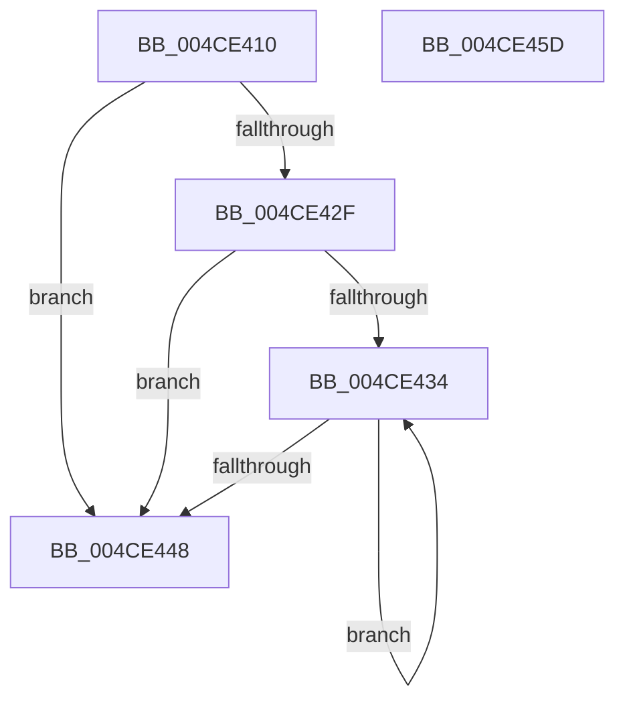

# MiPurgeZeroListHeads

- RVA: `0x004CE410`–`0x004CE45E` (길이 `78` bytes)
- VA: `0x00000001404CE410`
- 실행 섹션: `.text`
- PDB 이름 있음: `예`; PDB Function 태그: `아니요`
- unwind 정보 RVA: `0x00060BC4`
- 디코드: `24`개 명령, `78/78` bytes 표시
- 미해석 바이트: `0` (있으면 어셈블리에 `.byte`로 보존)

> 이 문서는 커널 이미지의 기계어와 PDB 기호를 분석해 생성했습니다. 4번과 5번은 함수 원형과 자료형을 바이너리 사용 방식에서 추정한 C 해석이며 원본 소스 복구 결과는 아닙니다.

## 1. Dependencies

- 직접 호출 지점: **1**; 고유 호출 대상: **1**
- 직접 호출자로 확인된 함수: **0**
- RIP 상대 이미지 참조: **0**

### Outgoing calls
- `0x004CE43A` → [MiPurgeZeroListHead](MiPurgeZeroListHead_function_004CE464.md) (function, `0x004CE464`)

### Direct callers
- 이 함수 시작 RVA로 연결되는 직접 call은 확인되지 않았습니다. 간접 호출은 완전히 역산할 수 없습니다.

### Static image references
- 디코드된 RIP-relative 메모리 참조가 없습니다.

## 2. Other-region calls and transfers

- 다른 실행 섹션으로 향하는 call: **0**
- 별도 외부 분기/꼬리 이동을 확인하지 못했습니다.

## 3. Assembly (complete function range)

```asm
004CE410  48 89 5C 24 08                  mov qword ptr [rsp + 8], rbx
004CE415  48 89 74 24 10                  mov qword ptr [rsp + 0x10], rsi
004CE41A  57                              push rdi
004CE41B  48 83 EC 20                     sub rsp, 0x20
004CE41F  41 83 78 0C 00                  cmp dword ptr [r8 + 0xc], 0
004CE424  41 8B F9                        mov edi, r9d
004CE427  49 8B D8                        mov rbx, r8
004CE42A  48 8B F2                        mov rsi, rdx
004CE42D  75 19                           jne 0x1404ce448
004CE42F  45 85 C9                        test r9d, r9d
004CE432  74 14                           je 0x1404ce448
004CE434  48 8B D3                        mov rdx, rbx
004CE437  48 8B CE                        mov rcx, rsi
004CE43A  E8 25 00 00 00                  call 0x1404ce464
004CE43F  48 83 C3 58                     add rbx, 0x58
004CE443  83 C7 FF                        add edi, -1
004CE446  75 EC                           jne 0x1404ce434
004CE448  48 8B 5C 24 30                  mov rbx, qword ptr [rsp + 0x30]
004CE44D  B8 01 00 00 00                  mov eax, 1
004CE452  48 8B 74 24 38                  mov rsi, qword ptr [rsp + 0x38]
004CE457  48 83 C4 20                     add rsp, 0x20
004CE45B  5F                              pop rdi
004CE45C  C3                              ret
004CE45D  CC                              int3
```

## 4. C-style interpretation (structured pseudocode)

```c
__int64 __fastcall MiPurgeZeroListHeads(__int64 a1, __int64 a2, __int64 a3, int a4)
{
    __int64 result;
    __int64 v_rbx;
    __int64 v_rdi;
    __int64 v_rsp;
    unsigned __int64 v_stack_p10;
    unsigned __int64 v_stack_p8;

    v_stack_p8 = v_rbx;
    v_stack_p10 = v_rsi;
    v_rsp = (v_rsp) - (32);
    if ((*(unsigned int *)(a3 + 12)) != 0) goto loc_004CE448;
    if (a4 == 0) goto loc_004CE448;
loc_004CE434:
    result = MiPurgeZeroListHead(a2, a3, a3, a4);
    v_rbx = (a3) + (88);
    v_rdi = (unsigned int)(((unsigned int)(a4)) + (-1));
    if (condition_is_not_equal) goto loc_004CE434;
loc_004CE448:
    v_rsp = (v_rsp) + (32);
    return 1;
}
```

## 5. (Beta) C Style

```c
int64_t MiPurgeZeroListHeads(int64_t Arg1, int64_t Arg2, void *Arg3, int32_t Arg4)
{
    uint8_t *arg3 = (uint8_t *)Arg3;

    int64_t result;
    int64_t local_rbx;
    int64_t local_rdi;
    int64_t local_rsp;
    uint64_t v_stack_p10;
    uint64_t v_stack_p8;

    v_stack_p8 = local_rbx;
    v_stack_p10 = local_rsi;
    local_rsp = (local_rsp) - (32);
    if ((*(uint32_t *)(arg3 + 0xC)) != 0) goto loc_004CE448;
    if (Arg4 == 0) goto loc_004CE448;
loc_004CE434:
    result = MiPurgeZeroListHead(Arg2, Arg3, Arg3, Arg4);
    local_rbx = (Arg3) + (88);
    local_rdi = (uint32_t)(((uint32_t)(Arg4)) + (-1));
    if (condition_is_not_equal) goto loc_004CE434;
loc_004CE448:
    local_rsp = (local_rsp) + (32);
    return 1;
}
```

### 관측된 메모리 오프셋

구조체 형식이 확인되지 않은 접근은 인자 기준의 오프셋으로만 기록했습니다.

| 기준 인자 | 오프셋 표현 | 폭 (bit) | 접근 |
|---|---:|---:|---|
| `Arg3` | `+ 0xC` | `32` | `R` |

## 6. Execution-region graph

[열기: 2D/3D 그래프와 함수 탐색 컨트롤 패널](../../../control-panel.html?section=text&rva=0x004CE410&view=graph)

- 2D 그래프는 위에서 아래로 흐르고, 3D 그래프는 빈 공간을 드래그해 회전합니다. Shift+드래그는 이동, 휠은 확대·축소, 함수 노드 선택은 대상 보고서 이동입니다.

### Static fallback


