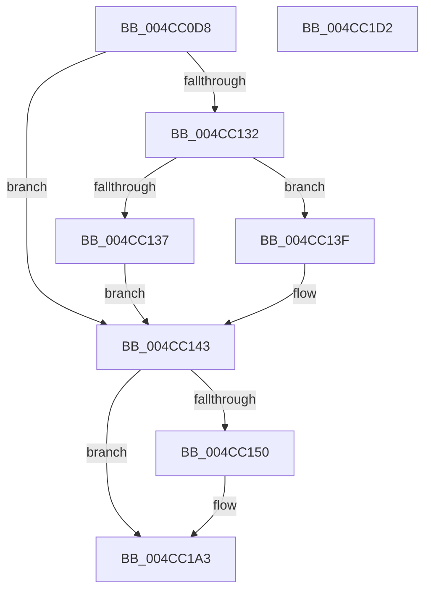

# MiReadyReservedView

- RVA: `0x004CC0D8`–`0x004CC1D3` (길이 `251` bytes)
- VA: `0x00000001404CC0D8`
- 실행 섹션: `.text`
- PDB 이름 있음: `예`; PDB Function 태그: `아니요`
- unwind 정보 RVA: `0x000BD760`
- 디코드: `58`개 명령, `251/251` bytes 표시
- 미해석 바이트: `0` (있으면 어셈블리에 `.byte`로 보존)

> 이 문서는 커널 이미지의 기계어와 PDB 기호를 분석해 생성했습니다. 4번과 5번은 함수 원형과 자료형을 바이너리 사용 방식에서 추정한 C 해석이며 원본 소스 복구 결과는 아닙니다.

## 1. Dependencies

- 직접 호출 지점: **6**; 고유 호출 대상: **6**
- 직접 호출자로 확인된 함수: **2**
- RIP 상대 이미지 참조: **3**

### Outgoing calls
- `0x004CC147` → [MiCompareTbFlushTimeStamp](../31/MiCompareTbFlushTimeStamp_function_0031ADE4.md) (function, `0x0031ADE4`)
- `0x004CC15D` → [memset](../6C/memset_function_006C6C40.md) (function, `0x006C6C40`)
- `0x004CC180` → [MiInitializeTbFlushList](../29/MiInitializeTbFlushList_function_00294F00.md) (function, `0x00294F00`)
- `0x004CC194` → [MiInsertTbFlushEntry](../29/MiInsertTbFlushEntry_function_00293670.md) (function, `0x00293670`)
- `0x004CC19E` → [MiFlushTbList](../31/MiFlushTbList_function_00311FC0.md) (function, `0x00311FC0`)
- `0x004CC1B8` → [_security_check_cookie](../6A/_security_check_cookie_function_006AC640.md) (function, `0x006AC640`)

### Direct callers
- [MmMapViewInSystemCache](../27/MmMapViewInSystemCache_function_00273094.md) at `0x00273302`
- [sub_006D78EE](../6D/Unknown_function_006D78EE.md) at `0x006D78F8`

### Static image references
- `0x004CC0EA` → RVA `0x00E0A740` (`.data`; read)
- `0x004CC126` → RVA `0x00E2DC80` (`.data`; read)
- `0x004CC1A3` → RVA `0x00010880` (`.rdata`; read)

## 2. Other-region calls and transfers

- 다른 실행 섹션으로 향하는 call: **0**
- 별도 외부 분기/꼬리 이동을 확인하지 못했습니다.

## 3. Assembly (complete function range)

```asm
004CC0D8  48 89 5C 24 08                  mov qword ptr [rsp + 8], rbx
004CC0DD  48 89 74 24 18                  mov qword ptr [rsp + 0x18], rsi
004CC0E2  57                              push rdi
004CC0E3  48 81 EC 20 01 00 00            sub rsp, 0x120
004CC0EA  48 8B 05 4F E6 93 00            mov rax, qword ptr [rip + 0x93e64f]
004CC0F1  48 33 C4                        xor rax, rsp
004CC0F4  48 89 84 24 10 01 00 00         mov qword ptr [rsp + 0x110], rax
004CC0FC  48 8B DA                        mov rbx, rdx
004CC0FF  48 B8 F8 FF FF FF 7F 00 00 00   movabs rax, 0x7ffffffff8
004CC109  48 C1 EB 09                     shr rbx, 9
004CC10D  48 8B FA                        mov rdi, rdx
004CC110  48 23 D8                        and rbx, rax
004CC113  48 8B F1                        mov rsi, rcx
004CC116  48 B8 00 00 00 00 80 F6 FF FF   movabs rax, 0xfffff68000000000
004CC120  48 03 D8                        add rbx, rax
004CC123  48 8B 0B                        mov rcx, qword ptr [rbx]
004CC126  48 8B 05 53 1B 96 00            mov rax, qword ptr [rip + 0x961b53]
004CC12D  48 85 C0                        test rax, rax
004CC130  74 11                           je 0x1404cc143
004CC132  F6 C1 10                        test cl, 0x10
004CC135  75 08                           jne 0x1404cc13f
004CC137  48 F7 D0                        not rax
004CC13A  48 23 C8                        and rcx, rax
004CC13D  EB 04                           jmp 0x1404cc143
004CC13F  48 83 E1 EF                     and rcx, 0xffffffffffffffef
004CC143  48 C1 E9 20                     shr rcx, 0x20
004CC147  E8 98 EC E4 FF                  call 0x14031ade4
004CC14C  84 C0                           test al, al
004CC14E  74 53                           je 0x1404cc1a3
004CC150  33 D2                           xor edx, edx
004CC152  48 8D 4C 24 40                  lea rcx, [rsp + 0x40]
004CC157  41 B8 C8 00 00 00               mov r8d, 0xc8
004CC15D  E8 DE AA 1F 00                  call 0x1406c6c40
004CC162  41 B9 08 00 00 00               mov r9d, 8
004CC168  C7 44 24 20 01 00 00 00         mov dword ptr [rsp + 0x20], 1
004CC170  48 8D 96 80 49 00 00            lea rdx, [rsi + 0x4980]
004CC177  48 8D 4C 24 40                  lea rcx, [rsp + 0x40]
004CC17C  45 8D 41 0C                     lea r8d, [r9 + 0xc]
004CC180  E8 7B 8D DC FF                  call 0x140294f00
004CC185  45 33 C9                        xor r9d, r9d
004CC188  48 8D 4C 24 40                  lea rcx, [rsp + 0x40]
004CC18D  48 8B D7                        mov rdx, rdi
004CC190  45 8D 41 40                     lea r8d, [r9 + 0x40]
004CC194  E8 D7 74 DC FF                  call 0x140293670
004CC199  48 8D 4C 24 40                  lea rcx, [rsp + 0x40]
004CC19E  E8 1D 5E E4 FF                  call 0x140311fc0
004CC1A3  48 8B 05 D6 46 B4 FF            mov rax, qword ptr [rip - 0x4bb92a]
004CC1AA  48 89 03                        mov qword ptr [rbx], rax
004CC1AD  48 8B 8C 24 10 01 00 00         mov rcx, qword ptr [rsp + 0x110]
004CC1B5  48 33 CC                        xor rcx, rsp
004CC1B8  E8 83 04 1E 00                  call 0x1406ac640
004CC1BD  4C 8D 9C 24 20 01 00 00         lea r11, [rsp + 0x120]
004CC1C5  49 8B 5B 10                     mov rbx, qword ptr [r11 + 0x10]
004CC1C9  49 8B 73 20                     mov rsi, qword ptr [r11 + 0x20]
004CC1CD  49 8B E3                        mov rsp, r11
004CC1D0  5F                              pop rdi
004CC1D1  C3                              ret
004CC1D2  CC                              int3
```

## 4. C-style interpretation (structured pseudocode)

```c
__int64 __fastcall MiReadyReservedView(__int64 a1, __int64 a2)
{
    __int64 result;
    __int64 v_rbx;
    __int64 v_rsp;
    unsigned int v_stack_m108;
    unsigned __int64 v_stack_m18;
    unsigned __int64 v_stack_m8;
    unsigned __int64 v_stack_mE8;
    unsigned __int64 v_stack_p18;
    unsigned __int64 v_stack_p8;

    v_stack_p8 = v_rbx;
    v_stack_p18 = v_rsi;
    v_rsp = (v_rsp) - (288);
    result = (*(unsigned __int64 *)(v_rip + 9692751)) ^ (v_rsp);
    v_stack_m18 = result;
    v_rbx = (a2) >> (9);
    v_rbx = (v_rbx) & (result);
    v_rbx = (v_rbx) + (result);
    if (*(unsigned __int64 *)(v_rip + 9837395) == 0) goto loc_004CC143;
    if ((((unsigned __int8)(*(unsigned __int64 *)(v_rbx))) & (16)) != 0) goto loc_004CC13F;
    result = ~(*(unsigned __int64 *)(v_rip + 9837395));
    a1 = (*(unsigned __int64 *)(v_rbx)) & (result);
    goto loc_004CC143;
loc_004CC13F:
    a1 = (a1) & (-17);
loc_004CC143:
    a1 = (a1) >> (32);
    result = MiCompareTbFlushTimeStamp(a1, a2, a3, a4);
    if ((unsigned __int8)(result) != 0) {
        a2 = 0;
        a1 = v_stack_mE8;
        a3 = 200;
        result = memset(a1, a2, a3, a4);
        a4 = 8;
        v_stack_m108 = 1;
        a2 = a1 + 18816;
        a1 = v_stack_mE8;
        a3 = a4 + 12;
        result = MiInitializeTbFlushList(a1, a2, a3, a4);
        a4 = 0;
        a1 = v_stack_mE8;
        a2 = a2;
        a3 = a4 + 64;
        result = MiInsertTbFlushEntry(a1, a2, a3, a4);
        a1 = v_stack_mE8;
        result = MiFlushTbList(a1, a2, a3, a4);
    }
    *(unsigned __int64 *)(v_rbx) = *(unsigned __int64 *)(v_rip - 4962602);
    a1 = (v_stack_m18) ^ (v_rsp);
    result = _security_check_cookie(a1, a2, a3, a4);
    return result;
}
```

## 5. (Beta) C Style

```c
int64_t MiReadyReservedView(void *Arg1, int64_t Arg2)
{
    uint8_t *arg1 = (uint8_t *)Arg1;

    int64_t result;
    int64_t local_rbx;
    int64_t local_rsp;
    uint32_t v_stack_m108;
    uint64_t v_stack_m18;
    uint64_t v_stack_m8;
    uint64_t v_stack_mE8;
    uint64_t v_stack_p18;
    uint64_t v_stack_p8;

    v_stack_p8 = local_rbx;
    v_stack_p18 = local_rsi;
    local_rsp = (local_rsp) - (288);
    result = (*(uint64_t *)(v_rip + 0x93E64F)) ^ (local_rsp);
    v_stack_m18 = result;
    local_rbx = (Arg2) >> (9);
    local_rbx = (local_rbx) & (result);
    local_rbx = (local_rbx) + (result);
    if (*(uint64_t *)(v_rip + 0x961B53) == 0) goto loc_004CC143;
    if ((((uint8_t)(*(uint64_t *)(local_rbx))) & (16)) != 0) goto loc_004CC13F;
    result = ~(*(uint64_t *)(v_rip + 0x961B53));
    Arg1 = (*(uint64_t *)(local_rbx)) & (result);
    goto loc_004CC143;
loc_004CC13F:
    Arg1 = (Arg1) & (-17);
loc_004CC143:
    Arg1 = (Arg1) >> (32);
    result = MiCompareTbFlushTimeStamp(Arg1, Arg2, a3, a4);
    if ((uint8_t)(result) != 0) {
        Arg2 = 0;
        Arg1 = v_stack_mE8;
        a3 = 200;
        result = memset(Arg1, Arg2, a3, a4);
        a4 = 8;
        v_stack_m108 = 1;
        Arg2 = Arg1 + 18816;
        Arg1 = v_stack_mE8;
        a3 = a4 + 12;
        result = MiInitializeTbFlushList(Arg1, Arg2, a3, a4);
        a4 = 0;
        Arg1 = v_stack_mE8;
        Arg2 = Arg2;
        a3 = a4 + 64;
        result = MiInsertTbFlushEntry(Arg1, Arg2, a3, a4);
        Arg1 = v_stack_mE8;
        result = MiFlushTbList(Arg1, Arg2, a3, a4);
    }
    *(uint64_t *)(local_rbx) = *(uint64_t *)(v_rip - 0x4BB92A);
    Arg1 = (v_stack_m18) ^ (local_rsp);
    result = _security_check_cookie(Arg1, Arg2, a3, a4);
    return result;
}
```

### 관측된 메모리 오프셋

구조체 형식이 확인되지 않은 접근은 인자 기준의 오프셋으로만 기록했습니다.

| 기준 인자 | 오프셋 표현 | 폭 (bit) | 접근 |
|---|---:|---:|---|
| `Arg1` | `+ 0x4980` | `64` | `R` |

## 6. Execution-region graph

[열기: 2D/3D 그래프와 함수 탐색 컨트롤 패널](../../../control-panel.html?section=text&rva=0x004CC0D8&view=graph)

- 2D 그래프는 위에서 아래로 흐르고, 3D 그래프는 빈 공간을 드래그해 회전합니다. Shift+드래그는 이동, 휠은 확대·축소, 함수 노드 선택은 대상 보고서 이동입니다.

### Static fallback


