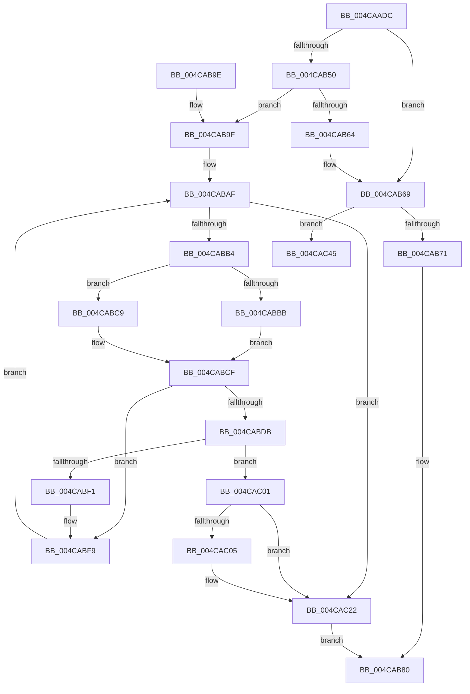

# MiTransferFileExtent

- RVA: `0x004CAADC`–`0x004CAC63` (길이 `391` bytes)
- VA: `0x00000001404CAADC`
- 실행 섹션: `.text`
- PDB 이름 있음: `예`; PDB Function 태그: `아니요`
- unwind 정보 RVA: `0x000BD5D0`
- 디코드: `112`개 명령, `391/391` bytes 표시
- 미해석 바이트: `0` (있으면 어셈블리에 `.byte`로 보존)

> 이 문서는 커널 이미지의 기계어와 PDB 기호를 분석해 생성했습니다. 4번과 5번은 함수 원형과 자료형을 바이너리 사용 방식에서 추정한 C 해석이며 원본 소스 복구 결과는 아닙니다.

## 1. Dependencies

- 직접 호출 지점: **5**; 고유 호출 대상: **4**
- 직접 호출자로 확인된 함수: **2**
- RIP 상대 이미지 참조: **0**

### Outgoing calls
- `0x004CAB45` → [MiInitializeCachedExtentWalker](MiInitializeCachedExtentWalker_function_004CAC6C.md) (function, `0x004CAC6C`)
- `0x004CABCF` → [MiCopyFilePage](../68/MiCopyFilePage_function_00680790.md) (function, `0x00680790`)
- `0x004CABE8` → [MiGetCachedExtentWalkerNextPage](../68/MiGetCachedExtentWalkerNextPage_function_00681234.md) (function, `0x00681234`)
- `0x004CAC1C` → [KeBugCheckEx](../4F/KeBugCheckEx_function_004FD660.md) (function, `0x004FD660`)
- `0x004CAC5D` → [KeBugCheckEx](../4F/KeBugCheckEx_function_004FD660.md) (function, `0x004FD660`)

### Direct callers
- [MiIssueHardFaultIo](../38/MiIssueHardFaultIo_function_003812EC.md) at `0x003814B5`
- [MiFlushFileOnlyMdl](../40/MiFlushFileOnlyMdl_function_00403208.md) at `0x0040324F`

### Static image references
- 디코드된 RIP-relative 메모리 참조가 없습니다.

## 2. Other-region calls and transfers

- 다른 실행 섹션으로 향하는 call: **0**
- 별도 외부 분기/꼬리 이동을 확인하지 못했습니다.

## 3. Assembly (complete function range)

```asm
004CAADC  4C 8B DC                        mov r11, rsp
004CAADF  49 89 5B 10                     mov qword ptr [r11 + 0x10], rbx
004CAAE3  49 89 6B 18                     mov qword ptr [r11 + 0x18], rbp
004CAAE7  49 89 73 20                     mov qword ptr [r11 + 0x20], rsi
004CAAEB  57                              push rdi
004CAAEC  41 54                           push r12
004CAAEE  41 55                           push r13
004CAAF0  41 56                           push r14
004CAAF2  41 57                           push r15
004CAAF4  48 83 EC 60                     sub rsp, 0x60
004CAAF8  44 8B 51 2C                     mov r10d, dword ptr [rcx + 0x2c]
004CAAFC  41 8B E9                        mov ebp, r9d
004CAAFF  44 03 51 20                     add r10d, dword ptr [rcx + 0x20]
004CAB03  33 C0                           xor eax, eax
004CAB05  44 8B 79 28                     mov r15d, dword ptr [rcx + 0x28]
004CAB09  41 81 E2 FF 0F 00 00            and r10d, 0xfff
004CAB10  49 81 C7 FF 0F 00 00            add r15, 0xfff
004CAB17  45 33 C9                        xor r9d, r9d
004CAB1A  4D 03 FA                        add r15, r10
004CAB1D  0F 57 C0                        xorps xmm0, xmm0
004CAB20  4C 8B F1                        mov r14, rcx
004CAB23  49 C1 EF 0C                     shr r15, 0xc
004CAB27  0F 11 44 24 30                  movups xmmword ptr [rsp + 0x30], xmm0
004CAB2C  85 ED                           test ebp, ebp
004CAB2E  49 8D 4B A8                     lea rcx, [r11 - 0x58]
004CAB32  0F 11 44 24 40                  movups xmmword ptr [rsp + 0x40], xmm0
004CAB37  41 0F 94 C1                     sete r9b
004CAB3B  49 89 43 C8                     mov qword ptr [r11 - 0x38], rax
004CAB3F  4D 8B E0                        mov r12, r8
004CAB42  4C 8B EA                        mov r13, rdx
004CAB45  E8 22 01 00 00                  call 0x1404cac6c
004CAB4A  8B C8                           mov ecx, eax
004CAB4C  85 C0                           test eax, eax
004CAB4E  78 19                           js 0x1404cab69
004CAB50  48 8B 7C 24 40                  mov rdi, qword ptr [rsp + 0x40]
004CAB55  48 B8 00 00 00 00 00 00 00 80   movabs rax, 0x8000000000000000
004CAB5F  48 3B F8                        cmp rdi, rax
004CAB62  75 3B                           jne 0x1404cab9f
004CAB64  B9 09 07 00 C0                  mov ecx, 0xc0000709
004CAB69  85 ED                           test ebp, ebp
004CAB6B  0F 85 D4 00 00 00               jne 0x1404cac45
004CAB71  48 8B 84 24 B0 00 00 00         mov rax, qword ptr [rsp + 0xb0]
004CAB79  48 83 60 08 00                  and qword ptr [rax + 8], 0
004CAB7E  89 08                           mov dword ptr [rax], ecx
004CAB80  4C 8D 5C 24 60                  lea r11, [rsp + 0x60]
004CAB85  49 8B 5B 38                     mov rbx, qword ptr [r11 + 0x38]
004CAB89  49 8B 6B 40                     mov rbp, qword ptr [r11 + 0x40]
004CAB8D  49 8B 73 48                     mov rsi, qword ptr [r11 + 0x48]
004CAB91  49 8B E3                        mov rsp, r11
004CAB94  41 5F                           pop r15
004CAB96  41 5E                           pop r14
004CAB98  41 5D                           pop r13
004CAB9A  41 5C                           pop r12
004CAB9C  5F                              pop rdi
004CAB9D  C3                              ret
004CAB9E  CC                              int3
004CAB9F  33 DB                           xor ebx, ebx
004CABA1  48 89 BC 24 90 00 00 00         mov qword ptr [rsp + 0x90], rdi
004CABA9  49 83 C6 30                     add r14, 0x30
004CABAD  33 F6                           xor esi, esi
004CABAF  41 3B F7                        cmp esi, r15d
004CABB2  73 6E                           jae 0x1404cac22
004CABB4  49 8B 0E                        mov rcx, qword ptr [r14]
004CABB7  85 ED                           test ebp, ebp
004CABB9  74 0E                           je 0x1404cabc9
004CABBB  48 8B D1                        mov rdx, rcx
004CABBE  41 B8 01 00 00 00               mov r8d, 1
004CABC4  48 8B CF                        mov rcx, rdi
004CABC7  EB 06                           jmp 0x1404cabcf
004CABC9  45 33 C0                        xor r8d, r8d
004CABCC  48 8B D7                        mov rdx, rdi
004CABCF  E8 BC 5B 1B 00                  call 0x140680790
004CABD4  FF C3                           inc ebx
004CABD6  41 3B DF                        cmp ebx, r15d
004CABD9  74 1E                           je 0x1404cabf9
004CABDB  48 8D 94 24 90 00 00 00         lea rdx, [rsp + 0x90]
004CABE3  48 8D 4C 24 30                  lea rcx, [rsp + 0x30]
004CABE8  E8 47 66 1B 00                  call 0x140681234
004CABED  85 C0                           test eax, eax
004CABEF  78 10                           js 0x1404cac01
004CABF1  48 8B BC 24 90 00 00 00         mov rdi, qword ptr [rsp + 0x90]
004CABF9  FF C6                           inc esi
004CABFB  49 83 C6 08                     add r14, 8
004CABFF  EB AE                           jmp 0x1404cabaf
004CAC01  85 ED                           test ebp, ebp
004CAC03  74 1D                           je 0x1404cac22
004CAC05  48 98                           cdqe
004CAC07  4D 8B CC                        mov r9, r12
004CAC0A  4D 8B C5                        mov r8, r13
004CAC0D  48 89 44 24 20                  mov qword ptr [rsp + 0x20], rax
004CAC12  BA 86 14 00 00                  mov edx, 0x1486
004CAC17  B9 1A 00 00 00                  mov ecx, 0x1a
004CAC1C  E8 3F 2A 03 00                  call 0x1404fd660
004CAC21  CC                              int3
004CAC22  48 8B 94 24 B0 00 00 00         mov rdx, qword ptr [rsp + 0xb0]
004CAC2A  8B CB                           mov ecx, ebx
004CAC2C  C1 E1 0C                        shl ecx, 0xc
004CAC2F  F7 DB                           neg ebx
004CAC31  1B C0                           sbb eax, eax
004CAC33  48 89 4A 08                     mov qword ptr [rdx + 8], rcx
004CAC37  F7 D0                           not eax
004CAC39  25 09 07 00 C0                  and eax, 0xc0000709
004CAC3E  89 02                           mov dword ptr [rdx], eax
004CAC40  E9 3B FF FF FF                  jmp 0x1404cab80
004CAC45  48 63 C1                        movsxd rax, ecx
004CAC48  4D 8B CC                        mov r9, r12
004CAC4B  B9 1A 00 00 00                  mov ecx, 0x1a
004CAC50  48 89 44 24 20                  mov qword ptr [rsp + 0x20], rax
004CAC55  4D 8B C5                        mov r8, r13
004CAC58  BA 86 14 00 00                  mov edx, 0x1486
004CAC5D  E8 FE 29 03 00                  call 0x1404fd660
004CAC62  CC                              int3
```

## 4. C-style interpretation (structured pseudocode)

```c
__int64 __fastcall MiTransferFileExtent(__int64 a1, __int64 a2, __int64 a3, int a4, __int64 a5)
{
    __int64 result;
    __int64 v_r10;
    __int64 v_r14;
    __int64 v_r15;
    __int64 v_rbx;
    __int64 v_rsi;
    __int64 v_rsp;
    unsigned __int64 v_stack_m28;
    unsigned __int64 v_stack_m30;
    unsigned __int64 v_stack_m40;
    unsigned __int64 v_stack_m48;
    unsigned __int64 v_stack_m58;
    unsigned __int64 v_stack_p30;

    *(unsigned __int64 *)(v_rsp + 16) = v_rbx;
    *(unsigned __int64 *)(v_rsp + 24) = v_rbp;
    *(unsigned __int64 *)(v_rsp + 32) = v_rsi;
    v_rsp = (v_rsp) - (96);
    v_r10 = (unsigned int)(((unsigned int)(*(unsigned int *)(a1 + 44))) + (*(unsigned int *)(a1 + 32)));
    result = 0;
    v_r10 = (unsigned int)((v_r10) & (0xFFFULL));
    v_r15 = ((unsigned int)(*(unsigned int *)(a1 + 40))) + (0xFFFULL);
    a4 = 0;
    v_r15 = (v_r15) + (v_r10);
    v_r15 = (v_r15) >> (12);
    v_stack_m58 = v_xmm0;
    v_stack_m48 = v_xmm0;
    a4 = ((unsigned int)((unsigned int)(a4)) == 0) ? 1 : 0;
    *(unsigned __int64 *)(v_rsp - 56) = 0;
    result = MiInitializeCachedExtentWalker(v_rsp - 88, a2, a3, a4);
    if (sign_flag) goto loc_004CAB69;
    if (v_stack_m48 != result) goto loc_004CAB9F;
loc_004CAB69:
    if ((unsigned int)((unsigned int)(a4)) != 0) goto loc_004CAC45;
    *(unsigned int *)(a5) = (unsigned int)((unsigned int)(0xC0000709ULL));
loc_004CAB80:
    return a5;
loc_004CAB9F:
    v_rbx = 0;
    v_stack_p30 = v_stack_m48;
    v_r14 = (a1) + (48);
    v_rsi = 0;
loc_004CABAF:
    if (0 >= ((unsigned int)(v_r15))) goto loc_004CAC22;
    if ((unsigned int)(*(unsigned __int64 *)(v_stack_m28 + 64)) == 0) goto loc_004CABC9;
    goto loc_004CABCF;
loc_004CABC9:
    a3 = 0;
loc_004CABCF:
    result = MiCopyFilePage(v_stack_m48, v_stack_m48, a3, a4);
    v_rbx = (unsigned int)((v_rbx) + 1);
    if (((unsigned int)(v_rbx)) == ((unsigned int)(v_r15))) goto loc_004CABF9;
    result = MiGetCachedExtentWalkerNextPage(v_stack_m30, v_stack_p30, a3, a4);
    if (sign_flag) goto loc_004CAC01;
loc_004CABF9:
    v_rsi = (unsigned int)((v_rsi) + 1);
    v_r14 = (v_r14) + (8);
    goto loc_004CABAF;
loc_004CAC01:
    if ((unsigned int)(*(unsigned __int64 *)(v_stack_m28 + 64)) != 0) {
        a4 = 0;
        a3 = a2;
        v_stack_m40 = result;
        a2 = 0x1486ULL;
        a1 = 26;
        result = KeBugCheckEx(a1, a2, a3, a4);
    }
    a1 = (unsigned int)(((unsigned int)((unsigned int)(v_rbx))) << (12));
    v_rbx = (unsigned int)(-(v_rbx));
    *(unsigned __int64 *)(a5 + 8) = a1;
    result = (unsigned int)(~(result));
    result = (unsigned int)((result) & (0xC0000709ULL));
    *(unsigned int *)(a5) = (unsigned int)(result);
    goto loc_004CAB80;
loc_004CAC45:
    v_stack_m40 = (int)((unsigned int)(a1));
    result = KeBugCheckEx(26, (unsigned int)(0x1486ULL), a2, a3);
    return result;
}
```

## 5. (Beta) C Style

```c
void *MiTransferFileExtent(void *Arg1, int64_t Arg2, int64_t Arg3, int32_t Arg4, void *Arg5)
{
    uint8_t *arg1 = (uint8_t *)Arg1;
    uint8_t *arg5 = (uint8_t *)Arg5;

    int64_t result;
    int64_t local_r10;
    int64_t local_r14;
    int64_t local_r15;
    int64_t local_rbx;
    int64_t local_rsi;
    int64_t local_rsp;
    uint64_t v_stack_m28;
    uint64_t v_stack_m30;
    uint64_t v_stack_m40;
    uint64_t v_stack_m48;
    uint64_t v_stack_m58;
    uint64_t v_stack_p30;

    *(uint64_t *)(local_rsp + 0x10) = local_rbx;
    *(uint64_t *)(local_rsp + 0x18) = local_rbp;
    *(uint64_t *)(local_rsp + 0x20) = local_rsi;
    local_rsp = (local_rsp) - (96);
    local_r10 = (uint32_t)(((uint32_t)(*(uint32_t *)(arg1 + 0x2C))) + (*(uint32_t *)(arg1 + 0x20)));
    result = 0;
    local_r10 = (uint32_t)((local_r10) & (0xFFFULL));
    local_r15 = ((uint32_t)(*(uint32_t *)(arg1 + 0x28))) + (0xFFFULL);
    Arg4 = 0;
    local_r15 = (local_r15) + (local_r10);
    local_r15 = (local_r15) >> (12);
    v_stack_m58 = v_xmm0;
    v_stack_m48 = v_xmm0;
    Arg4 = ((uint32_t)((uint32_t)(Arg4)) == 0) ? 1 : 0;
    *(uint64_t *)(local_rsp - 0x38) = 0;
    result = MiInitializeCachedExtentWalker(local_rsp - 88, Arg2, Arg3, Arg4);
    if (sign_flag) goto loc_004CAB69;
    if (v_stack_m48 != result) goto loc_004CAB9F;
loc_004CAB69:
    if ((uint32_t)((uint32_t)(Arg4)) != 0) goto loc_004CAC45;
    *(uint32_t *)(arg5) = (uint32_t)((uint32_t)(0xC0000709ULL));
loc_004CAB80:
    return Arg5;
loc_004CAB9F:
    local_rbx = 0;
    v_stack_p30 = v_stack_m48;
    local_r14 = (Arg1) + (48);
    local_rsi = 0;
loc_004CABAF:
    if (0 >= ((uint32_t)(local_r15))) goto loc_004CAC22;
    if ((uint32_t)(*(uint64_t *)(v_stack_m28 + 0x40)) == 0) goto loc_004CABC9;
    goto loc_004CABCF;
loc_004CABC9:
    Arg3 = 0;
loc_004CABCF:
    result = MiCopyFilePage(v_stack_m48, v_stack_m48, Arg3, Arg4);
    local_rbx = (uint32_t)((local_rbx) + 1);
    if (((uint32_t)(local_rbx)) == ((uint32_t)(local_r15))) goto loc_004CABF9;
    result = MiGetCachedExtentWalkerNextPage(v_stack_m30, v_stack_p30, Arg3, Arg4);
    if (sign_flag) goto loc_004CAC01;
loc_004CABF9:
    local_rsi = (uint32_t)((local_rsi) + 1);
    local_r14 = (local_r14) + (8);
    goto loc_004CABAF;
loc_004CAC01:
    if ((uint32_t)(*(uint64_t *)(v_stack_m28 + 0x40)) != 0) {
        Arg4 = 0;
        Arg3 = Arg2;
        v_stack_m40 = result;
        Arg2 = 0x1486ULL;
        Arg1 = 26;
        result = KeBugCheckEx(Arg1, Arg2, Arg3, Arg4);
    }
    Arg1 = (uint32_t)(((uint32_t)((uint32_t)(local_rbx))) << (12));
    local_rbx = (uint32_t)(-(local_rbx));
    *(void **)(arg5 + 0x8) = Arg1;
    result = (uint32_t)(~(result));
    result = (uint32_t)((result) & (0xC0000709ULL));
    *(uint32_t *)(arg5) = (uint32_t)(result);
    goto loc_004CAB80;
loc_004CAC45:
    v_stack_m40 = (int32_t)((uint32_t)(Arg1));
    result = KeBugCheckEx(26, (uint32_t)(0x1486ULL), Arg2, Arg3);
    return result;
}
```

### 관측된 메모리 오프셋

구조체 형식이 확인되지 않은 접근은 인자 기준의 오프셋으로만 기록했습니다.

| 기준 인자 | 오프셋 표현 | 폭 (bit) | 접근 |
|---|---:|---:|---|
| `Arg1` | `+ 0x0` | `64` | `R` |
| `Arg1` | `+ 0x20` | `32` | `R` |
| `Arg1` | `+ 0x28` | `32` | `R` |
| `Arg1` | `+ 0x2C` | `32` | `R` |
| `Arg5` | `+ 0x0` | `32` | `W` |
| `Arg5` | `+ 0x8` | `64` | `R/W` |
| `Arg5` | `+ 0x8` | `64` | `W` |

## 6. Execution-region graph

[열기: 2D/3D 그래프와 함수 탐색 컨트롤 패널](../../../control-panel.html?section=text&rva=0x004CAADC&view=graph)

- 2D 그래프는 위에서 아래로 흐르고, 3D 그래프는 빈 공간을 드래그해 회전합니다. Shift+드래그는 이동, 휠은 확대·축소, 함수 노드 선택은 대상 보고서 이동입니다.

### Static fallback


