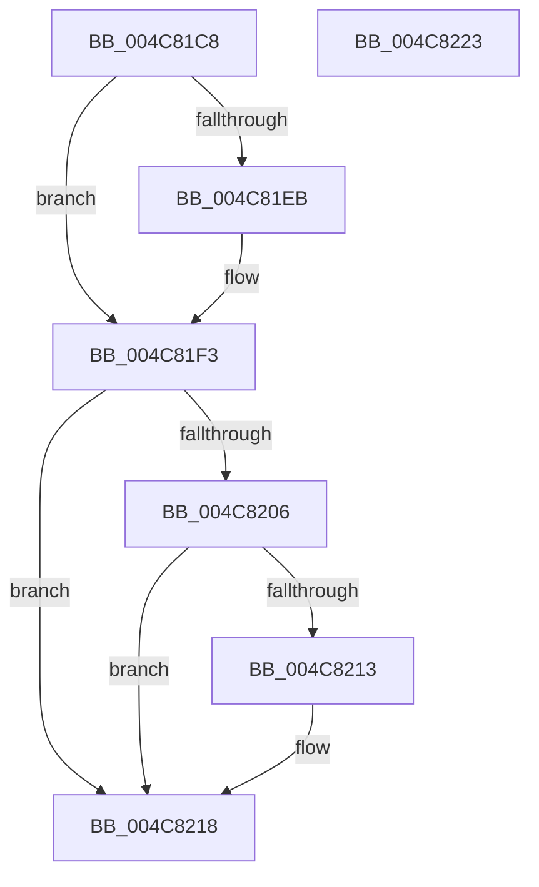

# MiUnlockSystemCacheInit

- RVA: `0x004C81C8`–`0x004C8224` (길이 `92` bytes)
- VA: `0x00000001404C81C8`
- 실행 섹션: `.text`
- PDB 이름 있음: `예`; PDB Function 태그: `아니요`
- unwind 정보 RVA: `0x0005CAAC`
- 디코드: `27`개 명령, `92/92` bytes 표시
- 미해석 바이트: `0` (있으면 어셈블리에 `.byte`로 보존)

> 이 문서는 커널 이미지의 기계어와 PDB 기호를 분석해 생성했습니다. 4번과 5번은 함수 원형과 자료형을 바이너리 사용 방식에서 추정한 C 해석이며 원본 소스 복구 결과는 아닙니다.

## 1. Dependencies

- 직접 호출 지점: **3**; 고유 호출 대상: **3**
- 직접 호출자로 확인된 함수: **1**
- RIP 상대 이미지 참조: **0**

### Outgoing calls
- `0x004C81EE` → [ExfTryToWakePushLock](../26/ExfTryToWakePushLock_function_00265DD0.md) (function, `0x00265DD0`)
- `0x004C81F6` → [KeAbPostRelease](../2E/KeAbPostRelease_function_002E1600.md) (function, `0x002E1600`)
- `0x004C8213` → [KiCheckForKernelApcDelivery](../2E/KiCheckForKernelApcDelivery_function_002E2C80.md) (function, `0x002E2C80`)

### Direct callers
- [MiLateInitializeSystemCache](MiLateInitializeSystemCache_function_004C8104.md) at `0x004C81A5`

### Static image references
- 디코드된 RIP-relative 메모리 참조가 없습니다.

## 2. Other-region calls and transfers

- 다른 실행 섹션으로 향하는 call: **0**
- 별도 외부 분기/꼬리 이동을 확인하지 못했습니다.

## 3. Assembly (complete function range)

```asm
004C81C8  48 89 5C 24 08                  mov qword ptr [rsp + 8], rbx
004C81CD  57                              push rdi
004C81CE  48 83 EC 20                     sub rsp, 0x20
004C81D2  48 8B FA                        mov rdi, rdx
004C81D5  48 8D 99 70 09 00 00            lea rbx, [rcx + 0x970]
004C81DC  48 83 C8 FF                     or rax, 0xffffffffffffffff
004C81E0  F0 48 0F C1 03                  lock xadd qword ptr [rbx], rax
004C81E5  24 06                           and al, 6
004C81E7  3C 02                           cmp al, 2
004C81E9  75 08                           jne 0x1404c81f3
004C81EB  48 8B CB                        mov rcx, rbx
004C81EE  E8 DD DB D9 FF                  call 0x140265dd0
004C81F3  48 8B CB                        mov rcx, rbx
004C81F6  E8 05 94 E1 FF                  call 0x1402e1600
004C81FB  90                              nop
004C81FC  66 83 87 E6 01 00 00 01         add word ptr [rdi + 0x1e6], 1
004C8204  75 12                           jne 0x1404c8218
004C8206  48 8D 87 98 00 00 00            lea rax, [rdi + 0x98]
004C820D  90                              nop
004C820E  48 39 00                        cmp qword ptr [rax], rax
004C8211  74 05                           je 0x1404c8218
004C8213  E8 68 AA E1 FF                  call 0x1402e2c80
004C8218  48 8B 5C 24 30                  mov rbx, qword ptr [rsp + 0x30]
004C821D  48 83 C4 20                     add rsp, 0x20
004C8221  5F                              pop rdi
004C8222  C3                              ret
004C8223  CC                              int3
```

## 4. C-style interpretation (structured pseudocode)

```c
__int64 __fastcall MiUnlockSystemCacheInit(__int64 a1, __int64 a2)
{
    __int64 result;
    __int64 v_rsp;
    unsigned __int64 v_stack_p8;

    v_stack_p8 = v_rbx;
    v_rsp = (v_rsp) - (32);
    result = (result) | (-1);
    result = (unsigned __int8)((result) & (6));
    if (((unsigned __int8)(result)) == 2) {
        a1 = a1 + 2416;
        result = ExfTryToWakePushLock(a1, a2, a3, a4);
    }
    result = KeAbPostRelease(a1 + 2416, a2, a3, a4);
    if (((unsigned __int8)(result)) != 2) goto loc_004C8218;
    result = a2 + 152;
    if ((*(unsigned __int64 *)(a2 + 152)) != (a2 + 152)) {
        result = KiCheckForKernelApcDelivery(a1 + 2416, a2, a3, a4);
    }
    v_rsp = (v_rsp) + (32);
    return result;
}
```

## 5. (Beta) C Style

```c
int64_t MiUnlockSystemCacheInit(void *Arg1, void *Arg2)
{
    uint8_t *arg1 = (uint8_t *)Arg1;
    uint8_t *arg2 = (uint8_t *)Arg2;

    int64_t result;
    int64_t local_rsp;
    uint64_t v_stack_p8;

    v_stack_p8 = local_rbx;
    local_rsp = (local_rsp) - (32);
    result = (result) | (-1);
    result = (uint8_t)((result) & (6));
    if (((uint8_t)(result)) == 2) {
        Arg1 = Arg1 + 2416;
        result = ExfTryToWakePushLock(Arg1, Arg2, a3, a4);
    }
    result = KeAbPostRelease(Arg1 + 2416, Arg2, a3, a4);
    if (((uint8_t)(result)) != 2) goto loc_004C8218;
    result = Arg2 + 152;
    if ((*(uint64_t *)(arg2 + 0x98)) != (Arg2 + 152)) {
        result = KiCheckForKernelApcDelivery(Arg1 + 2416, Arg2, a3, a4);
    }
    local_rsp = (local_rsp) + (32);
    return result;
}
```

### 관측된 메모리 오프셋

구조체 형식이 확인되지 않은 접근은 인자 기준의 오프셋으로만 기록했습니다.

| 기준 인자 | 오프셋 표현 | 폭 (bit) | 접근 |
|---|---:|---:|---|
| `Arg1` | `+ 0x0` | `64` | `R/W` |
| `Arg1` | `+ 0x970` | `64` | `R` |
| `Arg2` | `+ 0x0` | `64` | `R` |
| `Arg2` | `+ 0x98` | `64` | `R` |
| `Arg2` | `+ 0x1E6` | `16` | `R/W` |

## 6. Execution-region graph

[열기: 2D/3D 그래프와 함수 탐색 컨트롤 패널](../../../control-panel.html?section=text&rva=0x004C81C8&view=graph)

- 2D 그래프는 위에서 아래로 흐르고, 3D 그래프는 빈 공간을 드래그해 회전합니다. Shift+드래그는 이동, 휠은 확대·축소, 함수 노드 선택은 대상 보고서 이동입니다.

### Static fallback


