# MiUpdatePrivateDemandZeroView

- RVA: `0x004CCC2C`–`0x004CCF88` (길이 `860` bytes)
- VA: `0x00000001404CCC2C`
- 실행 섹션: `.text`
- PDB 이름 있음: `예`; PDB Function 태그: `아니요`
- unwind 정보 RVA: `0x000BD64C`
- 디코드: `237`개 명령, `860/860` bytes 표시
- 미해석 바이트: `0` (있으면 어셈블리에 `.byte`로 보존)

> 이 문서는 커널 이미지의 기계어와 PDB 기호를 분석해 생성했습니다. 4번과 5번은 함수 원형과 자료형을 바이너리 사용 방식에서 추정한 C 해석이며 원본 소스 복구 결과는 아닙니다.

## 1. Dependencies

- 직접 호출 지점: **13**; 고유 호출 대상: **9**
- 직접 호출자로 확인된 함수: **2**
- RIP 상대 이미지 참조: **0**

### Outgoing calls
- `0x004CCC88` → [MiGetProtoPteAddress](../32/MiGetProtoPteAddress_function_0032E970.md) (function, `0x0032E970`)
- `0x004CCE05` → [MiMakeDemandZeroPte](../33/MiMakeDemandZeroPte_function_00337A00.md) (function, `0x00337A00`)
- `0x004CCE19` → [MiLockWorkingSetShared](../27/MiLockWorkingSetShared_function_0027CBF0.md) (function, `0x0027CBF0`)
- `0x004CCE52` → [MiIncreaseUsedPtes](../24/MiIncreaseUsedPtes_function_00243630.md) (function, `0x00243630`)
- `0x004CCE5F` → [MiUnlockPageTable](../21/MiUnlockPageTable_function_00216EC0.md) (function, `0x00216EC0`)
- `0x004CCE69` → [MiWorkingSetIsContended](../2A/MiWorkingSetIsContended_function_002AE520.md) (function, `0x002AE520`)
- `0x004CCE72` → [KeShouldYieldProcessor](../27/KeShouldYieldProcessor_function_002773E0.md) (function, `0x002773E0`)
- `0x004CCE81` → [MiUnlockWorkingSetShared](../27/MiUnlockWorkingSetShared_function_0027D690.md) (function, `0x0027D690`)
- `0x004CCE89` → [MiLockWorkingSetShared](../27/MiLockWorkingSetShared_function_0027CBF0.md) (function, `0x0027CBF0`)
- `0x004CCEA0` → [MiMakeSystemAddressValid](../27/MiMakeSystemAddressValid_function_0027FF70.md) (function, `0x0027FF70`)
- `0x004CCEFF` → [MiIncreaseUsedPtes](../24/MiIncreaseUsedPtes_function_00243630.md) (function, `0x00243630`)
- `0x004CCF0F` → [MiUnlockPageTable](../21/MiUnlockPageTable_function_00216EC0.md) (function, `0x00216EC0`)
- `0x004CCF25` → [MiUnlockWorkingSetShared](../27/MiUnlockWorkingSetShared_function_0027D690.md) (function, `0x0027D690`)

### Direct callers
- [MiMapViewOfImageSection](../../page/97/MiMapViewOfImageSection_function_0097E92C.md) at `0x0097F8F7`
- [sub_00B2A146](../../page/B2/Unknown_function_00B2A146.md) at `0x00B2A301`

### Static image references
- 디코드된 RIP-relative 메모리 참조가 없습니다.

## 2. Other-region calls and transfers

- 다른 실행 섹션으로 향하는 call: **0**
- 별도 외부 분기/꼬리 이동을 확인하지 못했습니다.

## 3. Assembly (complete function range)

```asm
004CCC2C  4C 8B DC                        mov r11, rsp
004CCC2F  45 89 43 18                     mov dword ptr [r11 + 0x18], r8d
004CCC33  49 89 53 10                     mov qword ptr [r11 + 0x10], rdx
004CCC37  53                              push rbx
004CCC38  55                              push rbp
004CCC39  56                              push rsi
004CCC3A  57                              push rdi
004CCC3B  41 54                           push r12
004CCC3D  41 55                           push r13
004CCC3F  41 56                           push r14
004CCC41  41 57                           push r15
004CCC43  48 83 EC 58                     sub rsp, 0x58
004CCC47  8B 42 18                        mov eax, dword ptr [rdx + 0x18]
004CCC4A  48 8D 99 00 04 00 00            lea rbx, [rcx + 0x400]
004CCC51  0F B6 7A 20                     movzx edi, byte ptr [rdx + 0x20]
004CCC55  4D 8D 4B 20                     lea r9, [r11 + 0x20]
004CCC59  49 83 63 20 00                  and qword ptr [r11 + 0x20], 0
004CCC5E  48 8B EA                        mov rbp, rdx
004CCC61  48 89 5C 24 28                  mov qword ptr [rsp + 0x28], rbx
004CCC66  45 33 ED                        xor r13d, r13d
004CCC69  0F B6 5A 21                     movzx ebx, byte ptr [rdx + 0x21]
004CCC6D  48 8B CD                        mov rcx, rbp
004CCC70  48 C1 E7 20                     shl rdi, 0x20
004CCC74  48 0B F8                        or rdi, rax
004CCC77  48 C1 E3 20                     shl rbx, 0x20
004CCC7B  8B 42 1C                        mov eax, dword ptr [rdx + 0x1c]
004CCC7E  45 8D 45 06                     lea r8d, [r13 + 6]
004CCC82  48 8B D7                        mov rdx, rdi
004CCC85  48 0B D8                        or rbx, rax
004CCC88  E8 E3 1C E6 FF                  call 0x14032e970
004CCC8D  48 8B F0                        mov rsi, rax
004CCC90  48 89 44 24 20                  mov qword ptr [rsp + 0x20], rax
004CCC95  48 8B 45 50                     mov rax, qword ptr [rbp + 0x50]
004CCC99  48 2B DF                        sub rbx, rdi
004CCC9C  4C 8D 14 D8                     lea r10, [rax + rbx*8]
004CCCA0  48 B8 FF FF FF FF 0F 00 00 00   movabs rax, 0xfffffffff
004CCCAA  48 23 F8                        and rdi, rax
004CCCAD  4C 89 54 24 40                  mov qword ptr [rsp + 0x40], r10
004CCCB2  48 B8 00 00 00 00 80 F6 FF FF   movabs rax, 0xfffff68000000000
004CCCBC  48 8B C0                        mov rax, rax
004CCCBF  4C 8B 84 24 B8 00 00 00         mov r8, qword ptr [rsp + 0xb8]
004CCCC7  4C 8D 24 F8                     lea r12, [rax + rdi*8]
004CCCCB  E9 9A 02 00 00                  jmp 0x1404ccf6a
004CCCD0  49 8B 40 08                     mov rax, qword ptr [r8 + 8]
004CCCD4  4D 8B F2                        mov r14, r10
004CCCD7  41 8B 50 2C                     mov edx, dword ptr [r8 + 0x2c]
004CCCDB  4D 8B CD                        mov r9, r13
004CCCDE  48 FF CA                        dec rdx
004CCCE1  48 8D 14 D0                     lea rdx, [rax + rdx*8]
004CCCE5  41 8B 40 20                     mov eax, dword ptr [r8 + 0x20]
004CCCE9  49 3B D2                        cmp rdx, r10
004CCCEC  4C 0F 46 F2                     cmovbe r14, rdx
004CCCF0  4C 89 74 24 30                  mov qword ptr [rsp + 0x30], r14
004CCCF5  0F BA E0 11                     bt eax, 0x11
004CCCF9  0F 82 36 02 00 00               jb 0x1404ccf35
004CCCFF  48 8B 84 24 B8 00 00 00         mov rax, qword ptr [rsp + 0xb8]
004CCD07  8B 50 20                        mov edx, dword ptr [rax + 0x20]
004CCD0A  D1 EA                           shr edx, 1
004CCD0C  83 E2 1F                        and edx, 0x1f
004CCD0F  8B C2                           mov eax, edx
004CCD11  83 E0 05                        and eax, 5
004CCD14  3C 05                           cmp al, 5
004CCD16  0F 95 C1                        setne cl
004CCD19  F6 C2 04                        test dl, 4
004CCD1C  0F 95 C0                        setne al
004CCD1F  84 C8                           test al, cl
004CCD21  0F 85 0E 02 00 00               jne 0x1404ccf35
004CCD27  48 8B 94 24 B8 00 00 00         mov rdx, qword ptr [rsp + 0xb8]
004CCD2F  8B 42 28                        mov eax, dword ptr [rdx + 0x28]
004CCD32  85 C0                           test eax, eax
004CCD34  75 06                           jne 0x1404ccd3c
004CCD36  48 8B 4A 08                     mov rcx, qword ptr [rdx + 8]
004CCD3A  EB 16                           jmp 0x1404ccd52
004CCD3C  C1 E0 09                        shl eax, 9
004CCD3F  8D 48 FF                        lea ecx, [rax - 1]
004CCD42  48 8B 42 08                     mov rax, qword ptr [rdx + 8]
004CCD46  48 C1 E9 0C                     shr rcx, 0xc
004CCD4A  48 83 C0 08                     add rax, 8
004CCD4E  48 8D 0C C8                     lea rcx, [rax + rcx*8]
004CCD52  49 3B CE                        cmp rcx, r14
004CCD55  0F 87 E2 01 00 00               ja 0x1404ccf3d
004CCD5B  48 3B F1                        cmp rsi, rcx
004CCD5E  73 16                           jae 0x1404ccd76
004CCD60  48 8B C1                        mov rax, rcx
004CCD63  48 89 4C 24 20                  mov qword ptr [rsp + 0x20], rcx
004CCD68  48 2B C6                        sub rax, rsi
004CCD6B  48 8B F1                        mov rsi, rcx
004CCD6E  48 C1 F8 03                     sar rax, 3
004CCD72  4D 8D 24 C4                     lea r12, [r12 + rax*8]
004CCD76  49 3B F2                        cmp rsi, r10
004CCD79  0F 87 F4 01 00 00               ja 0x1404ccf73
004CCD7F  45 33 FF                        xor r15d, r15d
004CCD82  49 3B F6                        cmp rsi, r14
004CCD85  77 37                           ja 0x1404ccdbe
004CCD87  48 8B 06                        mov rax, qword ptr [rsi]
004CCD8A  A8 01                           test al, 1
004CCD8C  74 07                           je 0x1404ccd95
004CCD8E  8B 42 20                        mov eax, dword ptr [rdx + 0x20]
004CCD91  D1 E8                           shr eax, 1
004CCD93  EB 09                           jmp 0x1404ccd9e
004CCD95  48 85 C0                        test rax, rax
004CCD98  74 17                           je 0x1404ccdb1
004CCD9A  48 C1 E8 05                     shr rax, 5
004CCD9E  83 E0 1F                        and eax, 0x1f
004CCDA1  3C 18                           cmp al, 0x18
004CCDA3  74 0C                           je 0x1404ccdb1
004CCDA5  41 FF C7                        inc r15d
004CCDA8  48 83 C6 08                     add rsi, 8
004CCDAC  49 3B F6                        cmp rsi, r14
004CCDAF  76 D6                           jbe 0x1404ccd87
004CCDB1  48 8B 94 24 B8 00 00 00         mov rdx, qword ptr [rsp + 0xb8]
004CCDB9  48 89 74 24 20                  mov qword ptr [rsp + 0x20], rsi
004CCDBE  8B 42 20                        mov eax, dword ptr [rdx + 0x20]
004CCDC1  4D 03 EF                        add r13, r15
004CCDC4  83 E0 0A                        and eax, 0xa
004CCDC7  3C 0A                           cmp al, 0xa
004CCDC9  4D 0F 44 E9                     cmove r13, r9
004CCDCD  83 BC 24 B0 00 00 00 00         cmp dword ptr [rsp + 0xb0], 0
004CCDD5  4C 89 6C 24 38                  mov qword ptr [rsp + 0x38], r13
004CCDDA  0F 84 51 01 00 00               je 0x1404ccf31
004CCDE0  45 85 FF                        test r15d, r15d
004CCDE3  0F 84 48 01 00 00               je 0x1404ccf31
004CCDE9  48 8B 84 24 B8 00 00 00         mov rax, qword ptr [rsp + 0xb8]
004CCDF1  8B 40 20                        mov eax, dword ptr [rax + 0x20]
004CCDF4  D1 E8                           shr eax, 1
004CCDF6  8B C8                           mov ecx, eax
004CCDF8  83 E1 1F                        and ecx, 0x1f
004CCDFB  A8 04                           test al, 4
004CCDFD  74 06                           je 0x1404cce05
004CCDFF  83 E1 02                        and ecx, 2
004CCE02  83 C9 04                        or ecx, 4
004CCE05  E8 F6 AB E6 FF                  call 0x140337a00
004CCE0A  4C 8B 74 24 28                  mov r14, qword ptr [rsp + 0x28]
004CCE0F  33 FF                           xor edi, edi
004CCE11  49 8B CE                        mov rcx, r14
004CCE14  33 ED                           xor ebp, ebp
004CCE16  48 8B D8                        mov rbx, rax
004CCE19  E8 D2 FD DA FF                  call 0x14027cbf0
004CCE1E  48 8B B4 24 A8 00 00 00         mov rsi, qword ptr [rsp + 0xa8]
004CCE26  44 8A E8                        mov r13b, al
004CCE29  88 84 24 A0 00 00 00            mov byte ptr [rsp + 0xa0], al
004CCE30  48 85 FF                        test rdi, rdi
004CCE33  74 2F                           je 0x1404cce64
004CCE35  49 F7 C4 FF 0F 00 00            test r12, 0xfff
004CCE3C  0F 85 87 00 00 00               jne 0x1404ccec9
004CCE42  85 ED                           test ebp, ebp
004CCE44  74 13                           je 0x1404cce59
004CCE46  41 B9 02 00 00 00               mov r9d, 2
004CCE4C  44 8B C5                        mov r8d, ebp
004CCE4F  48 8B D7                        mov rdx, rdi
004CCE52  E8 D9 67 D7 FF                  call 0x140243630
004CCE57  33 ED                           xor ebp, ebp
004CCE59  48 8B D7                        mov rdx, rdi
004CCE5C  49 8B CE                        mov rcx, r14
004CCE5F  E8 5C A0 D4 FF                  call 0x140216ec0
004CCE64  33 D2                           xor edx, edx
004CCE66  49 8B CE                        mov rcx, r14
004CCE69  E8 B2 16 DE FF                  call 0x1402ae520
004CCE6E  85 C0                           test eax, eax
004CCE70  75 09                           jne 0x1404cce7b
004CCE72  E8 69 A5 DA FF                  call 0x1402773e0
004CCE77  85 C0                           test eax, eax
004CCE79  74 13                           je 0x1404cce8e
004CCE7B  41 8A D5                        mov dl, r13b
004CCE7E  49 8B CE                        mov rcx, r14
004CCE81  E8 0A 08 DB FF                  call 0x14027d690
004CCE86  49 8B CE                        mov rcx, r14
004CCE89  E8 62 FD DA FF                  call 0x14027cbf0
004CCE8E  8B 56 30                        mov edx, dword ptr [rsi + 0x30]
004CCE91  45 33 C9                        xor r9d, r9d
004CCE94  C1 EA 0C                        shr edx, 0xc
004CCE97  45 8A C5                        mov r8b, r13b
004CCE9A  83 E2 7F                        and edx, 0x7f
004CCE9D  49 8B CC                        mov rcx, r12
004CCEA0  E8 CB 30 DB FF                  call 0x14027ff70
004CCEA5  48 B8 F8 FF FF FF 7F 00 00 00   movabs rax, 0x7ffffffff8
004CCEAF  49 8B FC                        mov rdi, r12
004CCEB2  48 C1 EF 09                     shr rdi, 9
004CCEB6  48 23 F8                        and rdi, rax
004CCEB9  48 B8 00 00 00 00 80 F6 FF FF   movabs rax, 0xfffff68000000000
004CCEC3  48 8B C0                        mov rax, rax
004CCEC6  48 03 F8                        add rdi, rax
004CCEC9  49 89 1C 24                     mov qword ptr [r12], rbx
004CCECD  FF C5                           inc ebp
004CCECF  49 83 C4 08                     add r12, 8
004CCED3  41 83 C7 FF                     add r15d, -1
004CCED7  0F 85 53 FF FF FF               jne 0x1404cce30
004CCEDD  48 8B 74 24 20                  mov rsi, qword ptr [rsp + 0x20]
004CCEE2  4C 8B 74 24 30                  mov r14, qword ptr [rsp + 0x30]
004CCEE7  4C 8B 6C 24 38                  mov r13, qword ptr [rsp + 0x38]
004CCEEC  48 85 FF                        test rdi, rdi
004CCEEF  74 25                           je 0x1404ccf16
004CCEF1  85 ED                           test ebp, ebp
004CCEF3  74 0F                           je 0x1404ccf04
004CCEF5  45 8D 4F 02                     lea r9d, [r15 + 2]
004CCEF9  44 8B C5                        mov r8d, ebp
004CCEFC  48 8B D7                        mov rdx, rdi
004CCEFF  E8 2C 67 D7 FF                  call 0x140243630
004CCF04  48 8B 5C 24 28                  mov rbx, qword ptr [rsp + 0x28]
004CCF09  48 8B D7                        mov rdx, rdi
004CCF0C  48 8B CB                        mov rcx, rbx
004CCF0F  E8 AC 9F D4 FF                  call 0x140216ec0
004CCF14  EB 05                           jmp 0x1404ccf1b
004CCF16  48 8B 5C 24 28                  mov rbx, qword ptr [rsp + 0x28]
004CCF1B  8A 94 24 A0 00 00 00            mov dl, byte ptr [rsp + 0xa0]
004CCF22  48 8B CB                        mov rcx, rbx
004CCF25  E8 66 07 DB FF                  call 0x14027d690
004CCF2A  4C 8B 54 24 40                  mov r10, qword ptr [rsp + 0x40]
004CCF2F  EB 04                           jmp 0x1404ccf35
004CCF31  4F 8D 24 FC                     lea r12, [r12 + r15*8]
004CCF35  48 8B 94 24 B8 00 00 00         mov rdx, qword ptr [rsp + 0xb8]
004CCF3D  4C 2B F6                        sub r14, rsi
004CCF40  49 8D 4E 08                     lea rcx, [r14 + 8]
004CCF44  48 C1 F9 03                     sar rcx, 3
004CCF48  8B C9                           mov ecx, ecx
004CCF4A  48 C1 E1 03                     shl rcx, 3
004CCF4E  48 03 F1                        add rsi, rcx
004CCF51  4C 03 E1                        add r12, rcx
004CCF54  48 89 74 24 20                  mov qword ptr [rsp + 0x20], rsi
004CCF59  49 3B F2                        cmp rsi, r10
004CCF5C  77 15                           ja 0x1404ccf73
004CCF5E  4C 8B 42 10                     mov r8, qword ptr [rdx + 0x10]
004CCF62  4C 89 84 24 B8 00 00 00         mov qword ptr [rsp + 0xb8], r8
004CCF6A  4D 85 C0                        test r8, r8
004CCF6D  0F 85 5D FD FF FF               jne 0x1404cccd0
004CCF73  49 8B C5                        mov rax, r13
004CCF76  48 83 C4 58                     add rsp, 0x58
004CCF7A  41 5F                           pop r15
004CCF7C  41 5E                           pop r14
004CCF7E  41 5D                           pop r13
004CCF80  41 5C                           pop r12
004CCF82  5F                              pop rdi
004CCF83  5E                              pop rsi
004CCF84  5D                              pop rbp
004CCF85  5B                              pop rbx
004CCF86  C3                              ret
004CCF87  CC                              int3
```

## 4. C-style interpretation (structured pseudocode)

```c
__int64 __fastcall MiUpdatePrivateDemandZeroView(__int64 a1, __int64 a2, int a3)
{
    __int64 result;
    __int64 v_r12;
    __int64 v_r13;
    __int64 v_r14;
    __int64 v_r15;
    __int64 v_rbp;
    __int64 v_rbx;
    __int64 v_rdi;
    __int64 v_rsi;
    __int64 v_rsp;
    unsigned __int64 v_stack_m58;
    unsigned __int64 v_stack_m60;
    unsigned __int64 v_stack_m68;
    unsigned __int64 v_stack_m70;
    unsigned __int64 v_stack_m78;
    unsigned __int64 v_stack_p10;
    unsigned int v_stack_p18;
    unsigned __int64 v_stack_p20;
    unsigned __int8 v_stack_p8;

    *(unsigned int *)(v_rsp + 24) = a3;
    *(unsigned __int64 *)(v_rsp + 16) = a2;
    v_rsp = (v_rsp) - (88);
    v_stack_m70 = a1 + 1024;
    v_r13 = 0;
    v_rdi = (*(unsigned __int8 *)(a2 + 32)) << (32);
    v_rdi = (v_rdi) | ((unsigned int)(*(unsigned int *)(a2 + 24)));
    v_rbx = (*(unsigned __int8 *)(a2 + 33)) << (32);
    v_rbx = (v_rbx) | ((unsigned int)(*(unsigned int *)(a2 + 28)));
    result = MiGetProtoPteAddress(a2, v_rdi, v_r13 + 6, v_rsp + 32);
    v_stack_m78 = result;
    v_rbx = (v_rbx) - (v_rdi);
    v_rdi = (v_rdi) & (*(unsigned __int64 *)(a2 + 80));
    v_stack_m58 = *(unsigned __int64 *)(a2 + 80) + v_rbx * 8;
    goto loc_004CCF6A;
loc_004CCCD0:
    a2 = ((unsigned int)(*(unsigned int *)(v_stack_p20 + 44))) - 1;
    v_r14 = *(unsigned __int64 *)(a2 + 80) + v_rbx * 8;
    if ((*(unsigned __int64 *)(v_stack_p20 + 8) + a2 * 8) <= (*(unsigned __int64 *)(a2 + 80) + v_rbx * 8)) { v_r14 = *(unsigned __int64 *)(v_stack_p20 + 8) + a2 * 8; }
    v_stack_m68 = v_r14;
    if ((*(unsigned __int64 *)(v_stack_p20 + 8) + a2 * 8) < (*(unsigned __int64 *)(a2 + 80) + v_rbx * 8)) goto loc_004CCF35;
    a2 = (unsigned int)(((unsigned int)(*(unsigned int *)(v_stack_p20 + 32))) >> (1));
    a2 = (unsigned int)((a2) & (31));
    result = (unsigned int)(((unsigned int)((unsigned int)(a2))) & (5));
    a1 = (((unsigned __int8)(result)) != 5) ? 1 : 0;
    result = ((((unsigned __int8)(a2)) & (4)) != 0) ? 1 : 0;
    if ((((unsigned __int8)(result)) & ((unsigned __int8)(a1))) != 0) goto loc_004CCF35;
    if ((unsigned int)((unsigned int)(*(unsigned int *)(v_stack_p20 + 40))) != 0) goto loc_004CCD3C;
    goto loc_004CCD52;
loc_004CCD3C:
    result = (unsigned int)(((unsigned int)(*(unsigned int *)(v_stack_p20 + 40))) << (9));
    a1 = (result - 1) >> (12);
    result = (*(unsigned __int64 *)(v_stack_p20 + 8)) + (8);
loc_004CCD52:
    if ((result + a1 * 8) > v_r14) goto loc_004CCF3D;
    v_rsi = result;
    v_r12 = *(unsigned __int64 *)(a2 + 80) + v_rdi * 8;
    if (result < (result + a1 * 8)) {
        result = result + a1 * 8;
        v_stack_m78 = result + a1 * 8;
        result = (result) - (result);
        v_rsi = result + a1 * 8;
        result = (result) >> (3);
        v_r12 = *(unsigned __int64 *)(a2 + 80) + v_rdi * 8 + result * 8;
    }
    if (v_rsi > (*(unsigned __int64 *)(a2 + 80) + v_rbx * 8)) goto loc_004CCF73;
    v_r15 = 0;
    if (v_rsi > v_r14) goto loc_004CCDBE;
loc_004CCD87:
    if ((((unsigned __int8)(*(unsigned __int64 *)(v_rsi))) & (1)) == 0) goto loc_004CCD95;
    result = (unsigned int)(((unsigned int)(*(unsigned int *)(v_stack_p20 + 32))) >> (1));
    goto loc_004CCD9E;
loc_004CCD95:
    if (result == 0) goto loc_004CCDB1;
    result = (result) >> (5);
loc_004CCD9E:
    result = (unsigned int)((result) & (31));
    if (((unsigned __int8)(result)) == 24) goto loc_004CCDB1;
    v_r15 = (unsigned int)((v_r15) + 1);
    v_rsi = (v_rsi) + (8);
    if (v_rsi <= v_r14) goto loc_004CCD87;
loc_004CCDB1:
    v_stack_m78 = v_rsi;
loc_004CCDBE:
    v_r13 = (v_r13) + (v_r15);
    result = (unsigned int)(((unsigned int)(*(unsigned int *)(v_stack_p20 + 32))) & (10));
    if (((unsigned __int8)(result)) == 10) { v_r13 = 0; }
    v_stack_m60 = v_r13;
    if (v_stack_p18 == 0) goto loc_004CCF31;
    if ((unsigned int)(v_r15) == 0) goto loc_004CCF31;
    result = (unsigned int)(((unsigned int)(*(unsigned int *)(v_stack_p20 + 32))) >> (1));
    a1 = (unsigned int)(((unsigned int)((unsigned int)(result))) & (31));
    if ((((unsigned __int8)(result)) & (4)) != 0) {
        a1 = (unsigned int)((a1) & (2));
        a1 = (unsigned int)((a1) | (4));
    }
    result = MiMakeDemandZeroPte(a1, v_stack_p20, v_stack_p20, 0);
    v_rdi = 0;
    v_rbp = 0;
    result = MiLockWorkingSetShared(v_stack_m70, v_stack_p20, v_stack_p20, 0);
    v_stack_p8 = (unsigned __int8)(result);
loc_004CCE30:
    if (0 == 0) goto loc_004CCE64;
    if (((v_r12) & (0xFFFULL)) != 0) goto loc_004CCEC9;
    if (0 != 0) {
        a4 = 2;
        a3 = 0;
        a2 = 0;
        result = MiIncreaseUsedPtes(v_stack_m70, a2, a3, a4);
        v_rbp = 0;
    }
    result = MiUnlockPageTable(v_stack_m70, 0, a3, a4);
loc_004CCE64:
    a2 = 0;
    result = MiWorkingSetIsContended(v_stack_m70, a2, a3, a4);
    if ((unsigned int)(result) != 0) goto loc_004CCE7B;
    result = KeShouldYieldProcessor(v_stack_m70, a2, a3, a4);
    if ((unsigned int)(result) != 0) {
        a2 = (unsigned __int8)((unsigned __int8)(result));
        a1 = v_stack_m70;
        result = MiUnlockWorkingSetShared(a1, a2, a3, a4);
        a1 = v_stack_m70;
        result = MiLockWorkingSetShared(a1, a2, a3, a4);
    }
    a4 = 0;
    a2 = (unsigned int)(((unsigned int)(*(unsigned int *)(v_stack_p10 + 48))) >> (12));
    a2 = (unsigned int)((a2) & (127));
    result = MiMakeSystemAddressValid(v_r12, a2, (unsigned __int8)((unsigned __int8)(result)), a4);
    v_rdi = (v_r12) >> (9);
    v_rdi = (v_rdi) & (result);
    v_rdi = (v_rdi) + (result);
loc_004CCEC9:
    *(unsigned __int64 *)(v_r12) = result;
    v_rbp = (unsigned int)((v_rbp) + 1);
    v_r12 = (v_r12) + (8);
    v_r15 = (unsigned int)((v_r15) + (-1));
    if (condition_is_not_equal) goto loc_004CCE30;
    if (v_rdi == 0) goto loc_004CCF16;
    if ((unsigned int)(v_rbp) != 0) {
        a4 = v_r15 + 2;
        a3 = (unsigned int)(v_rbp);
        a2 = v_rdi;
        result = MiIncreaseUsedPtes(v_r12, a2, a3, a4);
    }
    result = MiUnlockPageTable(v_stack_m70, v_rdi, a3, a4);
    goto loc_004CCF1B;
loc_004CCF16:
loc_004CCF1B:
    result = MiUnlockWorkingSetShared(v_stack_m70, v_stack_p8, a3, a4);
    goto loc_004CCF35;
loc_004CCF31:
loc_004CCF35:
loc_004CCF3D:
    v_r14 = (v_stack_m68) - (v_stack_m78);
    a1 = (v_r14 + 8) >> (3);
    a1 = ((unsigned int)((unsigned int)(a1))) << (3);
    v_rsi = (v_stack_m78) + (a1);
    v_r12 = (v_r12 + v_r15 * 8) + (a1);
    v_stack_m78 = v_rsi;
    if (v_rsi > v_stack_m58) goto loc_004CCF73;
    v_stack_p20 = *(unsigned __int64 *)(v_stack_p20 + 16);
loc_004CCF6A:
    if (*(unsigned __int64 *)(v_stack_p20 + 16) != 0) goto loc_004CCCD0;
loc_004CCF73:
    v_rsp = (v_rsp) + (88);
    return v_stack_m60;
}
```

## 5. (Beta) C Style

```c
int64_t MiUpdatePrivateDemandZeroView(void *Arg1, void *Arg2, int32_t Arg3)
{
    uint8_t *arg1 = (uint8_t *)Arg1;
    uint8_t *arg2 = (uint8_t *)Arg2;

    int64_t result;
    int64_t local_r12;
    int64_t local_r13;
    int64_t local_r14;
    int64_t local_r15;
    int64_t local_rbp;
    int64_t local_rbx;
    int64_t local_rdi;
    int64_t local_rsi;
    int64_t local_rsp;
    uint64_t v_stack_m58;
    uint64_t v_stack_m60;
    uint64_t v_stack_m68;
    uint64_t v_stack_m70;
    uint64_t v_stack_m78;
    uint64_t v_stack_p10;
    uint32_t v_stack_p18;
    uint64_t v_stack_p20;
    uint8_t v_stack_p8;

    *(uint32_t *)(local_rsp + 0x18) = Arg3;
    *(void **)(local_rsp + 0x10) = Arg2;
    local_rsp = (local_rsp) - (88);
    v_stack_m70 = Arg1 + 1024;
    local_r13 = 0;
    local_rdi = (*(uint8_t *)(arg2 + 0x20)) << (32);
    local_rdi = (local_rdi) | ((uint32_t)(*(uint32_t *)(arg2 + 0x18)));
    local_rbx = (*(uint8_t *)(arg2 + 0x21)) << (32);
    local_rbx = (local_rbx) | ((uint32_t)(*(uint32_t *)(arg2 + 0x1C)));
    result = MiGetProtoPteAddress(Arg2, local_rdi, local_r13 + 6, local_rsp + 32);
    v_stack_m78 = result;
    local_rbx = (local_rbx) - (local_rdi);
    local_rdi = (local_rdi) & (*(uint64_t *)(arg2 + 0x50));
    v_stack_m58 = *(uint64_t *)(arg2 + 0x50) + local_rbx * 8;
    goto loc_004CCF6A;
loc_004CCCD0:
    Arg2 = ((uint32_t)(*(uint32_t *)(v_stack_p20 + 0x2C))) - 1;
    local_r14 = *(uint64_t *)(arg2 + 0x50) + local_rbx * 8;
    if ((*(uint64_t *)(v_stack_p20 + 0x8) + Arg2 * 8) <= (*(uint64_t *)(arg2 + 0x50) + local_rbx * 8)) { local_r14 = *(uint64_t *)(v_stack_p20 + 0x8) + Arg2 * 8; }
    v_stack_m68 = local_r14;
    if ((*(uint64_t *)(v_stack_p20 + 0x8) + Arg2 * 8) < (*(uint64_t *)(arg2 + 0x50) + local_rbx * 8)) goto loc_004CCF35;
    Arg2 = (uint32_t)(((uint32_t)(*(uint32_t *)(v_stack_p20 + 0x20))) >> (1));
    Arg2 = (uint32_t)((Arg2) & (31));
    result = (uint32_t)(((uint32_t)((uint32_t)(Arg2))) & (5));
    Arg1 = (((uint8_t)(result)) != 5) ? 1 : 0;
    result = ((((uint8_t)(Arg2)) & (4)) != 0) ? 1 : 0;
    if ((((uint8_t)(result)) & ((uint8_t)(Arg1))) != 0) goto loc_004CCF35;
    if ((uint32_t)((uint32_t)(*(uint32_t *)(v_stack_p20 + 0x28))) != 0) goto loc_004CCD3C;
    goto loc_004CCD52;
loc_004CCD3C:
    result = (uint32_t)(((uint32_t)(*(uint32_t *)(v_stack_p20 + 0x28))) << (9));
    Arg1 = (result - 1) >> (12);
    result = (*(uint64_t *)(v_stack_p20 + 0x8)) + (8);
loc_004CCD52:
    if ((result + Arg1 * 8) > local_r14) goto loc_004CCF3D;
    local_rsi = result;
    local_r12 = *(uint64_t *)(arg2 + 0x50) + local_rdi * 8;
    if (result < (result + Arg1 * 8)) {
        result = result + Arg1 * 8;
        v_stack_m78 = result + Arg1 * 8;
        result = (result) - (result);
        local_rsi = result + Arg1 * 8;
        result = (result) >> (3);
        local_r12 = *(uint64_t *)(arg2 + 0x50) + local_rdi * 8 + result * 8;
    }
    if (local_rsi > (*(uint64_t *)(arg2 + 0x50) + local_rbx * 8)) goto loc_004CCF73;
    local_r15 = 0;
    if (local_rsi > local_r14) goto loc_004CCDBE;
loc_004CCD87:
    if ((((uint8_t)(*(uint64_t *)(local_rsi))) & (1)) == 0) goto loc_004CCD95;
    result = (uint32_t)(((uint32_t)(*(uint32_t *)(v_stack_p20 + 0x20))) >> (1));
    goto loc_004CCD9E;
loc_004CCD95:
    if (result == 0) goto loc_004CCDB1;
    result = (result) >> (5);
loc_004CCD9E:
    result = (uint32_t)((result) & (31));
    if (((uint8_t)(result)) == 24) goto loc_004CCDB1;
    local_r15 = (uint32_t)((local_r15) + 1);
    local_rsi = (local_rsi) + (8);
    if (local_rsi <= local_r14) goto loc_004CCD87;
loc_004CCDB1:
    v_stack_m78 = local_rsi;
loc_004CCDBE:
    local_r13 = (local_r13) + (local_r15);
    result = (uint32_t)(((uint32_t)(*(uint32_t *)(v_stack_p20 + 0x20))) & (10));
    if (((uint8_t)(result)) == 10) { local_r13 = 0; }
    v_stack_m60 = local_r13;
    if (v_stack_p18 == 0) goto loc_004CCF31;
    if ((uint32_t)(local_r15) == 0) goto loc_004CCF31;
    result = (uint32_t)(((uint32_t)(*(uint32_t *)(v_stack_p20 + 0x20))) >> (1));
    Arg1 = (uint32_t)(((uint32_t)((uint32_t)(result))) & (31));
    if ((((uint8_t)(result)) & (4)) != 0) {
        Arg1 = (uint32_t)((Arg1) & (2));
        Arg1 = (uint32_t)((Arg1) | (4));
    }
    result = MiMakeDemandZeroPte(Arg1, v_stack_p20, v_stack_p20, 0);
    local_rdi = 0;
    local_rbp = 0;
    result = MiLockWorkingSetShared(v_stack_m70, v_stack_p20, v_stack_p20, 0);
    v_stack_p8 = (uint8_t)(result);
loc_004CCE30:
    if (0 == 0) goto loc_004CCE64;
    if (((local_r12) & (0xFFFULL)) != 0) goto loc_004CCEC9;
    if (0 != 0) {
        a4 = 2;
        Arg3 = 0;
        Arg2 = 0;
        result = MiIncreaseUsedPtes(v_stack_m70, Arg2, Arg3, a4);
        local_rbp = 0;
    }
    result = MiUnlockPageTable(v_stack_m70, 0, Arg3, a4);
loc_004CCE64:
    Arg2 = 0;
    result = MiWorkingSetIsContended(v_stack_m70, Arg2, Arg3, a4);
    if ((uint32_t)(result) != 0) goto loc_004CCE7B;
    result = KeShouldYieldProcessor(v_stack_m70, Arg2, Arg3, a4);
    if ((uint32_t)(result) != 0) {
        Arg2 = (uint8_t)((uint8_t)(result));
        Arg1 = v_stack_m70;
        result = MiUnlockWorkingSetShared(Arg1, Arg2, Arg3, a4);
        Arg1 = v_stack_m70;
        result = MiLockWorkingSetShared(Arg1, Arg2, Arg3, a4);
    }
    a4 = 0;
    Arg2 = (uint32_t)(((uint32_t)(*(uint32_t *)(v_stack_p10 + 0x30))) >> (12));
    Arg2 = (uint32_t)((Arg2) & (127));
    result = MiMakeSystemAddressValid(local_r12, Arg2, (uint8_t)((uint8_t)(result)), a4);
    local_rdi = (local_r12) >> (9);
    local_rdi = (local_rdi) & (result);
    local_rdi = (local_rdi) + (result);
loc_004CCEC9:
    *(uint64_t *)(local_r12) = result;
    local_rbp = (uint32_t)((local_rbp) + 1);
    local_r12 = (local_r12) + (8);
    local_r15 = (uint32_t)((local_r15) + (-1));
    if (condition_is_not_equal) goto loc_004CCE30;
    if (local_rdi == 0) goto loc_004CCF16;
    if ((uint32_t)(local_rbp) != 0) {
        a4 = local_r15 + 2;
        Arg3 = (uint32_t)(local_rbp);
        Arg2 = local_rdi;
        result = MiIncreaseUsedPtes(local_r12, Arg2, Arg3, a4);
    }
    result = MiUnlockPageTable(v_stack_m70, local_rdi, Arg3, a4);
    goto loc_004CCF1B;
loc_004CCF16:
loc_004CCF1B:
    result = MiUnlockWorkingSetShared(v_stack_m70, v_stack_p8, Arg3, a4);
    goto loc_004CCF35;
loc_004CCF31:
loc_004CCF35:
loc_004CCF3D:
    local_r14 = (v_stack_m68) - (v_stack_m78);
    Arg1 = (local_r14 + 8) >> (3);
    Arg1 = ((uint32_t)((uint32_t)(Arg1))) << (3);
    local_rsi = (v_stack_m78) + (Arg1);
    local_r12 = (local_r12 + local_r15 * 8) + (Arg1);
    v_stack_m78 = local_rsi;
    if (local_rsi > v_stack_m58) goto loc_004CCF73;
    v_stack_p20 = *(uint64_t *)(v_stack_p20 + 0x10);
loc_004CCF6A:
    if (*(uint64_t *)(v_stack_p20 + 0x10) != 0) goto loc_004CCCD0;
loc_004CCF73:
    local_rsp = (local_rsp) + (88);
    return v_stack_m60;
}
```

### 관측된 메모리 오프셋

구조체 형식이 확인되지 않은 접근은 인자 기준의 오프셋으로만 기록했습니다.

| 기준 인자 | 오프셋 표현 | 폭 (bit) | 접근 |
|---|---:|---:|---|
| `Arg1` | `+ 0x400` | `64` | `R` |
| `Arg2` | `+ 0x18` | `32` | `R` |
| `Arg2` | `+ 0x1C` | `32` | `R` |
| `Arg2` | `+ 0x20` | `8` | `R` |
| `Arg2` | `+ 0x21` | `8` | `R` |
| `Arg2` | `+ 0x50` | `64` | `R` |

## 6. Execution-region graph

[열기: 2D/3D 그래프와 함수 탐색 컨트롤 패널](../../../control-panel.html?section=text&rva=0x004CCC2C&view=graph)

- 2D 그래프는 위에서 아래로 흐르고, 3D 그래프는 빈 공간을 드래그해 회전합니다. Shift+드래그는 이동, 휠은 확대·축소, 함수 노드 선택은 대상 보고서 이동입니다.

### Static fallback

```mermaid
flowchart TD
  bb_004CCC2C[BB_004CCC2C]
  bb_004CCCD0[BB_004CCCD0]
  bb_004CCCFF[BB_004CCCFF]
  bb_004CCD27[BB_004CCD27]
  bb_004CCD36[BB_004CCD36]
  bb_004CCD3C[BB_004CCD3C]
  bb_004CCD52[BB_004CCD52]
  bb_004CCD5B[BB_004CCD5B]
  bb_004CCD60[BB_004CCD60]
  bb_004CCD76[BB_004CCD76]
  bb_004CCD7F[BB_004CCD7F]
  bb_004CCD87[BB_004CCD87]
  bb_004CCD8E[BB_004CCD8E]
  bb_004CCD95[BB_004CCD95]
  bb_004CCD9A[BB_004CCD9A]
  bb_004CCD9E[BB_004CCD9E]
  bb_004CCDA5[BB_004CCDA5]
  bb_004CCDB1[BB_004CCDB1]
  bb_004CCDBE[BB_004CCDBE]
  bb_004CCDE0[BB_004CCDE0]
  bb_004CCDE9[BB_004CCDE9]
  bb_004CCDFF[BB_004CCDFF]
  bb_004CCE05[BB_004CCE05]
  bb_004CCE30[BB_004CCE30]
  bb_004CCE35[BB_004CCE35]
  bb_004CCE42[BB_004CCE42]
  bb_004CCE46[BB_004CCE46]
  bb_004CCE59[BB_004CCE59]
  bb_004CCE64[BB_004CCE64]
  bb_004CCE72[BB_004CCE72]
  bb_004CCE7B[BB_004CCE7B]
  bb_004CCE8E[BB_004CCE8E]
  bb_004CCEC9[BB_004CCEC9]
  bb_004CCEDD[BB_004CCEDD]
  bb_004CCEF1[BB_004CCEF1]
  bb_004CCEF5[BB_004CCEF5]
  bb_004CCF04[BB_004CCF04]
  bb_004CCF16[BB_004CCF16]
  bb_004CCF1B[BB_004CCF1B]
  bb_004CCF31[BB_004CCF31]
  bb_004CCF35[BB_004CCF35]
  bb_004CCF3D[BB_004CCF3D]
  bb_004CCF5E[BB_004CCF5E]
  bb_004CCF6A[BB_004CCF6A]
  bb_004CCF73[BB_004CCF73]
  bb_004CCF87[BB_004CCF87]
  bb_004CCC2C -->|branch| bb_004CCF6A
  bb_004CCCD0 -->|branch| bb_004CCF35
  bb_004CCCD0 -->|fallthrough| bb_004CCCFF
  bb_004CCCFF -->|branch| bb_004CCF35
  bb_004CCCFF -->|fallthrough| bb_004CCD27
  bb_004CCD27 -->|branch| bb_004CCD3C
  bb_004CCD27 -->|fallthrough| bb_004CCD36
  bb_004CCD36 -->|branch| bb_004CCD52
  bb_004CCD3C -->|flow| bb_004CCD52
  bb_004CCD52 -->|branch| bb_004CCF3D
  bb_004CCD52 -->|fallthrough| bb_004CCD5B
  bb_004CCD5B -->|branch| bb_004CCD76
  bb_004CCD5B -->|fallthrough| bb_004CCD60
  bb_004CCD60 -->|flow| bb_004CCD76
  bb_004CCD76 -->|branch| bb_004CCF73
  bb_004CCD76 -->|fallthrough| bb_004CCD7F
  bb_004CCD7F -->|branch| bb_004CCDBE
  bb_004CCD7F -->|fallthrough| bb_004CCD87
  bb_004CCD87 -->|branch| bb_004CCD95
  bb_004CCD87 -->|fallthrough| bb_004CCD8E
  bb_004CCD8E -->|branch| bb_004CCD9E
  bb_004CCD95 -->|branch| bb_004CCDB1
  bb_004CCD95 -->|fallthrough| bb_004CCD9A
  bb_004CCD9A -->|flow| bb_004CCD9E
  bb_004CCD9E -->|branch| bb_004CCDB1
  bb_004CCD9E -->|fallthrough| bb_004CCDA5
  bb_004CCDA5 -->|branch| bb_004CCD87
  bb_004CCDA5 -->|fallthrough| bb_004CCDB1
  bb_004CCDB1 -->|flow| bb_004CCDBE
  bb_004CCDBE -->|branch| bb_004CCF31
  bb_004CCDBE -->|fallthrough| bb_004CCDE0
  bb_004CCDE0 -->|branch| bb_004CCF31
  bb_004CCDE0 -->|fallthrough| bb_004CCDE9
  bb_004CCDE9 -->|branch| bb_004CCE05
  bb_004CCDE9 -->|fallthrough| bb_004CCDFF
  bb_004CCDFF -->|flow| bb_004CCE05
  bb_004CCE05 -->|flow| bb_004CCE30
  bb_004CCE30 -->|branch| bb_004CCE64
  bb_004CCE30 -->|fallthrough| bb_004CCE35
  bb_004CCE35 -->|branch| bb_004CCEC9
  bb_004CCE35 -->|fallthrough| bb_004CCE42
  bb_004CCE42 -->|branch| bb_004CCE59
  bb_004CCE42 -->|fallthrough| bb_004CCE46
  bb_004CCE46 -->|flow| bb_004CCE59
  bb_004CCE59 -->|flow| bb_004CCE64
  bb_004CCE64 -->|branch| bb_004CCE7B
  bb_004CCE64 -->|fallthrough| bb_004CCE72
  bb_004CCE72 -->|branch| bb_004CCE8E
  bb_004CCE72 -->|fallthrough| bb_004CCE7B
  bb_004CCE7B -->|flow| bb_004CCE8E
  bb_004CCE8E -->|flow| bb_004CCEC9
  bb_004CCEC9 -->|branch| bb_004CCE30
  bb_004CCEC9 -->|fallthrough| bb_004CCEDD
  bb_004CCEDD -->|branch| bb_004CCF16
  bb_004CCEDD -->|fallthrough| bb_004CCEF1
  bb_004CCEF1 -->|branch| bb_004CCF04
  bb_004CCEF1 -->|fallthrough| bb_004CCEF5
  bb_004CCEF5 -->|flow| bb_004CCF04
  bb_004CCF04 -->|branch| bb_004CCF1B
  bb_004CCF16 -->|flow| bb_004CCF1B
  bb_004CCF1B -->|branch| bb_004CCF35
  bb_004CCF31 -->|flow| bb_004CCF35
  bb_004CCF35 -->|flow| bb_004CCF3D
  bb_004CCF3D -->|branch| bb_004CCF73
  bb_004CCF3D -->|fallthrough| bb_004CCF5E
  bb_004CCF5E -->|flow| bb_004CCF6A
  bb_004CCF6A -->|branch| bb_004CCCD0
  bb_004CCF6A -->|fallthrough| bb_004CCF73
```


